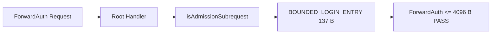

# Portal login admission fix checkpoint

The portal login admission regression on branch `codex/portal-login-admission-fix-nov25` is repaired and verified. ForwardAuth admission subrequests receive a 137-byte response, while browser visits receive the 412-KB portal. Blocked: none.

## Execution jobs

| Role | Backend | Target | Status |
|---|---|---|---|
| Coordinator | Antigravity Coordinator | Native job 1 | Active |
| Implementer | Flash Implementer | Native job 2 | Completed |
| Reviewer | Independent Neon Reviewer | Native job 3 | Completed |

## Repository state

| Attribute | Value |
|---|---|
| Working directory | /Users/gonzo/Code/gwrk-worktrees/portal-login-admission-fix-nov25 |
| Current branch | codex/portal-login-admission-fix-nov25 |
| Base commit | 50351afac9a4e39a5cc3673668d91eaa09a0ba32 |
| Target branch | develop |

## Observed regression

| Probe | Observation | Effect |
|---|---|---|
| GET https://gwrk.gforge.ai/ | HTTP 200 with 405852 bytes | Served uncompressed portal |
| GET https://gwrk.gforge.ai/oauth2/start | HTTP 401 with 0 bytes | Blocked Google sign-in |
| ForwardAuth subrequest | Body exceeded 4096 bytes | Gateway returned 401 |

## Implementation repair

The repair in `src/server/routes/auth.ts` inspects incoming root requests. When `request.headers["x-forwarded-uri"] === "/"` or the Accept header omits `text/html`, the route serves `BOUNDED_LOGIN_ENTRY`. That payload is 137 bytes. When a public browser requests HTML, the route serves `LOGIN_ENTRY`. That payload is 405852 bytes. On HEAD requests, the route returns an empty body.

Authoritative login rate accounting through `consumeLogin` runs in Fastify's `onRequest` hook before route execution. Rate accounting and header invariants apply to every root request.

## Test verification

| Suite | Scope | Verdict |
|---|---|---|
| auth-session.test.ts AUTH-15 | Bounded admission and portal separation | PASS |
| auth-session.test.ts | Full 26 auth session tests | PASS |
| auth-bounds.test.ts | Full 22 rate admission tests | PASS |
| production-bundle.test.ts | Pinned Traefik dynamic configuration | PASS |
| pnpm build | TypeScript compilation | PASS |
| scripts/lint.mjs | Biome repository linting across 566 files | PASS |

## Independent review

The independent Neon reviewer evaluated the changes in an isolated worktree branch.

| Review item | Verdict | Note |
|---|---|---|
| Pinned 4096-byte cap | PASS | 137 bytes on admission subrequest |
| Full portal presentation | PASS | 405852 bytes on browser navigation |
| Login quota accounting | PASS | consumeLogin runs in onRequest |
| Root header cleanliness | PASS | Zero forbidden headers returned |
| Security boundaries | PASS | Zero auto-role grants and zero escalations |
| Review verdict | GO | Approved for pull request |

## Remaining validation

1. Native Docker container testing requires operator authorization on an approved host target.
2. Fresh native security evidence and operator signing are required before extending acceptance to this release.
3. Prior Phase 9 acceptance remains historical for release 3a110c63.
