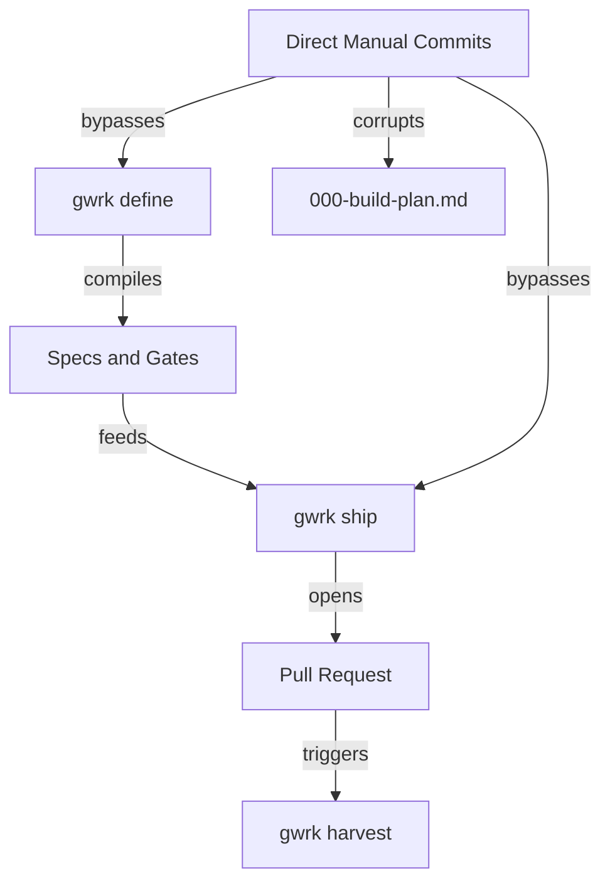
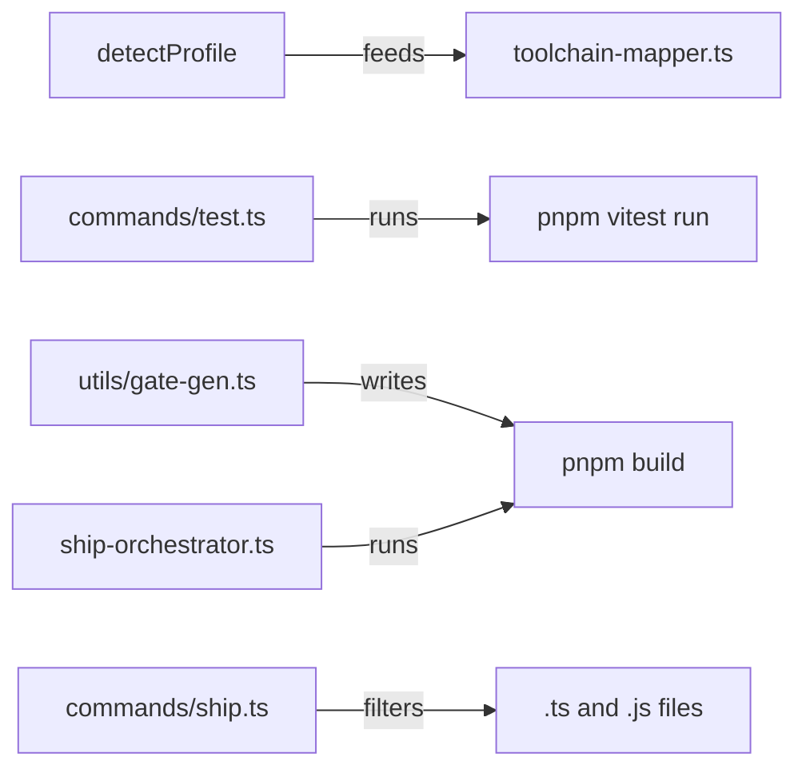
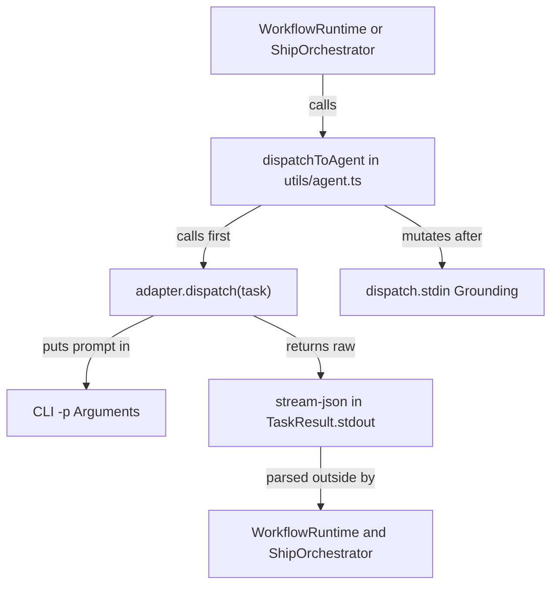
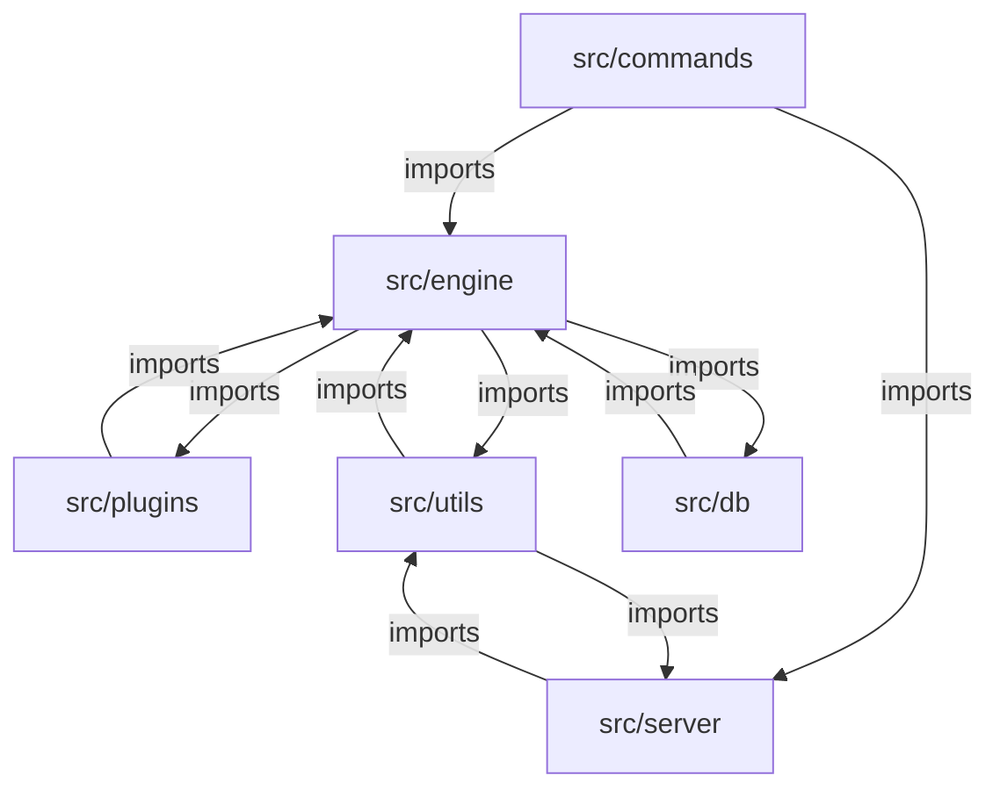

# Grounding and Architecture Audit

`gwrk` drifted from its specification-driven loop between releases `1.4.0` and `1.5.2-alpha.2`. It now operates as a TypeScript-only tool with split routing and coupled layers. Shipping non-TypeScript projects and loading third-party plugins are blocked. Running reliable multi-agent builds is also blocked. The Core Engineering owner (`@dgonzo`) owns the remediation across five workstreams.

## 1. Executive Scorecard

| Area | Vision Target | Current State | Verdict |
|---|---|---|---|
| Dogfooding | Every feature ships via `define` and `ship` | Features `021` to `029` bypassed the loop | RED |
| Polyglot Build | Language-agnostic build and gate execution | Gate runner and file discovery hardcode TypeScript | RED |
| Plugin System | Three-layer runtime with Git registry | Dynamic agent loading is an empty stub | RED |
| Usable Plugins | Atomic and compound skills | Seeded skills fail schema validation | RED |
| CLI Backends | Stdin-first adapters for `agy` and `claude` | Prompts pass via CLI args and leak `stream-json` | RED |
| Clean Architecture | Inward dependency rule with ports | Seven bidirectional import cycles across six folders | RED |

## 2. Vision Grounding and Dogfooding

`gwrk` was built around three pillars in [WHAT_IS_GWRK.md](product/WHAT_IS_GWRK.md): Clarity (`gwrk define`) and Throughput (`gwrk ship`), followed by Harvesting (`gwrk harvest`). The system relies on Architecture Decision Record `ADR` governance and Story Points `SP` tracking. It also requires User Acceptance Testing `UAT` artifacts. Recent work abandoned this loop in favour of direct code edits.

### Build Plan and Specification Drift

| Feature or Release | Spec Artifacts Present | Ship Run Manifests | Drift Finding |
|---|---|---|---|
| [000-build-plan.md](../specs/000-build-plan.md) | Features `001` through `020` | None | Frozen since June 2026 with `0` SP |
| [021-polyglot-toolchain](../specs/021-polyglot-toolchain/spec.md) | `spec.md` and `plan.md` | `0` runs | Missing `tasks.json` and `gates/` |
| `022` | None | `0` runs | Feature number skipped in `specs/` |
| [026-gate-runner-convergence](../specs/026-gate-runner-convergence/spec.md) | `spec.md` and `plan.md` | `0` runs | Missing `tasks.json` and `gates/` |
| [027-gate-liveness](../specs/027-gate-liveness/spec.md) | `spec.md` only | `0` runs | Missing `plan.md` and `tasks.json` |
| [029-decision-records](../specs/029-decision-records/spec.md) | Full spec tree | Phases `01` to `02` only | Phases `05` to `11` hand-coded in `b583a06b` |
| Releases `1.5.0` to `1.5.2` | None | `0` runs | Telegram and `--refs` shipped without specs |

### Dogfooding Findings

1. [000-build-plan.md](../specs/000-build-plan.md#L1-L237) stops at `020-polyglot-monorepo`. Features `021` through `029` do not exist in the master build plan.
2. Every feature in [000-build-plan.md](../specs/000-build-plan.md#L18-L237) records `0 SP`. This breaks domain invariant `I-GW-S05` in [domain.md](../.gwrk/ontology/domain.md#L84) and starves the **Compression Flywheel**.
3. Feature `029-decision-records` ran six failed or partial `ship_phase-02` attempts in `specs/029-decision-records/.gwrk/runs/`. Developers then hand-coded phases `05` through `11` in pull request `#199` without review artifacts.
4. Pull request `#199` also shipped the Telegram control plane in [telegram.ts](../src/server/telegram.ts) with no specification. The vault loader in [read-refs.ts](../src/utils/read-refs.ts) also shipped without a specification.
5. Commit `04a2d3a1` leaked `Author: Gemini CLI <gonzodbg@gmail.com>` into `main` history. This violates the repository identity rule in [AGENTS.md](../AGENTS.md#L4-L5).

## 3. Polyglot Build and Test Lock-In

`gwrk` cannot define or ship a non-TypeScript repository end to end. Features `020` and `021` added [profile-detector.ts](../src/engine/profile-detector.ts) and [toolchain-mapper.ts](../src/utils/toolchain-mapper.ts). Six core execution paths bypass those modules and hardcode TypeScript and `vitest`.

### Hardcoded TypeScript and Vitest Paths

| File and Symbol | Lines | Hardcoded Assumption | Failure on Python, Go, or Rust |
|---|---|---|---|
| [test.ts](../src/commands/test.ts#L68-L98) | `68-98` | Filters `.ts` and `.js` and runs `pnpm vitest run` | `gwrk test` ignores non-TS files and runs Vitest |
| [ship.ts](../src/commands/ship.ts#L157-L165) | `157-165` | Pre-flight filters `sourceFiles` for `.ts` and `.js` | Pre-flight passes empty arrays to `phaseHasTests` |
| [ship.ts](../src/commands/ship.ts#L760-L833) | `760, 833` | Passes `language: "typescript"` to `selectBackend` | Router always classifies tasks as TypeScript |
| [ship-orchestrator.ts](../src/engine/ship-orchestrator.ts#L2569) | `2569` | `stageDiagnose` executes `pnpm build` | Diagnose loop crashes when `package.json` is absent |
| [gate-gen.ts](../src/utils/gate-gen.ts#L22-L87) | `22, 87` | `GateBrief.projectType` is `"gwrk-typescript"` | Gate generator has no polyglot project type |
| [gate-gen.ts](../src/utils/gate-gen.ts#L217-L223) | `217-223` | `run-all-gates.sh` runs `pnpm build` pre-flight | Every generated gate runner fails without `pnpm` |
| [gate-gen.ts](../src/utils/gate-gen.ts#L728-L891) | `728-891` | Rejects non-TS files and writes `pnpm vitest run` | Filesystem gates only emit Vitest commands |
| [file-extract.ts](../src/utils/file-extract.ts#L13) | `13` | Regex requires `src/`, `tests/`, `docs/`, or `packages/` | Go `cmd/` and Rust `crates/` return empty |
| [test-discovery.ts](../src/utils/test-discovery.ts#L79-L139) | `79, 139` | Replaces extension with `getTestExtension` (`.py`) | `src/foo.py` becomes `src/foo.py` and matches itself |
| [test-discovery.ts](../src/utils/test-discovery.ts#L10) | `10` | `TEST_FILE_RE` omits `.rs` files | Rust integration tests in `tests/` are invisible |
| [test-runner.ts](../src/engine/test-runner.ts#L29-L56) | `29-56` | `parseTestOutput` requires `N passed` or `# pass N` | `go test -v` prints `PASS` and reports `0` tests run |
| [test-activator.ts](../src/engine/test-activator.ts#L40-L44) | `40-44` | Un-skips `it.skip(` and `describe.skip(` only | Ignores `pytest.mark.skip`, `#[ignore]`, and `t.Skip()` |
| [define-orchestrator.ts](../src/engine/define-orchestrator.ts#L88-L99) | `88-99` | Checks top-level `src/` for `.test.ts` files | Misses nested tests and non-TS test suites |
| [toolchain-mapper.ts](../src/utils/toolchain-mapper.ts#L101-L131) | `101-131` | `getBuildCommand` handles Node, Cargo, and Go only | Returns `null` for Python, Make, CMake, and JVM |

## 4. Plugin Architecture and Usability

The three-layer plugin architecture from Feature `018` ([manifest.ts](../src/plugins/manifest.ts) and [loader.ts](../src/plugins/loader.ts)) is an incomplete scaffold. Only built-in workflows and two enforcement skills work in production.

### Plugin Layer Audit

| Layer | Component | Implementation State | Usability Blocker |
|---|---|---|---|
| Layer 1 | [agent-registry.ts](../src/plugins/agent-registry.ts#L31-L59) | Empty `if` blocks for user agent plugins | User agent plugins in `~/.gwrk/plugins/agents` never load |
| Layer 2 | [seed.ts](../src/plugins/seed.ts#L78-L93) | Omits required `preferredModel` in `manifest.yaml` | Every `gwrk plugin seed` skill fails Zod validation |
| Layer 2 | [skill-runtime.ts](../src/plugins/skill-runtime.ts#L39-L74) | `assemblePrompt` reads `manifest.prompt` only | `SKILL.md` is ignored for atomic and compound skills |
| Layer 2 | `src/plugins/builtins/skills/` | Two enforcement skills and one broken `narrative` stub | Missing `domain-map` and `ontology-validate` skills |
| Layer 3 | [extension-runtime.ts](../src/plugins/extension-runtime.ts#L1-L78) | Runs `obsidian-vault` context hook only | `harvestHook` exists on the interface with zero callers |
| Layer 3 | `src/plugins/builtins/channels/` | YAML manifests with no `adapter` field | Server hardcodes Slack and Telegram instead of plugins |
| Registry | [registry.ts](../src/engine/registry.ts#L13-L195) | Clones nonexistent `gwrk-org/gwrk-plugins.git` | `search` returns empty and `update` is a dead no-op |

### Plugin Defects

1. [`AgentBackendRegistry.getBackends`](../src/plugins/agent-registry.ts#L31-L36) and [`getAgentBackend`](../src/plugins/agent-registry.ts#L54-L59) contain comment placeholders instead of dynamic `import()` calls. Only the three hardcoded adapters in [`BUILTIN_AGENT_BACKENDS`](../src/plugins/builtins/agents/index.ts#L11-L15) can run.
2. [`createAtomicSkill`](../src/plugins/seed.ts#L78-L93) writes `runtime: { preferredAgent: "agy" }` without `preferredModel`. [`SkillRuntimeSchema`](../src/plugins/manifest.ts#L56-L61) requires `preferredModel: z.string()`. `gwrk plugin list` drops every skill created by `gwrk plugin seed`, and `gwrk skill` throws **ManifestValidationError**.
3. [`SkillRuntime.assemblePrompt`](../src/plugins/skill-runtime.ts#L39-L74) builds the prompt from the one-line `manifest.prompt` string. It never reads `SKILL.md` for atomic or compound skills.
4. [`DEFAULT_REGISTRY_URL`](../src/engine/registry.ts#L13) points to `https://github.com/gwrk-org/gwrk-plugins.git`. That repository does not exist under `gforge-esc`. [`installPlugin`](../src/engine/registry.ts#L138-L152) copies one directory level and deletes `.git`, while [`updatePlugin`](../src/engine/registry.ts#L187) requires `.git`.
5. `src/plugins/builtins/personas/` and `src/plugins/builtins/rules/` lack `manifest.yaml` files, so [`PluginLoader`](../src/plugins/loader.ts) skips them. Also, `postbuild` in [package.json](../package.json#L28) copies raw `.ts` and `.test.ts` files into `dist/plugins/builtins/`.

## 5. CLI Backend Boundary

The Command Line Interface `CLI` backend boundary violates ADR-006 and splits routing across three incompatible subsystems.

### Adapter Contract Violations

| Adapter | Prompt Delivery | Output Handling | Backend-Specific Defect |
|---|---|---|---|
| [AgyAdapter](../src/plugins/builtins/agents/agy/adapter.ts#L69-L95) | Passes full prompt inline via `-p` arg | Leaves raw `stream-json` in `stdout` | Drops models not matching hardcoded `AGY_2_MODEL_PATTERN` |
| [ClaudeAdapter](../src/plugins/builtins/agents/claude/adapter.ts#L70-L87) | Passes prompt via `-p` and `featureDir` as arg | Leaves raw `stream-json` in `stdout` | Splits prompt into `-p` and grounding into `stdin` |
| [CodexAdapter](../src/plugins/builtins/agents/codex/adapter.ts#L57-L65) | Passes `workflow`, `featureDir`, and `prompt` as args | Returns raw `stdout` | Leaves `nativeWriter` unset so orchestrator treats it as read-only |

### Root Causes in the Backend Boundary

1. ADR-006 §2.3 and [agent-backend.ts](../src/plugins/agent-backend.ts#L40) require `stdin` delivery to avoid **ARG_MAX** limits. In [agent.ts](../src/utils/agent.ts#L539-L645), `dispatchToAgent` calls `adapter.dispatch(task)` while `task.stdin` is still `undefined`. The adapters put `task.prompt` into `-p` flags, and `dispatchToAgent` appends grounding to `dispatch.stdin` afterward.
2. [`AgyAdapter.dispatch`](../src/plugins/builtins/agents/agy/adapter.ts#L69-L73) prepends `/${workflow} ${featureDir}` to `task.prompt`. When `WorkflowRuntime` dispatches a workflow, `task.prompt` already contains `PROMPT.md`. `agy` therefore receives a bogus slash command header.
3. Both `AgyAdapter` and `ClaudeAdapter` pass `--output-format stream-json`, yet neither unwraps the stream in `parseResult`. [`WorkflowRuntime.extractJsonFromOutput`](../src/plugins/workflow-runtime.ts#L27-L95) and [`agentAnswerText`](../src/engine/ship-orchestrator.ts#L276-L293) must parse `stream-json` outside the adapter boundary.
4. [`AGY_2_MODEL_PATTERN`](../src/plugins/builtins/agents/agy/adapter.ts#L11-L12) only matches `gemini-4-` and `gemini-3.8-` prefixes. It also matches `claude-opus-5-5-` and `claude-sonnet-5-5-` prefixes, plus `gpt-oss-`. The adapter drops real model flags unless `AGY_MODEL` is set in the environment.
5. Three separate routers compete across the codebase:
   - [`BackendSelector`](../src/server/backend-selector.ts) uses [`src/server/agent-registry.ts`](../src/server/agent-registry.ts) and the `routing_decisions` SQLite table. `gwrk ship` calls it when `--agent` is omitted, yet `ShipOrchestrator` ignores its `selectedCommand` output.
   - [`selectBackend`](../src/engine/router.ts) uses [`src/plugins/agent-registry.ts`](../src/plugins/agent-registry.ts) and the `plugin_routing_decisions` SQLite table. Only `SkillRuntime` calls it.
   - [`pillarBackend`](../src/utils/resolve-agent.ts) reads static strings from `.gwrkrc.local.json` and defaults to `"agy"`. `define` and `adr` call this function, as do `research` and `DispatchQueue`.

## 6. Clean and Hexagonal Architecture

`gwrk` violates the core rule of Clean and Hexagonal Architecture. Inner modules in `src/engine/` depend directly on `fs` and `child_process`. They also import `better-sqlite3` and `src/server/` directly. The six top-level directories form seven **bidirectional dependency cycles**.

### Cross-Layer Dependency Cycles

| Package Pair | Forward Imports | Reverse Imports | Architectural Violation |
|---|---|---|---|
| `engine` and `plugins` | `8` | `5` | Core engine and plugin runtime are mutually coupled |
| `engine` and `utils` | `38` | `5` | `utils` imports domain logic from `engine` |
| `engine` and `db` | `10` | `1` | `engine` runs SQLite queries with no repository port |
| `engine` and `server` | `1` | `12` | [`engine/issues.ts`](../src/engine/issues.ts#L8) imports `server/slack-notify.js` |
| `plugins` and `utils` | `14` | `6` | [`utils/agent.ts`](../src/utils/agent.ts) is the actual plugin host |
| `server` and `utils` | `37` | `5` | [`utils/config.ts`](../src/utils/config.ts) imports `server/agent-registry.js` |
| `db` and `utils` | `1` | `2` | [`utils/agent.ts`](../src/utils/agent.ts) writes directly to `db/plugins.js` |

### God Objects and Misplaced Services

| File | Lines | Mixed Responsibilities |
|---|---|---|
| [ship-orchestrator.ts](../src/engine/ship-orchestrator.ts) | `2708` | State machine, git shell calls, GitHub CLI parsing, and Vitest runner |
| [slack-commands.ts](../src/server/slack-commands.ts) | `1022` | Slack parsing, SQLite queries, shell execution, and orchestrator dispatch |
| [gate-gen.ts](../src/utils/gate-gen.ts) | `913` | Spec parsing, TypeScript heuristics, and bash script generation inside `utils/` |
| [ship.ts](../src/commands/ship.ts) | `892` | CLI flag parsing, test discovery, git commits, and worktree management |
| [agent.ts](../src/utils/agent.ts) | `704` | Process spawning, stream-json parsing, and grounding injection inside `utils/` |

### Boundary Violations

1. Out of `38` production files in `src/engine/`, `24` import `node:fs` directly. Nine execute shell commands, and `10` import SQLite modules from `src/db/`.
2. `src/utils/` is not a pure utility layer. It houses the agent dispatcher ([agent.ts](../src/utils/agent.ts)) and the gate compiler ([gate-gen.ts](../src/utils/gate-gen.ts)). It also houses the model resolver ([resolve-model.ts](../src/utils/resolve-model.ts)).
3. Both [ship.ts](../src/commands/ship.ts) and [ship-orchestrator.ts](../src/engine/ship-orchestrator.ts) duplicate orchestration duties. Both check test existence and run git commands. Both also write SQLite run rows and manage crash state files.

## 7. Remediation Roadmap

All remediation work must run through `gwrk` itself once Workstream 1 restores the build loop.

| Workstream | Owner | Scope | Done When |
|---|---|---|---|
| WS-1 Dogfooding | `@dgonzo` | Backfill specs `021` to `029` and `1.5.x` into `000-build-plan.md` with SP | `gwrk plan status` and `I-GW-S05` pass with zero drift |
| WS-2 Agent Boundary | `@dgonzo` | Merge three routers, move prompts to `stdin`, and unwrap `stream-json` in adapters | One `AgentPort` dispatches `agy`, `claude`, and `codex` |
| WS-3 Polyglot Toolchain | `@dgonzo` | Route `gwrk test`, `gate-gen`, `ship`, and `test-discovery` through `ToolchainPort` | Python, Go, and Rust fixture repos pass `define` and `ship --dry-run` |
| WS-4 Plugin Runtime | `@dgonzo` | Fix `seed.ts` schema, read `SKILL.md`, load user agents, and fix `registry.ts` | `gwrk plugin seed` and `gwrk skill` pass end-to-end tests |
| WS-5 Hexagonal Layering | `@dgonzo` | Extract `domain`, `application`, `ports`, and `adapters` and break all seven cycles | `madge --circular src/` and cross-layer lint rules report zero errors |
