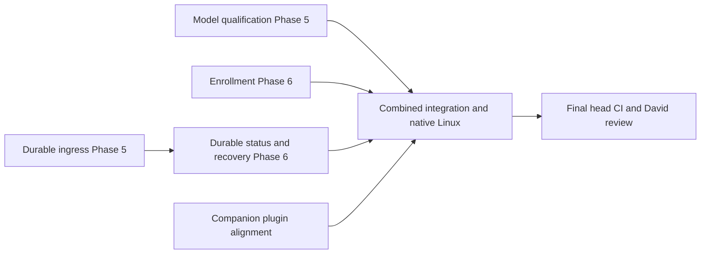

# Core implementation checkpoint

Slack server scope now clears all five implemented phases and composes with the integration candidate. Blocked: model qualification and the remaining server phases need independent clearance. The coordinator owns final integration and verification.

## Cleared phases

| Feature | Cleared phases | Final evidence head | CI verdict |
|---|---|---|---|
| 044 Architecture policy | All four | `5a701723` | PASS, run 44439554353 |
| 045 Workflow governance | All four | `dc7da707` | PASS, run 45246332986 |
| 046 Model discovery | All five | `f5c285c1` | PASS, run 44391585085 |
| 047 Model qualification | First four | `3bd8b2d7` | PASS, run 44452741392 |
| 048 Project identity and Slack | First five | `fa3a8c27` | PASS, run 45255762550 |
| 049 Durable dispatch and harvest | First four | `eec2b080` | PASS, run 45247992333 |
| 050 Linux lifecycle | All five | `a00007fb` | PASS, run 44426644228 |

Review clearance includes code and acceptance review. Every merge remains pending David's approval. Foundations 040 through 043 remain integrated. PR 222's merge commit `d3120324` remains an ancestor of the combined candidate.

## Active assignments

| Work | Branch | Worktree | Model |
|---|---|---|---|
| Model qualification Phase 5 repair | `feat/047-model-qualification` | `model-phase4-red-nov18/.runs/sandboxes/047-model-qualification-ship-a2cca19a` | Codex Astra |
| Enrollment and isolation Phase 6 | `feat/048-project-identity-slack` | `slack-phase4-prep-nov18/.runs/sandboxes/048-project-identity-slack-ship-40f2a5e2` | Antigravity Neon High |
| Durable ingress Phase 5 | `feat/049-durable-dispatch-harvest` | `durable-next-phases-nov18/.runs/sandboxes/049-durable-dispatch-harvest-ship-2de95b05` | Antigravity Neon High |

Each parent lives under `/Users/gonzo/Code/gwrk-worktrees`. Each feature branch has one writer. Each ship call selects one phase with `--worktree --max-iterations 2`. The integration composition worker has finished and released its slot. Three worker assignments remain active. Heavy checks use a separate two-slot limit. CI waits hold no inference capacity.

## Blocking findings

Model review retains eight failing cases at `1d667bca`. They cover rejected or stale fallback evidence and changed enforcement policy. They also cover unsupported lock versions and missing provider-default behavior. The runbook needs sequential evaluation and promotion. Its hosted examples need the approved credential-file environment. Evidence is `/tmp/gwrk-nov23-model5-review-restored-red.log`.

Enrollment needs its own implementation and isolation proof. Its parent includes the combined candidate at `72413f16`. The handoff preserves zero-inference initialization and target architecture context. It also preserves scoped authorization and Linux shutdown behavior.

Durable ingress starts from the real HTTP acceptance regression at `80dc86f4`. The server acknowledges work without a committed operation. The worker must compose durable receipts and startup recovery against the approved ports. Its later command and recovery phase remains open.

## Combined verification

The combined branch is `codex/full-feature-integration-nov18` at `72413f16`. PR 240 remains the draft integration candidate.

| Check | Head | Verdict |
|---|---|---|
| Latest focused composition | `72413f16` | PASS, 201 checks |
| Latest build and lint | `72413f16` | PASS, zero errors |
| Full local suite before Slack Phase 5 | `e36e6692` | PASS, 4,276 tests |
| Native Node 22 Linux before Slack Phase 5 | `1240e615` | PASS, 4,285 tests |
| CI before Slack Phase 5 | `1240e615` | PASS, both jobs in run 45254321695 |
| Full local suite after Slack Phase 5 | `72413f16` | PASS, 4,311 tests |
| Final combined native Linux | Final head | PENDING |

The current local suite skips 16 tests and retains six todo cases. Evidence is `/tmp/gwrk-nov23-slack5-combined-full-ci.log`.

The Linux run first exposed two fixtures that relied on the host Git identity. The repaired fixtures use the existing isolated Git helper and explicit test identity. The fresh native run passes. The subsequent Slack composition preserves legacy notification compatibility only without a registry or explicit recipient. It also preserves explicit-null recipient suppression and adds enrolled-project drain regressions. See `specs/048-project-identity-slack/evidence/nov23-integration-composition.md`.

## Completion dependencies

The next released assignment is durable status and recovery after ingress clears. Every final evidence head needs required CI. Final delivery needs aligned documentation and ADR references. It also needs PR links and merge order.

## External prerequisites

Hosted pilot 051 and project rollout 052 remain subsequent stages. Live deployment and DNS remain external. Google authentication configuration and project enrollment also remain external. Core synthetic checks do not establish always-on service behavior.
