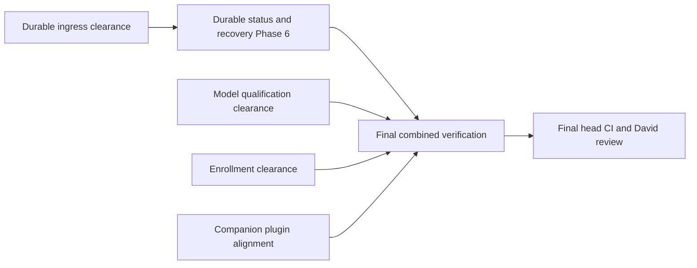

# Core implementation checkpoint

Enrollment has code-review clearance and is in acceptance review. Model qualification and durable ingress remain under repair. Blocked: four core phases still need final clearance. The coordinator owns integration and final verification.

## Active assignments

| Work | Branch | Worktree under its parent | Stage |
|---|---|---|---|
| 047 Model qualification Phase 5 | `feat/047-model-qualification` | `model-phase4-red-nov18/.runs/sandboxes/047-model-qualification-ship-81d3a302` | Second repair, 193 scoped checks pass |
| 048 Enrollment Phase 6 | `feat/048-project-identity-slack` | `slack-phase4-prep-nov18/.runs/sandboxes/048-project-identity-slack-ship-876b45ad` | Code GO, acceptance review |
| 049 Durable ingress Phase 5 | `feat/049-durable-dispatch-harvest` | `durable-next-phases-nov18/.runs/sandboxes/049-durable-dispatch-harvest-ship-8ef0ddbe` | Scheduling repair |

Parents live under `/Users/gonzo/Code/gwrk-worktrees`. Each feature branch has one writer. Model qualification and durable ingress use Codex Astra. Enrollment uses Antigravity Neon High. All three worker assignments remain allocated. CI waits release inference capacity. Heavy checks have a separate two-slot limit.

## Cleared phases

| Feature | Cleared phases | Evidence head |
|---|---|---|
| 044 Architecture policy | All four | `5a701723` |
| 045 Workflow governance | All four | `dc7da707` |
| 046 Model discovery | All five | `f5c285c1` |
| 047 Model qualification | First four | `3bd8b2d7` |
| 048 Project identity and Slack | First five | `fa3a8c27` |
| 049 Durable dispatch and harvest | First four | `eec2b080` |
| 050 Linux lifecycle | All five | `a00007fb` |

These heads have code and acceptance clearance plus passing required CI. Foundations 040 through 043 remain integrated. PR 222 remains on develop at `d3120324`. PR merges remain David's decision. No live deployment has occurred.

## Remaining findings

Model review reproduced project-only workflow resolution and active review-step freshness defects. Their retained regressions precede repair. The second repair builds and passes 193 scoped checks. Full checks and independent clearance remain required.

Enrollment repaired project-specific sandbox routing and symlinked startup selection. It also validates role options before enrollment writes. Its 64 scoped checks and full suite pass. Code review is GO. Acceptance review and final CI remain required.

Durable ingress preserves its completed implementation and prior scope repairs. The composed parent passes 283 checks with three reproduced failures. Those failures cover launch before acceptance returns, repeated draining of an unrunnable row and launch before Slack acknowledgment. The fresh repair uses the composed project-scope interfaces.

## Verification infrastructure

Runner repairs `8b0e7134` and `b34a6b1d` distinguish interrupted execution from assertion results. They retain diagnostics and read the terminal summary after fixture samples. Related checks pass 243 cases. Independent checks pass 55 cases. The complete combined run at `8b0e7134` passes 4,335 tests.

CI exposed two fixture contract problems. The Git-only fixture lacked an explicit no-test declaration. The ADR race assumed two concurrent calls read the same snapshot. The corrected fixtures retain their isolation and unique-number assertions. Their integration and ADR suites pass all 67 checks. Both CI jobs still need a fresh passing head.

The latest independent native Linux run passes 4,320 tests at `fa002ca4`. Final worker integration still needs refreshed full and native verification. See the runner repair and CI fixture notes under `docs/operations/`.

## Completion dependencies

The next released assignment is durable status and unattended recovery. Its handoff is prepared. Final delivery needs PR links and merge order. It also needs aligned documentation and ADR references.

Hosted pilot 051 and project rollout 052 remain subsequent work. Live deployment and DNS remain external. Google authentication configuration and live project enrollment also remain external.
