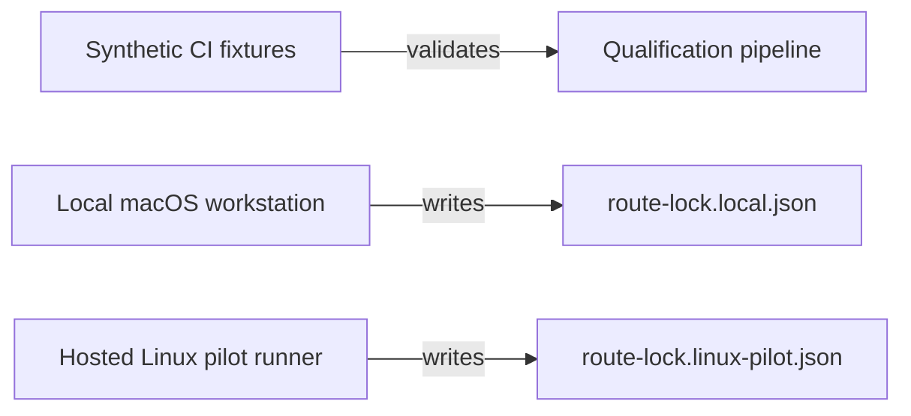

# Live model qualification

Run live model qualification separately for the local macOS workstation and the hosted Linux pilot runner. Keep live runs outside hermetic continuous integration (CI). Blocked: live runner qualification waits on operator-supplied host credentials and approved provider accounts.

## Runner isolation



| Runner profile | Environment | Route lock | Credential source |
|---|---|---|---|
| `local` | macOS developer workstation | `.gwrk/models/route-lock.local.json` | Interactive CLI sessions |
| `linux-pilot` | Hosted Linux systemd service | `.gwrk/models/route-lock.linux-pilot.json` | `/etc/gwrk/secrets/agent-credential` |
| Synthetic CI | Hermetic test harness | Ephemeral temp workspace | None |

Hermetic CI exercises discovery and evaluation against injected fakes. It also verifies promotion and rollback without live credentials. Live runs verify real provider CLIs and accounts on each target runner.

## Prerequisites

- Verify the target runner has current `tests/fixtures/model-qualification/suite.json` files checked out.
- Select two independent frontier judge routes from distinct providers and distinct model families.
- Send only synthetic fixtures under `tests/fixtures/model-qualification/` to cross-provider judges.
- Keep tokens and cookies out of snapshots and evaluation bundles. Exclude email addresses and private account material from route locks.
- Confirm `gwrk` resolves the intended workspace identifier through `.gwrkrc.json` or `GWRK_WORKSPACE_ID`.

## Local macOS workstation qualification

1. Check authenticated CLI sessions for enabled backends in the shell profile used for `gwrk`. Those backends are `agy`, `claude` and `codex`.
2. Set `GWRK_RUNNER_PROFILE=local` before running discovery.
3. Run discovery to record tool versions and visible models for the workstation.

   ```bash
   GWRK_RUNNER_PROFILE=local gwrk models discover --runner local --format json
   ```

4. Inspect `.runs/models/discovery/local.json` and pick a concrete candidate `backend:modelId[:effort]` from an available adapter. Exclude aliases such as `default` and `auto`. Exclude `latest` and `unknown` as well.
5. Set `CANDIDATE` and `INCUMBENT` to the definition routes. Set `FIXED_IMPLEMENTER`, `JUDGE_1` and `JUDGE_2` to their discovered routes. Evaluate the definition candidate.

   ```bash
   GWRK_RUNNER_PROFILE=local gwrk models evaluate --runner local --role define \
     --candidate "$CANDIDATE" --incumbent "$INCUMBENT" --fixed-implementer "$FIXED_IMPLEMENTER" \
     --judges "$JUDGE_1" "$JUDGE_2" --format json
   ```

6. If evaluation fails, keep the incumbent and inspect the rejection in `.runs/models/evaluations/<evalId>/bundle.json`.
7. If evaluation passes, set `EVAL_ID` to its returned `evaluationId`. Promote it before evaluating another role.

   ```bash
   GWRK_RUNNER_PROFILE=local gwrk models promote --runner local --eval "$EVAL_ID" --format json
   ```

8. Repeat steps 5 through 7 for `implement`, then for `review`. Change the role and both comparison routes. Omit `--fixed-implementer` for these roles. Each promotion changes the runner lock digest. If promotion returns `incumbent-changed`, evaluate that role again against the current lock.
9. Inspect each role in `.gwrk/models/route-lock.local.json`. Confirm its tool versions, evidence hashes and fallback order.
10. If a promoted route regresses, restore the prior lock.

    ```bash
    GWRK_RUNNER_PROFILE=local gwrk models promote --runner local --rollback --format json
    ```

## Hosted Linux pilot runner qualification

1. Confirm service preflight passes. The approved wrapper reads `GWRK_AGENT_CREDENTIAL_FILE` from the service environment. Its default path is `/etc/gwrk/secrets/agent-credential`. [Linux runner credentials](../../deploy/linux-runner/README.md#credentials)
2. Define this helper in the operator's root shell. It loads the installed service environment and credential setup as the `gwrk` user.

   ```bash
   pilot_models() {
     systemd-run --quiet --pipe --wait --collect --uid=gwrk --gid=gwrk \
       --property=EnvironmentFile=/etc/gwrk/runner.env \
       --setenv=HOME=/var/lib/gwrk --setenv=GWRK_RUNNER_PROFILE=linux-pilot \
       /bin/bash -euc '
         source /opt/gwrk/current/deploy/linux-runner/credentials.sh
         load_runner_credentials
         cd -- "$GWRK_PILOT_REPO"
         exec node /opt/gwrk/current/dist/cli.js models "$@"
       ' pilot-models "$@"
   }
   pilot_models discover --runner linux-pilot --format json
   ```

3. Check the platform, architecture and CLI versions in `.runs/models/discovery/linux-pilot.json`. If a required adapter reports `auth_error` or `unavailable`, repair its wrapper or credential and repeat discovery.
4. Use routes from the pilot snapshot for the candidate and incumbent. Select a fixed implementer and two independent judges from that snapshot.

   ```bash
   pilot_models evaluate --runner linux-pilot --role define \
     --candidate "$CANDIDATE" --incumbent "$INCUMBENT" --fixed-implementer "$FIXED_IMPLEMENTER" \
     --judges "$JUDGE_1" "$JUDGE_2" --format json
   ```

5. If evaluation passes, set `EVAL_ID` to its returned `evaluationId`. Promote it before evaluating the next role.

   ```bash
   pilot_models promote --runner linux-pilot --eval "$EVAL_ID" --format json
   ```

6. Repeat evaluation and promotion for `implement`, then for `review`. Use each role's candidate and incumbent. Omit `--fixed-implementer` for these roles. Verify each successful promotion in `.gwrk/models/route-lock.linux-pilot.json`.
7. Requalify when the prompt or fixture changes. Tool version and catalog changes also require requalification.
8. To revert the last promotion, restore the prior pilot lock.

   ```bash
   pilot_models promote --runner linux-pilot --rollback --format json
   ```

## Provider default and diagnostics

- Explicit `provider-default` mode bypasses model pinning and leaves model selection to the provider CLI.
- Execution manifests under `specs/<feature>/.gwrk/runs/` persist `requestedModel` and `observedModel` without credentials. Manifests also record `routeMode` and `fallbackReason`.
- Explicit backend selection resolves through the active runner lock. It reports `unavailable_pin` when that backend lacks a qualified pin.
- Pinned execution uses only `fallbackRoutes` carrying passing `evaluationId` bundles for the same role and runner profile.

## Live qualification record

Keep pending rows unmarked until observed on each runner.

| Field | Local macOS target | Linux pilot target | Status |
|---|---|---|---|
| Runner profile | `local` | `linux-pilot` | pending |
| Discovery snapshot | `.runs/models/discovery/local.json` | `.runs/models/discovery/linux-pilot.json` | pending |
| Active route lock | `.gwrk/models/route-lock.local.json` | `.gwrk/models/route-lock.linux-pilot.json` | pending |
| Observed model evidence | Manifest `observedModel` recorded | Manifest `observedModel` recorded | pending |
| Rollback verification | `--rollback` restores prior lock | `--rollback` restores prior lock | pending |
