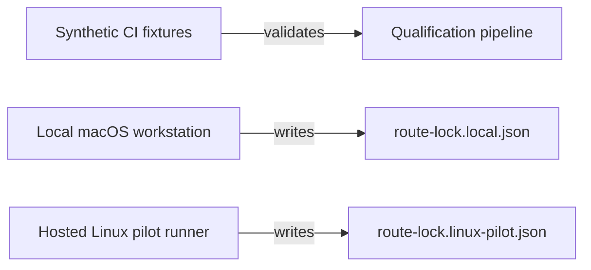

# Live model qualification

Run live model qualification separately for the local macOS workstation and the hosted Linux pilot runner. Keep live runs outside hermetic continuous integration (CI). Blocked: live runner qualification waits on operator-supplied host credentials and approved provider accounts.

## Runner isolation



| Runner profile | Environment | Route lock | Credential source |
|---|---|---|---|
| `local` | macOS developer workstation | `.gwrk/models/route-lock.local.json` | Interactive CLI sessions |
| `linux-pilot` | Hosted Linux systemd service | `.gwrk/models/route-lock.linux-pilot.json` | `/etc/gwrk/secrets/agent-credential` |
| Synthetic CI | Hermetic test harness | Ephemeral temp workspace | None |

Hermetic CI exercises discovery and evaluation against injected fakes. It also verifies promotion and rollback without live credentials. Live runs verify real provider CLIs and accounts on each target runner.

## Prerequisites

- Verify the target runner has current `tests/fixtures/model-qualification/suite.json` files checked out.
- Select two independent frontier judge routes from distinct providers and distinct model families.
- Send only synthetic fixtures under `tests/fixtures/model-qualification/` to cross-provider judges.
- Keep tokens and cookies out of snapshots and evaluation bundles. Exclude email addresses and private account material from route locks.
- Confirm `gwrk` resolves the intended workspace identifier through `.gwrkrc.json` or `GWRK_WORKSPACE_ID`.

## Local macOS workstation qualification

1. Check authenticated CLI sessions for enabled backends in the shell profile used for `gwrk`. Those backends are `agy`, `claude` and `codex`.
2. Set `GWRK_RUNNER_PROFILE=local` before running discovery.
3. Run discovery to record tool versions and visible models for the workstation.

   ```bash
   GWRK_RUNNER_PROFILE=local gwrk models discover --runner local --format json
   ```

4. Inspect `.runs/models/discovery/local.json` and pick a concrete candidate `backend:modelId[:effort]` from an available adapter. Exclude aliases such as `default` and `auto`. Exclude `latest` and `unknown` as well.
5. Run evaluation for `define` with an incumbent route, a fixed implementer and two independent judges.

   ```bash
   GWRK_RUNNER_PROFILE=local gwrk models evaluate \
     --runner local \
     --role define \
     --candidate <backend:modelId[:effort]> \
     --incumbent <backend:modelId[:effort]> \
     --fixed-implementer <backend:modelId[:effort]> \
     --judges <judge1-backend:modelId> <judge2-backend:modelId> \
     --format json
   ```

6. Run evaluation for `implement` and `review` roles against their incumbents and the same independent judge policy.
7. If deterministic gates fail or judges disagree, keep the incumbent lock intact and record the rejection reason from `.runs/models/evaluations/<evalId>/bundle.json`.
8. Promote a passing evaluation to write `.gwrk/models/route-lock.local.json` atomically.

   ```bash
   GWRK_RUNNER_PROFILE=local gwrk models promote --runner local --eval <evalId> --format json
   ```

9. Inspect `.gwrk/models/route-lock.local.json` to confirm `toolVersions` and `evidence` hashes. Confirm `fallbackRoutes` and zero credential strings.
10. If a promoted route regresses in daily use, restore the prior lock immediately.

    ```bash
    GWRK_RUNNER_PROFILE=local gwrk models promote --runner local --rollback --format json
    ```

## Hosted Linux pilot runner qualification

Execute hosted runner commands as the dedicated `gwrk` service user inside `/var/lib/gwrk/repos/pilot` using the service paths defined in [Linux runner](../../deploy/linux-runner/README.md). Do not copy a macOS route lock onto the Linux host.

1. Confirm systemd preflight passes and `/etc/gwrk/secrets/agent-credential` is readable only by `root:gwrk` with mode `0640`.
2. Run discovery as the `gwrk` user under `linux-pilot`.

   ```bash
   runuser -u gwrk -- env \
     GWRK_HOME=/var/lib/gwrk \
     GWRK_RUNTIME_DIR=/run/gwrk \
     GWRK_RUNNER_PROFILE=linux-pilot \
     node /opt/gwrk/current/dist/cli.js models discover --runner linux-pilot --format json
   ```

3. Verify `.runs/models/discovery/linux-pilot.json` records the Linux platform and architecture. Confirm CLI versions and adapter status match the host.
4. Run evaluation as `gwrk` for each enabled role with two independent judges available to the hosted runner. Enabled roles are `define`, `implement` and `review`.

   ```bash
   runuser -u gwrk -- env \
     GWRK_HOME=/var/lib/gwrk \
     GWRK_RUNTIME_DIR=/run/gwrk \
     GWRK_RUNNER_PROFILE=linux-pilot \
     node /opt/gwrk/current/dist/cli.js models evaluate \
       --runner linux-pilot \
       --role implement \
       --candidate <backend:modelId[:effort]> \
       --incumbent <backend:modelId[:effort]> \
       --judges <judge1-backend:modelId> <judge2-backend:modelId> \
       --format json
   ```

5. If any required adapter reports `auth_error` or `unavailable`, fix the host wrapper or credential file and repeat discovery before evaluating.
6. Promote each passing evaluation explicitly to write `.gwrk/models/route-lock.linux-pilot.json`.

   ```bash
   runuser -u gwrk -- env \
     GWRK_HOME=/var/lib/gwrk \
     GWRK_RUNTIME_DIR=/run/gwrk \
     GWRK_RUNNER_PROFILE=linux-pilot \
     node /opt/gwrk/current/dist/cli.js models promote --runner linux-pilot --eval <evalId> --format json
   ```

7. If prompts or fixtures change on the Linux host, requalify before dispatching pinned runs. Requalify after CLI version or eligible model changes as well.
8. To revert an active Linux pilot pin, run rollback under `linux-pilot`.

   ```bash
   runuser -u gwrk -- env \
     GWRK_HOME=/var/lib/gwrk \
     GWRK_RUNTIME_DIR=/run/gwrk \
     GWRK_RUNNER_PROFILE=linux-pilot \
     node /opt/gwrk/current/dist/cli.js models promote --runner linux-pilot --rollback --format json
   ```

## Provider default and diagnostics

- Explicit `provider-default` mode bypasses model pinning and leaves model selection to the provider CLI.
- Execution manifests under `specs/<feature>/.gwrk/runs/` persist `requestedModel` and `observedModel` without credentials. Manifests also record `routeMode` and `fallbackReason`.
- Explicit backend selection resolves through the active runner lock. It reports `unavailable_pin` when that backend lacks a qualified pin.
- Pinned execution uses only `fallbackRoutes` carrying passing `evaluationId` bundles for the same role and runner profile.

## Live qualification record

Keep pending rows unmarked until observed on each runner.

| Field | Local macOS target | Linux pilot target | Status |
|---|---|---|---|
| Runner profile | `local` | `linux-pilot` | pending |
| Discovery snapshot | `.runs/models/discovery/local.json` | `.runs/models/discovery/linux-pilot.json` | pending |
| Active route lock | `.gwrk/models/route-lock.local.json` | `.gwrk/models/route-lock.linux-pilot.json` | pending |
| Observed model evidence | Manifest `observedModel` recorded | Manifest `observedModel` recorded | pending |
| Rollback verification | `--rollback` restores prior lock | `--rollback` restores prior lock | pending |
