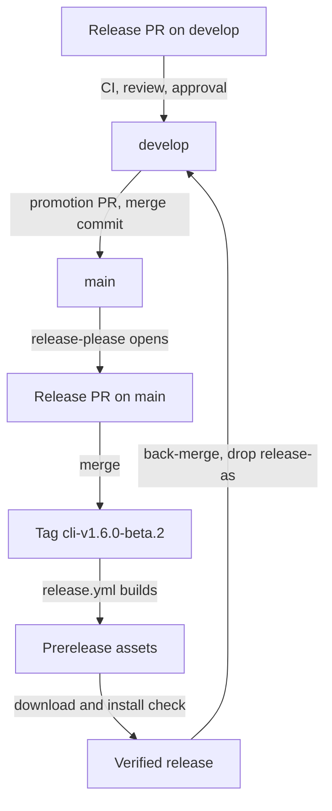

# Release 1.6.0-beta.2 notes and promotion path

`1.6.0-beta.2` packages architecture context and hosted production authentication (`ADR-014`) from reviewed `develop`. It also packages the embedded portal guides and verified Linux release packaging. Release-please creates the tag and assets from final `main` source. Blocked: none for this record. Publication follows the path below.

## Difference from 1.6.0-beta.1

The published `cli-v1.6.0-beta.1` release stays unchanged. It points at `3fba0bf6` from November 6, 2026. It does not contain these capabilities. Never replace assets on `cli-v1.6.0-beta.1`.

| Capability | `cli-v1.6.0-beta.1` | `cli-v1.6.0-beta.2` |
|---|---|---|
| Deterministic `gwrk init` context and `gwrk assess` | Absent | Included |
| Hosted Google OIDC auth and `gwrk_v1.<id>.<secret>` API keys | Absent | Included |
| Embedded portal, Human Consumer Guide and Consumer-Agent Guide | Absent | Included |
| Frozen `pnpm-lock.yaml`, `release-manifest.json` and `install-release.sh` | Absent | Included |
| Automatic retention and disk preflight | Absent | Included |
| GitHub prerelease flag | Not set | Set |

## Runtime support

| Environment | Node.js | pnpm | Platform |
|---|---|---|---|
| Local CLI | 20 or 22 | 9.x | macOS or Linux |
| CI | 20 and 22 | 9.15.9 | Ubuntu |
| Hosted Linux runner and release build | 22 | 9.15.9 | Linux x64 |

`package.json` declares `engines.node >=20.0.0`.

## Version source of truth

| File | Value on `develop` | Owner |
|---|---|---|
| `package.json` | `1.6.0-beta.2` | This release pull request |
| `docs/openapi/gwrk-openapi.yaml` | `1.6.0-beta.2` | This release pull request |
| `.release-please-config.json` `release-as` | `1.6.0-beta.2` | This release pull request |
| `.release-please-manifest.json` | `1.6.0-beta.1` | Release-please |
| `CHANGELOG.md` | No `1.6.0-beta.2` section | Release-please |

Release-please computes the next version from the last release tag. Without `release-as`, the `feat` commits since `cli-v1.6.0-beta.1` would bump the minor version. The `release-as` value pins `1.6.0-beta.2`. The release pull request finds `package.json` already at that version and changes nothing there. It writes the only `1.6.0-beta.2` changelog section and moves the manifest to `1.6.0-beta.2`.

## Promotion and publication path



1. Merge this pull request into `develop` after final-head CI (`ci (20)` and `ci (22)`), independent review and David's approval.
2. Open a promotion pull request from `develop` to `main`. Paste the commit override block below into its body. Choose **Create a merge commit** after CI passes. This preserves the ancestry checked by the signed native evidence.
3. `release.yml` runs `release-please-action@v4` on `main`. It opens `chore(main): release cli 1.6.0-beta.2`.
4. Confirm that the release pull request changes only `CHANGELOG.md` and `.release-please-manifest.json`. Confirm that the runtime manifest digest of its head equals the digest in the fresh native proof. Merge it.
5. `release.yml` tags the merge commit `cli-v1.6.0-beta.2`. Release-please marks it a prerelease. The upload step repeats `gh release edit --prerelease` for any tag with a hyphen. The job builds from the tag on Linux with Node 22 and pnpm `9.15.9`. It uploads the tarball `gwrk-cli-v1.6.0-beta.2.tgz` and its `.sha256` file. It also uploads `release-manifest.json` and `install-release.sh`.
6. Verify publication. `release-manifest.json` `commitSha` must equal the tag commit. Its `tarballSha256` must match the `.sha256` file. Follow the README install steps on a clean workstation. Run `install-release.sh` into an owned test root on Linux.
7. Open a pull request that merges `main` back into `develop` and removes `release-as` from `.release-please-config.json`.

David retains final merge approval for the promotion and release pull requests. Verify published assets before the hosted rollout.

## Commit override for the promotion pull request

Release-please reads this block from the merged promotion pull request body and writes the changelog from it.

```text
BEGIN_COMMIT_OVERRIDE
feat(architecture-context): deterministic gwrk init architecture targets, --context-only, nonconformance guardrails and gwrk assess
feat(hosted-auth): Google OIDC ID token verification, live allowlist reload, digest-only sessions, browser CSRF protection, origin-first logout and scoped gwrk_v1 API credentials (ADR-014)
feat(portal): hosted portal with embedded consumer guides, consumer-agent guide, reciprocal repository and plugin links and OpenAPI 3.1 explorer
feat(durable-ops): enrolled project registry, project role bindings, durable dispatch and harvest outbox and model qualification
feat(packaging): Linux release builder, release-manifest.json inventory verification, frozen pnpm-lock.yaml and install-release.sh checksum verification
feat(release-retention): automatic retention and disk preflight protect releases and active jobs
fix(auth): bounded 4096-byte login admission response and preserved session UI on failed logout
fix(webhooks): fail closed on missing or blank GitHub webhook secrets
fix(release): mark prerelease tags as GitHub prereleases
docs(consumer): rewrite README, SECURITY, CONTRIBUTING, SUPPORT and DEVELOPMENT for beta consumers and hosted trust boundaries
END_COMMIT_OVERRIDE
```

## Hosted native proof

This release changes `package.json` and regenerates `src/server/routes/portal-html.ts`. Both sit inside `CLOSED_RUNTIME_ROOTS` in `tests/hosted-pilot/native-evidence/runtime-manifest.mjs`.

| Proof | Runtime manifest | Covers beta.2 |
|---|---|---|
| Signed envelope for deployed `bb15497b` | `ce871c6ad859ff5acade2e19525e4fefbfffc15674bb370be353424f76c1efa1` | No |
| Signed beta.2 proof for reviewed source `236b57d6` | `d50b4dbaaa38fcaffb613bbea2084f1a6703f323a579b88ebb2eac954ed4d73f` | Yes |

The signed beta.2 envelope and signature are committed in the merged candidate. Native verification and independent review passed. Confirm the same runtime binding before promotion and publication.

```sh
node tests/hosted-pilot/gateway-production.mjs
```

The hosted service receives `1.6.0-beta.2` through `install-release.sh` after publication and artifact verification. The installer runs retention and disk preflight before activation. It preserves the running release and rollback release.
