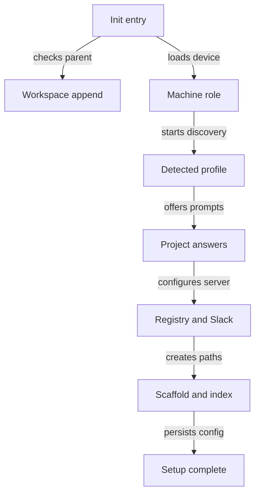
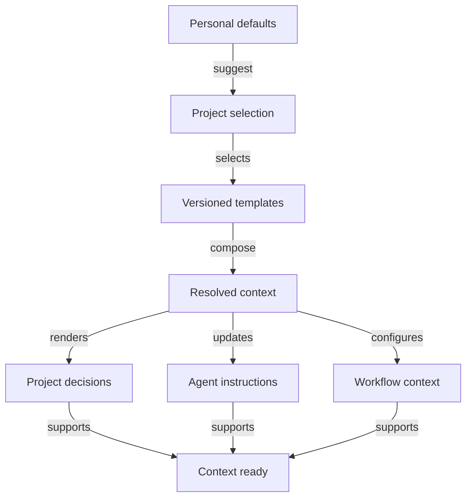
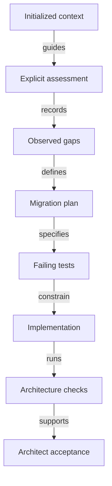

# Architecture onboarding gap map

`gwrk init` should assemble architecture context from versioned templates without calling a language model. Initialization records the chosen target while code conformance remains unassessed. Blocked: none. The project owner decides whether to adopt future architecture decisions.

## Scope and evidence

This is a source review of both local repositories on November 11, 2026. Proposed behavior below is not implemented or ratified.

| Source | Population | Contents | Used in |
|---|---|---|---|
| `gwrk` at `0bad8681` | Local working tree | Core code and governance | Current behavior |
| `gwrk-plugins` at `e0f79e6` | Local working tree | Installable plugin catalog | Plugin cascade |
| Maintainer guidance | Architecture and delivery preferences | Design and review criteria | Preferred standards |
| Focused local test runs | Selected test files | Executed assertions | Verification |
| User clarification on November 11 | Desired initialization behavior | Model-free context setup | Proposed cascade |

The core reports version `1.6.0-beta.1` in [package.json](../../package.json). Its working tree already contains documentation and test edits. This review preserves those edits. The plugin repository was clean at inspection.

## Repository layout

| Area | Role | Current location |
|---|---|---|
| Core domain | Types and policy functions | `gwrk/src/domain/` |
| Core ports | Agent and infrastructure contracts | `gwrk/src/ports/` |
| Application | Extracted shipping policies | `gwrk/src/application/ship/` |
| Adapters | Wrappers and infrastructure exports | `gwrk/src/adapters/` |
| Existing implementation | Commands and orchestration | `gwrk/src/{commands,engine,utils,server,db}/` |
| Plugin runtime | Loading and dispatch | `gwrk/src/plugins/` |
| Built-in plugins | Language baselines and workflows | `gwrk/src/plugins/builtins/` |
| Project governance | Decisions and grounding | `gwrk/docs/` |
| Feature definitions | Specs and task state | `gwrk/specs/` |
| External catalog | Versioned plugin metadata | `gwrk-plugins/registry.json` |
| External skills | Framework standards | `gwrk-plugins/skills/` |
| External agents | Additional agent adapters | `gwrk-plugins/agents/` |
| External reviews | API and library strategies | `gwrk-plugins/reviews/` |

The refactor established four named layers. It did not relocate all infrastructure behind those layers. Several adapter entry points re-export existing implementations. Application extraction covers shipping review and diagnosis. It also covers verification policies.

Sources:

- [architecture gate](../../src/architecture.test.ts)
- [application entry](../../src/application/index.ts)
- [CLI adapter entry](../../src/adapters/cli/index.ts)
- [agent adapter entry](../../src/adapters/agents/index.ts)
- [plugin catalog overview](../../../gwrk-plugins/README.md)

The external catalog contains five agent backends and ten framework skills. It also contains two review strategies. It has no architecture pack. Built-in language standards live in core rather than the external catalog.

## Current onboarding

| Stage | Current behavior | Source |
|---|---|---|
| Workspace append | Stores detected type, stack, layout | `src/commands/init.ts:214` |
| Machine role | Reuses role or asks server question | `src/commands/init.ts:243` |
| Discovery | Detects stack and agent availability | `src/commands/init.ts:289` |
| Project identity | Preserves existing identity defaults | `src/commands/init.ts:335` |
| Architecture | Free-text answer with Layered default | `src/commands/init.ts:387` |
| Conventions | Free-text answer with TDD default | `src/commands/init.ts:391` |
| Personal setup | Agent selection and Slack preference | `src/commands/init.ts` |
| Server setup | Registry sync and Slack provisioning | `src/commands/init.ts` |
| Scaffolding | Empty architecture, decision, rule directories | `src/commands/init.ts` |
| Decision index | Indexes an existing default corpus | `src/commands/init.ts` |
| Skill seed | Reads a historical reasoning taxonomy | `src/plugins/seed.ts` |
| Persistence | Splits tracked and personal config | `src/commands/init.ts` |
| Completion | Suggests feature definition and status | `src/commands/init.ts` |

The wizard already permits `Hexagonal` and `functional` as text. It does not translate them into an architecture model or enforcement selection.

Interactive re-init passes fixed defaults to the architecture and conventions prompts. An empty answer can replace an existing preference with `Layered` or `TDD`. Noninteractive init preserves existing values and otherwise writes `unknown`.

The schema also permits an architecture object with `doc` and `decisions` paths. The text prompt does not preserve that object form. Decision commands respect the custom corpus path. Init indexes the hardcoded `docs/decisions/` path instead.

The completion message overstates skill provisioning. `seedSkills()` attempts to read `docs/archive/reference/reasoning-modes.md`. That file is absent from this checkout. Package publication includes `dist/` rather than `docs/`. Seeding catches errors and continues. Built-in enforcement remains separately available through the plugin loader.

Sources:

- [init implementation](../../src/commands/init.ts)
- [configuration schema](../../src/utils/config.ts:89)
- [decision path resolution](../../src/engine/adr-scaffold.ts:230)
- [seeding implementation](../../src/plugins/seed.ts)

## Preferred standards

The maintainer wants these language-independent design and delivery practices.

| Requirement | Reusable form | Evidence |
|---|---|---|
| Hexagonal architecture | Explicit dependency contracts | Maintainer guidance |
| Functional core | Effects outside domain policy | Maintainer guidance |
| Determinism | Same input produces same output | Maintainer guidance |
| Domain laws | Property tests for invariants | Maintainer guidance |
| Explicit state | Inputs and results carry state | Maintainer guidance |
| Focused functions | Separate pure work from effects | Maintainer guidance |
| Measured duplication | Identify repeated work and cost | Maintainer guidance |
| Stable terms | One name per domain concept | Maintainer guidance |
| Test-driven development | Observed failing tests before implementation | User request and TDD decision |
| Migration safety | Parity before changing behavior | Maintainer guidance |
| Architectural authority | Named decider and recorded choices | Maintainer guidance |
| Production readiness | Contracts and operational evidence | Maintainer guidance |

Test-driven development is abbreviated TDD below. Architecture decision records are abbreviated ADRs below.

Some standards need project-specific translation. Text-edit provenance applies to transforms that change text. Model ports apply where inference exists. Versioned golden datasets apply where data quality needs measured thresholds.

Keep product-specific data and deployment conventions in project guidance. The core architecture decision restricts `application/` to domain and ports. A shared profile must distinguish use cases from composition before generating import contracts.

## Standards composition

Architecture rules can remain language agnostic. Language and framework plugins must supply compatible guidance where their idioms affect those rules. Initialization should compose authored content through explicit selectors.

| Content | Owns | Example |
|---|---|---|
| Architecture template | Dependency and effect rules | Domain has no external effects |
| Language baseline | Language idioms | Python ports use protocols |
| Framework guidance | Integration placement | FastAPI dependencies supply adapters |
| Compatibility fragment | Combination-specific guidance | Django persistence stays outside domain |
| Project decision | Local authority and exceptions | Existing persistence retained during migration |

A compatibility fragment is optional authored content within the existing plugin system. It does not require a new executable plugin type. A language baseline need not contain a copy of every architecture rule.

For hexagonal Python with FastAPI, the architecture template states the inward dependency rule. The Python baseline describes interface and typing idioms. The FastAPI fragment keeps routing and dependency injection outside the domain. Project decisions name local paths and exceptions.

The resolver selects declared compatible content. It must not rewrite plugin text through a model call. Unsupported combinations should report the missing guidance. They can still use the shared architecture rules without claiming full framework support.

The target contract must define precedence between project decisions and packaged defaults. Existing accepted decisions remain authoritative. Detect declared incompatibilities mechanically. Leave semantic conflict assessment to a later review.

## Existing decision model

| Decision | Constraint relevant to this work |
|---|---|
| Task tracking, ADR-001 | Completion requires a passing task gate |
| Execution ledger, ADR-002 | Tracked task files remain task authority |
| Execution state, ADR-003 | Runs produce Git-native manifests |
| Agent-native output, ADR-004 | Commands preserve the signal contract |
| TDD gates, ADR-005 | Tests and execution evidence support completion |
| Agent backends, ADR-006 | Adapters hide agent-specific behavior |
| Single dispatch, ADR-007 | Workflows use the shared runtime |
| Command safety, ADR-008 | Agent subprocesses stay bounded and noninteractive |
| Project knowledge, ADR-009 | Projects own their knowledge documents |
| Decision records, ADR-010 | Authored corpus produces a dispatch index |
| Hexagonal layering, ADR-011 | Domain and application depend inward |
| Plugin separation, ADR-012 | Core baselines precede external framework packs |

Sources:

- [decision corpus](../decisions/)
- [TDD gate decision](../decisions/ADR-005-tdd-gate-architecture.md)
- [decision-record decision](../decisions/ADR-010-decision-records.md)
- [hexagonal decision](../decisions/ADR-011-hexagonal-and-agent-port.md)
- [plugin separation decision](../decisions/ADR-012-plugin-registry-and-framework-packs.md)

Read amendments before treating an ADR's opening decision as current behavior. The TDD decision evolved from agent-authored gates to deterministic test-backed gates. Later amendments added RED evidence and liveness. They also added declared test targets and one gate runner. Its final amendment explicitly limits test-count liveness to selected execution paths.

`gwrk define adr` already scaffolds project records. It supports drafting with `--run` and ratification with `--decide`. Authors can amend sections or append them. Other modes reindex the corpus and check citations. The `--audit` mode dispatches an agent review.

Drafting keeps records Proposed. Its workflow states that ratification is human judgment. The index includes every status. Proposed records therefore reach agents too. Future enforcement must distinguish an accepted constraint from a proposed change.

`--check` verifies citations and registered correction references. It also checks index freshness. It does not evaluate dependency direction or code smells. The constitution audit asks an agent to compare decisions with code. It does not produce a deterministic architecture certificate.

The current continuous integration workflow runs `define adr --check`. Its lint step is advisory. Generated project onboarding does not install equivalent governance checks.

Sources:

- [ADR command](../../src/commands/adr.ts)
- [drafting workflow](../../src/plugins/builtins/workflows/gwrk-adr-record/PROMPT.md)
- [index builder](../../src/engine/adr-index.ts)
- [citation checks](../../src/engine/adr-check.ts)
- [constitution workflow](../../src/plugins/builtins/workflows/gwrk-constitution/PROMPT.md)
- [continuous integration](../../.github/workflows/ci.yml)

## Gaps and consequences

| Gap | Evidence | Consequence |
|---|---|---|
| No architecture selection model | Config stores text or document paths | Choice cannot select checks |
| Re-init resets prompt defaults | Fixed Layered and TDD defaults | Preference loss |
| No greenfield ADR bootstrap | Init creates directories only | New projects lack constraints |
| Custom corpus mismatch | Init hardcodes default decision path | Incomplete decision grounding |
| No standards selection in profile | Detection merges stack and toolchain | Architecture absent from routing |
| No architecture manifest selector | Enforcement schema has language and framework | Install scope substitutes for intent |
| Conditional standards injection | Dispatch requires a quality placeholder | Definition stages can miss standards |
| Language skills exclude reviews | Built-in manifests use implementation scope | Review lacks language baseline |
| Core conventions apply universally | Ungated TypeScript file rule | Conflicts with other languages |
| JavaScript baseline absent | Four built-in language skills | Uneven language support |
| Architecture checks miss effects | Import scanner accepts relative paths only | Pure-core violations pass |
| Generic clean-code checks absent | Language skills focus on tools | Hidden state remains untested |
| No architecture readiness evidence | Discovery reports specs and gate counts | No basis for architect acceptance |
| Installed versions are machine state | Global plugin lock path | Team policy can differ |
| Framework rules lack shared contract | Standalone framework skill text | Architecture guidance can conflict |
| Prompt layout remains legacy | Plan workflow lists engine and utils | New work can reinforce old layout |
| Skill seeding uses absent source | Historical taxonomy dependency | Init success hides seed failure |

Sources:

- [profile detection](../../src/engine/profile-detector.ts)
- [manifest schema](../../src/plugins/manifest.ts)
- [skill resolution](../../src/plugins/skill-runtime.ts:200)
- [dispatch injection](../../src/utils/agent.ts:555)
- [built-in language skills](../../src/plugins/builtins/skills/)
- [project discovery](../../src/engine/discover.ts)
- [registry implementation](../../src/engine/registry.ts)
- [plan workflow](../../src/plugins/builtins/workflows/gwrk-plan/PROMPT.md)

The runtime filters built-ins and framework skills using language and framework. Project-local enforcement skills load unconditionally. Arbitrary global language-only packs fall outside parts of that filtering condition. A new pack cannot assume every selector applies uniformly.

Architecture selection needs to reach definition as well as implementation. A plan generated without the chosen boundaries can produce tests and task gates for the wrong design.

## Core architecture findings

The existing architecture suite passes. Its relative-import parser ignores package imports and `node:` imports. These source findings remain outside its assertions.

| File | Effect inside domain | Required separation |
|---|---|---|
| `src/domain/project-id.ts:29` | Executes Git subprocesses | Resolve identity inputs in adapter |
| `src/domain/agent-config.ts:167` | Reads project and global config | Separate loading from selection |
| `src/domain/toolchain.ts:92` | Reads manifests and lockfiles | Separate detection from command policy |

Sources:

- [identity implementation](../../src/domain/project-id.ts)
- [agent configuration](../../src/domain/agent-config.ts)
- [toolchain policy](../../src/domain/toolchain.ts)
- [boundary scanner](../../src/architecture.test.ts:32)

These findings contradict the pure-domain assertion in the hexagonal decision. They do not establish that the refactor had no value. The inward relative-import checks and extracted policy functions provide a starting point.

The toolchain port module also contains its adapter factory. A full conformity pass should separate contracts from construction. Adapter re-exports need review before documenting the layout as a completed physical migration.

## Proposed initialization contract

`gwrk init` should perform deterministic context setup for both new and existing projects. No initialization path should invoke a language model. Agent-assisted drafting and assessment remain separate commands.

Personal defaults should suggest hexagonal architecture with a functional core. They should also suggest clean-code checks and TDD. Tracked project policy records the chosen target. Re-init preserves it unless the user changes the selection.

Templates should provide language-agnostic decisions for dependency direction and effect isolation. Testing policy can use a separate template. Render project-specific values supplied through prompts or configuration. Leave unknown local paths unresolved rather than inventing a codebase description.

Template adoption records a decision about future work. It does not claim that current code follows the decision. New records default to Proposed. Explicit user adoption may ratify a template during setup if the future contract supports that action. Ratification must never follow from detection alone.

Reuse the existing decision corpus and derived index. Add concise references in a gwrk-managed section of `AGENTS.md`. Generate other agent instruction surfaces from the same resolved context where supported. Do not duplicate the full architecture standard in each file.

Workflow dispatch should resolve the same selections as initialization. Supported agent instruction files provide context outside gwrk dispatch. Neither surface should depend on a second hand-maintained copy of the rules.

### Existing projects

| Concern | Initialization behavior |
|---|---|
| Existing code | Preserve source files |
| Selected target | Record desired architecture |
| Existing accepted decisions | Preserve authority and content |
| Conflicting target | Create a proposed change |
| Existing agent instructions | Edit only gwrk-managed content |
| Prior generated files | Preserve human edits |
| Unknown local layout | Record unresolved bindings |
| Existing check configuration | Preserve activation state |
| Code conformance | Leave unassessed |
| Migration plan | Defer to explicit assessment |

Choosing hexagonal architecture on an existing layered project establishes a direction for later work. Initialization need not inspect every module or produce a migration plan. A declared conflict can appear in setup output without a model call.

Safe re-init needs template provenance and stable generated identifiers. It should detect edits to generated content before replacing it. It should report conflicts and preserve the edited artifact. Regenerating a derived index remains separate from rewriting authored decisions.

### Setup output

Track context completeness independently from code conformance. Prefer a small addition to existing discovery output over a separate governance database.

| Dimension | Example value | Meaning |
|---|---|---|
| Architecture target | Hexagonal functional core | Chosen direction |
| Decision status | Proposed | Awaiting project adoption |
| Context setup | Ready | Selected references available |
| Architecture checks | Not configured | No executable boundary rules |
| Code conformance | Unassessed | No code assessment performed |

These values are proposed output semantics. Their storage and command syntax need a contract. Selecting a policy must not set check results or code conformance.

A successful setup can say “Architecture context installed. Code conformance has not been assessed.” It should list unresolved context dependencies when setup is incomplete. Check execution and migration remain separate actions.

## Assessment and enforcement lifecycle

An accepted architecture decision describes policy. Passing checks provide scoped evidence at a revision. Human acceptance adds judgment about that evidence and open exceptions. These states must remain distinct.

Import rules can provide deterministic evidence. They cannot prove every code smell absent. Agent findings need file references and concrete examples. An architecture acceptance record should name the decider and reviewed revision.

Initialization must not depend on completing an assessment or repairing core's own architectural gaps. Core alignment remains a separate workstream in this cascade.

## Core cascade

The following is proposed scope for later definition work. It assigns implementation ownership by repository rather than inventing team members.

| Change | Owner | Acceptance evidence |
|---|---|---|
| Architecture profile contract | Core maintainer | Target separate from conformance |
| Model-free initialization | Core maintainer | Zero model dispatches in setup tests |
| Deterministic context composition | Core maintainer | Stable output from fixed selections |
| Personal defaults model | Core maintainer | Project choice wins over defaults |
| Init selection and repair | Core maintainer | Re-init preserves accepted policy |
| New and existing project templates | Core maintainer | Proposed target decisions and correct index |
| Managed agent instructions | Core maintainer | Human content preserved on re-init |
| Template provenance and upgrades | Core maintainer | Edited decisions preserved |
| Custom corpus handling | Core maintainer | Init and ADR commands agree |
| Workspace policy inheritance | Core maintainer | Polyglot workspace seam tests |
| Enforcement selection | Core maintainer | Language and architecture routing tests |
| Definition-stage grounding | Core maintainer | Captured workflow prompt tests |
| Review-stage baselines | Core maintainer | Review receives selected standards |
| Later architecture check integration | Core maintainer | Violating fixture blocks completion |
| Acceptance evidence | Core maintainer | Revision and decisions trace to checks |
| Core domain effect removal | Core maintainer | Stronger boundary tests fail first |
| Discovery and doctor output | Core maintainer | Context and conformance reported separately |
| Reproducible policy versions | Core maintainer | Two machines resolve same selection |
| Seed repair | Core maintainer | Installed-package init fixture |

| Area | Primary file |
|---|---|
| Onboarding | `src/commands/init.ts` |
| Configuration | `src/utils/config.ts` |
| Profile types | `src/domain/types.ts` |
| Profile detection | `src/engine/profile-detector.ts` |
| Plugin contract | `src/plugins/manifest.ts` |
| Skill selection | `src/plugins/skill-runtime.ts` |
| Dispatch context | `src/utils/agent.ts` |
| Shipping | `src/engine/ship-orchestrator.ts` |

Delivery work also reaches the shared gate runner. Review resolution and discovery need the resolved policy.

Implement context composition as a functional core. Pass selections and template contents as inputs. Return resolved context and a file-change plan as data.

Ports should isolate template access and project-file reads. Adapters should apply file writes and handle prompts. Model dispatch must not be a dependency of the initialization use case.

Toolchain execution remains behind the existing toolchain boundary. Context extensions remain context providers. Executable architecture checks should use project test or lint tooling. A new executable plugin kind would require a separate architecture decision.

## Plugin cascade

| Plugin group | Required change | Repository |
|---|---|---|
| Architecture context pack | Language-agnostic ADR templates and rules | `gwrk-plugins` |
| Compatibility fragments | Authored language and framework bindings | Existing skills |
| Architecture audit workflow | Census and dependency assessment | `gwrk-plugins` |
| Production readiness workflow | Owned gaps and release evidence | `gwrk-plugins` |
| TypeScript standards | Ports and dependency-check recipes | `gwrk` built-ins |
| Python standards | Protocols and import-contract recipes | `gwrk` built-ins |
| Go standards | Interface and package-boundary recipes | `gwrk` built-ins |
| Rust standards | Trait and crate-boundary recipes | `gwrk` built-ins |
| JavaScript standards | Explicit baseline matching toolchain support | Placement decision required |
| API and library reviews | Architecture evidence in verdict | `gwrk-plugins/reviews/` |
| CLI and web reviews | Architecture evidence in verdict | `gwrk` built-ins |
| Agent adapters | Verify shared context delivery | Both repositories |

Keep shared architectural rules in one pack. Language skills supply idioms and later check recipes. Framework skills describe integration placement. Compatibility fragments address concrete conflicts between a framework and the selected architecture.

Initialization selects existing fragments and renders templates. It does not modify the installed plugin or synthesize a new variant. Unsupported custom architectures can reference project-owned decisions. Their framework compatibility remains unassessed until a later review.

All ten external framework skills require a compatibility pass.

- `nextjs-standards`
- `react-standards`
- `fastify-standards`
- `express-standards`
- `fastapi-standards`
- `django-standards`
- `gin-standards`
- `chi-standards`
- `axum-standards`
- `clap-standards`

For example, FastAPI dependency injection should supply adapters without importing FastAPI into domain modules. Django models need an explicit persistence boundary. React rendering needs separation from domain transforms. Framework choice must not choose the architecture implicitly.

Agent backends do not need separate copies of the standards. Verify that each receives the resolved context through the shared dispatch path.

Changes to external plugin content require version bumps and catalog digest regeneration. Verify installation and upgrade behavior. Check disabled state and plugin doctor output. Global installation integrity already exists. A tracked team policy selection remains a separate requirement.

## Workflow and documentation cascade

| Surface | Required update | Purpose |
|---|---|---|
| ADR corpus | Target adoption and conformance distinction | Ratified design |
| ADR templates | Model-free project rendering | Deterministic setup |
| Agent instruction files | Managed references to selected context | Consistent agent guidance |
| Hexagonal ADR | Pure-core contract and layer semantics | Resolve implementation drift |
| Plugin separation ADR | Architecture pack placement | Stable extension boundary |
| TDD ADR | Architecture-test relationship | Preserve execution evidence |
| Specify workflow | Architecture constraints as requirements | Traceability |
| Plan workflow | Current layers and selected policy | Correct design inputs |
| Define-tests workflow | Boundary and determinism cases | RED evidence |
| Task and gate workflows | Executable architecture targets | Completion enforcement |
| Implement workflow | Pure-core and effect rules | Consistent implementation |
| Code review workflows | Architecture findings in task state | Blocking verdicts |
| Constitution workflow | Check results and exceptions | Supported acceptance |
| Cascade-sync workflow | Policy impact on downstream artifacts | Change propagation |
| Principal engineer persona | Remove fixed stack assumptions | Language-neutral review |
| Core README and development guide | Context-only setup examples | Usable setup |
| Grounding and CLI grammar | Profile and ADR lifecycle | Agent context |
| Product documentation | Architect acceptance boundaries | Accurate capability claims |
| Plugin README and author guide | Selectors and check recipes | Pack authorship |
| Release and migration notes | Existing-project behavior | Safe adoption |
| Continuous integration templates | Required architecture checks | Repository enforcement |

The principal engineer persona currently requires Zod and `make up`. Those are stack assumptions. Its existence does not prove every review executes it. Audit persona loading before changing runtime behavior.

Update existing research and feature definitions where contracts change. Project perspective and decision records need review. Plugin runtime and polyglot toolchains also need review. Check hexagonal architecture and registry versioning for changed contracts. Preserve completed execution history. New scope belongs in new definitions or explicit amendments.

## Delivery sequence

| Workstream | First deliverable | Dependency |
|---|---|---|
| Context contract | Selection and adoption semantics | User requirements |
| Deterministic setup | Templates and managed instructions | Context contract |
| Plugin compatibility | Authored integration fragments | Selection contract |
| Core architecture alignment | Pure domain and stronger tests | Existing hexagonal decision |
| Assessment and migration | Scoped gaps and executable checks | Initialized context |
| Architect acceptance | Revision-bound review evidence | Executed checks |

Context setup can ship before automated architecture enforcement. Core's architecture repairs can proceed independently of onboarding. Later assessment uses the chosen context to define the remaining work.

1. Record the model-free initialization contract as a proposed decision.
2. Define composition rules and template adoption semantics.
3. Define migration contracts that preserve project decisions and human edits.
4. Specify failing tests for deterministic setup and zero model dispatches.
5. Implement template rendering and managed context updates.
6. Add language and framework compatibility fragments.
7. Update onboarding documentation and plugin catalog versions.
8. Define assessment and enforcement as separate features.

Use gwrk's existing definition sequence for each feature. Define the spec first. Follow with the plan and contracts. Author failing tests before generating tasks and gates. Then ship.

Project setup should use the deterministic ADR scaffolding path and template rendering. Agent-assisted `gwrk define adr --run` remains an explicit later operation. The constitution audit remains supporting review rather than proof of compliance.

Run bounded single-phase shipping under the repository's execution rule. This review did not start an agent shipping loop.

## Acceptance scenarios

| Scenario | Target | Verdict |
|---|---|---|
| Fresh project selects preferred architecture | Context ready with conformance unassessed | Unmeasured |
| Any project runs initialization | Zero model calls | Unmeasured |
| Fixed selections use fixed template versions | Identical generated context | Unmeasured |
| Existing nonconforming project initializes | Target recorded without conformance claim | Unmeasured |
| Context is ready without executable checks | Checks remain not configured | Unmeasured |
| User edits managed decision content | Re-init preserves edit and reports conflict | Unmeasured |
| User supplies existing agent instructions | Unmanaged content preserved | Unmeasured |
| Framework lacks compatibility guidance | Missing binding reported | Unmeasured |
| Existing project reruns init | Accepted choices preserved | Unmeasured |
| Existing accepted policy conflicts with selection | Proposed change without overwrite | Unmeasured |
| Later configured check detects domain effects | Required check fails | Unmeasured |
| Adapter changes external behavior | Contract test fails | Unmeasured |
| Core changes result between equal inputs | Determinism check fails | Unmeasured |
| Review discovers architecture breach | Task reopens and phase blocks | Unmeasured |
| Proposed decision reaches an agent | Proposed status remains explicit | Unmeasured |
| Required context plugin is unavailable | Setup reports incomplete context | Unmeasured |
| Workspace uses another language | Correct local check recipe | Unmeasured |
| New machine resolves project policy | Same pinned policy versions | Unmeasured |

## Verification and limits

| Check | Target | Result | Verdict |
|---|---|---|---|
| Onboarding and ADR engine tests | All selected tests pass | 93 passed | Passes |
| ADR dispatch and plugin runtime tests | All selected tests pass | 42 passed | Passes |
| Existing architecture suite | All boundary tests pass | Included above | Passes |
| Functional-core purity | No domain infrastructure effects | Three source findings | Fails |
| Full repository suite | All tests pass | Not run | Unmeasured |
| Fresh-machine onboarding | End-to-end setup succeeds | Not run | Unmeasured |
| External backend execution | All adapters deliver context | Not run | Unmeasured |

The initial review executed tests across nine files. This cascade update changes prose only and does not rerun implementation tests. The earlier results establish the current tested behavior. They do not establish the proposed lifecycle or production readiness.

This review creates one Markdown report. Implementation and governance remain unchanged.
