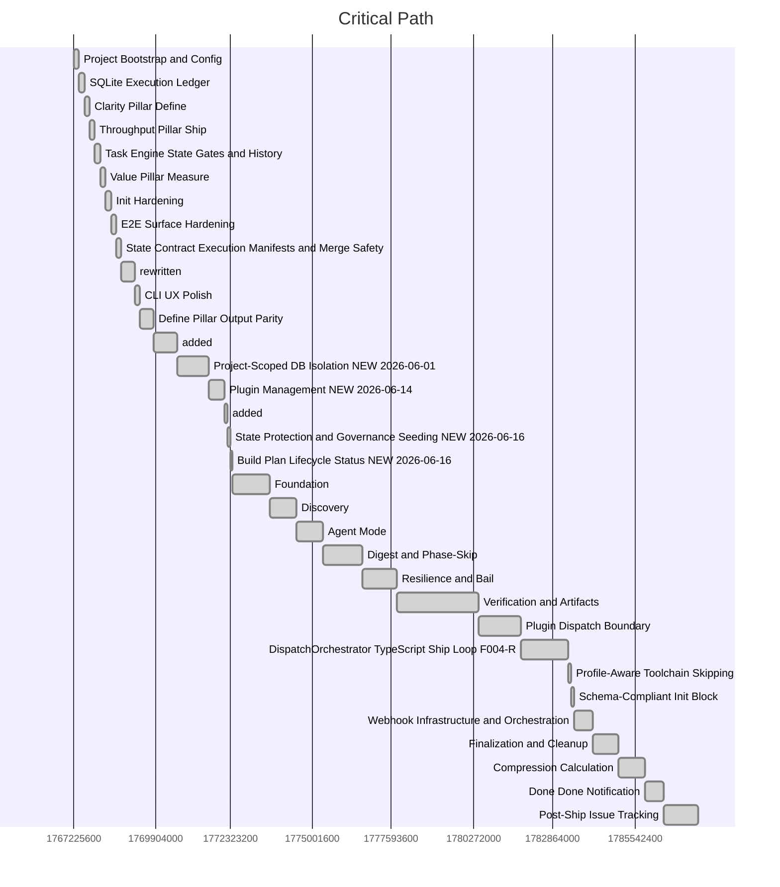

# 000 Build Plan — gwrk

> **Status:** Authoritative · **Date:** 2026-11-06
> **Anchored to:** [architecture.md](docs/grounding/architecture.md), [GWRK-PRD-PRFAQ.md](docs/product/GWRK-PRD-PRFAQ.md)
> **Decisions:** [Decision Index](.gwrk/decisions/index.md)

---

## Terminology

| Term | Meaning | Example |
|---|---|---|
| **Feature** | A spec subdirectory under `specs/`. Has its own spec.md, plan.md, contracts/, gates/, etc. | `specs/001-cli-core/` = Feature 001 |
| **Phase** | An implementation stage *within* a feature's `plan.md`. A feature has 1+ phases. | Phase 1 of Feature 013 = "Foundation (7 SP)" |
| **Wave** | A scheduling group of features that can execute concurrently. | Wave 2 = {F013, F006, F007, F012} |

---

## Dependency Graph

```mermaid
graph TD
    001-cli-core["001-cli-core ✅"] --> 013-agent-native-interface["013-agent-native-interface ✅"]
    001-cli-core["001-cli-core ✅"] --> 002-build-server["002-build-server ✅"]
    001-cli-core["001-cli-core ✅"] --> 006-pulse["006-pulse ✅"]
    001-cli-core["001-cli-core ✅"] --> 007-effort-compression["007-effort-compression ✅"]
    001-cli-core["001-cli-core ✅"] --> 014-plugin-system["014-plugin-system ✅"]
    002-build-server["002-build-server ✅"] --> 003-slack["003-slack ✅"]
    002-build-server["002-build-server ✅"] --> 005-parallel-dispatch["005-parallel-dispatch ✅"]
    013-agent-native-interface["013-agent-native-interface ✅"] --> 004-ship-loop["004-ship-loop ✅"]
    004-ship-loop["004-ship-loop ✅"] --> 005-parallel-dispatch["005-parallel-dispatch ✅"]
    004-ship-loop["004-ship-loop ✅"] --> 011-harvest["011-harvest ✅"]
    003-slack["003-slack ✅"] --> 011-harvest["011-harvest ✅"]
    002-build-server["002-build-server ✅"] --> 011-harvest["011-harvest ✅"]
    030-dogfood-spine["030-dogfood-spine ✅"] --> 031-unified-agent-port["031-unified-agent-port ✅"]
    031-unified-agent-port["031-unified-agent-port ✅"] --> 032-polyglot-toolchain["032-polyglot-toolchain ✅"]
    032-polyglot-toolchain["032-polyglot-toolchain ✅"] --> 033-plugin-runtime["033-plugin-runtime ✅"]
    033-plugin-runtime["033-plugin-runtime ✅"] --> 034-hexagonal-architecture["034-hexagonal-architecture ✅"]
    style 001-cli-core fill:#22cc22,stroke:#118811,color:#fff
    style 002-build-server fill:#22cc22,stroke:#118811,color:#fff
    style 003-slack fill:#22cc22,stroke:#118811,color:#fff
    style 004-ship-loop fill:#22cc22,stroke:#118811,color:#fff
    style 005-parallel-dispatch fill:#22cc22,stroke:#118811,color:#fff
    style 006-pulse fill:#22cc22,stroke:#118811,color:#fff
    style 007-effort-compression fill:#22cc22,stroke:#118811,color:#fff
    style 008-agent-router fill:#22cc22,stroke:#118811,color:#fff
    style 011-harvest fill:#22cc22,stroke:#118811,color:#fff
    style 013-agent-native-interface fill:#22cc22,stroke:#118811,color:#fff
    style 014-plugin-system fill:#22cc22,stroke:#118811,color:#fff
    style 018-build-plan-orchestrator fill:#22cc22,stroke:#118811,color:#fff
    style 019-agy-agent-migration fill:#22cc22,stroke:#118811,color:#fff
    style 020-polyglot-monorepo fill:#22cc22,stroke:#118811,color:#fff
    style 021-polyglot-toolchain fill:#22cc22,stroke:#118811,color:#fff
    style 023-plan-format-contract fill:#22cc22,stroke:#118811,color:#fff
    style 024-gate-assertion-contract fill:#22cc22,stroke:#118811,color:#fff
    style 025-gate-only-phases fill:#22cc22,stroke:#118811,color:#fff
    style 026-gate-runner-convergence fill:#22cc22,stroke:#118811,color:#fff
    style 027-gate-liveness fill:#22cc22,stroke:#118811,color:#fff
    style 028-review-finding-liveness fill:#22cc22,stroke:#118811,color:#fff
    style 029-decision-records fill:#22cc22,stroke:#118811,color:#fff
    style 030-dogfood-spine fill:#22cc22,stroke:#118811,color:#fff
    style 031-unified-agent-port fill:#22cc22,stroke:#118811,color:#fff
    style 032-polyglot-toolchain fill:#22cc22,stroke:#118811,color:#fff
    style 033-plugin-runtime fill:#22cc22,stroke:#118811,color:#fff
    style 034-hexagonal-architecture fill:#22cc22,stroke:#118811,color:#fff
    style 035-polyglot-canary-e2e fill:#22cc22,stroke:#118811,color:#fff
    style 036-plugin-registry-versioning fill:#22cc22,stroke:#118811,color:#fff
    style 037-biome-lint-zero fill:#22cc22,stroke:#118811,color:#fff
    style 038-telemetry-cost-ledger fill:#22cc22,stroke:#118811,color:#fff
```

---

## Critical Path

---

## Features

### Feature 001-cli-core ✅

**Status:** SHIPPED ✅

| Phase | Name | Status | SP |
|---|---|---|---|
| 1 | Project Bootstrap & Config ✅ | SHIPPED ✅ | 2 |
| 2 | SQLite Execution Ledger ✅ | SHIPPED ✅ | 2 |
| 3 | Clarity Pillar — Define ✅ | SHIPPED ✅ | 2 |
| 4 | Throughput Pillar — Ship ✅ | SHIPPED ✅ | 2 |
| 5 | Task Engine — State, Gates & History ✅ | SHIPPED ✅ | 2 |
| 6 | Value Pillar — Measure ✅ | SHIPPED ✅ | 2 |
| 7 | Init Hardening ✅ | SHIPPED ✅ | 2 |
| 8 | E2E Surface Hardening ✅ | SHIPPED ✅ | 2 |
| 9 | State Contract — Execution Manifests & Merge Safety | SHIPPED ✅ | 2 |
| 10 | rewritten | SHIPPED ✅ | 5 |
| 11 | CLI UX Polish ✅ | SHIPPED ✅ | 2 |
| 12 | Define Pillar Output Parity | SHIPPED ✅ | 5 |
| 13 | added | SHIPPED ✅ | 9 |
| 14 | Project-Scoped DB Isolation ⭐ NEW (2026-06-01) | SHIPPED ✅ | 12 |
| 15 | Plugin Management ⭐ NEW (2026-06-14) | SHIPPED ✅ | 6 |
| 16 | added | SHIPPED ✅ | 0 |
| 17 | State Protection & Governance Seeding ⭐ NEW (2026-06-16) | SHIPPED ✅ | 0 |
| 18 | Build Plan Lifecycle Status ⭐ NEW (2026-06-16) | SHIPPED ✅ | 0 |

### Feature 002-build-server ✅

**Status:** SHIPPED ✅

| Phase | Name | Status | SP |
|---|---|---|---|
| 1 | Daemon Lifecycle & Service Management | SHIPPED ✅ | 25 |
| 2 | Resilience & System Status | SHIPPED ✅ | 19 |
| 3 | Slack Event Bridge & Bless Actions | SHIPPED ✅ | 13 |
| 4 | Execution Ledger | SHIPPED ✅ | 7 |

### Feature 003-slack ✅

**Status:** SHIPPED ✅

| Phase | Name | Status | SP |
|---|---|---|---|
| 1 | Slack Definition Pillar (P0) | SHIPPED ✅ | 13 |
| 2 | Conversational Agent Surface (P1) | SHIPPED ✅ | 10 |
| 3 | Webhook Hardening & Topology (P1) | SHIPPED ✅ | 10 |

### Feature 004-ship-loop ✅

**Status:** SHIPPED ✅

| Phase | Name | Status | SP |
|---|---|---|---|
| 1 | Digest & Phase-Skip | SHIPPED ✅ | 15 |
| 2 | Resilience & Bail | SHIPPED ✅ | 13 |
| 3 | Verification & Artifacts | SHIPPED ✅ | 31 |
| 4 | Plugin Dispatch Boundary | SHIPPED ✅ | 16 |
| 5 | DispatchOrchestrator — TypeScript Ship Loop (F004-R) | SHIPPED ✅ | 18 |
| 6 | Profile-Aware Toolchain Skipping | SHIPPED ✅ | 0 |
| 7 | Schema-Compliant Init Block | SHIPPED ✅ | 0 |

### Feature 005-parallel-dispatch ✅

**Status:** SHIPPED ✅

| Phase | Name | Status | SP |
|---|---|---|---|
| 1 | Worktree Sandbox Manager | SHIPPED ✅ | 8 |
| 2 | Parallel Dispatch Orchestrator | SHIPPED ✅ | 9 |

### Feature 006-pulse ✅

**Status:** SHIPPED ✅

| Phase | Name | Status | SP |
|---|---|---|---|
| 1 | Engine & Git Utility Refinement | SHIPPED ✅ | 10 |
| 2 | CLI Commands & Terminal Rendering | SHIPPED ✅ | 6 |
| 3 | Final Verification & E2E | SHIPPED ✅ | 6 |

### Feature 007-effort-compression ✅

**Status:** SHIPPED ✅

| Phase | Name | Status | SP |
|---|---|---|---|
| 1 |  | SHIPPED ✅ | 10 |
| 2 |  | SHIPPED ✅ | 8 |
| 3 |  | SHIPPED ✅ | 6 |
| 4 |  | SHIPPED ✅ | 4 |
| 5 |  | SHIPPED ✅ | 3 |

### Feature 008-agent-router ✅

**Status:** SHIPPED ✅

| Phase | Name | Status | SP |
|---|---|---|---|
| 1 | Agent Registry & Zod Validation | SHIPPED ✅ | 12 |
| 2 | Quota Prober & Cache | SHIPPED ✅ | 10 |
| 3 | Backend Selector (Core Logic) | SHIPPED ✅ | 14 |
| 4 | Integration & Wiring | SHIPPED ✅ | 10 |

### Feature 011-harvest ✅

**Status:** SHIPPED ✅

| Phase | Name | Status | SP |
|---|---|---|---|
| 1 | Webhook Infrastructure & Orchestration | SHIPPED ✅ | 7 |
| 2 | Finalization & Cleanup | SHIPPED ✅ | 10 |
| 3 | Compression Calculation | SHIPPED ✅ | 10 |
| 4 | Done, Done! Notification | SHIPPED ✅ | 7 |
| 5 | Post-Ship Issue Tracking | SHIPPED ✅ | 13 |

### Feature 013-agent-native-interface ✅

**Status:** SHIPPED ✅

| Phase | Name | Status | SP |
|---|---|---|---|
| 1 | Foundation ✅ | SHIPPED ✅ | 14 |
| 2 | Discovery ✅ | SHIPPED ✅ | 10 |
| 3 | Agent Mode ✅ | SHIPPED ✅ | 10 |

### Feature 014-plugin-system ✅

**Status:** SHIPPED ✅

| Phase | Name | Status | SP |
|---|---|---|---|
| 1 | Foundation (Plugin Loader & Registry) ✅ SHIPPED | SHIPPED ✅ | 2 |
| 2 | Skill Runtime (Layer 2) ✅ SHIPPED | SHIPPED ✅ | 2 |
| 3 | Agent Backend Adapters (Layer 1 - ADR-006) ✅ SHIPPED | SHIPPED ✅ | 2 |
| 4 | Antigravity (agy) Adapter ✅ SHIPPED | SHIPPED ✅ | 2 |
| 5 | WorkflowRuntime (Layer 2.5 - F014-R) ✅ SHIPPED | SHIPPED ✅ | 2 |
| 6 | DefineOrchestrator & CLI Rewiring ✅ SHIPPED | SHIPPED ✅ | 2 |
| 7 | Provisioning & Migration ✅ SHIPPED | SHIPPED ✅ | 2 |
| 8 | Routing & Intelligence (ex-F008) ✅ SHIPPED | SHIPPED ✅ | 2 |
| 9 | Enforcement Skills (FR-014 / US-016) ✅ SHIPPED | SHIPPED ✅ | 52 |
| 10 | .agents/ Migration to Builtins (ADR-007) ✅ SHIPPED | SHIPPED ✅ | 2 |
| 11 | Research CLI (R006) ✅ SHIPPED | SHIPPED ✅ | 3 |
| 12 | Methodology Dispatch (R006) ✅ SHIPPED | SHIPPED ✅ | 2 |
| 13 | Grounding Injection (ADR-009) ✅ SHIPPED | SHIPPED ✅ | 2 |
| 14 | .agents/ Deletion & Verification (ADR-007) ✅ SHIPPED | SHIPPED ✅ | 2 |
| 15 | Profile-Aware Enforcement Routing (R007) ✅ SHIPPED | SHIPPED ✅ | 2 |
| 16 | Toolchain Detection (R007) | SHIPPED ✅ | 3 |
| 17 | Context Gathering Mandate (R007) | SHIPPED ✅ | 1 |
| 18 | Ontology Construction Workflow (ADR-009) | SHIPPED ✅ | 10 |
| 19 | Extension Schema and Runtime (Layer 3) | SHIPPED ✅ | 6 |
| 20 | Built-in Obsidian Vault Extension | SHIPPED ✅ | 4 |
| 21 | Context Injection in Dispatch | SHIPPED ✅ | 1 |

### Feature 018-build-plan-orchestrator ✅

**Status:** SHIPPED ✅

| Phase | Name | Status | SP |
|---|---|---|---|
| 1 | Foundation & Data Model | SHIPPED ✅ | 22 |
| 2 | Solver Engine & Ready Queue | SHIPPED ✅ | 9 |
| 3 | Graph Mutation & Lifecycle Hooks | SHIPPED ✅ | 16 |
| 4 | Verification & Markdown Rendering | SHIPPED ✅ | 10 |
| 5 | Visualization & Monitoring | SHIPPED ✅ | 13 |

### Feature 019-agy-agent-migration ✅

**Status:** SHIPPED ✅

| Phase | Name | Status | SP |
|---|---|---|---|
| 1 | AgyAdapter Foundation | SHIPPED ✅ | 5 |
| 2 | Router Integration | SHIPPED ✅ | 1 |

### Feature 020-polyglot-monorepo ✅

**Status:** SHIPPED ✅

| Phase | Name | Status | SP |
|---|---|---|---|
| 1 | Configuration Schema & Profile Detection | SHIPPED ✅ | 2 |
| 2 | CLI Integration & Init Workspaces | SHIPPED ✅ | 2 |

### Feature 021-polyglot-toolchain ✅

**Status:** SHIPPED ✅

| Phase | Name | Status | SP |
|---|---|---|---|
| 1 | Spec Reconciliation and Toolchain Config Schema | SHIPPED ✅ | 3 |
| 2 | Toolchain Mapper and Build/Test Commands | SHIPPED ✅ | 5 |
| 3 | Ship Orchestrator and Gate Quality Integration | SHIPPED ✅ | 5 |

### Feature 023-plan-format-contract ✅

**Status:** SHIPPED ✅

| Phase | Name | Status | SP |
|---|---|---|---|
| 1 | Parser grammar alignment (canonical format + backward compatibility) | SHIPPED ✅ | 5 |
| 2 | Generator emits the canonical format | SHIPPED ✅ | 1 |
| 3 | `define plan` self-validation (fail loudly on stub gates) | SHIPPED ✅ | 5 |

### Feature 024-gate-assertion-contract ✅

**Status:** SHIPPED ✅

| Phase | Name | Status | SP |
|---|---|---|---|
| 1 | Generator emits exit-based Done-When assertions and forbids output-as-pass (FR-001, FR-002) | SHIPPED ✅ | 1 |
| 2 | `define plan` lint rejects the output-as-pass antipattern (FR-003) | SHIPPED ✅ | 6 |

### Feature 025-gate-only-phases ✅

**Status:** SHIPPED ✅

| Phase | Name | Status | SP |
|---|---|---|---|
| 1 | Fix A (precise, test-discovery). Export a single `isTestFile(relPath, testExt?)` predicate (the multi-language regex currently inline in `listTestsTree` at ` | SHIPPED ✅ | 1 |
| 2 | Fix B (positive verification, ship orchestrator). In `stageTestGate`, when a phase is test-less (`getPhaseTestFiles()` empty after Fix A) and declares a Done-When gate, run `phase.doneWhen` as a `set -e` bare-clone gate and pass iff exit 0 — an honest verification of config/schema/migration work — instead of relying on the weak baseline "no regression" path. Correspondingly, `stageActivateTests` scopes RED-liveness to test-driven phases (the existing ` | SHIPPED ✅ | 1 |

### Feature 026-gate-runner-convergence ✅

**Status:** SHIPPED ✅

| Phase | Name | Status | SP |
|---|---|---|---|
| 1 | Spec De-Drift and Gate Quality Accessors | SHIPPED ✅ | 2 |
| 2 | Unified Gate Execution Port | SHIPPED ✅ | 3 |
| 3 | Migrate Verdict Drivers | SHIPPED ✅ | 3 |
| 4 | Read Unification and Seam Verification | SHIPPED ✅ | 2 |

### Feature 027-gate-liveness ✅

**Status:** SHIPPED ✅

| Phase | Name | Status | SP |
|---|---|---|---|
| 1 | Conservative Liveness in Inline Gate Runner | SHIPPED ✅ | 3 |

### Feature 028-review-finding-liveness ✅

**Status:** SHIPPED ✅

| Phase | Name | Status | SP |
|---|---|---|---|
| 1 | Regression guards for the landed W1/W2 contract | SHIPPED ✅ | 2 |
| 2 | Description-diff finding detection (FR-008, D3 detection) | SHIPPED ✅ | 1 |
| 3 | Append-only findings ledger (FR-009, D3 durability) | SHIPPED ✅ | 3 |
| 4 | One-way returned-verdict ratchet (FR-010, D4) | SHIPPED ✅ | 3 |
| 5 | The doctrine correction (FR-011, W4) | SHIPPED ✅ | 1 |
| 6 | Seam proof and full verification (TR-012, VR-001…VR-009) | SHIPPED ✅ | 1 |

### Feature 029-decision-records ✅

**Status:** SHIPPED ✅

| Phase | Name | Status | SP |
|---|---|---|---|
| 1 | Parser and corpus reconciliation | SHIPPED ✅ | 6 |
| 2 | Scaffolder and `gwrk define adr` | SHIPPED ✅ | 5 |
| 3 | `gwrk-adr-record` builtin and `--run` dispatch | SHIPPED ✅ | 5 |
| 4 | `Constraint:` field across the nine records | SHIPPED ✅ | 9 |
| 5 | Index generator, `--reindex`, `--reindex --check` | SHIPPED ✅ | 3 |
| 6 | Grounding injection, `gwrk init`, and the scanner field split | SHIPPED ✅ | 4 |
| 7 | Stale citation replacement | SHIPPED ✅ | 5 |
| 8 | Amend, append-section, registry, and ratification | SHIPPED ✅ | 5 |
| 9 | ADR-010, written by the command this feature ships | SHIPPED ✅ | 2 |
| 10 | Citation checker `--check` and CI wiring | SHIPPED ✅ | 5 |
| 11 | Audit wiring and full-suite verification | SHIPPED ✅ | 3 |

### Feature 030-dogfood-spine ✅

**Status:** SHIPPED ✅

| Phase | Name | Status | SP |
|---|---|---|---|
| 1 | Readiness Scanner, Drift Detector, and Build Plan Reconciliation | SHIPPED ✅ | 5 |

### Feature 031-unified-agent-port ✅

**Status:** SHIPPED ✅

| Phase | Name | Status | SP |
|---|---|---|---|
| 1 | Canonical AgentPort, Stdin Pipeline, and Unified Router | SHIPPED ✅ | 8 |

### Feature 032-polyglot-toolchain ✅

**Status:** SHIPPED ✅

| Phase | Name | Status | SP |
|---|---|---|---|
| 1 | ToolchainPort, Test Discovery, Runner, and Activator | SHIPPED ✅ | 8 |

### Feature 033-plugin-runtime ✅

**Status:** SHIPPED ✅

| Phase | Name | Status | SP |
|---|---|---|---|
| 1 | Skill Seeding, SKILL.md Loading, Dynamic Agent Plugins, and NotificationPort | SHIPPED ✅ | 8 |

### Feature 034-hexagonal-architecture ✅

**Status:** SHIPPED ✅

| Phase | Name | Status | SP |
|---|---|---|---|
| 1 | Four-Layer Hexagonal Structure, Cycle Elimination, and Architecture Gate | SHIPPED ✅ | 13 |

### Feature 035-polyglot-canary-e2e ✅

**Status:** SHIPPED ✅

| Phase | Name | Status | SP |
|---|---|---|---|
| 1 |  | SHIPPED ✅ | 3 |

### Feature 036-plugin-registry-versioning ✅

**Status:** SHIPPED ✅

| Phase | Name | Status | SP |
|---|---|---|---|
| 1 |  | SHIPPED ✅ | 8 |

### Feature 037-biome-lint-zero ✅

**Status:** SHIPPED ✅

| Phase | Name | Status | SP |
|---|---|---|---|
| 1 |  | SHIPPED ✅ | 5 |

### Feature 038-telemetry-cost-ledger ✅

**Status:** SHIPPED ✅

| Phase | Name | Status | SP |
|---|---|---|---|
| 1 |  | SHIPPED ✅ | 3 |

---

## Wave Strategy

| Wave | Features | Theme |
|---|---|---|
| Wave 1 | 001-cli-core, 008-agent-router, 018-build-plan-orchestrator, 019-agy-agent-migration, 020-polyglot-monorepo, 021-polyglot-toolchain, 023-plan-format-contract, 024-gate-assertion-contract, 025-gate-only-phases, 026-gate-runner-convergence, 027-gate-liveness, 028-review-finding-liveness, 029-decision-records, 030-dogfood-spine, 035-polyglot-canary-e2e, 036-plugin-registry-versioning, 037-biome-lint-zero, 038-telemetry-cost-ledger | TBD |
| Wave 2 | 001-cli-core, 008-agent-router, 018-build-plan-orchestrator, 019-agy-agent-migration, 020-polyglot-monorepo, 021-polyglot-toolchain, 023-plan-format-contract, 024-gate-assertion-contract, 025-gate-only-phases, 026-gate-runner-convergence, 028-review-finding-liveness, 029-decision-records, 031-unified-agent-port | TBD |
| Wave 3 | 001-cli-core, 008-agent-router, 018-build-plan-orchestrator, 021-polyglot-toolchain, 023-plan-format-contract, 026-gate-runner-convergence, 028-review-finding-liveness, 029-decision-records, 032-polyglot-toolchain | TBD |
| Wave 4 | 001-cli-core, 008-agent-router, 018-build-plan-orchestrator, 026-gate-runner-convergence, 028-review-finding-liveness, 029-decision-records, 033-plugin-runtime | TBD |
| Wave 5 | 001-cli-core, 018-build-plan-orchestrator, 028-review-finding-liveness, 029-decision-records, 034-hexagonal-architecture | TBD |
| Wave 6 | 001-cli-core, 028-review-finding-liveness, 029-decision-records | TBD |
| Wave 7 | 001-cli-core, 029-decision-records | TBD |
| Wave 8 | 001-cli-core, 029-decision-records | TBD |
| Wave 9 | 001-cli-core, 029-decision-records | TBD |
| Wave 10 | 001-cli-core, 029-decision-records | TBD |
| Wave 11 | 001-cli-core, 029-decision-records | TBD |
| Wave 12 | 001-cli-core | TBD |
| Wave 13 | 001-cli-core | TBD |
| Wave 14 | 001-cli-core | TBD |
| Wave 15 | 001-cli-core | TBD |
| Wave 16 | 001-cli-core | TBD |
| Wave 17 | 001-cli-core | TBD |
| Wave 18 | 001-cli-core | TBD |
| Wave 19 | 013-agent-native-interface, 002-build-server, 006-pulse, 007-effort-compression, 014-plugin-system | TBD |
| Wave 20 | 013-agent-native-interface, 002-build-server, 006-pulse, 007-effort-compression, 014-plugin-system | TBD |
| Wave 21 | 013-agent-native-interface, 002-build-server, 006-pulse, 007-effort-compression, 014-plugin-system | TBD |
| Wave 22 | 004-ship-loop, 002-build-server, 007-effort-compression, 014-plugin-system | TBD |
| Wave 23 | 004-ship-loop, 003-slack, 007-effort-compression, 014-plugin-system | TBD |
| Wave 24 | 004-ship-loop, 003-slack, 014-plugin-system | TBD |
| Wave 25 | 004-ship-loop, 003-slack, 014-plugin-system | TBD |
| Wave 26 | 004-ship-loop, 014-plugin-system | TBD |
| Wave 27 | 004-ship-loop, 014-plugin-system | TBD |
| Wave 28 | 004-ship-loop, 014-plugin-system | TBD |
| Wave 29 | 005-parallel-dispatch, 011-harvest, 014-plugin-system | TBD |
| Wave 30 | 005-parallel-dispatch, 011-harvest, 014-plugin-system | TBD |
| Wave 31 | 011-harvest, 014-plugin-system | TBD |
| Wave 32 | 011-harvest, 014-plugin-system | TBD |
| Wave 33 | 011-harvest, 014-plugin-system | TBD |
| Wave 34 | 014-plugin-system | TBD |
| Wave 35 | 014-plugin-system | TBD |
| Wave 36 | 014-plugin-system | TBD |
| Wave 37 | 014-plugin-system | TBD |
| Wave 38 | 014-plugin-system | TBD |
| Wave 39 | 014-plugin-system | TBD |

---

## Estimated Effort

| Feature | SP | Status |
|---|---|---|
| 001-cli-core | 57 | SHIPPED |
| 002-build-server | 64 | SHIPPED |
| 003-slack | 33 | SHIPPED |
| 004-ship-loop | 93 | SHIPPED |
| 005-parallel-dispatch | 17 | SHIPPED |
| 006-pulse | 22 | SHIPPED |
| 007-effort-compression | 31 | SHIPPED |
| 008-agent-router | 46 | SHIPPED |
| 011-harvest | 47 | SHIPPED |
| 013-agent-native-interface | 34 | SHIPPED |
| 014-plugin-system | 106 | SHIPPED |
| 018-build-plan-orchestrator | 70 | SHIPPED |
| 019-agy-agent-migration | 6 | SHIPPED |
| 020-polyglot-monorepo | 4 | SHIPPED |
| 021-polyglot-toolchain | 13 | SHIPPED |
| 023-plan-format-contract | 11 | SHIPPED |
| 024-gate-assertion-contract | 7 | SHIPPED |
| 025-gate-only-phases | 2 | SHIPPED |
| 026-gate-runner-convergence | 10 | SHIPPED |
| 027-gate-liveness | 3 | SHIPPED |
| 028-review-finding-liveness | 11 | SHIPPED |
| 029-decision-records | 52 | SHIPPED |
| 030-dogfood-spine | 5 | SHIPPED |
| 031-unified-agent-port | 8 | SHIPPED |
| 032-polyglot-toolchain | 8 | SHIPPED |
| 033-plugin-runtime | 8 | SHIPPED |
| 034-hexagonal-architecture | 13 | SHIPPED |
| 035-polyglot-canary-e2e | 3 | SHIPPED |
| 036-plugin-registry-versioning | 8 | SHIPPED |
| 037-biome-lint-zero | 5 | SHIPPED |
| 038-telemetry-cost-ledger | 3 | SHIPPED |
| **Total** | **800** | |

---

## Open Questions

| # | Question | Status |
|---|---|---|
| 1 | TBD | 🟡 Open |

---

## Changelog

- **2026-11-06:** Regenerated from graph state via `gwrk plan render`.
