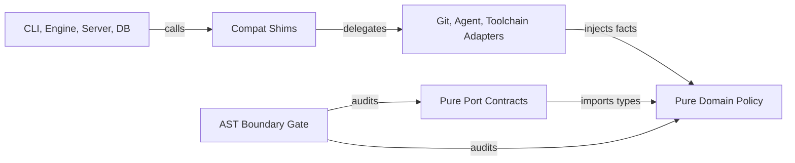

# 040 Pure Domain and Boundary Gates

Domain policy modules still spawn Git, read config files, and exit the process. Boundary tests in `src/architecture.test.ts` inspect only relative static imports and miss those effects. Feature `040-pure-domain-boundary-gates` isolates effects in adapters and checks package imports, dynamic imports, and ambient domain state. Blocked: none.

> **Feature Directory:** `specs/040-pure-domain-boundary-gates/`
> **Status:** Reviewed for planning · **Created:** 2026-11-11
> **Authoritative Source:** [`docs/architecture/assessments/2026-11-11-self-assessment/specs/01-pure-domain-and-boundary-gates/spec.md`](../../docs/architecture/assessments/2026-11-11-self-assessment/specs/01-pure-domain-and-boundary-gates/spec.md)
> **Reviewed Report:** [`docs/architecture/assessments/2026-11-11-self-assessment/report.md`](../../docs/architecture/assessments/2026-11-11-self-assessment/report.md)
> **Decisions:** [`ADR-004`](../../docs/decisions/ADR-004-agent-native-output.md) · [`ADR-005`](../../docs/decisions/ADR-005-tdd-gate-architecture.md) · [`ADR-008`](../../docs/decisions/ADR-008-command-safety-posture.md) · [`ADR-010`](../../docs/decisions/ADR-010-decision-records.md) · [`ADR-011`](../../docs/decisions/ADR-011-hexagonal-and-agent-port.md) · [`ADR-013`](../../docs/decisions/ADR-013-desired-architecture.md)

## 1. Overview

The self-assessment report records two open findings in this first migration slice. Domain effects (`F01`) remain inside three modules under `src/domain/`. Boundary coverage (`F02`) in `src/architecture.test.ts` checks only relative static import specifiers. It misses Node built-ins and external packages. It also misses dynamic `import()` calls and ambient `process` access.



### Current Call Sites and Impure Seams

| Module | Current effect | Live callers | Target module |
|---|---|---|---|
| `src/domain/project-id.ts` | `execFileSync("git")` via `node:child_process` | Commands and engines through the utility shim, plus `src/db/runs.ts` | `src/adapters/git/project-id.ts` |
| `src/domain/agent-config.ts` | `node:fs`, `node:os`, `process.cwd`, `process.exit` | `src/server/agent-registry.ts`, `src/utils/resolve-model.ts`, `src/utils/config.ts` | `src/adapters/agents/registry-loader.ts` |
| `src/domain/toolchain.ts` | `fs.existsSync` and `fs.readFileSync` in `getBuildCommand` | `src/utils/toolchain-mapper.ts`, `src/ports/toolchain-port.ts` | `src/adapters/toolchain/manifest-discovery.ts` |
| `src/architecture.test.ts` | Relative static import regex only | Vitest CI suite | `tests/helpers/architecture-boundary.ts` |

Caller inventory verified in the working tree:

| Symbol | Import path | Consumer count | Representative consumers |
|---|---|---|---|
| `resolveProjectId` | `src/utils/project-id.ts` | 22 modules | `commands/ship.ts`, `engine/router.ts`, `server/github.ts`, `utils/agent.ts` |
| `resolveProjectId` | `src/domain/project-id.ts` | 1 module | `src/db/runs.ts:11` (`ensureProjectRow` at `:61`) |
| `loadRegistry` | `src/server/agent-registry.ts` | 1 module plus 2 suites | `src/server/index.ts:24`, `src/server/agent-registry.test.ts` |
| `loadRegistry` | `src/domain/agent-config.ts` | 1 module plus 1 mock | `src/utils/resolve-model.ts:8`, `src/utils/resolve-model.test.ts:9` |
| `AgentBackendConfigSchema` | `src/domain/agent-config.ts` | 1 module | `src/utils/config.ts:9` |
| `ModelSelector` | `src/domain/agent-config.ts` | 2 modules | `src/server/model-selector.ts:5`, `src/utils/resolve-model.ts:7` |
| `getBuildCommand` | `src/utils/toolchain-mapper.ts` | 1 module plus 1 suite | `src/engine/ship-orchestrator.ts` (`:1137`, `:2714`), `toolchain-mapper.test.ts` |
| `getBuildCommand` | `src/domain/toolchain.ts` | 1 module | `src/ports/toolchain-port.ts:48` (`createToolchainAdapter`) |

One false-positive hazard exists in `src/application/ship/stage-diagnose.ts:60`. That line embeds literal `import { type PluginSummary } from '../plugins/loader.js'` inside a prompt string. An AST parser ignores string literals while catching real dynamic `import()` expressions.

### Governing Architecture Decisions

| Decision | Status | Binding rule for Feature 040 |
|---|---|---|
| `ADR-004` Agent-native CLI output | Decided | Preserve stderr text and exit code `1` on fail-fast config paths |
| `ADR-005` TDD gate architecture | Decided | Author executable gates against observed RED tests before implementation |
| `ADR-008` Command safety posture | Decided | Keep Git discovery non-interactive with ignored stdin |
| `ADR-010` Decision records | Decided | Keep `.gwrk/decisions/index.md` carrying `Decided` and `Proposed` rows |
| `ADR-011` Hexagonal architecture | Decided | Ban `node:fs`, `node:child_process`, `better-sqlite3`, and outward imports in `src/domain/` |
| `ADR-012` Plugin registry packs | Decided | Keep plugin adapter contracts untouched during registry loader extraction |
| `ADR-013` Desired architecture | Proposed | Inject external facts into pure policy while `Decided` ADRs retain authority |

### Delivery Shape and Phase Gates

| Phase | Scope | Measurable phase gate |
|---|---|---|
| Phase 1 | AST boundary analyzer, negative fixtures, pre-migration RED proof | `pnpm build && pnpm exec vitest run src/architecture.test.ts` |
| Phase 2 | Pure `project-id` domain policy and `adapters/git/project-id.ts` | `pnpm build && pnpm exec vitest run src/domain/project-id.test.ts src/utils/project-id.test.ts src/db/runs.test.ts src/architecture.test.ts` |
| Phase 3 | Pure `agent-config` validation and `adapters/agents/registry-loader.ts` | `pnpm build && pnpm exec vitest run src/domain/agent-config.test.ts src/server/agent-registry.test.ts src/server/agent-registry.integration.test.ts src/utils/resolve-model.test.ts src/utils/resolve-agent.test.ts src/architecture.test.ts` |
| Phase 4 | Pure `toolchain` policy, manifest adapter, zero-exemption gate, `F07` regression | `pnpm build && pnpm exec vitest run src/domain/toolchain.test.ts src/utils/toolchain-mapper.test.ts src/polyglot-canary.e2e.test.ts src/architecture.test.ts src/application/architecture/context.test.ts` |

### Out of Scope

- Proposal 02 owns physical port-adapter separation (`F03`) and SQLite or stdout state isolation (`F06`). Feature `040` keeps `createToolchainAdapter` exported from `src/ports/toolchain-port.ts` with optional pure callback injection.
- Proposal 03 owns routing consolidation (`F04`) and prompt transport seam tests (`F05`). Feature `040` preserves `src/server/agent-registry.ts` as a compatibility shim per `report.md`.
- Proposals 04 through 06 own profile design propagation (`F08`), workflow prompt layout (`F09`), readiness discovery (`F10`), and CI quarantine cleanup (`F11`).
- Closed finding `F07` (template mismatch) needs no code edits in `src/domain/architecture-context.ts`. Feature `040` retains its existing determinism regression test.

## 2. User Scenarios and Testing

### US-001 Boundary checks block impure imports [3 SP, P0, TS]

As a maintainer enforcing `ADR-011`, I run `src/architecture.test.ts` to catch disallowed packages and Node built-ins. The gate also catches dynamic `import()` calls, `require()` calls, and ambient `process` or wall-clock `Date` access in `src/domain/`.

Implements: `FR-001`, `FR-002`, and `FR-003`.

Independent Test: Run `tests/helpers/architecture-boundary.ts` against negative fixtures under `tests/fixtures/architecture-boundary/` and pre-migration `src/domain/` snapshots. Verify violations on impure code and zero findings on import syntax inside string literals.

Acceptance Scenarios:

1. Given snapshots of the three pre-migration domain files, when unexempted domain checks run before migration, then:
   - `pnpm exec vitest run src/architecture.test.ts -t "FR-003: flags pre-migration domain effect imports"` exits `0`
2. Given negative fixtures for prohibited built-ins, packages, dynamic imports, `require()`, and `process` calls, when the analyzer runs, then:
   - `pnpm exec vitest run src/architecture.test.ts -t "FR-001: detects static, package, dynamic, and ambient violations"` exits `0`
3. Given source text containing `import { x } from '../plugins/loader.js'` inside a string literal or comment, when analyzed, then:
   - `pnpm exec vitest run src/architecture.test.ts -t "FR-001: ignores import syntax inside string literals and comments"` exits `0`
4. Given all four phases completed, when the live repository boundary gate runs with zero exemptions, then:
   - `pnpm exec vitest run src/architecture.test.ts` exits `0`

### US-002 Pure project identity across directories [3 SP, P0, TS]

As a `gwrk` developer working across linked Git worktrees, I get stable MD5 project IDs from every `resolveProjectId` caller. `src/domain/project-id.ts` computes keys purely from injected facts without spawning `git`.

Implements: `FR-004`, `FR-005`, and `FR-006`.

Independent Test: Call `computeProjectId` in `src/domain/project-id.test.ts` with fixed `ProjectIdentityFacts` across two working directories via `process.chdir`. Run `src/utils/project-id.test.ts` against temporary Git repositories and linked worktrees.

Acceptance Scenarios:

1. Given identical `ProjectIdentityFacts` inputs, when `computeProjectId` executes from two different working directories, then:
   - `pnpm exec vitest run src/domain/project-id.test.ts -t "FR-004"` exits `0`
2. Given linked Git worktrees and distinct remotes on disk, when callers invoke `resolveProjectId` through `src/utils/project-id.ts`, then:
   - `pnpm exec vitest run src/utils/project-id.test.ts` exits `0`
3. Given SQLite run attribution in `src/db/runs.ts`, when `startRun` resolves default project IDs via `src/adapters/git/project-id.ts`, then:
   - `pnpm exec vitest run src/db/runs.test.ts` exits `0`

### US-003 Pure agent registry validation [3 SP, P0, TS]

As an engineer testing agent configuration, I validate layered registry JSON in `src/domain/agent-config.ts` through explicit result values without touching disk. Existing `loadRegistry` callers keep fail-fast stderr output and exit code `1`.

Implements: `FR-007`, `FR-008`, and `FR-009`.

Independent Test: Pass raw JSON layer strings into `validateAgentRegistry` in `src/domain/agent-config.test.ts` across two working directories. Run the existing server registry and model resolution test suites without changes to caller behavior.

Acceptance Scenarios:

1. Given raw project, local, and global JSON inputs, when `validateAgentRegistry` runs across two working directories, then:
   - `pnpm exec vitest run src/domain/agent-config.test.ts -t "FR-007"` exits `0`
2. Given layered config files on disk or mocked via `node:fs`, when `loadRegistry` and `tryLoadRegistry` execute, then:
   - `pnpm exec vitest run src/server/agent-registry.test.ts src/server/agent-registry.integration.test.ts` exits `0`
3. Given model lookup in `resolveModelForTask` and `resolveAgent`, when configs include or omit `agents.registry`, then:
   - `pnpm exec vitest run src/utils/resolve-model.test.ts src/utils/resolve-agent.test.ts` exits `0`

### US-004 Pure toolchain build policy [3 SP, P0, TS]

As a polyglot gate runner, I resolve build commands in `src/domain/toolchain.ts` purely from `ProjectProfile` and `ToolchainManifestFacts`. `src/adapters/toolchain/manifest-discovery.ts` inspects disk manifests and preserves every `getBuildCommand(profile, cwd)` caller.

Implements: `FR-010` and `FR-011`.

Independent Test: Pass `ToolchainManifestFacts` permutations into `resolveBuildCommand` in `src/domain/toolchain.test.ts` across two working directories. Run `src/utils/toolchain-mapper.test.ts` and `src/polyglot-canary.e2e.test.ts` to verify caller compatibility.

Acceptance Scenarios:

1. Given `ProjectProfile` and `ToolchainManifestFacts` combinations, when `resolveBuildCommand` runs from two different working directories, then:
   - `pnpm exec vitest run src/domain/toolchain.test.ts -t "FR-010"` exits `0`
2. Given temporary directories with Node, Rust, or Go manifests, when `getBuildCommand(profile, cwd)` runs through `src/utils/toolchain-mapper.ts`, then:
   - `pnpm exec vitest run src/utils/toolchain-mapper.test.ts` exits `0`
3. Given TypeScript, Python, Go, and Rust project fixtures, when the polyglot canary suite runs, then:
   - `pnpm exec vitest run src/polyglot-canary.e2e.test.ts` exits `0`

### US-005 Context determinism regression retained [1 SP, P1, TS]

As the project owner, I retain the passing architecture context determinism suite for closed finding `F07` without editing `src/domain/architecture-context.ts`.

Implements: `FR-012`.

Independent Test: Run `src/application/architecture/context.test.ts` and confirm `src/domain/architecture-context.ts` passes the Phase 4 zero-exemption domain gate.

Acceptance Scenarios:

1. Given the checked-out `src/domain/architecture-context.ts` and `src/application/architecture/context.test.ts`, when the context suite runs, then:
   - `pnpm exec vitest run src/application/architecture/context.test.ts` exits `0`

## 3. Functional Requirements

### FR-001 AST boundary and ambient effect analyzer

`tests/helpers/architecture-boundary.ts` MUST parse TypeScript source with `ts.createSourceFile` from `typescript`. It MUST inspect:

1. Static `import` statements, side-effect `import` declarations, `export ... from` statements, and `import x = require(...)` declarations.
2. Dynamic `import(arg)` calls and CommonJS `require(arg)` or `createRequire` calls. Non-string-literal dynamic import arguments MUST fail in `src/domain/`, `src/ports/`, and `src/application/`.
3. Ambient global expressions in `src/domain/`: `process.<member>` access, `Date.now()` calls, and zero-argument `new Date()` calls.

String literals, template literals, and comments MUST NOT trigger import findings. Fulfills `US-001`.

| Condition | Result or stderr | Exit code | Layer |
|---|---|---|---|
| Disallowed import or effect in checked layer | Vitest reports `<relFile> -> <violation>` | `1` | Test gate |
| Non-literal `import(expr)` in pure layer | Vitest reports `<relFile> -> dynamic-import:<non-literal>` | `1` | Test gate |
| Import syntax inside string literal or comment | Zero violations reported | `0` | Test gate |

### FR-002 Layer import allowlists and effect bans

`src/architecture.test.ts` MUST enforce these rules across all non-test `.ts` files:

| Layer directory | Permitted relative targets | Non-relative and dynamic import rules |
|---|---|---|
| `src/domain/` | `src/domain/` only | Allow only `zod`, `node:crypto`, `crypto`, `node:path`, `path`, `node:path/posix`, `path/posix`. Ban dynamic `import()`, `require()`, `process.*`, and wall-clock `Date` |
| `src/ports/` | `src/domain/` and `src/ports/` | Ban `node:fs*`, `fs*`, `node:child_process`, `child_process`, `node:os`, `os`, `node:net`, `net`, `node:http*`, `http*`, `node:tls`, `tls`, `node:dns`, `dns`, `better-sqlite3`, `fastify`, `@slack/*`, `dockerode`, `commander` |
| `src/application/` | `src/domain/`, `src/ports/`, `src/application/` | Same built-in and infrastructure package ban as `src/ports/` |
| `src/db/` | `src/db/`, `src/domain/`, `src/ports/`, `src/adapters/` | Forbid `engine`, `utils`, `plugins`, `server`, and `commands` across static and dynamic imports |
| `src/utils/` and `src/engine/` | Any except `src/server/` | Forbid static and dynamic imports resolving to `src/server/` |

Fulfills `US-001`.

### FR-003 Pre-migration RED proof and negative fixtures

`tests/fixtures/architecture-boundary/` and `src/architecture.test.ts` MUST test negative fixtures covering:

1. Pre-migration domain effects (`node:child_process`, `node:fs`, `node:os`, `process.cwd()`, and `process.exit(1)`).
2. Disallowed bare packages (`better-sqlite3` and `fastify`) inside `domain`, `ports`, and `application`.
3. Dynamic `await import("node:fs/promises")`, cross-layer `await import("../adapters/git/index.js")`, computed `await import(target)`, and `require("node:fs")`.

Phase 1 MUST assert the three-file pre-migration violation set on `src/domain/`. Phases 2 and 3 MUST shrink that set after each migration. Phase 4 MUST delete the transitional allowlist and enforce zero exemptions. Fulfills `US-001`.

### FR-004 Pure project identity policy

`src/domain/project-id.ts` MUST import only `node:crypto` and `node:path`. It MUST export these pure contracts:

```ts
export interface ProjectIdentityFacts {
  projectRoot: string;
  remoteOriginUrl?: string | null;
  gitCommonDir?: string | null;
}

export function normalizeGitRemoteSlug(remoteOriginUrl: string): string | null;
export function computeProjectKey(facts: ProjectIdentityFacts): string;
export function computeProjectId(facts: ProjectIdentityFacts): string;
```

`normalizeGitRemoteSlug` trims input, strips trailing `.git`, and lowercases `host/owner/repo` for SCP and URL remotes. `computeProjectKey` returns `remote:<slug>`, else `local:<path.dirname(gitCommonDir)>`, else `path:<projectRoot>`. `computeProjectId` returns the 32-character lowercase MD5 hex digest of `computeProjectKey(facts)`. Equal inputs MUST produce equal outputs regardless of `process.cwd()`. Fulfills `US-002`.

### FR-005 Git identity discovery adapter

`src/adapters/git/project-id.ts` (re-exported by `src/adapters/git/index.ts`) MUST export `discoverGitIdentityFacts(projectRoot)` and `resolveProjectId(projectRoot)`. `discoverGitIdentityFacts` runs `git config --get remote.origin.url` with `stdio: ["ignore", "pipe", "ignore"]`. When no remote exists, it runs `git rev-parse --path-format=absolute --git-common-dir`. Failed Git commands MUST return `null` fields without throwing. `resolveProjectId` composes `discoverGitIdentityFacts` with `computeProjectId`. Fulfills `US-002`.

| Condition | Result or stderr | Exit code | Layer |
|---|---|---|---|
| Non-Git directory or unavailable `git` binary | Falls back to `path:<projectRoot>` MD5 hash silently | `0` | `adapters/git` |
| Linked worktree without `remote.origin.url` | Hashes `local:<mainWorktree>` matching main checkout | `0` | `adapters/git` |

### FR-006 Project identity caller preservation

`src/utils/project-id.ts` MUST re-export `resolveProjectId` and `discoverGitIdentityFacts` from `../adapters/git/project-id.js` plus pure exports from `../domain/project-id.js`. `src/db/runs.ts` MUST import `resolveProjectId` from `../adapters/git/project-id.js`. All existing `../utils/project-id.js` callers and test mocks MUST keep identical behavior. Fulfills `US-002`.

### FR-007 Pure agent registry validation and merge policy

`src/domain/agent-config.ts` MUST NOT import `node:fs`, `node:os`, or `node:path`. It MUST NOT reference `process.cwd()` or `process.exit()`. Alongside `deepMerge`, Zod schemas, and `ModelSelector`, it MUST export:

```ts
export interface RegistryConfigLayers {
  projectConfigRaw: string | null;
  configPath?: string;
  localConfigRaw?: string | null;
  globalConfigRaw?: string | null;
}

export type RegistryValidationErrorCode =
  | "MISSING_CONFIG_FILE"
  | "INVALID_CONFIG_JSON"
  | "MISSING_REGISTRY_CONFIG"
  | "INVALID_REGISTRY_SCHEMA";

export interface RegistryValidationError {
  code: RegistryValidationErrorCode;
  message: string;
}

export type RegistryValidationResult =
  | { ok: true; value: AgentRegistry }
  | { ok: false; error: RegistryValidationError };

export function validateAgentRegistry(
  layers: RegistryConfigLayers,
): RegistryValidationResult;
```

`validateAgentRegistry` parses `projectConfigRaw`, then merges valid plain-object JSON from `localConfigRaw` and `globalConfigRaw` in order. Malformed optional local or global JSON MUST be ignored non-fatally. It injects each backend key as `name` and validates through `AgentRegistrySchema.safeParse`. Fulfills `US-003`.

| Condition | Result or stderr | Exit code | Layer |
|---|---|---|---|
| `projectConfigRaw === null` | `MISSING_CONFIG_FILE` with `Missing required config: agents.registry (file .gwrkrc.json not found at <configPath>)` | `1` via `loadRegistry` | `domain` and `adapters/agents` |
| Invalid JSON in `projectConfigRaw` | `INVALID_CONFIG_JSON` with `Configuration error: invalid JSON in .gwrkrc.json` | `1` via `loadRegistry` | `domain` and `adapters/agents` |
| Malformed `localConfigRaw` or `globalConfigRaw` | Ignored non-fatally while base config stands | `0` | `domain` |
| Missing `agents.registry` or `fallbackOrder` | `MISSING_REGISTRY_CONFIG` with `Missing required config: agents.registry or agents.fallbackOrder` | `1` via `loadRegistry` | `domain` and `adapters/agents` |
| Backend entry fails `AgentRegistrySchema` | `INVALID_REGISTRY_SCHEMA` with `Invalid agent registry entry: <zodMessage>` | `1` via `loadRegistry` | `domain` and `adapters/agents` |

### FR-008 Agent registry filesystem loader adapter

`src/adapters/agents/registry-loader.ts` (re-exported by `src/adapters/agents/index.ts`) MUST implement:

- `readRegistryConfigLayers(projectRoot?, homeDir?)`: reads `.gwrkrc.json` and `.gwrkrc.local.json` under `projectRoot` plus `.gwrk/config.json` under `homeDir`.
- `tryLoadRegistry(projectRoot?, homeDir?)`: returns `validateAgentRegistry(readRegistryConfigLayers(projectRoot, homeDir))` without exiting the process.
- `loadRegistry(projectRoot = process.cwd())`: runs `tryLoadRegistry(projectRoot)`. On `{ ok: false }`, it logs `result.error.message` via `console.error`, calls `process.exit(1)`, and returns `{} as AgentRegistry` for mocked-exit tests.

Fulfills `US-003`.

### FR-009 Agent registry caller preservation

`src/server/agent-registry.ts` MUST re-export `src/domain/agent-config.ts` plus `loadRegistry`, `tryLoadRegistry`, and `readRegistryConfigLayers` from `../adapters/agents/registry-loader.js`. `src/utils/resolve-model.ts` and `src/utils/resolve-model.test.ts` MUST import `loadRegistry` from `../adapters/agents/registry-loader.js` while keeping `ModelSelector` from `../domain/agent-config.js`. Fulfills `US-003`.

### FR-010 Pure toolchain build command policy

`src/domain/toolchain.ts` MUST NOT import `node:fs` or `node:path`. Alongside `TEST_INVOCATION_VERBS`, `getTestCommand`, `getLintCommand`, `getTestExtension`, and `getSourceExtension`, it MUST export:

```ts
export interface ToolchainManifestFacts {
  hasPackageJson: boolean;
  hasPackageBuildScript: boolean;
  hasPnpmLock: boolean;
  hasYarnLock: boolean;
  hasCargoToml: boolean;
  hasGoMod: boolean;
}

export const EMPTY_TOOLCHAIN_MANIFEST_FACTS: Readonly<ToolchainManifestFacts>;

export function resolveBuildCommand(
  profile: ProjectProfile,
  facts?: ToolchainManifestFacts,
): string | null;
```

`resolveBuildCommand` applies five ordered rules:

1. Explicit `profile.toolchain.build === null` returns `null`, and a non-empty string returns that string.
2. When `facts.hasPackageJson` is `true` and `hasPackageBuildScript` is `true`, lockfiles pick `"pnpm build"`, `"yarn build"`, or `"npm run build"`.
3. When `facts.hasPackageJson` is `true` and `hasPackageBuildScript` is `false`, return `null` without falling through to Rust or Go.
4. When `facts.hasCargoToml` is `true`, return `"cargo build"`.
5. When `facts.hasGoMod` is `true`, return `"go build ./..."`, and otherwise return `null`.

Equal inputs MUST produce equal outputs regardless of `process.cwd()`. Fulfills `US-004`.

### FR-011 Toolchain manifest discovery adapter and port wiring

`src/adapters/toolchain/manifest-discovery.ts` (re-exported by `src/adapters/toolchain/index.ts`) MUST export `discoverToolchainManifests(cwd)` and `getBuildCommand(profile, cwd)`. `discoverToolchainManifests` inspects `package.json`, `pnpm-lock.yaml`, `yarn.lock`, `Cargo.toml`, and `go.mod` in `cwd`. `getBuildCommand` short-circuits explicit `profile.toolchain.build` overrides without touching disk, and otherwise calls `resolveBuildCommand(profile, discoverToolchainManifests(cwd))`.

`src/utils/toolchain-mapper.ts` MUST re-export pure symbols from `../domain/toolchain.js` plus `getBuildCommand` and `discoverToolchainManifests` from `../adapters/toolchain/manifest-discovery.js`. `createToolchainAdapter` in `src/ports/toolchain-port.ts` MUST accept optional `readManifests?: (cwd: string) => ToolchainManifestFacts` defaulting to `() => EMPTY_TOOLCHAIN_MANIFEST_FACTS`. `src/adapters/toolchain/index.ts` MUST bind `discoverToolchainManifests` as the default `readManifests` callback. Fulfills `US-004`.

| Condition | Result or stderr | Exit code | Layer |
|---|---|---|---|
| Malformed `package.json` in `cwd` | Reports `hasPackageJson: true` and `hasPackageBuildScript: false` (`null` command) | `0` | `adapters/toolchain` |
| Explicit `toolchain.build` with nonexistent `cwd` | Returns configured build command without disk reads | `0` | `adapters/toolchain` |

### FR-012 Architecture context determinism regression retention

`src/application/architecture/context.test.ts` MUST remain green without modifying `src/domain/architecture-context.ts` for closed finding `F07`. `src/domain/architecture-context.ts` MUST pass the zero-exemption domain gate in Phase 4. Fulfills `US-005`.

## 4. Technical Constraints

- `TC-001` Air-Gapped: Zero runtime network calls, CDN fetches, or external telemetry.
- `TC-002` Fail-Fast Config: `loadRegistry` preserves exact stderr text and `process.exit(1)` behavior (`ADR-004`).
- `TC-003` TypeScript Only: ESM TypeScript targeting `ES2022` with the three-line MPL-2.0 header on new `.ts` files.
- `TC-004` Dev-Only Compiler Isolation: Keep `typescript` AST helpers in `tests/helpers/` so `pnpm build` omits compiler imports from `dist/`.
- `TC-005` Working-Directory Invariance: Domain tests MUST switch `process.chdir` across two temp directories and assert identical results, restoring `cwd` in `afterEach`.
- `TC-006` Proposal Scope Discipline: Retain `src/server/agent-registry.ts` for Proposal 03 and `createToolchainAdapter` in `src/ports/toolchain-port.ts` for Proposal 02.
- `TC-007` Observed RED First: Observe failing boundary and unit tests before writing production implementation (`ADR-005` and `ADR-013` §2.5).
- `TC-008` Bare-Clone Operability: Domain policy and file discovery adapters MUST NOT import `better-sqlite3` or server modules.
- `TC-009` Non-Interactive Git Safety: `discoverGitIdentityFacts` MUST pass `stdio: ["ignore", "pipe", "ignore"]` to `execFileSync` (`ADR-008`).

## 5. Testing Requirements

| Test ID | Target suite | Assertions required | Covered FRs |
|---|---|---|---|
| `TR-001` | `src/architecture.test.ts` and `tests/helpers/architecture-boundary.ts` | Static, package, dynamic, `require()`, and `process`/`Date` checks plus negative fixtures and string-literal positive control | `FR-001`, `FR-002`, `FR-003` |
| `TR-002` | `src/domain/project-id.test.ts` | Pure SSH/HTTPS slug normalization, worktree key fallback, MD5 determinism, and `process.chdir` invariance | `FR-004` |
| `TR-003` | `src/utils/project-id.test.ts` and `src/db/runs.test.ts` | Real Git worktree identity parity, distinct remote hashes, non-Git fallback, and SQLite run project attribution | `FR-005`, `FR-006` |
| `TR-004` | `src/domain/agent-config.test.ts` | `validateAgentRegistry` error codes and messages, non-fatal optional JSON errors, three-layer merge order, and `process.chdir` invariance | `FR-007` |
| `TR-005` | `src/server/agent-registry.test.ts`, `agent-registry.integration.test.ts`, `resolve-model.test.ts`, `resolve-agent.test.ts` | `readRegistryConfigLayers`, `tryLoadRegistry`, `loadRegistry` `process.exit(1)` contract, shim exports, and tier routing | `FR-008`, `FR-009` |
| `TR-006` | `src/domain/toolchain.test.ts` | `resolveBuildCommand` override priority, lockfile priority, Node non-fallthrough over Rust/Go, and `process.chdir` invariance | `FR-010` |
| `TR-007` | `src/utils/toolchain-mapper.test.ts` and `src/polyglot-canary.e2e.test.ts` | `discoverToolchainManifests` disk reads, malformed `package.json`, nonexistent-dir override short-circuit, and adapter binding | `FR-011` |
| `TR-008` | `src/application/architecture/context.test.ts` | Retained deterministic context installation and human-edit preservation for closed finding `F07` | `FR-012` |
| `TR-009` | `DEFERRED`: `src/cli.ux.test.ts`, `cli.option-collisions.test.ts`, `cli.consistency.test.ts` | Deferred because Feature `040` introduces zero CLI commands, subcommands, or flags | None |

## 6. Coverage Matrix

### Story to Requirement Mapping

| Story | Priority and SP | Backed by FR | Phase |
|---|---|---|---|
| `US-001` | P0, 3 SP | `FR-001`, `FR-002`, `FR-003` | Phases 1 and 4 |
| `US-002` | P0, 3 SP | `FR-004`, `FR-005`, `FR-006` | Phase 2 |
| `US-003` | P0, 3 SP | `FR-007`, `FR-008`, `FR-009` | Phase 3 |
| `US-004` | P0, 3 SP | `FR-010`, `FR-011` | Phase 4 |
| `US-005` | P1, 1 SP | `FR-012` | Phase 4 |

### Requirement to Test Mapping

| FR | Fulfills US | Tested by TR | Phase |
|---|---|---|---|
| `FR-001` | `US-001` | `TR-001` | Phase 1 |
| `FR-002` | `US-001` | `TR-001` | Phases 1 and 4 |
| `FR-003` | `US-001` | `TR-001` | Phases 1 through 4 |
| `FR-004` | `US-002` | `TR-002` | Phase 2 |
| `FR-005` | `US-002` | `TR-003` | Phase 2 |
| `FR-006` | `US-002` | `TR-003` | Phase 2 |
| `FR-007` | `US-003` | `TR-004` | Phase 3 |
| `FR-008` | `US-003` | `TR-005` | Phase 3 |
| `FR-009` | `US-003` | `TR-005` | Phase 3 |
| `FR-010` | `US-004` | `TR-006` | Phase 4 |
| `FR-011` | `US-004` | `TR-007` | Phase 4 |
| `FR-012` | `US-005` | `TR-008` | Phase 4 |

## 7. Cross-References and Compatibility

| Artifact | Relationship | Compatibility status |
|---|---|---|
| `021-polyglot-toolchain` | Defined `getBuildCommand(profile, cwd)` and Node non-fallthrough rule | Preserved via `resolveBuildCommand` and `toolchain-mapper.ts` |
| `031-unified-agent-port` | Established `AgentPort` and `src/plugins/agent-registry.ts` | Compatible with `server/agent-registry.ts` shim retained |
| `032-polyglot-toolchain` | Introduced `ToolchainPort` and `createToolchainAdapter` | Compatible via optional `readManifests` parameter |
| `034-hexagonal-architecture` | Created four-layer directories and `src/architecture.test.ts` | Extended to close `F01` and `F02` |
| `039-architecture-context` | Added `src/domain/architecture-context.ts` and `context.test.ts` | Retained unchanged per `FR-012` |
| Assessment Proposals `02` to `06` | Downstream architecture migration proposals | Zero overlap with `F03` through `F11` |

## 8. Open Questions

None. Every requirement in `01-pure-domain-and-boundary-gates/spec.md` maps to verified call sites and executable Vitest gates.
