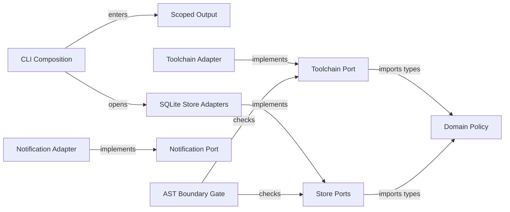

# Port and adapter separation plan

Separate port contracts from adapter construction across the toolchain and notification boundaries. Inject database handles and scoped CLI output sinks at composition while preserving existing contracts. Blocked: none for planning.

## Target boundary structure



## Contract mapping

| Contract group | Symbols | Phase | Contract file |
|---|---|---|---|
| Toolchain boundary | `ToolchainPort` and `createToolchainAdapter` | Phase 1 | `contracts/ports-and-adapters.md` |
| Port purity and notifications | `NotificationPort`, `dispatchNotification` and `notifyHarvestComplete` | Phase 2 | `contracts/ports-and-adapters.md` |
| SQLite store adapters | `openDatabase`, `createSqlitePlanStoreAdapter` and `createSqliteRunStoreAdapter` | Phase 3 | `contracts/ports-and-adapters.md` |
| Scoped CLI output | `runWithOutputScope`, `createCliProgram` and `runCli` | Phase 4 | `contracts/ports-and-adapters.md` |

### Phase 1: Toolchain port separation

#### Files

- `src/ports/toolchain-port.ts` (MODIFY: Retain only the `ToolchainPort` interface)
- `src/adapters/toolchain/index.ts` (MODIFY: Build `ToolchainPort` from domain policy and manifest discovery)
- `src/commands/ship.ts` (MODIFY: Import polyglot file predicates from `src/domain/test-rules.js`)
- `src/commands/tasks-generate.ts` (MODIFY: Import `isPolyglotTestFile` from `src/domain/test-rules.js`)
- `src/commands/test.ts` (MODIFY: Import polyglot file predicates from `src/domain/test-rules.js`)
- `src/commands/tests-generate.ts` (MODIFY: Import `isPolyglotTestFile` from `src/domain/test-rules.js`)
- `src/engine/define-orchestrator.ts` (MODIFY: Import `isPolyglotTestFile` from `src/domain/test-rules.js`)
- `src/utils/gate-gen.ts` (MODIFY: Import polyglot test helpers from `src/domain/test-rules.js`)
- `src/utils/test-discovery.ts` (MODIFY: Import polyglot test helpers from `src/domain/test-rules.js`)
- `src/utils/toolchain-mapper.test.ts` (MODIFY: Verify `createToolchainAdapter` ownership and pure `toolchain-port` exports)

#### Governance and skills

- Architecture rules: `.gwrk/architecture.md` and `docs/decisions/ADR-013-desired-architecture.md`
- Decisions: `docs/decisions/ADR-005-tdd-gate-architecture.md` and `docs/decisions/ADR-011-hexagonal-and-agent-port.md`
- Skills: `compile-gate`
- Delivers: `FR-001` (`AC-001` and `AC-004` for `F03`)

#### Test Strategy

| ID | Type | Target | Assertion |
|---|---|---|---|
| TR-001 | unit | `src/utils/toolchain-mapper.test.ts` | Adapter implements `ToolchainPort` without factory export on the port |
| TR-002 | unit | `src/utils/test-discovery.test.ts` | Polyglot test discovery resolves candidates from domain rules |
| TR-003 | unit | `src/utils/gate-gen.test.ts` | Gate generation preserves polyglot file classification |
| TR-004 | integration | `src/commands/test-cmd.test.ts` | Scoped test command preserves CLI behavior |

#### Done When

```bash
pnpm build
pnpm exec vitest run src/utils/toolchain-mapper.test.ts src/utils/test-discovery.test.ts src/utils/gate-gen.test.ts src/commands/test-cmd.test.ts src/cli.test.ts src/db/db.test.ts
```

### Phase 2: Port gate and explicit adapters

#### Files

- `tests/helpers/architecture-boundary.ts` (MODIFY: Require type-only domain imports in ports and reject legacy adapter re-exports)
- `src/architecture.test.ts` (MODIFY: Check port import purity and explicit adapter barrels)
- `src/ports/notification-port.ts` (MODIFY: Retain only `NotificationPayload` and `NotificationPort`)
- `src/adapters/notifications/index.ts` (MODIFY: Own the Slack default and harvest notification helpers)
- `src/adapters/agents/index.ts` (DELETE: Remove unused backend re-exports)
- `src/adapters/cli/index.ts` (DELETE: Remove unused command re-exports)
- `src/adapters/server/index.ts` (DELETE: Remove unused server re-exports)
- `src/adapters/index.ts` (DELETE: Remove unused aggregate barrel)
- `src/adapters/sqlite/index.ts` (MODIFY: Remove the unused PlanStore re-export)
- `src/server/slack-notify.ts` (MODIFY: Keep transport and move adapter construction to the notification adapter)
- `src/engine/issues.ts` (MODIFY: Route issue notifications through `dispatchNotification` in `src/adapters/notifications/index.js`)
- `src/engine/harvest.ts` (MODIFY: Route completion notifications through `notifyHarvestComplete` in `src/adapters/notifications/index.js`)

#### Governance and skills

- Architecture rules: `.gwrk/architecture.md` and `docs/decisions/ADR-005-tdd-gate-architecture.md`
- Decisions: `docs/decisions/ADR-011-hexagonal-and-agent-port.md` and `docs/decisions/ADR-012-plugin-registry-and-framework-packs.md`
- Skills: `compile-gate`
- Delivers: `FR-002` (`AC-001` and `AC-004` for `F03`)

#### Test Strategy

| ID | Type | Target | Assertion |
|---|---|---|---|
| TR-005 | unit | `src/architecture.test.ts` | Ports import only domain types and port contracts |
| TR-006 | unit | `src/architecture.test.ts` | Adapter packages reject direct legacy module re-exports |
| TR-007 | unit | `src/engine/issues.test.ts` | Issue notifications dispatch through the notification adapter |
| TR-008 | unit | `src/engine/harvest.test.ts` | Harvest completion notifications dispatch through the notification adapter |

#### Done When

```bash
pnpm build
pnpm exec vitest run src/architecture.test.ts src/engine/issues.test.ts src/engine/harvest.test.ts src/cli.test.ts src/db/db.test.ts
```

### Phase 3: Isolated SQLite store adapters

#### Files

- `src/db/index.ts` (MODIFY: Add `openDatabase` factory accepting database path and migration options)
- `src/ports/store-port.ts` (MODIFY: Add `close` lifecycle methods to `PlanStorePort` and `RunStorePort`)
- `src/adapters/sqlite/index.ts` (MODIFY: Implement `createSqlitePlanStoreAdapter` and `createSqliteRunStoreAdapter` with instance handles)
- `src/commands/plan.ts` (MODIFY: Write rendered plans through the SQLite plan adapter)
- `src/engine/harvest.ts` (MODIFY: Write compression records through the SQLite run adapter)
- `src/engine/plan-store.ts` (MODIFY: Accept optional `Database.Database` handle and preserve instance connection state)
- `src/adapters/sqlite/store-isolation.test.ts` (NEW: Open two file-backed stores in one process and verify isolated writes)
- `src/db/db.test.ts` (MODIFY: Verify `openDatabase` isolation alongside existing execution ledger cases)
- `src/db/compression.test.ts` (MODIFY: Verify `createSqliteRunStoreAdapter` writes only to its configured connection)
- `src/engine/plan-store-scoping.test.ts` (MODIFY: Verify `PlanStore` forwards injected handles without breaking default calls)

#### Governance and skills

- Architecture rules: `.gwrk/architecture.md` and `docs/decisions/ADR-011-hexagonal-and-agent-port.md`
- Decisions: `docs/decisions/ADR-002-sqlite-execution-ledger.md` and `docs/decisions/ADR-003-state-contract.md`
- Skills: `compile-gate`
- Delivers: `FR-002` and `FR-003` (`AC-002` and `AC-004` for `F06`)

#### Test Strategy

| ID | Type | Target | Assertion |
|---|---|---|---|
| TR-009 | integration | `src/adapters/sqlite/store-isolation.test.ts` | Two stores on separate paths in one process keep writes isolated |
| TR-010 | unit | `src/db/db.test.ts` | Existing SQLite execution ledger contracts pass |
| TR-011 | unit | `src/db/compression.test.ts` | Run store adapter records compression only in its bound database |
| TR-012 | unit | `src/engine/plan-store-scoping.test.ts` | `PlanStore` preserves project scoping and optional handle injection |

#### Done When

```bash
pnpm build
pnpm exec vitest run src/adapters/sqlite/store-isolation.test.ts src/db/db.test.ts src/db/compression.test.ts src/db/plan.test.ts src/db/scoping.test.ts src/engine/plan-store.test.ts src/engine/plan-store-scoping.test.ts src/architecture.test.ts
```

### Phase 4: Scoped CLI output handling

#### Files

- `src/adapters/cli/output-scope.ts` (NEW: Provide `AsyncLocalStorage` output scope and agent-mode transforms)
- `src/adapters/cli/output-scope.test.ts` (NEW: Run agent-mode and normal commands in one process and verify output isolation)
- `src/cli.ts` (MODIFY: Replace global `process.stdout.write` mutation with per-command output scope)
- `src/utils/output.ts` (MODIFY: Route `CommandOutput` writes through the active CLI output scope)
- `src/utils/format.ts` (MODIFY: Route formatted banners and status output through the active CLI output scope)
- `src/utils/signal.ts` (MODIFY: Emit `[exit:N | Xs]` on scoped stderr while preserving exit codes)
- `src/commands/project-discover.ts` (MODIFY: Write discovery text and JSON through scoped output)
- `src/commands/skill.ts` (MODIFY: Write skill stdout through scoped output)
- `src/utils/output.test.ts` (MODIFY: Verify `CommandOutput` text, JSON and scoped sink behavior)

#### Governance and skills

- Architecture rules: `docs/decisions/ADR-004-agent-native-output.md` and `docs/decisions/ADR-008-command-safety-posture.md`
- Decisions: `docs/decisions/ADR-011-hexagonal-and-agent-port.md`
- Skills: `compile-gate`
- Delivers: `FR-004` (`AC-003` and `AC-004` for `F06`)

#### Test Strategy

| ID | Type | Target | Assertion |
|---|---|---|---|
| TR-013 | integration | `src/adapters/cli/output-scope.test.ts` | Real agent and normal invocations preserve output contracts and isolate streams when they overlap |
| TR-014 | unit | `src/utils/output.test.ts` | Text and JSON `CommandOutput` contracts pass |
| TR-015 | unit | `src/utils/signal.test.ts` | Operational `[exit:N \| Xs]` stderr signal contract passes |
| TR-016 | integration | `src/commands/skill.test.ts` | CLI `--agent` and `--format json` options pass without global mutation |
| TR-017 | integration | `src/cli.ux.test.ts` | Each command tree retains help for registered subcommands |
| TR-018 | integration | `src/commands/gate.test.ts` | Each new command tree registers the gate command |

#### Done When

```bash
pnpm build
pnpm exec vitest run src/adapters/cli/output-scope.test.ts src/utils/output.test.ts src/utils/signal.test.ts src/utils/agent-layer.test.ts src/commands/skill.test.ts src/cli.test.ts src/cli.consistency.test.ts src/cli.option-collisions.test.ts src/cli.ux.test.ts src/commands/gate.test.ts src/architecture.test.ts
```

## Coverage matrix

| Item | Description | Phase | Verification |
|---|---|---|---|
| F03 | Physical layering between ports and adapters | Phase 1 and Phase 2 | `TR-001` through `TR-008` |
| F06 | Isolated SQLite store handles and scoped CLI stdout | Phase 3 and Phase 4 | `TR-009` through `TR-016` |
| FR-001 | Move `createToolchainAdapter` into `src/adapters/toolchain/` | Phase 1 | `TR-001` through `TR-004` |
| FR-002 | Replace legacy adapter re-exports with explicit implementations | Phase 2 and Phase 3 | `TR-006` through `TR-009` |
| FR-003 | Pass database handles and config into store instances | Phase 3 | `TR-009` through `TR-012` |
| FR-004 | Replace global stdout mutation with scoped output handling | Phase 4 | `TR-013` through `TR-016` |
| AC-001 | Ports import only domain types and port contracts | Phase 1 and Phase 2 | `TR-001` and `TR-005` |
| AC-002 | Two stores on separate paths keep writes isolated | Phase 3 | `TR-009` and `TR-011` |
| AC-003 | Agent and normal commands in one process isolate stdout | Phase 4 | `TR-013` and `TR-016` |
| AC-004 | Existing CLI and persistence contract tests pass after each move | Phase 1 through Phase 4 | `TR-004`, `TR-010`, `TR-014` and `TR-015` |

## Sister spec dependencies

- Upstream prerequisite: `040-pure-domain-boundary-gates` supplies the AST boundary analyzer in `tests/helpers/architecture-boundary.ts` and pure domain modules in `src/domain/`. Implementation remains blocked until `040-pure-domain-boundary-gates` passes review.
- Downstream consumer: `src/server/agent-registry.ts` remains a compatibility shim per `docs/architecture/assessments/2026-11-11-self-assessment/report.md` until unified routing migrates its callers.
- Preserved contracts: `specs/013-agent-native-interface/contracts/output.md`, `specs/013-agent-native-interface/contracts/signal.md` and `specs/018-build-plan-orchestrator/contracts/plan.md` remain unchanged.

## Deferred items

None. Full coverage of `specs/042-port-adapter-separation/spec.md`.
