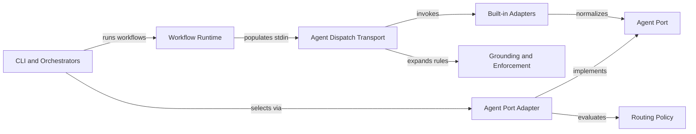

# Unified routing and prompt delivery plan

Consolidate backend and model selection behind `AgentPort`. Route workflow execution through `WorkflowRuntime` with complete stdin payload expansion before dispatch. Normalize terminal envelopes across built-in adapters so recorded responses recover offline and failed runs never produce reports. Blocked: none for planning.

## Target dispatch architecture



## Contract mapping

| Contract group | Symbols | Phase | Contract file |
|---|---|---|---|
| Unified routing policy | `selectAgentRoute` and `createAgentPortAdapter` | Phase 1 | `contracts/routing-and-dispatch.md` |
| Routing caller migration | `AgentPort`, `BackendSelector` and `loadRegistry` | Phase 2 and Phase 3 | `contracts/routing-and-dispatch.md` |
| Workflow payload transport | `WorkflowExecutionOptions` and `WorkflowExecutionResult` | Phase 4 | `contracts/routing-and-dispatch.md` |
| Stream envelope parity | `UnwrappedStreamResult` and `unwrapStreamJson` | Phase 5 | `contracts/routing-and-dispatch.md` |

### Phase 1: Unified routing and port adapter

#### Files

- `src/domain/agent-routing.ts` (NEW: Implement pure `selectAgentRoute` over supplied overrides, quotas, cooldowns and fallback order)
- `src/domain/agent-routing.test.ts` (NEW: Test fallback behavior, configured model selection and cooldown failover)
- `src/domain/index.ts` (MODIFY: Export pure routing contracts and `selectAgentRoute`)
- `src/ports/agent-port.ts` (MODIFY: Extend `RoutingContext` and `SelectedAgentRoute` with typed route mode, effort, quota and failover fields)
- `src/adapters/agents/index.ts` (NEW: Implement `createAgentPortAdapter` binding `AgentPort` to `selectAgentRoute`, quota probing and `dispatchToAgent`)
- `src/adapters/agents/agent-port.test.ts` (NEW: Verify `createAgentPortAdapter` delegates `selectRoute` and `execute` across registry and config inputs)
- `src/utils/resolve-model.ts` (MODIFY: Delegate registry model selection to `src/domain/agent-routing.js`)
- `src/utils/resolve-agent.ts` (MODIFY: Delegate synchronous pillar resolution and fallback selection to `src/domain/agent-routing.js`)
- `src/engine/router.ts` (MODIFY: Delegate `selectBackend` decision logic to `src/domain/agent-routing.js` over history and config facts)
- `src/plugins/skill-runtime.ts` (MODIFY: Route skill backend selection through `createAgentPortAdapter` while preserving `SkillResult` pipe semantics)

#### Governance and skills

- Architecture rules: `.gwrk/architecture.md` and `docs/decisions/ADR-013-desired-architecture.md`
- Decisions: `docs/decisions/ADR-006-plugin-agent-backends.md`, `docs/decisions/ADR-007-single-dispatch-path.md` and `docs/decisions/ADR-011-hexagonal-and-agent-port.md`
- Skills: `compile-gate`
- Delivers: `FR-001` and `AC-004` for `F04`

#### Test Strategy

| ID | Type | Target | Assertion |
|---|---|---|---|
| TR-001 | unit | `src/domain/agent-routing.test.ts` | Pure policy covers fallback order, configured models, quota tiebreakers and cooldown failover |
| TR-002 | unit | `src/adapters/agents/agent-port.test.ts` | Adapter implements `AgentPort` over config, registry and SQLite routing facts |
| TR-003 | unit | `src/utils/resolve-agent.test.ts` | Synchronous pillar resolver preserves CLI override and fallback semantics |
| TR-004 | unit | `src/plugins/skill-runtime.test.ts` | Skill execution selects backends via `AgentPort` without routing through `WorkflowRuntime` |

#### Done When

```bash
pnpm build
pnpm exec vitest run src/domain/agent-routing.test.ts src/adapters/agents/agent-port.test.ts src/utils/resolve-agent.test.ts src/utils/resolve-model.test.ts src/utils/config-resolution.conformance.test.ts src/engine/router.test.ts src/plugins/skill-runtime.test.ts src/architecture.test.ts
```

### Phase 2: Server routing caller migration

#### Files

- `src/commands/ship.ts` (MODIFY: Route backend and model selection through `createAgentPortAdapter` instead of `getBackendSelector`)
- `src/commands/ship.test.ts` (MODIFY: Verify `ship` dry-run and execution route selection through `createAgentPortAdapter` and `--agent` overrides)
- `src/server/backend-selector.ts` (MODIFY: Import domain config, task classifier and `ModelSelector` directly and delegate selection to `selectAgentRoute`)
- `src/server/quota-prober.ts` (MODIFY: Import `AgentBackendConfig` and `QuotaProbe` from `src/domain/agent-config.js`)
- `src/server/index.ts` (MODIFY: Import `loadRegistry` from `src/adapters/agents/registry-loader.js`)
- `src/engine/model-routing.test.ts` (MODIFY: Import task classification, registry types and `ModelSelector` from `src/domain/`)
- `src/server/agent-registry.test.ts` (MODIFY: Import `loadRegistry` from `src/adapters/agents/registry-loader.js`)
- `src/server/agent-registry.integration.test.ts` (MODIFY: Import `loadRegistry` from `src/adapters/agents/registry-loader.js`)
- `src/server/backend-selector.test.ts` (MODIFY: Import `AgentRegistry` and task classification types from `src/domain/`)
- `src/server/backend-selector.integration.test.ts` (MODIFY: Import `AgentRegistry` and task classification types from `src/domain/`)

#### Governance and skills

- Architecture rules: `.gwrk/architecture.md` and `docs/decisions/ADR-013-desired-architecture.md`
- Decisions: `docs/decisions/ADR-006-plugin-agent-backends.md` and `docs/decisions/ADR-011-hexagonal-and-agent-port.md`
- Skills: `compile-gate`
- Delivers: `FR-001` and `AC-004` for `F04`

#### Test Strategy

| ID | Type | Target | Assertion |
|---|---|---|---|
| TR-005 | integration | `src/commands/ship.test.ts` | `gwrk ship` selects backends and models via `AgentPort` and honors `--agent` overrides |
| TR-006 | unit | `src/engine/model-routing.test.ts` | Tier routing maps define and review to thinking models and implement to fast models |
| TR-007 | unit | `src/server/backend-selector.test.ts` | `BackendSelector` preserves quota tiebreaker and fallback behavior over `selectAgentRoute` |
| TR-008 | integration | `src/server/agent-registry.integration.test.ts` | Registry loader resolves layered configuration without the server compatibility shim |

#### Done When

```bash
pnpm build
pnpm exec vitest run src/commands/ship.test.ts src/engine/model-routing.test.ts src/server/agent-registry.test.ts src/server/agent-registry.integration.test.ts src/server/backend-selector.test.ts src/server/backend-selector.integration.test.ts src/architecture.test.ts
```

### Phase 3: Compatibility shim removal

#### Files

- `src/server/model-selector.test.ts` (MODIFY: Import `ModelSelector`, `AgentBackendConfig` and task classification types from `src/domain/`)
- `src/server/quota-prober.test.ts` (MODIFY: Import `AgentBackendConfig` and `TaskClassification` from `src/domain/`)
- `src/server/task-classifier.test.ts` (MODIFY: Import `TaskClassification`, `TaskType` and `classifyTask` from `src/domain/types.js`)
- `src/server/agent-registry.ts` (DELETE: Remove compatibility re-export shim after migrating all callers)
- `src/server/model-selector.ts` (DELETE: Remove compatibility re-export shim after migrating all callers)
- `src/server/task-classifier.ts` (DELETE: Remove compatibility re-export shim after migrating all callers)
- `src/architecture.test.ts` (MODIFY: Verify deleted server routing shims stay absent and `src/adapters/agents/` satisfies boundary gates)

#### Governance and skills

- Architecture rules: `.gwrk/architecture.md` and `docs/decisions/ADR-013-desired-architecture.md`
- Decisions: `docs/decisions/ADR-011-hexagonal-and-agent-port.md`
- Skills: `compile-gate`
- Delivers: `FR-001` and `AC-004` for `F04`

#### Test Strategy

| ID | Type | Target | Assertion |
|---|---|---|---|
| TR-009 | unit | `src/server/model-selector.test.ts` | `ModelSelector` tier and cooldown tests pass against `src/domain/agent-config.ts` |
| TR-010 | unit | `src/server/task-classifier.test.ts` | Task classification contracts pass against `src/domain/types.ts` |
| TR-011 | unit | `src/architecture.test.ts` | Deleted server routing shims remain absent and inward import rules hold |

#### Done When

```bash
pnpm build
pnpm exec vitest run src/server/model-selector.test.ts src/server/quota-prober.test.ts src/server/task-classifier.test.ts src/server/backend-selector.test.ts src/architecture.test.ts
```

### Phase 4: Workflow runtime and prompt transport

#### Files

- `src/plugins/workflow-runtime.ts` (MODIFY: Populate `task.stdin` before dispatch and support `nativeOnly` execution with an injected `dispatcher`)
- `src/engine/ship-orchestrator.ts` (MODIFY: Route `stageImplement` and `executeReviewWorkflow` through `WorkflowRuntime` in `nativeOnly` mode using `dispatchWithFailback`)
- `src/utils/agent.ts` (MODIFY: Combine prompt and stdin before enforcement resolution, grounding and `<command_safety>` injection without duplicating prompts)
- `src/plugins/builtins/workflows/gwrk-plan/PROMPT.md` (MODIFY: Add `<code_quality>` enforcement placeholder while preserving canonical plan format rules)
- `src/plugins/builtins/workflows/gwrk-implement/PROMPT.md` (MODIFY: Add `<code_quality>` enforcement placeholder for implementation dispatches)
- `src/plugins/workflow-runtime.test.ts` (MODIFY: Verify `WorkflowRuntime` populates `stdin` before dispatch and separates native workflow execution from skill execution)
- `src/utils/agent.test.ts` (MODIFY: Capture planning and implementation dispatches and verify expanded enforcement rules, project context and task instructions)
- `src/engine/ship-orchestrator.review.test.ts` (MODIFY: Verify `ShipOrchestrator` dispatches implementation and review workflows through `WorkflowRuntime` while preserving post-dispatch gates)

#### Governance and skills

- Architecture rules: `.gwrk/architecture.md`, `docs/decisions/ADR-008-command-safety-posture.md` and `docs/decisions/ADR-009-domain-ontology-information-hierarchy-ux.md`
- Decisions: `docs/decisions/ADR-007-single-dispatch-path.md` and `docs/decisions/ADR-012-plugin-registry-and-framework-packs.md`
- Skills: `compile-gate`
- Delivers: `FR-002` and `FR-003` with `AC-001` for `F05`

#### Test Strategy

| ID | Type | Target | Assertion |
|---|---|---|---|
| TR-012 | integration | `src/utils/agent.test.ts` | Captured planning and implementation dispatches contain expanded enforcement rules, grounding context and complete task instructions without duplication |
| TR-013 | unit | `src/plugins/workflow-runtime.test.ts` | `WorkflowRuntime` populates `task.stdin` before dispatch and supports `nativeOnly` execution |
| TR-014 | integration | `src/engine/ship-orchestrator.review.test.ts` | `ShipOrchestrator` routes implementation and review stages through `WorkflowRuntime` while preserving scope validation and gate checks |
| TR-015 | unit | `src/plugins/builtins/workflows/gwrk-plan/prompt-contract.test.ts` | `gwrk-plan` prompt retains exit-based `Done When` and canonical format rules alongside `<code_quality>` |

#### Done When

```bash
pnpm build
pnpm exec vitest run src/utils/agent.test.ts src/utils/agent.grounding-decisions.test.ts src/plugins/workflow-runtime.test.ts src/plugins/skill-runtime.test.ts src/engine/ship-orchestrator.review.test.ts src/plugins/builtins/workflows/gwrk-plan/prompt-contract.test.ts src/architecture.test.ts
```

### Phase 5: Adapter parity and recorded recovery

#### Files

- `src/ports/agent-port.ts` (MODIFY: Extend `UnwrappedStreamResult` and `unwrapStreamJson` to detect terminal `is_error` and failure subtypes in stream-json envelopes)
- `src/plugins/builtins/agents/agy/adapter.ts` (MODIFY: Retain Antigravity envelope parsing and reject an error terminal even when its response contains a GO verdict)
- `src/plugins/builtins/agents/claude/adapter.ts` (MODIFY: Populate `status` and force non-zero `exitCode` when stream-json terminal events report failure on raw exit `0`)
- `src/plugins/builtins/agents/codex/adapter.ts` (MODIFY: Populate `status`, `unwrappedStdout` and `structuredOutput` across JSON and plain-text responses)
- `src/plugins/builtins/agents/codex/manifest.yaml` (MODIFY: Match the supported non-interactive workspace-write invocation)
- `src/plugins/workflow-runtime.ts` (MODIFY: Reject `result.status === "failure"` before output extraction even when `exitCode` is `0`)
- `src/plugins/builtins/agents/agy/adapter.test.ts` (MODIFY: Verify success and failed terminals on raw exit `0`, including the recorded error after a GO verdict)
- `src/plugins/builtins/agents/claude/adapter.test.ts` (MODIFY: Verify Claude stream-json unwrapping, `status` parity and terminal `is_error` rejection on raw exit `0`)
- `src/plugins/builtins/agents/codex/adapter.test.ts` (MODIFY: Verify Codex `parseResult` status, unwrapped text and error classification parity)
- `src/commands/assess.test.ts` (MODIFY: Exercise recorded Antigravity assessment recovery through unmocked `WorkflowRuntime` with zero agent calls and reject failed terminal status)

#### Governance and skills

- Architecture rules: `.gwrk/architecture.md` and `docs/decisions/ADR-004-agent-native-output.md`
- Decisions: `docs/decisions/ADR-007-single-dispatch-path.md` and `docs/decisions/ADR-011-hexagonal-and-agent-port.md`
- Skills: `compile-gate`
- Delivers: `FR-004` with `AC-002` and `AC-003` for `F05`

#### Test Strategy

| ID | Type | Target | Assertion |
|---|---|---|---|
| TR-016 | unit | `src/plugins/builtins/agents/agy/adapter.test.ts` | Antigravity result envelopes normalize `status`, structured output, usage and terminal failure exit codes |
| TR-017 | unit | `src/plugins/builtins/agents/claude/adapter.test.ts` | Claude adapter matches Antigravity status and terminal failure handling on stream-json envelopes |
| TR-018 | unit | `src/plugins/builtins/agents/codex/adapter.test.ts` | Codex adapter matches `status` and unwrapped output handling across JSON and text responses |
| TR-019 | integration | `src/commands/assess.test.ts` | Recorded Antigravity output produces validated findings through `WorkflowRuntime` without agent calls and rejects failed terminal status |

#### Done When

```bash
pnpm build
pnpm exec vitest run src/plugins/builtins/agents/agy/adapter.test.ts src/plugins/builtins/agents/claude/adapter.test.ts src/plugins/builtins/agents/codex/adapter.test.ts src/plugins/workflow-runtime.test.ts src/commands/assess.test.ts src/architecture.test.ts
```

## Coverage matrix

| Item | Description | Phase | Verification |
|---|---|---|---|
| F04 | Consolidate routing policy behind `AgentPort` and remove server shims | Phase 1 through Phase 3 | `TR-001` through `TR-011` |
| F05 | Complete workflow prompt transport and normalize adapter envelopes | Phase 4 and Phase 5 | `TR-012` through `TR-019` |
| FR-001 | Consolidate selection policy behind `AgentPort` and migrate callers before shim removal | Phase 1 through Phase 3 | `TR-001` through `TR-011` |
| FR-002 | Route workflow operations through `WorkflowRuntime` while keeping `SkillRuntime` separate | Phase 1 and Phase 4 | `TR-004`, `TR-013` and `TR-014` |
| FR-003 | Populate workflow payload before enforcement resolution with project context and task instructions | Phase 4 | `TR-012` through `TR-015` |
| FR-004 | Retain Antigravity envelope recovery and prove equivalent output handling across adapters | Phase 5 | `TR-016` through `TR-019` |
| AC-001 | Captured planning and implementation dispatches contain expanded enforcement and task instructions | Phase 4 | `TR-012`, `TR-013` and `TR-014` |
| AC-002 | Recorded Antigravity response produces validated findings without another agent call | Phase 5 | `TR-016` and `TR-019` |
| AC-003 | Failed terminal status cannot produce a successful report | Phase 5 | `TR-016`, `TR-017`, `TR-018` and `TR-019` |
| AC-004 | Routing tests cover fallback behavior and configured model selection through unified policy | Phase 1 through Phase 3 | `TR-001`, `TR-002`, `TR-005` and `TR-007` |

## Sister spec dependencies

- Upstream prerequisites: `040-pure-domain-boundary-gates` supplies `tests/helpers/architecture-boundary.ts` and pure domain modules. `042-port-adapter-separation` supplies port-purity gates, isolated SQLite stores and scoped CLI output. Integration stays blocked until both upstream reviews pass.
- Downstream consumers: Proposal 04 adds project design metadata to typed profiles for enforcement selection. Proposal 05 updates hexagonal folder layout guidance in `gwrk-plan/PROMPT.md` and surfaces readiness in discovery. Phase 4 adds only `<code_quality>` to `gwrk-plan/PROMPT.md` so Proposal 05 owns layout guidance cleanly. Proposal 06 builds hermetic integration gates on unified dispatch.
- Preserved contracts: `specs/013-agent-native-interface/contracts/output.md`, `specs/013-agent-native-interface/contracts/signal.md` and `specs/042-port-adapter-separation/contracts/ports-and-adapters.md` remain unchanged.

## Deferred items

None. Full coverage of `specs/043-unified-routing-prompt-delivery/spec.md`.
