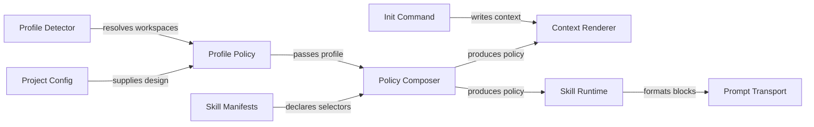

# Architecture-aware policy selection plan

Preserve `ProjectDesign` across workspace profile detection and compose compatible architecture, language and framework rules. Keep `gwrk init` deterministic and model-free while checks remain inactive until explicit configuration. Blocked: implementation depends on `043-unified-routing-prompt-delivery`.

## Target policy architecture



## Contract mapping

| Contract group | Symbols | Phase | Contract file |
|---|---|---|---|
| Profile design inheritance | `ProjectProfile` and `mergeProfileOverrides` and `resolveWorkspacePolicyProfile` | Phase 1 | `contracts/policy-selection.md` |
| Pure policy composition | `EnforcementSkillSelectors` and `evaluateEnforcementCandidate` and `composeEffectivePolicy` | Phase 2 | `contracts/policy-selection.md` |
| Runtime baselines and packs | `resolveEffectivePolicy` and `resolveEnforcementSkills` and `formatEffectivePolicyPrompt` | Phase 3 | `contracts/policy-selection.md` |
| Model-free init and transport | `ContextInput` and `contextMarkdown` | Phase 4 | `contracts/policy-selection.md` |

### Phase 1: Profile design and workspace inheritance

#### Files

- `src/domain/types.ts` (MODIFY: Add optional `design` metadata to `ProjectProfile` and export `WorkspaceProfileConfig`)
- `src/domain/profile-policy.ts` (NEW: Implement pure `mergeProfileOverrides` and `resolveWorkspacePolicyProfile`)
- `src/domain/profile-policy.test.ts` (NEW: Test design inheritance and workspace stack overrides and unchanged fallback without design)
- `src/domain/prompt-conditioner.ts` (MODIFY: Emit `<design>` inside `<project_context>` only when `profile.design` is set)
- `src/domain/index.ts` (MODIFY: Export pure profile policy contracts and helpers)
- `src/utils/config.ts` (MODIFY: Allow optional `design` overrides inside `GwrkConfigSchema.workspaces`)
- `src/engine/profile-detector.ts` (MODIFY: Read ancestor `.gwrkrc.json` in worktrees and delegate merging to `src/domain/profile-policy.js`)
- `src/engine/profile-detector.test.ts` (MODIFY: Verify polyglot fixtures preserve shared `design` while resolving stack and toolchain per workspace)
- `src/engine/prompt-conditioner.test.ts` (MODIFY: Verify `<design>` renders when present and stays absent for unconfigured profiles)

#### Governance and skills

- Architecture rules: `.gwrk/architecture.md` and `docs/decisions/ADR-013-desired-architecture.md`
- Decisions: `docs/decisions/ADR-010-decision-records.md` and `docs/decisions/ADR-011-hexagonal-and-agent-port.md`
- Skills: `compile-gate`
- Delivers: `FR-001` and `TR-001` for `F08`

#### Test Strategy

| ID | Type | Target | Assertion |
|---|---|---|---|
| TR-001 | integration | `src/engine/profile-detector.test.ts` | Polyglot fixture preserves shared design metadata while resolving language and framework per workspace |
| TR-005 | unit | `src/domain/profile-policy.test.ts` | Pure profile policy preserves existing behavior when `project.design` is absent and merges workspace overrides |
| TR-006 | unit | `src/engine/prompt-conditioner.test.ts` | Prompt conditioning emits `<design>` only when `profile.design` exists |

#### Done When

```bash
pnpm build
pnpm exec vitest run src/domain/profile-policy.test.ts src/engine/profile-detector.test.ts src/engine/prompt-conditioner.test.ts src/utils/config.test.ts src/architecture.test.ts
```

### Phase 2: Policy composition and manifest selectors

#### Files

- `src/plugins/manifest.ts` (MODIFY: Add optional `architectures` and `principles` and `projectScope` selectors plus `"define"` scope)
- `src/plugins/manifest.test.ts` (MODIFY: Verify new selector parsing and legacy enforcement manifest compatibility)
- `src/domain/architecture-context.ts` (MODIFY: Export pure `lookupLanguageGuidance` and `lookupFrameworkGuidance` helpers)
- `src/domain/policy-selection.ts` (NEW: Implement pure `evaluateEnforcementCandidate` and `composeEffectivePolicy` with override precedence and gap records)
- `src/domain/policy-selection.test.ts` (NEW: Test selector filtering and override precedence and explicit gaps and inactive check status)
- `src/domain/index.ts` (MODIFY: Export policy selection contracts and pure helpers)

#### Governance and skills

- Architecture rules: `.gwrk/architecture.md` and `docs/decisions/ADR-013-desired-architecture.md`
- Decisions: `docs/decisions/ADR-011-hexagonal-and-agent-port.md` and `docs/decisions/ADR-012-plugin-registry-and-framework-packs.md`
- Skills: `compile-gate`
- Delivers: `FR-002` and `FR-005` with `TR-003` for `F08`

#### Test Strategy

| ID | Type | Target | Assertion |
|---|---|---|---|
| TR-003 | unit | `src/domain/policy-selection.test.ts` | Framework without compatible policy returns an explicit gap and legacy manifests keep their previous scope |
| TR-007 | unit | `src/plugins/manifest.test.ts` | Enforcement manifests validate optional `architectures` and `principles` and `projectScope` selectors |
| TR-008 | unit | `src/domain/policy-selection.test.ts` | Source override order ranks `project-local` above `project-entry` and `global` and `builtin` while keeping `checksStatus` inactive |

#### Done When

```bash
pnpm build
pnpm exec vitest run src/plugins/manifest.test.ts src/domain/policy-selection.test.ts src/application/architecture/context.test.ts src/architecture.test.ts
```

### Phase 3: Language baselines and pack compatibility

#### Files

- `src/plugins/builtins/skills/javascript-standards/manifest.yaml` (NEW: Declare `javascript-standards` enforcement skill for `JavaScript` across `scope: all`)
- `src/plugins/builtins/skills/javascript-standards/SKILL.md` (NEW: Define ESM module boundaries and object port contracts and runtime validation rules)
- `src/plugins/builtins/skills/gwrk-conventions/manifest.yaml` (MODIFY: Set `projectScope: gwrk` so repository rules stay scoped to `gwrk`)
- `src/plugins/skill-runtime.ts` (MODIFY: Implement `resolveEffectivePolicy` and `formatEffectivePolicyPrompt` and delegate `resolveEnforcementSkills`)
- `src/commands/plugin.ts` (MODIFY: Route `gwrk plugin list --project` enforcement filtering through `evaluateEnforcementCandidate`)
- `src/plugins/skill-runtime.test.ts` (MODIFY: Verify `resolveEffectivePolicy` composition and override precedence and `gwrk-conventions` scoping)
- `src/plugins/enforcement.test.ts` (MODIFY: Verify `javascript-standards` loading and confirm external projects exclude `gwrk-conventions` even when their display name matches)
- `src/plugins/framework-pack-compatibility.test.ts` (NEW: Verify all five language baselines and all ten external framework pack contracts plus gap cases)
- `src/commands/plugin.p15.red.test.ts` (MODIFY: Verify `--project` listing honors architecture and framework and `projectScope` selectors)

#### Governance and skills

- Architecture rules: `.gwrk/architecture.md` and `docs/decisions/ADR-013-desired-architecture.md`
- Decisions: `docs/decisions/ADR-009-domain-ontology-information-hierarchy-ux.md` and `docs/decisions/ADR-012-plugin-registry-and-framework-packs.md`
- Skills: `compile-gate`
- Delivers: `FR-002` and `FR-003` and `FR-005` with `TR-002` and `TR-003` for `F08`

#### Test Strategy

| ID | Type | Target | Assertion |
|---|---|---|---|
| TR-002 | integration | `src/plugins/skill-runtime.test.ts` | New and existing projects compose chosen architecture with compatible language and framework guidance while excluding unrelated and `gwrk` rules |
| TR-009 | integration | `src/plugins/enforcement.test.ts` | Built-in `javascript-standards` loads for JavaScript projects and `gwrk-conventions` loads only when `_isGwrk` is true |
| TR-010 | integration | `src/plugins/framework-pack-compatibility.test.ts` | All five baselines and pinned manifests for ten published packs resolve compatible stacks or report a gap |
| TR-011 | integration | `src/commands/plugin.p15.red.test.ts` | CLI `plugin list --project` matches runtime policy selection across legacy and architecture-scoped skills |

#### Done When

```bash
pnpm build
pnpm exec vitest run src/plugins/skill-runtime.test.ts src/plugins/skill-runtime.p15.red.test.ts src/plugins/enforcement.test.ts src/plugins/framework-pack-compatibility.test.ts src/plugins/builtins/skills/gwrk-conventions/SKILL.test.ts src/commands/plugin.p15.red.test.ts src/architecture.test.ts
```

### Phase 4: Model-free init and prompt delivery

#### Files

- `src/domain/architecture-context.ts` (MODIFY: Render explicit policy gap notes in `contextMarkdown` while preserving manifest hashes when gaps are empty)
- `src/application/architecture/install-context.ts` (MODIFY: Compose `EffectivePolicy` deterministically during context installation without certifying existing code)
- `src/commands/init.ts` (MODIFY: Preserve `workspaces` and `project.design` across fresh and existing and `--workspace` runs with zero agent calls)
- `src/utils/agent.ts` (MODIFY: Resolve `EffectivePolicy` by workflow scope on the shared transport path and inject `<effective_policy>` with `<code_quality>`)
- `src/plugins/workflow-runtime.ts` (MODIFY: Forward workspace or root `ProjectProfile` with `design` into prompt conditioning and dispatch)
- `src/application/architecture/context.test.ts` (MODIFY: Verify context rendering reflects composed rules and explicit gap notes while keeping checks inactive)
- `src/commands/init.test.ts` (MODIFY: Verify zero agent dispatches and preserved source files and human `Decided` ADRs across fresh and repeat runs)
- `src/utils/agent.policy-binding.test.ts` (NEW: Capture define and implement and review dispatches and verify effective policy bindings and gap notes)
- `scripts/architecture-context-uat.py` (MODIFY: Exercise compiled CLI init across polyglot and missing-framework fixtures with zero model dispatches)

#### Governance and skills

- Architecture rules: `.gwrk/architecture.md` and `docs/decisions/ADR-004-agent-native-output.md`
- Decisions: `docs/decisions/ADR-007-single-dispatch-path.md` and `docs/decisions/ADR-011-hexagonal-and-agent-port.md` and `docs/decisions/ADR-013-desired-architecture.md`
- Skills: `compile-gate`
- Delivers: `FR-004` and `FR-005` with `TR-002` and `TR-003` and `TR-004` for `F08`

#### Test Strategy

| ID | Type | Target | Assertion |
|---|---|---|---|
| TR-004 | integration | `src/commands/init.test.ts` | Fresh and repeated init calls make zero agent dispatches and preserve existing source code and human `Decided` ADRs |
| TR-012 | unit | `src/application/architecture/context.test.ts` | Deterministic context rendering preserves manifest hashes without gaps and records explicit gap notes when bindings are missing |
| TR-013 | integration | `src/utils/agent.policy-binding.test.ts` | Shared prompt transport includes compatible policy once across define, implement and review scopes |
| TR-014 | e2e | `scripts/architecture-context-uat.py` | Built CLI init and assessment preview complete with zero model invocations across fresh and existing and polyglot fixtures |

#### Done When

```bash
pnpm build
pnpm exec vitest run src/application/architecture/context.test.ts src/commands/init.test.ts src/utils/agent.policy-binding.test.ts src/utils/agent.grounding-decisions.test.ts src/plugins/workflow-runtime.test.ts src/architecture.test.ts
python3 scripts/architecture-context-uat.py
```

## Coverage matrix

| Item | Description | Phase | Verification |
|---|---|---|---|
| F08 | Architecture-aware profile inheritance and enforcement skill routing | Phase 1 through Phase 4 | `TR-001` through `TR-014` |
| FR-001 | Preserve architecture and principles across profiles and workspaces | Phase 1 | `TR-001` and `TR-005` and `TR-006` |
| FR-002 | Compose architecture and language and framework policy and report gaps | Phase 2 through Phase 4 | `TR-002` and `TR-003` and `TR-010` and `TR-012` |
| FR-003 | Add JavaScript baseline and scope `gwrk-conventions` and verify packs | Phase 3 | `TR-002` and `TR-009` and `TR-010` and `TR-011` |
| FR-004 | Keep `gwrk init` deterministic and model-free and preserve user ADRs | Phase 4 | `TR-004` and `TR-012` and `TR-014` |
| FR-005 | Enforce override precedence and shared prompt bindings with inactive checks | Phase 2 through Phase 4 | `TR-008` and `TR-011` and `TR-012` and `TR-013` |
| TR-001 | Polyglot fixture preserves shared design metadata per workspace | Phase 1 | `TR-001` |
| TR-002 | Projects compose compatible policy and exclude unrelated or repo rules | Phase 3 and Phase 4 | `TR-002` and `TR-009` and `TR-013` |
| TR-003 | Missing compatible policy returns a clear gap and legacy manifests load | Phase 2 and Phase 3 | `TR-003` and `TR-007` and `TR-010` |
| TR-004 | Init makes zero agent calls and preserves code and ADRs and bindings | Phase 4 | `TR-004` and `TR-012` and `TR-013` and `TR-014` |

## Sister spec dependencies

- Upstream prerequisites: `040-pure-domain-boundary-gates` supplies `tests/helpers/architecture-boundary.ts` and pure domain modules. `042-port-adapter-separation` supplies port-purity gates and scoped CLI output. `043-unified-routing-prompt-delivery` supplies unified `WorkflowRuntime` prompt transport and `<code_quality>` expansion. Implementation stays blocked until `043-unified-routing-prompt-delivery` lands.
- Downstream consumers: Proposal 05 updates hexagonal folder layout guidance in `src/plugins/builtins/workflows/gwrk-plan/PROMPT.md` and exposes readiness in `gwrk project discover`. Proposal 06 exercises effective policy bindings inside hermetic integration gates.
- Preserved contracts: `specs/039-architecture-context/contracts/context.md` and `specs/043-unified-routing-prompt-delivery/contracts/routing-and-dispatch.md` remain unchanged.

## Plugin follow-up

Record pack versions and compatibility results in the feature review. A pack that needs changes gets a companion gwrk-plugins change and a fixture tied to its reviewed revision.
