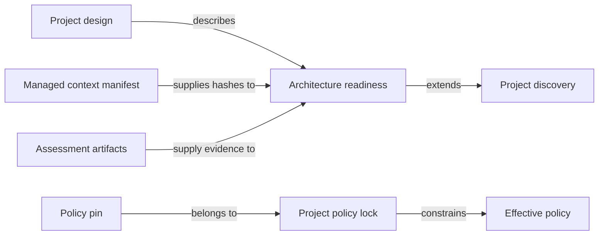

# Workflow governance data model

The project policy lock records exact enforcement versions in Git. Discovery reports architecture context health and scoped assessment evidence from existing repository files. Blocked: implementation awaits architecture-aware policy selection (feature 044).

## Type dependencies



## Architecture readiness

The existing `ProjectDesign` schema supplies selection metadata. Keep the read-only result beside the readiness reader. Reuse the feature 039 assessment schema for structured evidence and validate the provenance fields consumed by discovery.

```typescript
interface ArchitectureReadiness {
  target: {
    selection: ProjectDesign | null;
    path: string | null;
  };
  context: {
    status: "missing" | "incomplete" | "ready";
    issues: Array<{
      path: string;
      kind: "missing" | "invalid" | "unreadable" | "hash-mismatch";
    }>;
  };
  assessment: {
    latest: {
      reportPath: string;
      generatedAt: string | null;
      revision: string | null;
      targetMatch: "matches" | "differs" | "unknown";
      scope: {
        inspected: string[];
        limitations: string[];
      } | null;
    } | null;
  };
}
```

Report paths are repository-relative. An absent target and manifest mean missing context. Partial or unreadable context means incomplete. Ready means the target is readable and its SHA-256 matches the managed manifest. The decision index must also be readable. These checks cover the two grounding inputs. Index freshness remains the decision checker's responsibility.

Compare the recorded target digest with the current target digest when both are valid. Use the provenance timestamp for `generatedAt`. For a dated Markdown-only report, leave provenance and structured scope unknown. No assessment status certifies the checkout or activates checks.

## Project policy lock

Store the optional tracked lock at `.gwrk/policy-lock.json`. Co-locate the Zod schema and inferred types with the lock reader. The plugin lock in the home directory records installed registry packages.

```typescript
const PolicyPinSchema = z.strictObject({
  name: z.string().min(1),
  source: z.enum(["builtin", "global", "project-entry", "project-local"]),
  version: z.string().min(1),
  sha256: z.string().regex(/^[a-f0-9]{64}$/),
});

const ProjectPolicyLockSchema = z.strictObject({
  version: z.literal(1),
  gwrkVersion: z.string().min(1),
  skills: z.array(PolicyPinSchema).refine(
    (pins) => new Set(pins.map((pin) => pin.name)).size === pins.length,
    "Policy skill names must be unique",
  ),
});

type ProjectPolicyLock = z.infer<typeof ProjectPolicyLockSchema>;
```

Compare versions as exact strings. `gwrkVersion` pins the release that supplies inline guidance. Each skill digest hashes the UTF-8 JSON encoding of two values in order. Use the parsed manifest with object keys sorted recursively and the enforcement text with line endings normalized to LF. Preserve array order. Use the same verified text for composition.

Neither record needs SQLite tables or migrations. Context evidence remains in the project archive and the policy lock remains in Git.
