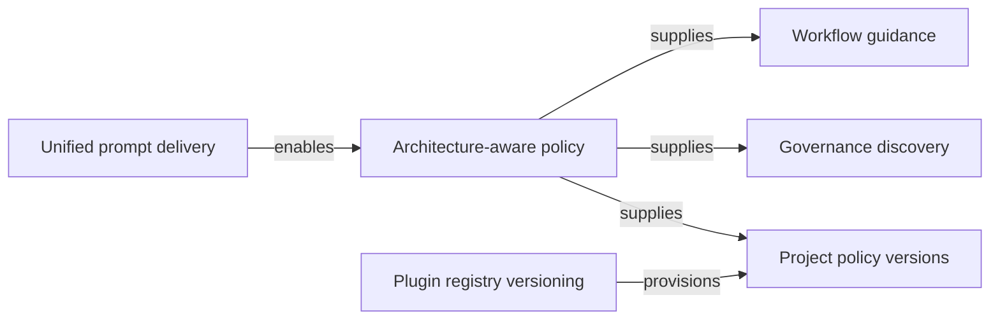

# Workflow guidance and governance visibility plan

Feature 045 aligns definition prompts with project policy and adds scoped architecture evidence to discovery. It also makes enforcement versions reproducible and gives plugin seed an actionable failure path. Blocked: implementation awaits architecture-aware policy selection (feature 044).

## Dependencies



Feature 043 supplies captured dispatch and enforcement expansion. Feature 044 supplies the typed project design and the shared policy resolver. The build plan dependency graph and critical path end at feature 038. The [self-assessment](../../docs/architecture/assessments/2026-11-11-self-assessment/report.md) supplies the later sequence. Hermetic integration and blocking lint can proceed after port and adapter separation (feature 042) and unified prompt delivery (feature 043). It has no dependency on this plan.

## Compatibility

| Existing contract | Surface | Integration |
|---|---|---|
| Feature 013, agent-native interface | `discoverProject` | Additive output with repository-only reads |
| Features 014 and 036, plugin runtime and versioning | Plugin manifests and installed inventory | Existing install, loader and global lock contracts |
| Features 023 and 024, plan format and gate assertions | Planning prompt | Canonical grammar and exit-based gates |
| Features 029 and 039, decision records and architecture context | Decision index and managed context | Uniform grounding and scoped assessment evidence |
| Features 043 and 044, prompt delivery and policy selection | Dispatch payload and effective policy | Existing transport and selector precedence |

Use [the repository layout and stack](../../docs/grounding/architecture.md) in sections 4 and 10. Domain policy stays pure. Adapters read repository files. Engine code assembles discovery and Commander renders it. Discovery uses neither the SQLite execution ledger nor the Fastify server. Definition workflows and plugin administration use their existing commands. See [agent-native design](../../docs/grounding/agent-native-cli.md).

## Contract mapping

| Method or boundary | Phase | Contract |
|---|---|---|
| `WorkflowRuntime.executeWorkflow` and `dispatchToAgent` | 1 | [Governance interfaces](contracts/governance.md#workflow-guidance) |
| `readArchitectureReadiness` and `discoverProject` | 2 | [Governance interfaces](contracts/governance.md#discovery) |
| `readProjectPolicyLock` and `resolveEffectivePolicy` | 3 | [Governance interfaces](contracts/governance.md#policy-versions) |
| `seedSkills` and the existing seed action | 4 | [Governance interfaces](contracts/governance.md#plugin-seed) |

### Phase 1: Workflow guidance and decision authority

#### Governance & Skills Contract

Delivers architecture guidance (FR-001) and decision authority (FR-002). Use the selected design and project standards from feature 044. For gwrk, describe the pure domain and its ports. Locate orchestration in `src/application/` and external effects in `src/adapters/`. Use the host repository's layout for other projects. Keep the planning output and gate contracts from features 023 and 024.

Apply the single dispatch path decision (ADR-007) and the decision records contract (ADR-010). Keep the index payload verbatim in every stage. Place shared conflict guidance outside that payload. Decided constraints govern. Record any conflict with a Proposed target in the plan. Require test-driven development and compile-gate.

#### Files

- `src/plugins/builtins/workflows/gwrk-specify/PROMPT.md` — **amend** — Use selected architecture and the current project layout. FR-001.
- `src/plugins/builtins/workflows/gwrk-plan/PROMPT.md` — **amend** — Use current hexagonal boundaries and preserve the parser contract. FR-001.
- `src/plugins/builtins/personas/principal-engineer.md` — **amend** — Use the project's verification commands and schema standards. FR-001.
- `src/utils/agent.ts` — **amend** — Add shared conflict guidance beside the intact decision index. FR-002.
- `src/utils/agent.grounding-decisions.test.ts` — **amend** — Assert status visibility and conflict guidance across dispatch stages. FR-002.
- `src/plugins/workflow-governance.test.ts` — **create** — Check conditioned specification and planning guidance for gwrk and Python. Verify that the persona preserves review reporting requirements. FR-001.
- `src/plugins/workflow-governance.delivery.test.ts` — **create** — Capture specification, planning and CLI review prompts through shared dry-run dispatch. FR-001 and FR-002.

#### Test Strategy

| TR-### | Type | Target | Assertion |
|---|---|---|---|
| TR-001 | integration | `src/plugins/workflow-governance.test.ts` | Profile-specific architecture guidance and gate examples with persona reporting triggers |
| TR-002 | integration | `src/utils/agent.grounding-decisions.test.ts` | Verbatim Proposed and Decided rows plus conflict guidance across stages |
| TR-003 | integration | `src/plugins/builtins/workflows/gwrk-plan/prompt-contract.test.ts` | Canonical gates and exit-based assertions |
| TR-012 | integration | `src/plugins/workflow-governance.delivery.test.ts` | Verbatim decision index and one authority block requiring conflict records in the plan |

#### Done When

```bash
pnpm run build
pnpm exec vitest run src/plugins/workflow-governance.delivery.test.ts src/plugins/workflow-governance.test.ts src/utils/agent.grounding-decisions.test.ts src/plugins/builtins/workflows/gwrk-plan/prompt-contract.test.ts src/commands/define-plan.test.ts src/architecture.test.ts
```

### Phase 2: Architecture context and assessment discovery

#### Governance & Skills Contract

Delivers FR-003, scoped discovery. Reuse the selected design and managed target hash from features 039 and 044. Keep context health separate from assessment scope and provenance. The target remains Proposed until the project owner adopts it. Apply the agent-native output protocol (ADR-004) and the inward dependency rule (ADR-011). Use temporary repository fixtures. Require test-driven development and compile-gate.

#### Files

- `src/adapters/architecture/readiness.ts` — **create** — Inspect project-local context and select the latest readable assessment. FR-003.
- `src/adapters/architecture/readiness.test.ts` — **create** — Exercise missing, changed and malformed evidence in temporary repositories. FR-003.
- `src/engine/discover.ts` — **amend** — Attach additive readiness data to the existing discovery result. FR-003.
- `src/engine/discover.test.ts` — **amend** — Verify discovery with and without architecture context and without SQLite. FR-003.
- `src/commands/project-discover.ts` — **amend** — Render target, context and latest assessment in text and JSON. FR-003.
- `src/commands/project-discover.readiness.test.ts` (NEW: Test the compiled CLI in temporary projects with global and local JSON options, agent mode and no ledger creation)
- `src/commands/project.test.ts` — **amend** — Verify text and JSON output plus the terminal stderr signal. FR-003.

#### Test Strategy

| TR-### | Type | Target | Assertion |
|---|---|---|---|
| TR-004 | integration | `src/adapters/architecture/readiness.test.ts` | Independent states and deterministic selection across default and custom output |
| TR-005 | integration | `src/engine/discover.test.ts` | Repository-only discovery with existing fields and no database or server |
| TR-006 | integration | `src/commands/project.test.ts` | Text and JSON parity, scoped evidence and terminal stderr signal |

#### Done When

```bash
pnpm run build
pnpm exec vitest run src/adapters/architecture/readiness.test.ts src/engine/discover.test.ts src/commands/project.test.ts src/application/architecture/context.test.ts src/architecture.test.ts
```

### Phase 3: Project policy versions

#### Governance & Skills Contract

Delivers FR-004, reproducible enforcement versions. Use the workspace config rules in `.gwrk/rules/workspace.md`. Apply the plugin registry decision (ADR-012) and feature 044's scope, selectors and precedence. Use a project-owned lock with exact versions and content digests. Keep installation and registry verification in feature 036. Resolve policy offline. Surface a pin failure before dispatch and identify the repair. Require test-driven development and compile-gate.

#### Files

- `src/plugins/policy-lock.ts` — **create** — Parse and validate tracked pins and verify the supplied policy candidates. FR-004.
- `src/plugins/policy-lock.test.ts` — **create** — Cover invalid lockfiles, incompatible versions and digest mismatches. FR-004.
- `src/plugins/skill-runtime.ts` — **amend** — Apply pins at feature 044's policy resolution boundary. FR-004.
- `src/plugins/skill-runtime.test.ts` — **amend** — Resolve the same locked policy across isolated plugin homes and preserve legacy resolution. FR-004.
- `src/plugins/policy-lock.dispatch.test.ts` — **create** — Check locked rules in captured dispatch and zero agent calls after lock failure. FR-004.
- `docs/grounding/architecture.md` — **amend** — Document the project lock format, digest procedure and provisioning steps. FR-004.

#### Test Strategy

| TR-### | Type | Target | Assertion |
|---|---|---|---|
| TR-007 | unit | `src/plugins/policy-lock.test.ts` | Schema and exact version, source and digest verification |
| TR-008 | integration | `src/plugins/skill-runtime.test.ts` | Equal effective rules across two homes with unrelated installed skills |
| TR-009 | integration | `src/plugins/policy-lock.dispatch.test.ts` | Verified locked payload and zero dispatches for unresolved pins |

#### Done When

```bash
pnpm run build
pnpm exec vitest run src/plugins/policy-lock.test.ts src/plugins/skill-runtime.test.ts src/plugins/policy-lock.dispatch.test.ts src/engine/registry-versioning.test.ts src/architecture.test.ts
```

### Phase 4: Plugin seed input and failure

#### Governance & Skills Contract

Delivers FR-005, actionable seed failures. Keep the existing `gwrk plugin seed` mutator and dry run. Support an explicit taxonomy path for the absent default input. Check the complete taxonomy before writing. Fail with the existing signal wrapper and a repair hint. Keep seeding separate from `gwrk init` and project policy resolution. Use temporary fixture inputs and require test-driven development and compile-gate.

#### Files

- `src/plugins/seed.ts` — **amend** — Validate the taxonomy and propagate read, parse and write failures. FR-005.
- `src/plugins/seed.test.ts` — **amend** — Cover absent or invalid input plus dry run and retry. FR-005.
- `src/commands/plugin.ts` — **amend** — Accept an explicit taxonomy path and report actionable failure. FR-005.
- `src/commands/plugin.test.ts` — **amend** — Verify seed CLI exit status, hint and dry-run behavior. FR-005.

#### Test Strategy

| TR-### | Type | Target | Assertion |
|---|---|---|---|
| TR-010 | unit | `src/plugins/seed.test.ts` | Valid taxonomy, no writes on invalid input, and safe retry after a write failure |
| TR-011 | integration | `src/commands/plugin.test.ts` | Nonzero exit and path hint on missing input plus success for a valid dry run |

#### Done When

```bash
pnpm run build
pnpm exec vitest run src/plugins/seed.test.ts src/commands/plugin.test.ts src/architecture.test.ts
```

## Coverage Matrix

The proposed [feature spec](spec.md) uses unnumbered bullets and numbered acceptance criteria. The identifiers below belong to this plan. Before implementation, observe the behavior tests fail for the intended reason. Run each phase gate after implementation and retain the results as verification evidence.

| Requirement | Spec item | Checks | Phase |
|---|---|---|---|
| FR-001 Architecture guidance | Required changes 1 and 2, acceptance 1 | TR-001, TR-003 and TR-012 | 1 |
| FR-002 Decision authority | Required change 3, acceptance 1 | TR-002 and TR-012 | 1 |
| FR-003 Scoped discovery | Required change 4, acceptance 2 | TR-004, TR-005 and TR-006 | 2 |
| FR-004 Reproducible policy versions | Required change 5, acceptance 3 | TR-007, TR-008 and TR-009 | 3 |
| FR-005 Actionable seed failures | Required change 5, acceptance 4 | TR-010 and TR-011 | 4 |

## Deferred Items

| Item | Dependency or scope |
|---|---|
| Feature 045 implementation | The completed [architecture-aware policy contract](../044-architecture-aware-policy/contracts/policy-selection.md) |

All five required changes and four acceptance criteria have phase coverage. The [reviewed findings](../../docs/architecture/assessments/2026-11-11-self-assessment/report.md) assign this feature workflow guidance (F09) and governance visibility (F10). Feature 043 owns the transport repair. The existing context determinism regression stays in the Phase 2 gate.

Phase 1 delivery coverage executes WorkflowRuntime for specification, planning and code review. It captures the shared dispatch payload with dry-run transport. Assertions cover Python project guidance, Proposed ratification, Decided authority and Superseded lineage. No agent process starts.

Phase 1 review regressions keep the GWRK build-plan path inside the native profile and preserve conditional requirements checklist authority for specification and implementation review. Both cases failed before the repair. The repaired phase gate passes 53 checks.
