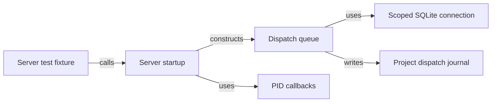

# Contract: Server composition for isolated tests

Server instances accept a project root and scoped persistence through internal composition options. Existing daemon callers keep their defaults. Blocked: Phase 1 depends on the 042 port separation and 043 unified dispatch gates.

## Type dependencies



The types stay in server infrastructure and test support. The database handle never enters domain policy or a new port. Use the SQLite connection ownership rules from [042 port and adapter contracts](../../042-port-adapter-separation/contracts/ports-and-adapters.md).

## Server startup

Source: `src/server/index.ts`. Phase 1.

```typescript
interface ServerPidScope {
  writePid(pid: number): void;
  removePid(): void;
}

interface ServerStartOptions {
  handleSignals?: boolean;
  projectRoot?: string;
  pid?: ServerPidScope;
  ledger?: DispatchLedgerScope;
}

function startServer(
  config: GwrkConfig,
  options?: ServerStartOptions,
): Promise<FastifyInstance>;
```

`startServer` registers the existing routes and listens on the configured address. The caller can use loopback port `0` for a kernel-assigned port. Pass the explicit root to the sandbox and dispatch queue. Use it for other project services. An omitted scope preserves existing defaults. `handleSignals: false` adds no process signal handlers. The default daemon retains its process signal and exit behavior.

Write the process ID after bind. Remove only the instance's own record. A missing record is safe to ignore.

Closing Fastify stops the instance's services. It clears the process ID record.

If startup fails, release resources first. Then report the error. With signals disabled, reject startup. Keep the worker alive.

## Dispatch queue

Source: `src/server/dispatch.ts`. Phase 1.

```typescript
interface DispatchLedgerScope {
  db: Database.Database;
  projectId: string;
}

class DispatchQueue {
  constructor(
    config: GwrkConfig,
    monitor: SystemMonitor,
    sandbox: SandboxManager,
    projectRoot: string,
    ledger?: DispatchLedgerScope,
  );
}
```

The ledger caller registers the fixture project before dispatch. The queue uses the supplied connection for run creation and completion. The caller owns the handle. With no ledger option the queue keeps its current ledger path. All queue journal writes call the existing `persistDispatch(record, projectRoot)` with the instance root. No HTTP route fields or status codes change.

## Fixture lifecycle

Source: `tests/helpers/server-fixture.ts`. Phase 1.

```typescript
interface ServerFixture {
  app: FastifyInstance;
  projectRoot: string;
  pidPath: string;
  db: Database.Database;
  close(): Promise<void>;
}

function createServerFixture(
  mode: "routes" | "listen",
): Promise<ServerFixture>;
```

Each fixture owns a unique temporary root and migrated store. Route mode registers routes for Fastify injection. Listen mode calls `startServer` with explicit scope. Stub live provider calls in the test. Await dispatch completion before closing the app. `close` then closes the owned database and removes the temporary root. Setup failure rejects after releasing acquired resources.
