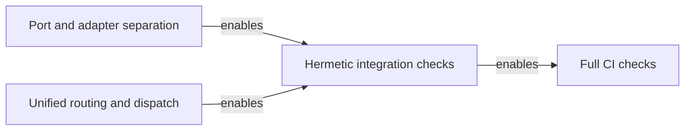

# Hermetic integration checks and blocking lint

Run all six quarantined suites in continuous integration (CI). Make unhandled worker errors and lint defects fail the job. Blocked: the project owner must adopt the proposal. The port separation and unified dispatch gates must pass on the implementation base.

## Scope and dependencies

The [reviewed self-assessment](../../docs/architecture/assessments/2026-11-11-self-assessment/report.md) governs delivery evidence (F11). The [feature specification](spec.md) defines acceptance. The [build plan](../000-build-plan.md#dependency-graph) predates this proposal. The assessment sets the order for this work.



Use the scoped SQLite and command-line output from [042 port and adapter separation](../042-port-adapter-separation/plan.md). Use the routing and workflow seams from [043 unified routing and prompt delivery](../043-unified-routing-prompt-delivery/plan.md). Verify both plans' applicable gates on the implementation base. The presence of a module does not prove its gate passed. Architecture policy selection can proceed in parallel once the prerequisites pass.

[Architecture §4 and §10](../../docs/grounding/architecture.md) place Fastify composition in `src/server/` and SQLite access in `src/db/` and its adapter. Keep tests beside their consumers. Keep CI policy in `vitest.config.ts` and `package.json`. Keep the workflow in `.github/workflows/ci.yml`. Preserve the hexagonal dependency rules in [ADR-011, Ports and adapters](../../docs/decisions/ADR-011-hexagonal-and-agent-port.md). Treat the architecture target in [ADR-013](../../docs/decisions/ADR-013-desired-architecture.md) as Proposed.

Public commands and endpoints stay unchanged. No new persisted entities or schemas. Keep the [agent-native command-line contract](../../docs/grounding/agent-native-cli.md) and [ADR-004, Agent-native output](../../docs/decisions/ADR-004-agent-native-output.md). The pulse suites retain exit codes and stderr signals. JSON stays on stdout when requested. The [server composition contract](contracts/server-isolation.md) covers the internal additions.

## Quarantine inventory

Recheck each pattern against the implementation base before recording failing evidence. A new match or rename needs a disposition before Phase 4 can remove the filter. The causes below are source observations. Reproduce the failures before attributing a worker error to them.

| Pattern in `vitest.config.ts` | Current match | Isolation concern | Phase |
|---|---|---|---|
| `**/src/server/e2e.test.ts` | `src/server/e2e.test.ts` | Checkout config and dispatch state | 1 |
| `**/src/server/integration.test.ts` | `src/server/integration.test.ts` | Fixed port, global state and background work | 1 |
| `**/src/server/routes/dispatch.test.ts` | `src/server/routes/dispatch.test.ts` | Shared state and dispatch teardown | 1 |
| `**/src/cli.pulse.e2e.test.ts` | `src/cli.pulse.e2e.test.ts` | Repeated CLI startup and Git setup | 2 |
| `**/src/**/notify.test.ts` | `src/server/routes/notify.test.ts` | Daemon startup for route assertions | 1 |
| `**/src/engine/pulse-integration.test.ts` | `src/engine/pulse-integration.test.ts` | Synchronous Git setup and wall-clock threshold | 2 |

## Phase conventions

The spec has five unnumbered requirements and four numbered acceptance criteria. This plan labels the requirements FR-001 through FR-005 in spec order. It assigns test references for task generation. Follow [ADR-005, Test-driven gates](../../docs/decisions/ADR-005-tdd-gate-architecture.md). Record each failing test and its expected failure before changing behavior. Keep gates non-interactive and bounded. Report timeouts as failures.

### Phase 1: Server and dispatch isolation

#### Files

- `src/server/index.ts` — **amend** — Accept explicit server scope and clean up owned effects on close and failed startup. FR-002, FR-003.
- `src/server/dispatch.ts` — **amend** — Scope all journal writes to the queue project root. Pass the supplied ledger to run start and finish. FR-002.
- `tests/helpers/server-fixture.ts` — **create** — Compose isolated Fastify instances and own their temporary project roots and SQLite handles. FR-002.
- `src/server/e2e.test.ts` — **amend** — Register real routes with fixture config and exercise them through Fastify injection. FR-002.
- `src/server/integration.test.ts` — **amend** — Start two isolated instances and verify dispatch completes in the correct journal and ledger. FR-002, FR-003.
- `src/server/routes/dispatch.test.ts` — **amend** — Retain route assertions with a real scoped queue and a controlled ship result. FR-002.
- `src/server/routes/notify.test.ts` — **amend** — Exercise the real notification routes with a captured notifier and no listener. FR-002.
- `src/server/routes/status.test.ts` — **amend** — Cover the registered status route with fixture scope and close it on assertion failure. FR-002, FR-003.

#### Governance & Skills Contract

Apply the workspace rules and the compile gate. Preserve [002 server lifecycle](../002-build-server/contracts/server.md), [002 dispatch responses](../002-build-server/contracts/dispatch.md) and [003 notification responses](../003-slack/contracts/POST-api-notify.md) for existing callers. Map server startup, queue construction and fixture lifecycle to [the internal contract](contracts/server-isolation.md). Use the existing 042 SQLite opener and the 043 workflow boundary. Do not add agent subprocesses or another routing policy.

Use Fastify injection when a test only needs a route. Keep one real startup and shutdown check on loopback port `0`. Stub external effects at their boundaries. Keep the real queue and run queries in the isolation test. Wait for terminal persistence and teardown before deleting fixtures. Never change the process working directory or write to the checkout or user home.

#### Test Strategy

| TR-### | Type | Target | Assertion |
|---|---|---|---|
| TR-001 | integration | `src/server/integration.test.ts` | Two live instances on distinct loopback ports; separate PID files, journals and run rows; no listener or polling after close |
| TR-002 | integration | `src/server/routes/dispatch.test.ts` | Enqueue and lookup retain their responses; terminal success and failure persist only in the fixture |
| TR-003 | integration | `src/server/routes/notify.test.ts` | Notification success, validation and transport failure without external calls |
| TR-004 | integration | `src/server/e2e.test.ts` | Health, status and dispatch routes with no shared persistence |
| TR-005 | integration | `src/server/routes/status.test.ts` | Status response and cleanup on failed startup or assertion |

#### Done When

```bash
pnpm run build
pnpm exec vitest run --retry 0 src/server/e2e.test.ts src/server/integration.test.ts src/server/routes/dispatch.test.ts src/server/routes/notify.test.ts src/server/routes/status.test.ts src/server/dispatch.test.ts src/adapters/sqlite/store-isolation.test.ts src/architecture.test.ts
```

### Phase 2: Pulse fixture isolation

#### Files

- `src/cli.pulse.e2e.test.ts` — **amend** — Use scoped CLI capture for cases that need no child working directory. Keep bounded subprocess coverage for config discovery. FR-002, FR-003.
- `src/engine/pulse-integration.test.ts` — **amend** — Seed fixed Git history in a temporary repository. Assert the scan results without a host-speed threshold. FR-002, FR-003.
- `tests/helpers/pulse-git-fixture.ts` — **create** — Seed explicit branch names and fixed author data through bounded asynchronous Git commands. FR-002, FR-003.

#### Governance & Skills Contract

Apply the workspace rules, the compile gate and the 042 scoped CLI contract. Preserve [006 Pulse command behavior](../006-pulse/contracts/pulse-cli.md) and [ADR-004, Agent-native output](../../docs/decisions/ADR-004-agent-native-output.md). Use a child with an explicit working directory for config-dependent cases. Pass arguments separately and disable Git prompts and signing in the fixture. Use a batch fixture for the 100-commit scan. Keep its scale assertion. Keep the [006 Pulse performance target](../006-pulse/spec.md) separate from the functional scan gate.

Capture the worker symptom under CI-style parallel load before changing the fixture. If the historical worker timeout does not reproduce, record the limit. Use a controlled unhandled error in Phase 4 to verify the masking defect. Do not treat the controlled error as proof of the historical timeout's cause.

#### Test Strategy

| TR-### | Type | Target | Assertion |
|---|---|---|---|
| TR-006 | integration | `src/cli.pulse.e2e.test.ts` | Text and JSON output, repeatable scans, config discovery and error exits from isolated fixtures; stderr exit signal |
| TR-007 | integration | `src/engine/pulse-integration.test.ts` | Repeatable scan across branch history and 100 commits; invalid path failures; fixture cleanup |

#### Done When

```bash
pnpm run build
pnpm exec vitest run --retry 0 src/cli.pulse.e2e.test.ts src/engine/pulse-integration.test.ts src/adapters/cli/output-scope.test.ts src/architecture.test.ts
```

### Phase 3: Database stub removal

#### Files

- `src/db/db.ts` — **delete** — Remove the throwing compression insert stub after confirming it has no production consumer. FR-004.
- `src/db/db.test.ts` — **amend** — Retain execution ledger tests and remove assertions that accept the stub throwing for every input. FR-004.

#### Governance & Skills Contract

Apply the compile gate and [ADR-003, State ownership](../../docs/decisions/ADR-003-state-contract.md). The existing `recordCompression` query and 042 run store adapter own persistence. Keep the [011 harvest contract](../011-harvest/contracts/harvest.md) and [007 compression persistence](../007-effort-compression/spec.md). Check imports, re-exports and published entry points on the implementation base before deleting the stub. If a production consumer appears, stop this phase and review that caller against the existing query. Do not add a migration or a second insert path.

#### Test Strategy

| TR-### | Type | Target | Assertion |
|---|---|---|---|
| TR-008 | integration | `src/db/compression.test.ts` | Valid compression report persists and can be read from an isolated database |
| TR-009 | integration | `src/adapters/sqlite/store-isolation.test.ts` | Compression writes stay in the supplied store |
| TR-010 | gate | `pnpm run build` | No unresolved production imports after deletion |
| TR-011 | integration | `src/db/db.test.ts` | Ledger migrations and run queries still work |

#### Done When

```bash
pnpm run build
pnpm exec vitest run src/db/db.test.ts src/db/compression.test.ts src/adapters/sqlite/store-isolation.test.ts src/architecture.test.ts
```

### Phase 4: Full CI test selection

#### Files

- `vitest.config.ts` — **amend** — Remove integration quarantine and unhandled error suppression. Keep general exclusions and worker isolation. FR-001, FR-003.
- `package.json` — **amend** — Keep `test:ci` as a full Vitest run without the quarantine flag. FR-001, FR-003.
- `src/ci-test-policy.test.ts` — **create** — Verify selection of all former matches and the exit status of isolated worker probes. FR-001, FR-003.

#### Governance & Skills Contract

Apply the compile gate and [ADR-005, Test-driven gates](../../docs/decisions/ADR-005-tdd-gate-architecture.md). Preserve `pnpm test:ci` for existing plans and the CI workflow. Keep unrelated suite exclusions. Remove the retry added for shared PID conflicts once its cause is fixed. Do not replace suppression with retries, serialization or a larger timeout.

Use a temporary Vitest root and the repository config for worker probes. Run a clean control first. Run a second fixture whose assertion passes but whose worker raises a known unhandled rejection. Require a normal nonzero exit and confirm the expected diagnostic within the test. A timeout, missing dependency or test assertion failure does not count. Use a positive discovery control with all six paths under the legacy flag. Confirm actual execution of those suites with a targeted CI run.

#### Test Strategy

| TR-### | Type | Target | Assertion |
|---|---|---|---|
| TR-012 | integration | `src/ci-test-policy.test.ts` | Vitest lists all six former matches with or without the legacy flag |
| TR-013 | integration | `src/ci-test-policy.test.ts` | Clean worker exits zero; unhandled rejection fails with an otherwise passing test |
| TR-014 | gate | `pnpm run test:ci` | Full suite passes without quarantine or masked errors |

#### Done When

```bash
pnpm run build
pnpm exec vitest run src/ci-test-policy.test.ts src/architecture.test.ts
CI=true pnpm run test:ci --retry 0 src/server/e2e.test.ts src/server/integration.test.ts src/server/routes/dispatch.test.ts src/server/routes/notify.test.ts src/cli.pulse.e2e.test.ts src/engine/pulse-integration.test.ts
CI=true pnpm run test:ci
```

### Phase 5: Blocking lint

#### Files

- `.github/workflows/ci.yml` — **amend** — Run blocking lint in both matrix jobs and remove stale quarantine comments. FR-005.
- `biome.json` — **amend** — Exclude the ignored machine-local config from project lint. Keep tracked lint coverage. FR-005.
- `src/ci-lint-policy.test.ts` — **create** — Check workflow failure propagation and run clean and defective lint fixtures. FR-005.

#### Governance & Skills Contract

Apply the compile gate and [037 Biome lint zero](../037-biome-lint-zero/spec.md). Keep Node 20 and 22 and their required check names. Preserve the build and decision citation checks. The current local lint baseline fails on the ignored `.gwrkrc.local.json`. Exclude that exact path and fix diagnostics in touched tracked files. Do not widen ignore rules or lower lint severity.

Parse the workflow and run its lint command against a clean temporary project. Seed a formatting defect in a tracked source fixture that still compiles. Require a normal nonzero exit from lint. Reject step or job settings that absorb the failure. Record both matrix results on the clean candidate. For the hosted failure check, use a disposable review revision with the seeded defect. Record the job conclusion before reverting the defect.

#### Test Strategy

| TR-### | Type | Target | Assertion |
|---|---|---|---|
| TR-015 | integration | `src/ci-lint-policy.test.ts` | Workflow retains both Node versions and propagates lint failure at step and job level |
| TR-016 | integration | `src/ci-lint-policy.test.ts` | Exact lint step exits zero on clean input and nonzero for a tracked-source lint defect |
| TR-017 | gate | `pnpm run lint` | Project lint passes with the machine-local config present |

#### Done When

```bash
pnpm run build
pnpm run lint
pnpm exec vitest run src/ci-lint-policy.test.ts src/architecture.test.ts
node dist/cli.js define adr --check
CI=true pnpm run test:ci
```

## Coverage Matrix

| Item | Scope | Phase | Verification |
|---|---|---|---|
| F11 | Delivery evidence | 1 through 5 | TR-001 through TR-017 |
| FR-001 | Quarantine pattern audit | 4 | TR-012, TR-014 |
| FR-002 | Ports and stores | 1 and 2 | TR-001 through TR-007 |
| FR-003 | Worker failures | 1, 2 and 4 | TR-001, TR-005 through TR-007, TR-013, TR-014 |
| FR-004 | Database stub | 3 | TR-008 through TR-011 |
| FR-005 | Blocking lint | 5 | TR-015 through TR-017 |
| Acceptance 1 | Former suites run in isolation | 1, 2 and 4 | TR-001 through TR-007, TR-012, TR-014 |
| Acceptance 2 | Worker error fails test run | 4 | TR-013 |
| Acceptance 3 | No callable stub | 3 | TR-008 through TR-011 |
| Acceptance 4 | Lint defect fails CI job | 5 | TR-015 through TR-017 and hosted job evidence |

The spec assigns no IDs to its requirements or acceptance criteria. The matrix maps both. The Test Strategy tables define the plan's test references.

## Deferred Items

- Start implementation after project adoption. Require passing gates from [042 port and adapter separation](../042-port-adapter-separation/plan.md) and [043 unified routing and prompt delivery](../043-unified-routing-prompt-delivery/plan.md). No feature requirement is deferred.
- [035 Polyglot canary](../035-polyglot-canary-e2e/spec.md) keeps its separate language-native acceptance. This feature restores only the matches of the six quarantine patterns. It leaves unrelated `tests/e2e/` selection alone.
- [040 domain purity and boundaries](../040-pure-domain-boundary-gates/plan.md) owns boundary expansion. This plan runs the existing architecture check. It leaves the repaired assessment envelope and template determinism regression coverage in place.
