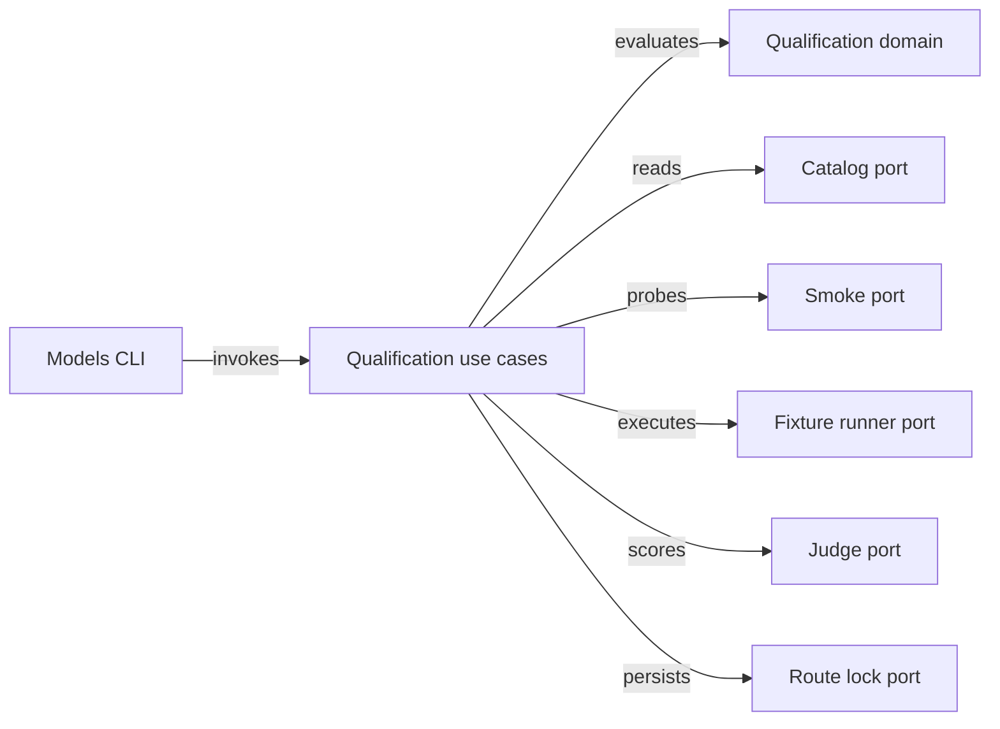

# Qualification ports and adapter contract

Keep discovery and smoke probing behind inward ports in `src/ports/`. Fixture execution, judging and lock persistence share that port boundary. `src/domain/model-qualification.ts` owns filtering and blinding without external effects. It also owns verdict rules, staleness checks and route selection. Blocked for live production command cutover until unified routing ships.



## Port interfaces

`src/ports/model-qualification-port.ts` imports only `src/domain/model-qualification.ts` and pure types. `src/application/models/` depends only on domain types and these ports. Seam tests inject deterministic fakes without live CLIs or network access.

```typescript
export interface RunnerScope {
  workspaceId: string;
  runnerProfile: string;
  platform: string;
  arch: string;
}

export interface DiscoveredModel {
  backend: string;
  provider: string;
  family: string;
  modelId: string;
  supportedEfforts: string[];
  isDefault: boolean;
  hidden: boolean;
}

export interface AdapterDiscoveryReport {
  backend: string;
  status: "available" | "auth_error" | "rate_limited" | "unavailable" | "unconfigured";
  cliVersion: string | "unknown";
  adapterVersion: string;
  supportsModelForwarding: boolean;
  models: DiscoveredModel[];
  error?: string;
}

export interface SmokeProbeRequest {
  scope: RunnerScope;
  backend: string;
  modelId: string;
  effort?: string;
  timeoutMs: number;
}

export interface SmokeProbeEvidence {
  backend: string;
  requestedModel: string;
  requestedEffort?: string;
  observedModel: string | "unknown";
  status: "passed" | "failed" | "timed_out" | "auth_error";
  schemaValid: boolean;
  exitCode: number;
  durationMs: number;
  error?: string;
}

export interface FixtureRepeatRequest {
  fixtureId: string;
  role: "define" | "implement" | "review";
  repeatIndex: number;
  route: {
    backend: string;
    modelId: string;
    effort?: string;
  };
  handoffArtifactDir?: string;
}

export interface FixtureRepeatEvidence {
  fixtureId: string;
  repeatIndex: number;
  requestedModel: string;
  observedModel: string | "unknown";
  deterministicGatesPassed: boolean;
  gateChecks: Array<{
    checkId: string;
    passed: boolean;
    detail: string;
  }>;
  durationMs: number;
  retries: number;
  usage?: {
    tokensIn?: number;
    tokensOut?: number;
    costUsd?: number;
  };
  sanitizedOutput: string;
}

export interface JudgeVerdictPacket {
  comparisonId: string;
  role: "define" | "implement" | "review";
  fixtureSummary: string;
  optionA: string;
  optionB: string;
  gateEvidenceSummary: string;
}

export interface StructuredJudgeVerdict {
  judgeBackend: string;
  judgeProvider: string;
  judgeFamily: string;
  judgeModelId: string;
  observedJudgeModel: string | "unknown";
  winner: "A" | "B" | "tie";
  optionARegression: boolean;
  optionBRegression: boolean;
  scores: {
    optionA: number;
    optionB: number;
  };
  citations: Array<{
    inputRef: string;
    outputRef: string;
    gateRef: string;
    claim: string;
  }>;
}

export interface ModelCatalogPort {
  discoverCatalog(input: {
    scope: RunnerScope;
    backends?: string[];
    explicitCandidates?: DiscoveredModel[];
    nowIso: string;
  }): Promise<AdapterDiscoveryReport[]>;
}

export interface SmokeProbePort {
  runSmokeProbe(request: SmokeProbeRequest): Promise<SmokeProbeEvidence>;
}

export interface QualificationRunnerPort {
  computeSuiteHashes(): Promise<{
    fixtureSuiteHash: string;
    workflowPromptHashes: Record<string, string>;
  }>;
  runFixtureRepeat(request: FixtureRepeatRequest): Promise<FixtureRepeatEvidence>;
}

export interface PromotionJudgePort {
  judgeComparison(
    judgeRoute: {
      backend: string;
      provider: string;
      family: string;
      modelId: string;
      effort?: string;
    },
    packet: JudgeVerdictPacket,
  ): Promise<StructuredJudgeVerdict>;
}

export interface RouteLockStorePort {
  writeDiscoverySnapshot(scope: RunnerScope, snapshot: unknown): Promise<string>;
  readDiscoverySnapshot(scope: RunnerScope): Promise<unknown | null>;
  writeEvaluationBundle(evaluationId: string, bundle: unknown): Promise<string>;
  readEvaluationBundle(idOrPath: string): Promise<unknown>;
  readRouteLock(scope: RunnerScope): Promise<unknown | null>;
  writeRouteLockAtomic(scope: RunnerScope, lock: unknown): Promise<string>;
}
```

## Plugin and unified-routing boundary

`AgentBackend` in `src/plugins/agent-backend.ts` gains an optional `discoverModels?()` method. `dispatch()` never runs catalog discovery, and `discoverModels()` never mutates governance files or dispatches workflow tasks.

`AgentTaskRequest` in `src/ports/agent-port.ts` adds typed `effort?: string` and `routeMode?: "pinned" | "provider-default"`. `AgentTaskResult` adds `observedModel?: string | "unknown"`. Adapters map `effort` to native CLI flags internally and populate `observedModel` only when runtime output reports it, returning `"unknown"` otherwise.

Live cutover of `define`, `implement` and `ship` waits on the unified routing spec in `docs/architecture/assessments/2026-11-11-self-assessment/specs/03-unified-agent-dispatch-and-stream-contracts/spec.md` so one `AgentPort.selectRoute` seam consumes the route lock.

## Discovery behavior by adapter

| Adapter | Discovery source | Qualification constraint | Phase |
|---|---|---|---|
| `agy` | Authenticated `agy models` CLI | Separate Antigravity Claude routes from native `claude` | Phase 2 |
| `codex` | App Server `model/list` stdio pagination | Preserve effort list and exclude `hidden` entries | Phase 2 |
| `claude` | Agent SDK `supportedModels()` or auth probe | Report expired OAuth as `auth_error` without blocking | Phase 2 |
| `cursor-agent` | Supported model-list command or explicit candidates | Exclude `auto` from candidate pins | Phase 2 |
| `opencode` | `opencode models` under project config | Preserve provider-qualified model ID and variant | Phase 2 |
| `aider` | `aider --list-models` plus explicit filter | Require smoke probe before candidate eligibility | Phase 2 |
| `goose` | Explicit `--candidates` input or provider list | Block pin promotion while `supportsModelForwarding` is false | Phase 2 |

The standalone `gemini` adapter stays out of qualification scope. Google model qualification runs through `agy`.

## Phase mapping

| Contract surface | Owning module | Seam test | Phase |
|---|---|---|---|
| Domain types and ports | `src/ports/model-qualification-port.ts` | `src/domain/model-qualification.test.ts` | Phase 1 |
| Adapter discovery and smoke probe | `src/adapters/models/catalog-discovery.ts` | `src/adapters/models/catalog-discovery.test.ts` | Phase 2 |
| Fixture runner and judge orchestration | `src/application/models/evaluate-models.ts` | `src/application/models/evaluate-models.test.ts` | Phase 3 |
| Atomic lock persistence and CLI | `src/adapters/models/route-lock-store.ts` | `src/adapters/models/route-lock-store.test.ts` | Phase 4 |
| Unified route resolution and manifests | `src/application/models/resolve-route.ts` | `src/application/models/resolve-route.test.ts` | Phase 5 |
