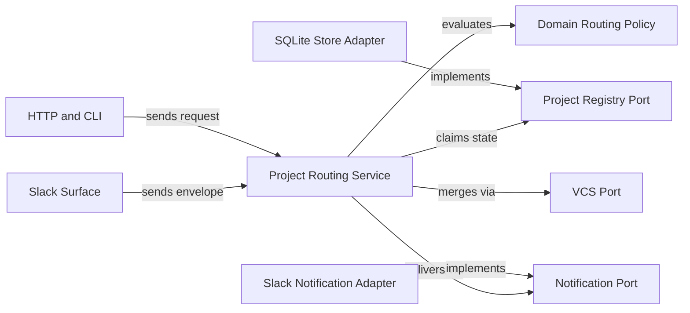

# Project identity and Slack routing plan

Enroll each repository behind `ProjectRegistryPort` and authorize every Slack and HTTP entry point before work starts. Scope SQLite keys, thread receipts and dispatch records by project and recipient. Blocked: integration waits on `042-port-adapter-separation` review.

## Target routing boundary



## Observed baseline

| Surface | Current module | Observed defect | Planned change |
|---|---|---|---|
| Project identity | `src/domain/project-id.ts` | Remote addition changes hash from path MD5 to remote MD5 | Keep canonical remote MD5 and register path aliases |
| Project table | `src/db/runs.ts` | `projects.path UNIQUE` forces `#projectId` path suffix | Drop `path UNIQUE` and store enrollment fields |
| SQLite composite keys | `src/db/migrations/009-project-scoping.sql` | Primary and unique keys omit `project_id` on six tables | Rebuild composite `(project_id, ...)` keys in migration `014` |
| Routing audit table | `src/server/routing-decisions.ts` | `routing_decisions` omits `project_id` | Add `project_id` column and scoped index |
| Slack command context | `src/server/slack.ts` | Startup `CommandContext` ignores workspace, channel and user | Resolve enrolled project and role per command |
| Shared channels and DMs | `src/server/slack-commands.ts` | Accepts unscoped commands without `--project` selector | Reject ambiguous bindings until caller selects project |
| Button actions and merge | `src/server/slack-actions.ts` | Lacks click-time auth, replay receipt and `VcsPort` merge | Re-authorize actor, record receipt and merge via `VcsPort` |
| Thread receipts | `src/server/slack-notify.ts` | Reads `process.cwd()` config and drops feature `thread_ts` | Persist `(project_id, feature_id)` root threads |
| Presence batching | `src/server/slack-presence.ts` | Polls `users.list()[0]` into one global event queue | Key away queues by `(projectId, recipientUserId)` |
| Dispatch and watchers | `src/server/dispatch.ts` | Keys active runs without `projectId` and hardcodes `develop` | Key by `(projectId, featureId, phaseId)` and `trunkBranch` |
| Notify and Telegram | `src/server/routes/notify.ts` | Forces `done_done` to ops channel and forwards to Telegram | Keep `done_done` on feature thread and disable Telegram |
| Local CLI status | `src/commands/status.ts` | Swallows server errors under `--json` and blurs readiness | Split daemon liveness, project readiness and Slack status |

## Contract mapping

| Contract group | Symbols | Phase | Contract file |
|---|---|---|---|
| Domain identity and enrollment | `EnrolledProject`, `DeliveryRecipient` and `computeLegacyProjectIds` | Phase 1 | `contracts/project-registry-and-storage.md` |
| Pure routing policy | `evaluateSlackRoute`, `evaluateSlackAction` and `evaluateHttpProjectAccess` | Phase 1 | `contracts/slack-routing-and-operations.md` |
| Store, notification and VCS ports | `ProjectRegistryPort`, `NotificationPort` and `VcsPort` | Phase 1 | `contracts/project-registry-and-storage.md` |
| SQLite composite keys and registry | Migration `014` and `createSqliteProjectRegistryAdapter` | Phase 2 | `contracts/project-registry-and-storage.md` |
| Slack coordinator and receipts | `ProjectRoutingService` and synthetic Slack fixtures | Phase 3 and Phase 4 | `contracts/slack-routing-and-operations.md` |
| Scoped dispatch, readiness and CLI | `DispatchRecord`, `HealthResponse` and `gwrk project enroll` | Phase 5 and Phase 6 | `contracts/slack-routing-and-operations.md` |

### Phase 1: Identity and routing policy

#### Files

- `src/domain/project-id.ts` (MODIFY: Add `computeLegacyProjectIds` alongside canonical `computeProjectId`)
- `src/domain/project-registry.ts` (NEW: Define pure enrollment and role schemas plus thread and action receipt types)
- `src/domain/slack-routing.ts` (NEW: Implement pure Slack and HTTP routing policy with thread and replay checks)
- `src/domain/index.ts` (MODIFY: Export project registry and Slack routing contracts from the domain barrel)
- `src/ports/store-port.ts` (MODIFY: Add `ProjectRegistryPort` to the existing persistence port module)
- `src/ports/notification-port.ts` (MODIFY: Add project and recipient fields plus receipt, presence and status contracts)
- `src/ports/vcs-port.ts` (MODIFY: Add identity discovery, pull request lookup and pull request merge methods)
- `src/domain/project-id.test.ts` (MODIFY: Verify canonical remote IDs and legacy path alias hashes)
- `src/domain/slack-routing.test.ts` (NEW: Test wrong workspace or channel denials and wrong user or project plus thread and replay faults)

#### Governance and skills

- Architecture rules: `.gwrk/architecture.md` and `docs/decisions/ADR-013-desired-architecture.md`
- Decisions: `docs/decisions/ADR-005-tdd-gate-architecture.md` and `docs/decisions/ADR-011-hexagonal-and-agent-port.md`
- Skills: `compile-gate`
- Delivers: `FR-001`, `FR-002` and `FR-003`

#### Test Strategy

| ID | Type | Target | Assertion |
|---|---|---|---|
| TR-001 | unit | `src/domain/project-id.test.ts` | Remote origin keeps canonical hash while emitting legacy path aliases |
| TR-002 | unit | `src/domain/slack-routing.test.ts` | Policy denies wrong workspace, channel, user, role and ambiguous DM or shared channel |
| TR-003 | unit | `src/domain/slack-routing.test.ts` | Click-time policy denies wrong project, wrong thread and replayed action receipts |
| TR-004 | unit | `src/architecture.test.ts` | New domain and port modules satisfy AST import purity rules |

#### Done When

```bash
pnpm build
pnpm exec vitest run src/domain/project-id.test.ts src/domain/slack-routing.test.ts src/architecture.test.ts
```

### Phase 2: SQLite registry and keys

#### Files

- `src/db/migrations/014-project-registry-and-composite-keys.sql` (NEW: Add registry tables and rebuild six composite `project_id` tables)
- `src/db/project-registry.ts` (NEW: Implement SQLite enrollment and alias lookup plus role bindings, threads and receipts)
- `src/db/runs.ts` (MODIFY: Remove `#projectId` path hack and read canonical plus alias project IDs)
- `src/db/plan.ts` (MODIFY: Scope feature and phase writes plus edge, proposal and alias queries by `project_id`)
- `src/db/gates.ts` (MODIFY: Scope gate upserts and alias reads by composite `project_id` key)
- `src/db/issues.ts` (MODIFY: Scope issue upserts and alias reads by `(project_id, issue_number)`)
- `src/db/compression.ts` (MODIFY: Match canonical and alias project IDs when reading compression history)
- `src/server/routing-decisions.ts` (MODIFY: Record and query `project_id` on `routing_decisions` rows)
- `src/adapters/sqlite/index.ts` (MODIFY: Export `createSqliteProjectRegistryAdapter` over injected database handles)
- `src/db/scoping.test.ts` (MODIFY: Prove two-repo composite key isolation and legacy alias preservation)

#### Governance and skills

- Architecture rules: `.gwrk/architecture.md` and `docs/decisions/ADR-011-hexagonal-and-agent-port.md`
- Decisions: `docs/decisions/ADR-002-sqlite-execution-ledger.md` and `docs/decisions/ADR-003-state-contract.md`
- Skills: `compile-gate`
- Delivers: `FR-001`, `FR-004` and `FR-006`

#### Test Strategy

| ID | Type | Target | Assertion |
|---|---|---|---|
| TR-005 | integration | `src/db/scoping.test.ts` | Two enrolled repos with matching feature IDs write plans, gates and issues without overwrite or cascade loss |
| TR-006 | integration | `src/db/scoping.test.ts` | Legacy local rows remain readable after remote enrollment adds canonical project ID |
| TR-007 | integration | `src/db/scoping.test.ts` | `recordActionReceipt` rejects duplicate button or reaction receipt keys |
| TR-008 | unit | `src/db/db.test.ts` | Migration `014` preserves existing SQLite ledger behavior |

#### Done When

```bash
pnpm build
pnpm exec vitest run src/db/scoping.test.ts src/db/db.test.ts src/db/plan.test.ts src/db/runs.test.ts src/db/issues.test.ts src/db/compression.test.ts src/architecture.test.ts
```

### Phase 3: Slack commands and receipts

#### Files

- `src/application/project-routing/index.ts` (NEW: Coordinate project resolution and role checks plus action receipts and thread delivery)
- `src/adapters/git/index.ts` (MODIFY: Implement identity discovery, pull request URL lookup and pull request merge on `VcsPort`)
- `src/server/slack-messages.ts` (MODIFY: Stamp `projectId`, project slug and `rootTs` into Slack blocks and action values)
- `src/server/slack-commands.ts` (MODIFY: Parse `--project`, authorize via `ProjectRoutingService` and thread replies per project)
- `src/server/slack-actions.ts` (MODIFY: Re-authorize clicks, enforce replay receipts and merge pull requests via `VcsPort`)
- `src/server/slack-agent.ts` (MODIFY: Require authorized project resolution for mentions, direct messages and reactions)
- `src/server/slack-home.ts` (MODIFY: Render only enrolled projects where the Slack viewer holds a role)
- `src/server/slack.ts` (MODIFY: Remove single-project startup context and resolve workspace, channel and user per event)
- `tests/helpers/synthetic-slack.ts` (NEW: Provide deterministic synthetic Slack fixtures with zero network calls)
- `src/server/slack-actions.test.ts` (MODIFY: Test click-time re-authorization and thread mismatch plus click replay and `VcsPort` merge)

#### Governance and skills

- Architecture rules: `.gwrk/architecture.md` and `docs/decisions/ADR-013-desired-architecture.md`
- Decisions: `docs/decisions/ADR-008-command-safety-posture.md` and `docs/decisions/ADR-011-hexagonal-and-agent-port.md`
- Skills: `compile-gate`
- Delivers: `FR-002` and `FR-003`

#### Test Strategy

| ID | Type | Target | Assertion |
|---|---|---|---|
| TR-009 | integration | `src/server/slack-actions.test.ts` | Button actions reject wrong user, wrong project, wrong thread and replayed clicks |
| TR-010 | unit | `src/server/slack-messages.test.ts` | Interactive payloads carry `projectId` and `rootTs` metadata |
| TR-011 | unit | `src/server/slack-agent.test.ts` | Mentions, direct messages and reactions enforce project selection and roles |
| TR-012 | unit | `src/server/slack-home.test.ts` | App Home lists only projects visible to the requesting Slack user |

#### Done When

```bash
pnpm build
pnpm exec vitest run src/server/slack-actions.test.ts src/server/slack-messages.test.ts src/server/slack-agent.test.ts src/server/slack-home.test.ts src/server/slack.test.ts src/architecture.test.ts
```

### Phase 4: Presence and pilot guards

#### Files

- `src/adapters/notifications/index.ts` (MODIFY: Implement scoped `NotificationPort` receipts, presence lookup and delivery status)
- `src/server/slack-notify.ts` (MODIFY: Route by enrolled project and stored feature thread without `process.cwd()` fallback)
- `src/server/slack-presence.ts` (MODIFY: Batch away notifications per `(projectId, recipientUserId)` instead of global `users.list`)
- `src/server/telegram.ts` (MODIFY: Disable Telegram transport in hosted pilot mode with zero outbound calls)
- `src/server/slack-notify.test.ts` (MODIFY: Verify per-project channel, feature thread and explicit ops channel delivery)
- `src/server/slack-presence.test.ts` (MODIFY: Verify away queues stay isolated per project and recipient user)
- `src/server/telegram.test.ts` (MODIFY: Verify pilot mode disables Telegram even when credentials exist)
- `src/server/slack-commands.test.ts` (MODIFY: Verify slash commands reject wrong workspace or channel plus unauthorized users and ambiguous bindings)

#### Governance and skills

- Architecture rules: `.gwrk/architecture.md` and `docs/decisions/ADR-011-hexagonal-and-agent-port.md`
- Decisions: `docs/decisions/ADR-005-tdd-gate-architecture.md`
- Skills: `compile-gate`
- Delivers: `FR-002` and `FR-003` plus `FR-005` and `FR-007`

#### Test Strategy

| ID | Type | Target | Assertion |
|---|---|---|---|
| TR-013 | unit | `src/server/slack-notify.test.ts` | Lifecycle events thread under `(projectId, featureId)` and keep `opsOnly` explicit |
| TR-014 | unit | `src/server/slack-presence.test.ts` | Away batches flush only to the matching project and recipient |
| TR-015 | unit | `src/server/telegram.test.ts` | Disabled pilot guard suppresses all Telegram HTTP requests |
| TR-016 | integration | `src/server/slack-commands.test.ts` | Synthetic slash commands enforce `--project` on shared channels and DMs |

#### Done When

```bash
pnpm build
pnpm exec vitest run src/server/slack-notify.test.ts src/server/slack-presence.test.ts src/server/telegram.test.ts src/server/slack-commands.test.ts src/architecture.test.ts
```

### Phase 5: Scoped dispatch and server routes

#### Files

- `src/server/types.ts` (MODIFY: Add `projectId` and `trunkBranch` plus `recipient` and structured readiness types)
- `src/server/dispatch.ts` (MODIFY: Key dispatches by `(projectId, featureId, phaseId)` and branch from enrolled `trunkBranch`)
- `src/server/persistence.ts` (MODIFY: Persist `projectId`, `trunkBranch` and `recipient` in dispatch snapshots)
- `src/server/github.ts` (MODIFY: Resolve pull requests through `VcsPort` inside the enrolled project checkout)
- `src/server/harvest-watcher.ts` (MODIFY: Watch enrolled project roots and attach project and thread recipients)
- `src/server/heartbeat.ts` (MODIFY: Emit per-project ops health without global single-channel assumptions)
- `src/server/routes/notify.ts` (MODIFY: Require authorized project scope and keep `done_done` on feature threads)
- `src/server/routes/health.ts` (MODIFY: Report separate `daemonLiveness` and `projectReadiness` plus `slackDelivery` and disabled Telegram)
- `src/server/routes/status.ts` (MODIFY: Filter dispatch history and active work by authorized `projectId`)
- `src/server/dispatch.test.ts` (MODIFY: Prove concurrent dispatches for matching feature IDs across two projects stay isolated)

#### Governance and skills

- Architecture rules: `.gwrk/architecture.md` and `docs/decisions/ADR-013-desired-architecture.md`
- Decisions: `docs/decisions/ADR-003-state-contract.md` and `docs/decisions/ADR-011-hexagonal-and-agent-port.md`
- Skills: `compile-gate`
- Delivers: `FR-003`, `FR-005` and `FR-007`

#### Test Strategy

| ID | Type | Target | Assertion |
|---|---|---|---|
| TR-017 | integration | `src/server/dispatch.test.ts` | Two projects with identical feature and phase IDs queue and branch independently |
| TR-018 | unit | `src/server/routes/notify.test.ts` | `/api/notify` rejects unauthorized remote calls and posts `done_done` to feature threads |
| TR-019 | unit | `src/server/routes/health.test.ts` | `/api/health` separates daemon liveness, project readiness and Slack delivery status |
| TR-020 | unit | `src/server/routes/status.test.ts` | `/api/status` returns only records belonging to the requested enrolled project |

#### Done When

```bash
pnpm build
pnpm exec vitest run src/server/dispatch.test.ts src/server/routes/notify.test.ts src/server/routes/health.test.ts src/server/routes/status.test.ts src/server/github.test.ts src/architecture.test.ts
```

### Phase 6: Enrollment CLI and isolation proof

#### Files

- `src/server/routes/dispatch.ts` (MODIFY: Enforce `evaluateHttpProjectAccess` and pass `projectId` and `recipient` to `DispatchQueue`)
- `src/server/index.ts` (MODIFY: Wire `ProjectRegistryPort` and `ProjectRoutingService` plus `VcsPort` and multi-project watchers)
- `src/commands/project-enroll.ts` (NEW: Implement `gwrk project enroll`, `list` and `show` with ADR-004 output)
- `src/commands/project.ts` (MODIFY: Register `enroll`, `list` and `show` subcommands on `gwrk project`)
- `src/commands/init.ts` (MODIFY: Enroll or update the local repository with legacy alias preservation)
- `src/commands/status.ts` (MODIFY: Surface daemon liveness and server reachability plus project readiness and Slack delivery)
- `src/commands/server.ts` (MODIFY: Start the server against the project registry while keeping local single-repo defaults)
- `src/commands/project.test.ts` (MODIFY: Test `gwrk project enroll`, `list` and `show` JSON and text contracts)
- `src/commands/status.test.ts` (NEW: Verify `gwrk status --json` exits non-zero when a configured server is unreachable)
- `src/server/two-repo-isolation.test.ts` (NEW: Prove two-repo isolation across identical feature IDs and synthetic Slack fault cases)

#### Governance and skills

- Architecture rules: `docs/decisions/ADR-004-agent-native-output.md` and `docs/decisions/ADR-008-command-safety-posture.md`
- Decisions: `docs/decisions/ADR-011-hexagonal-and-agent-port.md` and `docs/decisions/ADR-013-desired-architecture.md`
- Skills: `compile-gate`
- Delivers: `FR-001` and `FR-004` plus `FR-005` and `FR-006`

#### Test Strategy

| ID | Type | Target | Assertion |
|---|---|---|---|
| TR-021 | integration | `src/commands/project.test.ts` | CLI enrolls repositories, records aliases and emits ADR-004 JSON and stderr signals |
| TR-022 | unit | `src/commands/status.test.ts` | `gwrk status` distinguishes daemon liveness, project readiness, Slack delivery and unreachable servers |
| TR-023 | unit | `src/server/routes/dispatch.test.ts` | Remote `/api/dispatch` calls without project authorization fail while local enrolled calls succeed |
| TR-024 | integration | `src/server/two-repo-isolation.test.ts` | Two repos with matching feature IDs isolate reads, writes, threads, presence and replay guards with zero live calls |

#### Done When

```bash
pnpm build
pnpm exec vitest run src/commands/project.test.ts src/commands/status.test.ts src/commands/init.test.ts src/commands/server.test.ts src/server/routes/dispatch.test.ts src/server/two-repo-isolation.test.ts src/architecture.test.ts
```

## Coverage matrix

| Requirement | Summary | Phase | Verification |
|---|---|---|---|
| FR-001: Project enrollment and legacy aliases | Enroll stable repo identity, trunk, checkout, runner policy, Slack binding and legacy hashes | Phase 1, Phase 2 and Phase 6 | `TR-001`, `TR-006` and `TR-021` |
| FR-002: Slack workspace, channel and role auth | Authorize workspace, channel, user, selector and mutation role before accepting work | Phase 1, Phase 3 and Phase 4 | `TR-002`, `TR-011` and `TR-016` |
| FR-003: Scoped dispatch, threads and click auth | Thread replies per project feature, carry recipients and re-authorize button clicks with replay receipts | Phase 1, Phase 3, Phase 4 and Phase 5 | `TR-003`, `TR-009`, `TR-013` and `TR-017` |
| FR-004: Local single-project compatibility | Preserve local CLI workflow via `init` and loopback defaults while denying unauthorized remote requests | Phase 2 and Phase 6 | `TR-006`, `TR-021` and `TR-023` |
| FR-005: Liveness, readiness and ops separation | Separate daemon liveness, project readiness, Slack delivery and explicit operations routing | Phase 4, Phase 5 and Phase 6 | `TR-013`, `TR-019` and `TR-022` |
| FR-006: Two-repository collision proof | Prove two repos with matching feature and branch names stay isolated across synthetic Slack faults | Phase 2 and Phase 6 | `TR-005` and `TR-024` |
| FR-007: Downstream recipient contract and Telegram guard | Export `DeliveryRecipient` for durable dispatch and harvest while keeping Telegram disabled in pilot | Phase 4 and Phase 5 | `TR-015`, `TR-017` and `TR-018` |

## Sister spec dependencies

- Upstream boundary gates: `040-pure-domain-boundary-gates` provides the AST boundary checks in `src/architecture.test.ts`.
- Upstream port separation: `042-port-adapter-separation` separates `NotificationPort` and SQLite store handles, and blocks integration until review completes.
- Hosted auth sibling: `041-hosted-google-signin-proof` supplies `google_sub` principals consumed by `ProjectRoleBinding` on hosted HTTP routes.
- Downstream consumers: durable dispatch and harvest consume `EnrolledProject` and `DeliveryRecipient` from `contracts/project-registry-and-storage.md`.

## Deferred items

None. Full coverage of `specs/048-project-identity-slack/spec.md`.
