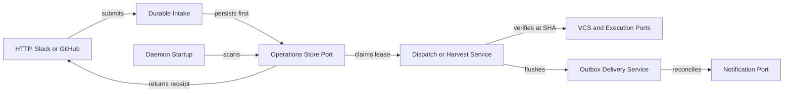

# Application coordinator, ingress and CLI contracts

Persist every accepted dispatch and harvest operation before acknowledging HTTP, Slack or GitHub callers. Resume incomplete stages and uncertain Slack deliveries from SQLite receipts on startup and replay. Blocked: HTTP and Slack entry points consume authorization decisions from `048-project-identity-slack`.

## Recovery flow



## Application coordinators

Modules: `src/application/dispatch/index.ts`, `src/application/harvest/index.ts` and `src/application/delivery/outbox.ts`

Phase: Phase 4

```typescript
export interface DurableDispatchService {
  accept(input: {
    project: EnrolledProject;
    featureId: string;
    phaseId: string;
    taskIds?: string[];
    backend: string;
    recipient?: DeliveryRecipient | null;
  }): DispatchReceipt;
  recoverOnStartup(ownerId: string): Promise<{
    requeuedCount: number;
    completedFromPrCount: number;
    failedCount: number;
  }>;
  drainReady(ownerId: string, maxConcurrent: number): Promise<void>;
  getOperation(
    projectId: string,
    featureId: string,
    phaseId: string,
  ): DurableDispatchOperation | null;
}

export interface HarvestExecutionSummary {
  operationId: string;
  projectId: string;
  workKey: string;
  deduplicatedTransport: boolean;
  deduplicatedWork: boolean;
  status: HarvestOperationStatus;
  linkedRunId: number | null;
  pendingStages: HarvestStageName[];
  failedStages: HarvestStageName[];
}

export interface DurableHarvestService {
  ingestWebhook(input: {
    deliveryId: string;
    eventType: string;
    rawBody: Buffer;
    signatureHeader?: string;
    webhookSecret?: string;
    parsedPayload: unknown;
  }): Promise<
    | { accepted: true; summary: HarvestExecutionSummary }
    | { accepted: false; httpStatus: 200 | 400 | 401; reason: string }
  >;
  pollProject(project: EnrolledProject, ownerId: string): Promise<HarvestExecutionSummary[]>;
  runManualHarvest(input: {
    project: EnrolledProject;
    featureId: string;
    phaseId?: string;
    prNumber?: number;
    commitSha?: string;
    recipient?: DeliveryRecipient | null;
    updateLocalTaskState: boolean;
    ownerId: string;
  }): Promise<HarvestExecutionSummary[]>;
  resumeIncomplete(ownerId: string): Promise<HarvestExecutionSummary[]>;
}

export interface OutboxDeliveryService {
  enqueueProjectNotification(input: {
    project: EnrolledProject;
    dedupeKey: string;
    ownerKind: "dispatch" | "harvest";
    ownerOperationId: string;
    eventType: string;
    featureId: string;
    phaseId?: string;
    recipient: DeliveryRecipient;
    message: { text: string; blocks?: unknown[]; opsOnly?: boolean };
  }): string;
  flushOutboxItem(outboxId: string): Promise<{
    status: "delivered" | "uncertain" | "skipped_no_target" | "failed";
    messageTs?: string;
    threadTs?: string;
  }>;
  flushPendingForProject(projectId: string): Promise<number>;
}
```

Startup recovery runs `DurableDispatchService.recoverOnStartup` before new workers start. Expired or interrupted running leases call `WorkerExecutionPort.inspectRecoveredWork` first. If the prior worker opened or merged a pull request, recovery records completion without starting a second worker. If the prior worker is still running, recovery waits or obtains a confirmed stop before requeueing. An unavailable or ambiguous worker lookup leaves recovery pending. Only a confirmed stopped worker without a terminal pull request can be requeued under a new `leaseEpoch`.

Harvest coordination drives five ordered stages for merged pull requests. Those stages are `git_sync`, `gate_verify` and `learning_record` plus `slack_delivery` and `branch_cleanup`. Each stage checks its `harvest_stage_receipts` row first and skips work marked `succeeded` or `skipped_no_target`. If `gate_verify` fails, the service records `gate_failed` and skips phase promotion. It then queues `harvest_gate_failed` to the feature thread so status reports the failure. Outbox flushing calls `NotificationPort.reconcileDelivery` whenever an item starts in `sending` or `uncertain`. Indeterminate lookup leaves the item uncertain and visible in status. Only confirmed absence permits a new send. Telegram remains disabled across all hosted pilot notifications.

Resolve the phase list from the checkout before accepting a manual commit harvest without an explicit phase. Use `scopeManualHarvestToPhases` to give each phase a stable delivery ID. Verify all scoped candidates before recording the first one. A retried intake uses the same scoped delivery IDs. A verified pull request for a covered phase reuses that phase's operation and receipts in either arrival order. For a verified whole-feature merge, resolve the covered phases at the merge checkout. If a manual command requests one phase, accept only that phase. Reject the request when coverage is empty or excludes that phase.

After acquiring a harvest lease, initialize every planned stage in one store call before running any effect. On takeover, read the complete set of stage receipts from the lease claim. Resume pending stages from those receipts.

## HTTP, Slack and webhook ingress contracts

Modules: `src/server/routes/dispatch.ts` and `src/server/slack.ts` plus `src/server/slack-commands.ts`, `src/server/slack-actions.ts` and `src/server/github.ts`

Phases: Phase 5 and Phase 6

| Ingress | Persistence before ack | Response or receipt | Duplicate behavior |
|---|---|---|---|
| `POST /api/dispatch` | `DurableDispatchService.accept` commits SQLite row | HTTP `201` (new) or `200` (existing) with `DispatchReceipt` | Returns existing active `operationId` |
| Slack `/gwrk dispatch` and `/gwrk ship` | Authorize via `048`, then persist `DispatchReceipt` before `ack()` | Ephemeral or threaded message with `operationId` | Replies with active `operationId` |
| Slack `request_changes` and `retry_phase` | Claim the authorized Slack action and persist `DispatchReceipt` in one SQLite transaction before `ack()` | Thread reply naming `operationId` and attempt | Rejects replayed click or returns active `operationId` |
| `POST /webhook/github` | Verify raw-body HMAC and commit `harvest_deliveries` plus `harvest_operations` | HTTP `200` with `{ status, deliveryId, operationId }` | Transport retry returns stored `operationId` |

Keep authorization and durable acceptance on the acknowledgement path. Run GitHub lookups and agent work after acceptance. Store a transport payload digest with the verified delivery ID. An out-of-order close cannot overwrite an already verified merge. Reconcile ambiguous GitHub state from the enrolled repository before promoting any phase.

### Durable status payload extensions

Source: `src/server/types.ts` and `src/server/routes/status.ts`

```typescript
export interface DurableOperationsStatus {
  projectId: string;
  queue: {
    queuedCount: number;
    activeCount: number;
    oldestQueuedAt: string | null;
    staleLeasesReconciled: number;
  };
  harvest: {
    lastCompletedAt: string | null;
    lastMergeCommitSha: string | null;
    pendingOperations: number;
    pendingStages: Array<{
      operationId: string;
      featureId: string;
      phaseId: string | null;
      stage: HarvestStageName;
      status: HarvestStageStatus;
    }>;
    unresolvedGateFailures: number;
    closedUnmergedCount: number;
    blockedCleanups: number;
  };
  delivery: {
    pendingCount: number;
    uncertainCount: number;
    failedCount: number;
    telegram: { enabled: false; reason: "disabled_in_pilot" };
  };
  historical: {
    legacyUnverifiedRuns: number;
    legacyUnverifiedDispatches: number;
  };
}
```

## CLI contracts (ADR-004)

Modules: `src/commands/harvest.ts` and `src/commands/status.ts`

Phase: Phase 6

| Command | Type | Flags | Exit codes and navigation |
|---|---|---|---|
| `gwrk harvest <feature> [phase]` | mutator | `--project <slug>`, `--pr <n>`, `--commit <sha>`, `--format json` | `0` completed or `closed_unmerged` recorded, `1` gate failure or stage error with recovery command, `2` invalid arguments |
| `gwrk status` | query | `--project <slug>`, `--json`, `--format json` | `0` healthy, `1` unreachable server, unresolved `gate_failed` or failed delivery with remediation hint |

Both CLI commands emit `[exit:N | Xs]` on `stderr` via `withSignal` and write JSON under `--format json`. Local single-project checkouts without Slack or a remote server resolve the local repository enrollment. Manual harvest verifies gates at the local trunk commit or `--commit <sha>` and skips Slack and remote delete. Historical rows stay marked `legacy_unverified`.
