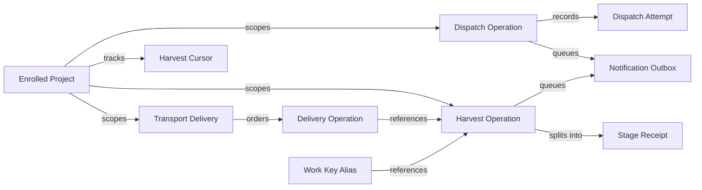

# Durable dispatch and harvest data model

Persist accepted dispatch and harvest operations plus lease epochs, stage receipts and outbound notifications in SQLite. Keep git authoritative for task state and execution manifests under Architecture Decision Record 002 (ADR-002) and ADR-003. Blocked: schema foreign keys depend on migration `014` from `048-project-identity-slack`.

## Entity relationships



## Storage responsibilities

| Table | Primary or unique key | Purpose | Authority |
|---|---|---|---|
| `dispatch_operations` | `operation_id`, active `(project_id, work_key)` | Durable dispatch acceptance, lease fencing and PR linkage | Operational queue ledger |
| `dispatch_attempts` | `(operation_id, attempt_number)` | Per-attempt worker lease, run ID and exit outcome | Operational attempt log |
| `harvest_deliveries` | `(source, delivery_id)` | Repository and payload identity for transport replay | Ingress audit log |
| `harvest_delivery_operations` | `(source, delivery_id, position)` | Ordered operations accepted for a delivery | Transport replay |
| `harvest_work_key_aliases` | `(project_id, work_key)` | Local and verified pull request work keys for one operation | Work deduplication |
| `harvest_cursors` | `project_id` | Per-project GitHub polling watermark and last error | Poller catch-up cursor |
| `harvest_operations` | `operation_id`, `(project_id, work_key)` | Single harvest record per verified work scope | Operational harvest ledger |
| `harvest_stage_receipts` | `(operation_id, phase_key, stage)` | Independent progress for sync, gates, learning, Slack and cleanup | Stage recovery state |
| `notification_outbox` | `outbox_id`, `(project_id, dedupe_key)` | Durable recipient routing and uncertain-send reconciliation | Outbound delivery ledger |

## SQLite migration `015`

Source: `src/db/migrations/015-durable-dispatch-and-harvest.sql`

```sql
CREATE TABLE IF NOT EXISTS dispatch_operations (
  operation_id     TEXT PRIMARY KEY,
  project_id       TEXT NOT NULL REFERENCES projects(id) ON DELETE CASCADE,
  work_key         TEXT NOT NULL,
  feature_id       TEXT NOT NULL,
  phase_id         TEXT NOT NULL,
  task_ids_json    TEXT NOT NULL DEFAULT '[]',
  backend          TEXT NOT NULL,
  branch_name      TEXT NOT NULL,
  trunk_branch     TEXT NOT NULL,
  recipient_json   TEXT,
  status           TEXT NOT NULL,
  attempt_count    INTEGER NOT NULL DEFAULT 0,
  lease_owner      TEXT,
  lease_epoch      INTEGER NOT NULL DEFAULT 0,
  lease_expires_at TEXT,
  heartbeat_at     TEXT,
  pr_number        INTEGER,
  pr_url           TEXT,
  last_run_id      INTEGER REFERENCES runs(id),
  last_error       TEXT,
  created_at       TEXT NOT NULL,
  updated_at       TEXT NOT NULL,
  completed_at     TEXT
);

CREATE UNIQUE INDEX IF NOT EXISTS idx_dispatch_operations_active_work_key
  ON dispatch_operations(project_id, work_key)
  WHERE status IN ('accepted', 'leased', 'running', 'reconciling');

CREATE INDEX IF NOT EXISTS idx_dispatch_operations_project_status
  ON dispatch_operations(project_id, status, created_at);

CREATE TABLE IF NOT EXISTS dispatch_attempts (
  operation_id   TEXT NOT NULL REFERENCES dispatch_operations(operation_id) ON DELETE CASCADE,
  attempt_number INTEGER NOT NULL,
  lease_epoch    INTEGER NOT NULL,
  lease_owner    TEXT NOT NULL,
  backend        TEXT NOT NULL,
  status         TEXT NOT NULL,
  run_id         INTEGER REFERENCES runs(id),
  worktree_dir   TEXT,
  exit_code      INTEGER,
  error          TEXT,
  started_at     TEXT NOT NULL,
  finished_at    TEXT,
  PRIMARY KEY (operation_id, attempt_number)
);

CREATE TABLE IF NOT EXISTS harvest_deliveries (
  source       TEXT NOT NULL,
  delivery_id  TEXT NOT NULL,
  project_id   TEXT REFERENCES projects(id) ON DELETE CASCADE,
  repo_slug    TEXT,
  payload_digest TEXT NOT NULL,
  event_type   TEXT NOT NULL,
  outcome      TEXT NOT NULL,
  reason       TEXT,
  received_at  TEXT NOT NULL,
  PRIMARY KEY (source, delivery_id),
  UNIQUE (source, delivery_id, project_id)
);

CREATE TABLE IF NOT EXISTS harvest_cursors (
  project_id       TEXT PRIMARY KEY REFERENCES projects(id) ON DELETE CASCADE,
  last_polled_at   TEXT NOT NULL,
  last_terminal_at TEXT,
  last_pr_number   INTEGER,
  last_error       TEXT
);

CREATE TABLE IF NOT EXISTS harvest_operations (
  operation_id      TEXT PRIMARY KEY,
  project_id        TEXT NOT NULL REFERENCES projects(id) ON DELETE CASCADE,
  work_key          TEXT NOT NULL,
  repo_slug         TEXT,
  head_repo_slug    TEXT,
  trunk_branch      TEXT NOT NULL,
  feature_id        TEXT NOT NULL,
  phase_id          TEXT,
  pr_number         INTEGER,
  pr_url            TEXT,
  head_branch       TEXT,
  expected_head_sha TEXT,
  terminal_event    TEXT NOT NULL,
  merge_commit_sha  TEXT,
  terminal_at       TEXT NOT NULL,
  recipient_json    TEXT,
  planned_slack_recipient_json TEXT,
  status            TEXT NOT NULL,
  lease_owner       TEXT,
  lease_epoch       INTEGER NOT NULL DEFAULT 0,
  lease_expires_at  TEXT,
  linked_run_id     INTEGER REFERENCES runs(id),
  last_error        TEXT,
  created_at        TEXT NOT NULL,
  updated_at        TEXT NOT NULL,
  completed_at      TEXT,
  UNIQUE (project_id, work_key),
  UNIQUE (project_id, operation_id)
);

CREATE TABLE IF NOT EXISTS harvest_delivery_operations (
  source        TEXT NOT NULL,
  delivery_id   TEXT NOT NULL,
  project_id    TEXT NOT NULL,
  position      INTEGER NOT NULL CHECK (position >= 0),
  operation_id  TEXT NOT NULL,
  PRIMARY KEY (source, delivery_id, position),
  UNIQUE (source, delivery_id, operation_id),
  FOREIGN KEY (source, delivery_id, project_id)
    REFERENCES harvest_deliveries(source, delivery_id, project_id) ON DELETE CASCADE,
  FOREIGN KEY (project_id, operation_id)
    REFERENCES harvest_operations(project_id, operation_id) ON DELETE CASCADE
);

CREATE TABLE IF NOT EXISTS harvest_work_key_aliases (
  project_id    TEXT NOT NULL,
  work_key      TEXT NOT NULL,
  operation_id  TEXT NOT NULL,
  PRIMARY KEY (project_id, work_key),
  FOREIGN KEY (project_id, operation_id)
    REFERENCES harvest_operations(project_id, operation_id) ON DELETE CASCADE
);

CREATE INDEX IF NOT EXISTS idx_harvest_operations_project_pr
  ON harvest_operations(project_id, pr_number, created_at);

CREATE TABLE IF NOT EXISTS harvest_stage_receipts (
  operation_id  TEXT NOT NULL REFERENCES harvest_operations(operation_id) ON DELETE CASCADE,
  phase_key     TEXT NOT NULL,
  stage         TEXT NOT NULL,
  status        TEXT NOT NULL,
  lease_epoch   INTEGER NOT NULL DEFAULT 0,
  attempt_count INTEGER NOT NULL DEFAULT 0,
  evidence_json TEXT,
  error         TEXT,
  updated_at    TEXT NOT NULL,
  completed_at  TEXT,
  PRIMARY KEY (operation_id, phase_key, stage)
);

CREATE TABLE IF NOT EXISTS notification_outbox (
  outbox_id           TEXT PRIMARY KEY,
  project_id          TEXT NOT NULL REFERENCES projects(id) ON DELETE CASCADE,
  dedupe_key          TEXT NOT NULL,
  owner_kind          TEXT NOT NULL,
  owner_operation_id  TEXT NOT NULL,
  event_type          TEXT NOT NULL,
  feature_id          TEXT NOT NULL,
  phase_id            TEXT,
  recipient_json      TEXT NOT NULL,
  payload_json        TEXT NOT NULL,
  client_metadata_key TEXT NOT NULL,
  status              TEXT NOT NULL,
  workspace_id        TEXT,
  channel_id          TEXT,
  thread_ts           TEXT,
  message_ts          TEXT,
  attempt_count       INTEGER NOT NULL DEFAULT 0,
  last_error          TEXT,
  created_at          TEXT NOT NULL,
  updated_at          TEXT NOT NULL,
  delivered_at        TEXT,
  UNIQUE (project_id, dedupe_key)
);

CREATE INDEX IF NOT EXISTS idx_notification_outbox_pending
  ON notification_outbox(project_id, status, created_at);
```

Record the delivery and its linked operations in one transaction. Persist work-key aliases in that transaction. Store the normalized repository and payload digest with the original delivery. Replay the linked operations in position order after checking both values. Rejected deliveries have no operation links. Resolve the primary work key and alias before inserting a work key in either table.

Save the resolved Slack recipient in `planned_slack_recipient_json` in the fenced transaction that initializes the stage receipts. Require the workspace and channel from the enrolled project binding. Leave it null when the plan has no Slack target. Reuse the saved recipient on plan replay. Use it for the atomic gate failure notice and the notice's first send claim.

## Domain Zod schemas

Sources: `src/domain/durable-dispatch.ts` and `src/domain/durable-harvest.ts`

```typescript
import { z } from "zod";

export const EvidenceLevelSchema = z.enum(["durable_verified", "legacy_unverified"]);

export const DispatchOperationStatusSchema = z.enum([
  "accepted",
  "leased",
  "running",
  "reconciling",
  "completed",
  "failed",
  "superseded",
]);

export const DispatchAttemptStatusSchema = z.enum([
  "running",
  "completed",
  "failed",
  "interrupted",
  "reconciled_completed",
]);

export const DeliverySourceSchema = z.enum([
  "github_webhook",
  "github_poller",
  "manual_cli",
]);

export const HarvestTerminalEventSchema = z.enum(["merged", "closed_unmerged"]);

export const HarvestOperationStatusSchema = z.enum([
  "accepted",
  "running",
  "completed",
  "gate_failed",
  "delivery_pending",
  "cleanup_blocked",
  "closed_unmerged",
  "failed",
]);

export const HarvestStageNameSchema = z.enum([
  "git_sync",
  "gate_verify",
  "learning_record",
  "slack_delivery",
  "branch_cleanup",
]);

export const HarvestStageStatusSchema = z.enum([
  "pending",
  "running",
  "succeeded",
  "gate_failed",
  "forecast_missing",
  "uncertain",
  "blocked_tip_mismatch",
  "skipped_no_target",
  "retryable_failure",
  "failed",
]);

export const OutboxStatusSchema = z.enum([
  "pending",
  "sending",
  "uncertain",
  "delivered",
  "skipped_no_target",
  "failed",
]);
```

## Historical compatibility rules

Pre-existing rows in `runs`, `compression_records` and `gate_results` plus `.gwrk/dispatches.jsonl` remain readable without destructive backfill. Read adapters tag records that lack `operation_id` or stage receipts with `evidenceLevel: "legacy_unverified"`. Status queries count legacy records separately and never synthesize merge commit hashes, gate passes or Slack message receipts.
