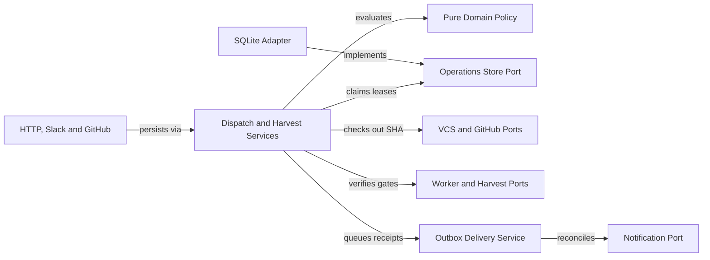

# Durable dispatch and harvest plan

Persist every dispatch and harvest operation in SQLite before acknowledging HTTP, Slack or GitHub callers. Resume unfinished stages and uncertain deliveries after restart while keeping git authoritative under Architecture Decision Record 002 (ADR-002) and ADR-003. Blocked: implementation depends on project-scoped identity and recipients from `048-project-identity-slack`.

## Target recovery boundary



## Observed baseline

| Surface | Current module | Observed defect | Planned change |
|---|---|---|---|
| Dispatch queue | `src/server/dispatch.ts` | Holds queue in memory without startup replay or lease fencing | Persist operations and fenced leases in SQLite |
| Dispatch log | `src/server/persistence.ts` | Appends `.gwrk/dispatches.jsonl` inside repo without recovery | Move queue state to SQLite and read legacy JSONL read-only |
| Slack ack order | `src/server/slack.ts` | Calls `ack()` before dispatch or action persistence runs | Persist durable receipt before acknowledging Slack |
| Webhook verify | `src/server/github.ts` | Hashes `JSON.stringify(body)` and runs harvest in background | Verify raw bytes and persist receipt before HTTP `200` |
| Poller watermark | `src/server/harvest-watcher.ts` | Scans latest 40 PRs and skips on compression row | Poll per-project cursors and route through `DurableHarvestService` |
| Harvest stages | `src/engine/harvest.ts` | Early run or compression write suppresses gate and Slack retries | Track five independent stage receipts per operation |
| Merge checkout | `src/utils/git.ts` | `syncTrunkForHarvest` can leave active checkout on wrong commit | Verify gates in an isolated detached checkout at `mergeCommitSha` |
| Closed PRs | `src/server/github.ts` | Drops closed unmerged PRs or conflates status with failures | Record `closed_unmerged` attempts without promoting phases |
| Branch delete | `src/utils/git.ts` | Runs `git push origin --delete` without tip verification | Delete remote branch with `--force-with-lease` at expected SHA |
| Slack retries | `src/server/slack-notify.ts` | Lacks durable outbox and message identity lookup after timeout | Reconcile uncertain sends by `clientMetadataKey` and disable Telegram |
| CLI harvest | `src/commands/harvest.ts` | Uses `"manual"` commit string and lacks JSON receipt output | Resolve real commit SHA and emit ADR-004 JSON and exit codes |
| Status surface | `src/commands/status.ts` | Hides pending harvest stages, delivery lag and gate failures | Report queue age, pending stages, failed gates and legacy counts |

## Contract mapping

| Contract group | Symbols | Phase | Contract file |
|---|---|---|---|
| SQLite durable tables and Zod schemas | Migration `015` and durable status enums | Phase 1 and Phase 2 | `data-model.md` |
| Pure dispatch and harvest policy | `evaluateDispatchAcceptance`, `validateLeaseFence`, `verifyHarvestTarget` and `evaluateBranchCleanupSafety` | Phase 1 | `contracts/durable-operations-and-ports.md` |
| Store, Git, GitHub and outbox ports | `ClockPort`, `OperationsStorePort`, `GitHubHarvestPort`, `WorkerExecutionPort` and `HarvestExecutionPort` | Phase 1 through Phase 3 | `contracts/durable-operations-and-ports.md` |
| Dispatch, harvest and outbox services | `DurableDispatchService`, `DurableHarvestService` and `OutboxDeliveryService` | Phase 4 | `contracts/coordinators-routes-and-cli.md` |
| HTTP, Slack and GitHub ingress | `DispatchReceipt`, pre-ack Slack persistence and raw-body webhook intake | Phase 5 | `contracts/coordinators-routes-and-cli.md` |
| Status and manual CLI contracts | `DurableOperationsStatus`, `gwrk harvest` and `gwrk status` | Phase 6 | `contracts/coordinators-routes-and-cli.md` |

### Phase 1: Durable policy and ports

#### Files

- `src/domain/durable-dispatch.ts` (NEW: Define pure dispatch work keys and acceptance receipts plus lease fencing and crash rules)
- `src/domain/durable-harvest.ts` (NEW: Define pure harvest work keys and PR verification plus stage plans and tip checks)
- `src/domain/index.ts` (MODIFY: Export durable dispatch and harvest schemas and policy functions)
- `src/ports/operations-port.ts` (NEW: Declare `ClockPort` and `OperationsStorePort` plus `GitHubHarvestPort`, `WorkerExecutionPort` and `HarvestExecutionPort`)
- `src/ports/vcs-port.ts` (MODIFY: Add detached commit checkout and ancestry checks plus remote tip lookup and compare-and-delete)
- `src/ports/notification-port.ts` (MODIFY: Add `clientMetadataKey` and `reconcileDelivery` contracts for uncertain outbound sends)
- `src/domain/durable-dispatch.test.ts` (NEW: Test work key deduplication, lease epoch fencing and pre-launch or started crash decisions)
- `src/domain/durable-harvest.test.ts` (NEW: Test duplicate and out-of-order intake plus closed PR rules, gate failures and tip checks)
- `src/architecture.test.ts` (MODIFY: Check pure domain rules and type-only port imports on durable operation modules)

#### Governance and skills

- Architecture rules: `.gwrk/architecture.md` and `docs/decisions/ADR-013-desired-architecture.md`
- Decisions: `docs/decisions/ADR-005-tdd-gate-architecture.md` and `docs/decisions/ADR-011-hexagonal-and-agent-port.md`
- Skills: `compile-gate`
- Delivers: `FR-001` through `FR-003` plus `FR-005` and `FR-006`

#### Test Strategy

| ID | Type | Target | Assertion |
|---|---|---|---|
| TR-001 | unit | `src/domain/durable-dispatch.test.ts` | Policy deduplicates active work keys and reconciles pre-launch vs PR-opened crashes |
| TR-002 | unit | `src/domain/durable-harvest.test.ts` | Policy converges duplicate or out-of-order events onto one project-scoped work key |
| TR-003 | unit | `src/domain/durable-dispatch.test.ts` | `validateLeaseFence` rejects stale lease epochs and expired leases |
| TR-004 | unit | `src/domain/durable-harvest.test.ts` | Policy separates `closed_unmerged` from `gate_failed` and blocks moved-tip cleanup |
| TR-005 | unit | `src/architecture.test.ts` | Domain and port files pass AST purity and inward dependency checks |

#### Done When

```bash
pnpm build
pnpm exec vitest run src/domain/durable-dispatch.test.ts src/domain/durable-harvest.test.ts src/architecture.test.ts
```

### Phase 2: SQLite ledger and fenced store

#### Files

- `src/db/migrations/015-durable-dispatch-and-harvest.sql` (NEW: Create dispatch and attempt tables plus delivery, cursor and outbox stage tables)
- `src/db/operations.ts` (NEW: Implement transactional acceptance and fenced leases plus stage receipts, cursors and outbox reads)
- `src/adapters/sqlite/operations.ts` (NEW: Implement `createSqliteOperationsStoreAdapter` over injected database connections)
- `src/adapters/sqlite/index.ts` (MODIFY: Export `createSqliteOperationsStoreAdapter` from the SQLite adapter barrel)
- `src/server/persistence.ts` (MODIFY: Read legacy `.gwrk/dispatches.jsonl` entries as `legacy_unverified` without mutating the repo tree)
- `src/db/operations.test.ts` (NEW: Test atomic acceptance and lease fencing plus transport dedup, stage receipts and legacy preservation)
- `src/db/db.test.ts` (MODIFY: Verify migration `015` foreign keys and backward compatibility on existing databases)

#### Governance and skills

- Architecture rules: `.gwrk/architecture.md` and `docs/decisions/ADR-011-hexagonal-and-agent-port.md`
- Decisions: `docs/decisions/ADR-002-sqlite-execution-ledger.md` and `docs/decisions/ADR-003-state-contract.md`
- Skills: `compile-gate`
- Delivers: `FR-001` through `FR-004` and `FR-006`

#### Test Strategy

| ID | Type | Target | Assertion |
|---|---|---|---|
| TR-001 | integration | `src/db/operations.test.ts` | Accepted dispatches survive reopen and list in FIFO order with expired leases flagged |
| TR-002 | integration | `src/db/operations.test.ts` | Separate transport deliveries across two repos with matching PR numbers stay isolated |
| TR-003 | integration | `src/db/operations.test.ts` | Stale `leaseEpoch` writes fail with `LEASE_FENCED` without mutating successor attempts |
| TR-005 | unit | `src/db/db.test.ts` | Migration `015` preserves legacy rows and marks unverified records |

#### Done When

```bash
pnpm build
pnpm exec vitest run src/db/operations.test.ts src/db/db.test.ts src/architecture.test.ts
```

### Phase 3: Git, GitHub and outbox adapters

#### Files

- `src/utils/git.ts` (MODIFY: Add detached commit worktrees and ancestry checks plus remote tip lookup and `--force-with-lease` delete)
- `src/adapters/git/index.ts` (MODIFY: Implement detached merge-SHA checkouts, ancestry checks and tip-safe branch deletion on `VcsPort`)
- `src/adapters/github/index.ts` (NEW: Implement `GitHubHarvestPort` raw-body HMAC verification, cursor pagination and PR lookup)
- `src/adapters/notifications/index.ts` (MODIFY: Stamp `clientMetadataKey`, implement `reconcileDelivery` and keep pilot Telegram disabled)
- `src/server/slack-notify.ts` (MODIFY: Return Slack delivery receipts and search thread or channel history for `clientMetadataKey`)
- `tests/helpers/synthetic-github.ts` (NEW: Provide deterministic synthetic GitHub webhook, PR metadata and paginated poller fixtures)
- `src/adapters/git/harvest-git.test.ts` (NEW: Test isolated merge-SHA checkouts, trunk ancestry checks and moved-tip delete blocking)
- `src/adapters/github/github-adapter.test.ts` (NEW: Test raw-body signature verification, cursor catch-up and per-repo PR isolation)
- `src/adapters/notifications/outbox-reconcile.test.ts` (NEW: Test uncertain Slack send reconciliation by metadata key and pilot Telegram suppression)

#### Governance and skills

- Architecture rules: `.gwrk/architecture.md` and `docs/decisions/ADR-013-desired-architecture.md`
- Decisions: `docs/decisions/ADR-008-command-safety-posture.md` and `docs/decisions/ADR-011-hexagonal-and-agent-port.md`
- Skills: `compile-gate`
- Delivers: `FR-002` through `FR-006`

#### Test Strategy

| ID | Type | Target | Assertion |
|---|---|---|---|
| TR-002 | unit | `src/adapters/github/github-adapter.test.ts` | Adapter verifies raw-body HMAC signatures and paginates terminal PRs past missed intervals |
| TR-003 | unit | `src/adapters/notifications/outbox-reconcile.test.ts` | Adapter finds the prior receipt by metadata key and suppresses resend after a partial or unauthorized lookup |
| TR-004 | integration | `src/adapters/git/harvest-git.test.ts` | Detached checkout leaves developer branch untouched and moved remote tip blocks deletion |

#### Done When

```bash
pnpm build
pnpm exec vitest run src/adapters/git/harvest-git.test.ts src/adapters/github/github-adapter.test.ts src/adapters/notifications/outbox-reconcile.test.ts src/architecture.test.ts
```

### Phase 4: Dispatch, harvest and outbox services

#### Files

- `src/application/delivery/outbox.ts` (NEW: Coordinate durable outbox claims, uncertain-send reconciliation and recipient thread delivery)
- `src/application/dispatch/index.ts` (NEW: Implement `DurableDispatchService` acceptance receipts and startup replay plus stale-lease recovery and fencing)
- `src/application/harvest/index.ts` (NEW: Implement `DurableHarvestService` intake dedup and stage resume plus closed-PR and cleanup handling)
- `src/application/index.ts` (MODIFY: Export durable dispatch, harvest and outbox services from the application barrel)
- `src/adapters/harvest/index.ts` (NEW: Adapt `reconcileGates`, manifest loading and compression reporting behind `HarvestExecutionPort`)
- `src/engine/reconcile-gates.ts` (MODIFY: Support isolated merge-SHA checkouts without dirtying unrelated trees and return failed task IDs)
- `src/engine/harvest.ts` (MODIFY: Route `harvestFeature` through `DurableHarvestService` while keeping single-project local compatibility)
- `src/application/dispatch/dispatch-service.test.ts` (NEW: Inject crashes before worker launch, after PR creation and across competing lease epochs)
- `src/application/harvest/harvest-service.test.ts` (NEW: Inject failures after every stage write and external effect plus duplicate and out-of-order deliveries)

#### Governance and skills

- Architecture rules: `.gwrk/architecture.md` and `docs/decisions/ADR-013-desired-architecture.md`
- Decisions: `docs/decisions/ADR-002-sqlite-execution-ledger.md`, `docs/decisions/ADR-003-state-contract.md` and `docs/decisions/ADR-011-hexagonal-and-agent-port.md`
- Skills: `compile-gate`
- Delivers: `FR-001` through `FR-006`

#### Test Strategy

| ID | Type | Target | Assertion |
|---|---|---|---|
| TR-001 | unit | `src/application/dispatch/dispatch-service.test.ts` | Crash after acceptance executes once. A live or unconfirmed old worker blocks relaunch |
| TR-002 | unit | `src/application/harvest/harvest-service.test.ts` | Duplicate and out-of-order events converge per repository merge. A stale close cannot replace a verified merge |
| TR-003 | unit | `src/application/harvest/harvest-service.test.ts` | Faults after each stage write and external effect resume cleanly and fence stale lease owners |
| TR-004 | unit | `src/application/harvest/harvest-service.test.ts` | Closed unmerged PRs skip phase promotion, gate failures stay distinct and moved tips block cleanup |

#### Done When

```bash
pnpm build
pnpm exec vitest run src/application/dispatch/dispatch-service.test.ts src/application/harvest/harvest-service.test.ts src/engine/harvest.test.ts src/architecture.test.ts
```

### Phase 5: Durable server and Slack ingress

#### Files

- `src/server/types.ts` (MODIFY: Add `DispatchReceipt`, `DurableOperationsStatus` and harvest pending-stage fields)
- `src/server/dispatch.ts` (MODIFY: Back `DispatchQueue` with `DurableDispatchService` and `WorkerExecutionPort` sandbox recovery)
- `src/server/routes/dispatch.ts` (MODIFY: Persist dispatches before returning HTTP `201` or `200` `DispatchReceipt` responses)
- `src/server/slack.ts` (MODIFY: Persist authorized dispatch commands before calling Slack `ack()`)
- `src/server/slack-commands.ts` (MODIFY: Return stable `operationId` receipts for `/gwrk dispatch` and `/gwrk ship`)
- `src/server/slack-actions.ts` (MODIFY: Persist retry and change-request dispatches before `ack()` and return `operationId` receipts)
- `src/server/github.ts` (MODIFY: Parse raw webhook bytes, persist deliveries before HTTP `200` and forward closed and merged PRs)
- `src/server/harvest-watcher.ts` (MODIFY: Poll enrolled repositories from durable cursors and submit PRs to `DurableHarvestService`)
- `src/server/dispatch.test.ts` (MODIFY: Test durable HTTP acceptance receipts, restart queue replay and active worker reconciliation)
- `src/server/github.test.ts` (MODIFY: Test raw-body HMAC verification, duplicate `X-GitHub-Delivery` handling and closed unmerged PR intake)

#### Governance and skills

- Architecture rules: `.gwrk/architecture.md` and `docs/decisions/ADR-011-hexagonal-and-agent-port.md`
- Decisions: `docs/decisions/ADR-007-single-dispatch-path.md` and `docs/decisions/ADR-008-command-safety-posture.md`
- Skills: `compile-gate`
- Delivers: `FR-001`, `FR-002` and `FR-004` plus `FR-005`

#### Test Strategy

| ID | Type | Target | Assertion |
|---|---|---|---|
| TR-001 | integration | `src/server/dispatch.test.ts` | HTTP and Slack dispatch paths persist stable receipts before acknowledgement and recover on restart |
| TR-002 | integration | `src/server/github.test.ts` | Webhook verifies raw-body signatures, deduplicates `X-GitHub-Delivery` and scopes by enrolled repo |
| TR-004 | integration | `src/server/github.test.ts` | Closed unmerged PR webhooks record terminal attempts on configured trunk without promoting phases |

#### Done When

```bash
pnpm build
pnpm exec vitest run src/server/dispatch.test.ts src/server/github.test.ts src/server/routes/dispatch.test.ts src/server/slack-commands.test.ts src/server/slack-actions.test.ts src/architecture.test.ts
```

### Phase 6: Status, CLI and unattended proof

#### Files

- `src/server/routes/status.ts` (MODIFY: Include `DurableOperationsStatus` queue age and last harvest plus outbox lag, gate failures and legacy counts)
- `src/server/routes/health.ts` (MODIFY: Report outbox degradation, unresolved harvest failures and disabled pilot Telegram state)
- `src/server/index.ts` (MODIFY: Wire `OperationsStorePort` and startup recovery sweeps plus raw-body webhook parsing and outbox flushing)
- `src/commands/harvest.ts` (MODIFY: Route manual CLI harvest through `DurableHarvestService` with `--project`, `--format json` and ADR-004 signals)
- `src/commands/status.ts` (MODIFY: Render queue age and pending harvest stages plus unresolved deliveries, gate failures and legacy counts)
- `src/commands/harvest.test.ts` (NEW: Test manual CLI harvest convergence and offline execution plus gate failure exit codes and JSON output)
- `src/server/routes/status.test.ts` (MODIFY: Verify project-scoped durable queue and harvest fields plus outbox and legacy counts)
- `src/commands/status.test.ts` (MODIFY: Verify `gwrk status` exits non-zero on unresolved gate failure or failed delivery and formats JSON)
- `src/server/unattended-recovery.test.ts` (NEW: Exercise unattended restarts, two-repo PR collisions and synthetic GitHub and Slack fault recovery)

#### Governance and skills

- Architecture rules: `docs/decisions/ADR-004-agent-native-output.md` and `docs/decisions/ADR-008-command-safety-posture.md`
- Decisions: `docs/decisions/ADR-011-hexagonal-and-agent-port.md` and `docs/decisions/ADR-013-desired-architecture.md`
- Skills: `compile-gate`
- Delivers: `FR-002` through `FR-006`

#### Test Strategy

| ID | Type | Target | Assertion |
|---|---|---|---|
| TR-002 | integration | `src/commands/harvest.test.ts` | Manual `gwrk harvest` converges with webhook and poller state while preserving local offline usage |
| TR-004 | unit | `src/commands/status.test.ts` | `gwrk status` surfaces unresolved `gate_failed` and pending deliveries distinctly from `closed_unmerged` |
| TR-005 | integration | `src/server/unattended-recovery.test.ts` | Synthetic unattended restarts preserve project receipts, run linkage, stage recovery and two-repo isolation |

#### Done When

```bash
pnpm build
pnpm exec vitest run src/commands/harvest.test.ts src/commands/status.test.ts src/server/routes/status.test.ts src/server/routes/health.test.ts src/server/unattended-recovery.test.ts src/architecture.test.ts
```

## Coverage matrix

| Item | Summary | Phase | Verification |
|---|---|---|---|
| FR-001 | Durable dispatch acceptance per project and work key plus restart and stale-lease recovery | Phase 1, Phase 2, Phase 4 and Phase 5 | `TR-001`, `TR-003` and `TR-005` |
| FR-002 | Single project-scoped harvest operation with separate transport dedup and repo, trunk, PR and SHA checks | Phase 1 through Phase 6 | `TR-002` and `TR-005` |
| FR-003 | Independent stage receipts for sync, gates, learning, Slack and cleanup while preserving git authority | Phase 1 through Phase 4 and Phase 6 | `TR-003`, `TR-004` and `TR-005` |
| FR-004 | Scoped recipient routing, uncertain Slack send reconciliation, failure status and disabled pilot Telegram | Phase 2 through Phase 6 | `TR-003`, `TR-004` and `TR-005` |
| FR-005 | Terminal `closed_unmerged` recording without phase promotion and tip-verified branch cleanup | Phase 1, Phase 3, Phase 4 and Phase 5 | `TR-004` |
| FR-006 | Pure domain policy, injected ports, preserved local CLI behavior and `legacy_unverified` reads | Phase 1 through Phase 4 and Phase 6 | `TR-001` through `TR-005` |
| TR-001 | Pre-launch crash replay once and started-worker crash reconciliation | Phase 1, Phase 2, Phase 4 and Phase 5 | `durable-dispatch.test.ts`, `operations.test.ts`, `dispatch-service.test.ts` and `dispatch.test.ts` |
| TR-002 | Duplicate and out-of-order poller, webhook and CLI convergence plus two-repo PR collision isolation | Phase 1 through Phase 6 | `durable-harvest.test.ts`, `operations.test.ts`, `harvest-service.test.ts`, `github.test.ts` and `harvest.test.ts` |
| TR-003 | Post-write and post-effect fault injection, uncertain delivery or cleanup recovery and lease fencing | Phase 1 through Phase 4 | `operations.test.ts`, `outbox-reconcile.test.ts` and `harvest-service.test.ts` |
| TR-004 | Distinct `closed_unmerged` and `gate_failed` status plus branch-movement cleanup block | Phase 1, Phase 3, Phase 4, Phase 5 and Phase 6 | `harvest-git.test.ts`, `harvest-service.test.ts`, `github.test.ts` and `status.test.ts` |
| TR-005 | Unattended synthetic restart proof with stable project receipt, run linkage and pending stages | Phase 6 | `unattended-recovery.test.ts` |

## Sister spec dependencies

- Upstream prerequisite: `048-project-identity-slack` supplies `EnrolledProject` and `DeliveryRecipient` plus `ProjectRegistryPort`, migration `014` and `tests/helpers/synthetic-slack.ts`. Implementation of `049` waits until `048` lands.
- Upstream architecture foundations: `040-pure-domain-boundary-gates` provides `src/architecture.test.ts` AST boundary checks. `042-port-adapter-separation` provides instance-bound `openDatabase` SQLite store handles and scoped CLI output.
- Legacy feature evolution: `049` supersedes in-memory queue state in `002-build-server` and `005-parallel-dispatch`. It also replaces early-return shortcuts in `011-harvest` while keeping `tasks.json` and `.gwrk/runs/` authoritative.
- Downstream pilot consumer: `R013` hosted pilot (`docs/research/R013-hosted-gwrk-server/brief.md`) and `041-hosted-google-signin-proof` run real hosted failover after synthetic `TR-005` passes.

## Deferred items

None. Full coverage of `specs/049-durable-dispatch-harvest/spec.md`.
