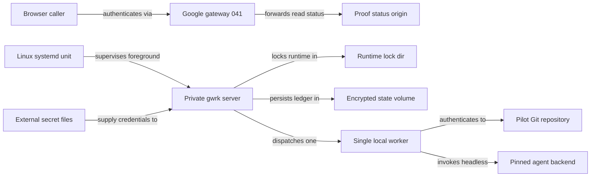

# Linux runner and deployment packaging plan

Package a pinned Linux release and supervise one private gwrk server and worker. Verify restore and rollback before pilot cutover. Blocked for live rollout until the Google sign-in proof and a Linux runner identity exist.

## Prerequisite and boundary



Feature `041-hosted-google-signin-proof` owns the browser edge at `https://gwrk.gforge.ai` through Traefik and OAuth2 Proxy. This feature binds `gwrk` to a private interface under a dedicated Linux account and keeps Telegram disabled. Multi-project authorization and live Slack workspace enrollment wait for the integrated pilot.

## Inspected repository baseline

| Area | Current file | Observed state | Planned change |
|---|---|---|---|
| Release tarball | `package.json` | Excludes `pnpm-lock.yaml` and runner bundle | Add the lockfile in the release builder and allowlist deployment scripts in the package |
| Release workflow | `.github/workflows/release.yml` | Uploads tarball without digest or manifest | Emit `release-manifest.json` and SHA-256 file |
| Installer | `scripts/install.sh` | Falls back to unpinned install in `$HOME/.gwrk` | Add digest-verified atomic Linux release installer |
| SQLite path | `src/db/index.ts` | Reads `GWRK_DIR` and ignores `GWRK_HOME` | Honor `GWRK_DIR` and `GWRK_HOME` consistently |
| Plugin paths | `src/plugins/loader.ts` | Hardcodes `os.homedir()` for global plugins | Honor `GWRK_HOME` for isolated state roots |
| Process tracking | `src/server/pid.ts` | Uses unlocked `server.pid` and macOS `launchctl` | Add exclusive lockfile in `GWRK_RUNTIME_DIR` |
| Service install | `src/commands/server-install.ts` | Supports macOS LaunchAgent and rejects Linux | Ship hardened Linux `systemd` unit and preflight |
| Ledger commands | `src/commands/db.ts` | Exposes `runs` and `stats` without backup | Add `gwrk db backup` and `gwrk db restore` |

### Phase 1: Release and rollback domain policy

Governance follows `.gwrk/architecture.md`, `ADR-011` and `ADR-013`. Keep pure logic in `src/domain/` and boundary ports in `src/ports/`. See [release-and-layout.md](contracts/release-and-layout.md).

#### Files

- `src/domain/release-packaging.ts` (NEW: Validate release manifests and check layout separation plus rollback migration compatibility)
- `src/domain/release-packaging.test.ts` (NEW: Test manifest digests and laptop path rejection plus rollback verdicts)

#### Test Strategy

| ID | Type | Target | Expected result |
|---|---|---|---|
| TR-001 | unit | `src/domain/release-packaging.test.ts` | Invalid digests and missing runtime metadata fail validation |
| TR-004 | unit | `src/domain/release-packaging.test.ts` | Overlapping roots and public binds or laptop paths fail validation |
| TR-006 | unit | `src/domain/release-packaging.test.ts` | Forward-only database migrations block rollback before switch |

#### Done When

```bash
pnpm run build
pnpm exec vitest run src/domain/release-packaging.test.ts src/architecture.test.ts
```

### Phase 2: Versioned Linux release installer

Governance follows `ADR-005` and `.gwrk/rules/workspace.md` with pinned lockfile packaging and zero host credentials. See [release-and-layout.md](contracts/release-and-layout.md).

#### Files

- `package.json` (MODIFY: Allowlist the Linux deployment bundle)
- `scripts/release/build-linux-release.mjs` (NEW: Build from the pinned commit, add the lockfile to the npm archive and emit the manifest and digest)
- `deploy/linux-runner/install-release.sh` (NEW: Verify digest and Node runtime plus native SQLite load before switching `current`)
- `.github/workflows/release.yml` (MODIFY: Build and upload `release-manifest.json` and SHA-256 digest with each release)
- `tests/linux-runner/release-packaging.test.ts` (NEW: Verify manifest provenance and lockfile inclusion plus tamper rejection)

#### Test Strategy

| ID | Type | Target | Expected result |
|---|---|---|---|
| TR-001 | integration | `tests/linux-runner/release-packaging.test.ts` | Release archive records pinned commit, runtime, plugin set and SHA-256 digest |
| TR-002 | integration | `tests/linux-runner/release-packaging.test.ts` | Clean directory install verifies digest and runs `gwrk --version` without source |

#### Done When

```bash
pnpm run build
pnpm exec vitest run tests/linux-runner/release-packaging.test.ts
```

### Phase 3: Single-instance server and state isolation

Governance follows `ADR-004`, `ADR-008` and `ADR-011`. Isolate state roots and prevent duplicate workers or Slack consumers on restart. See [supervision-and-preflight.md](contracts/supervision-and-preflight.md).

#### Files

- `src/ports/release-ops-port.ts` (NEW: Declare the instance lock boundary)
- `src/adapters/server/instance-lock.ts` (NEW: Hold a Linux instance lock for the server lifetime)
- `src/server/pid.ts` (MODIFY: Resolve `GWRK_RUNTIME_DIR` and `GWRK_HOME` paths and expose single-instance lock helpers)
- `src/db/index.ts` (MODIFY: Resolve default database directory from `GWRK_DIR` or `GWRK_HOME` before `~/.gwrk`)
- `src/plugins/loader.ts` (MODIFY: Resolve global plugin and config paths from `GWRK_HOME` before `~/.gwrk`)
- `src/server/index.ts` (MODIFY: Claim exclusive instance lock before binding HTTP or starting `DispatchQueue` and Slack)
- `src/commands/server.ts` (MODIFY: Honor `GWRK_RUNTIME_DIR` and `GWRK_HOME` for daemon logs and stop cleanup)
- `tests/linux-runner/single-instance-recovery.test.ts` (NEW: Prove isolated state roots and duplicate-start refusal plus single-worker recovery)

#### Test Strategy

| ID | Type | Target | Expected result |
|---|---|---|---|
| TR-003 | integration | `tests/linux-runner/single-instance-recovery.test.ts` | Supervised restart preserves state and blocks a second server or worker |
| TR-004 | unit | `tests/linux-runner/single-instance-recovery.test.ts` | State, runtime and config paths stay isolated from `~/.gwrk` |

#### Done When

```bash
pnpm run build
pnpm exec vitest run tests/linux-runner/single-instance-recovery.test.ts src/architecture.test.ts
```

### Phase 4: Ledger backup and rollback guard

Governance follows `ADR-002`, `ADR-003` and `ADR-004`. `gwrk db backup` is a `generator` command and `gwrk db restore` is a `mutator` command. Both emit `[exit:N | Xs]` on stderr, support `--format json` and print corrective hints on failure. See [backup-rollback-and-pilot-record.md](contracts/backup-rollback-and-pilot-record.md).

#### Files

- `src/adapters/sqlite/ledger-backup.ts` (NEW: Snapshot Write-Ahead Logging SQLite state via Online Backup API with repository metadata)
- `src/application/release/backup-restore.ts` (NEW: Orchestrate consistent backup creation and clean-instance restore checks plus rollback gating)
- `src/commands/db.ts` (MODIFY: Register `gwrk db backup` and `gwrk db restore` with JSON output and navigation errors)
- `deploy/linux-runner/rollback-release.sh` (NEW: Check persistent `_migrations` against target `release-manifest.json` before switching `current`)
- `tests/linux-runner/backup-restore-rollback.test.ts` (NEW: Verify online backup and clean restore of accepted work plus rollback gating)

#### Test Strategy

| ID | Type | Target | Expected result |
|---|---|---|---|
| TR-005 | integration | `tests/linux-runner/backup-restore-rollback.test.ts` | Restored clean instance preserves seeded project, accepted work and run history |
| TR-006 | integration | `tests/linux-runner/backup-restore-rollback.test.ts` | Compatible rollback preserves accepted work and incompatible migration stops switch |

#### Done When

```bash
pnpm run build
pnpm exec vitest run tests/linux-runner/backup-restore-rollback.test.ts src/architecture.test.ts
```

### Phase 5: Linux supervision and container proof

Governance follows `ADR-006`, `ADR-008` and `.gwrk/rules/workspace.md`. Validate inside local Linux containers with synthetic credentials. Exercise the systemd unit on a Linux systemd host and record that result separately. See [supervision-and-preflight.md](contracts/supervision-and-preflight.md) and [backup-rollback-and-pilot-record.md](contracts/backup-rollback-and-pilot-record.md).

#### Files

- `deploy/linux-runner/gwrk-runner.service` (NEW: Run foreground server as `gwrk:gwrk` on a private bind with separated state and secrets)
- `deploy/linux-runner/.env.example` (NEW: Name non-secret Linux paths and private bind address plus pilot repo and agent backend)
- `deploy/linux-runner/preflight.sh` (NEW: Verify Linux service user and secret modes plus unattended Git and headless agent probes)
- `deploy/linux-runner/README.md` (NEW: Document gateway boundary and secret supply plus credential revocation and rollback)
- `deploy/linux-runner/live-pilot-record.example.md` (NEW: Provide separate pending record for live host and credentials plus observed worker run)
- `tests/linux-runner/container-harness.mjs` (NEW: Run clean Linux containers without source checkout to test install and restart plus restore and rollback)
- `tests/linux-runner/bundle-and-live-record.test.ts` (NEW: Validate unit hardening and secret separation plus revocation failure and pending live record)

#### Test Strategy

| ID | Type | Target | Expected result |
|---|---|---|---|
| TR-002 | integration | `tests/linux-runner/container-harness.mjs` | Clean Linux container installs and runs release artifact without source checkout |
| TR-003 | integration | `tests/linux-runner/container-harness.mjs` | A Linux process restart resumes one server and one worker |
| TR-004 | unit | `tests/linux-runner/bundle-and-live-record.test.ts` | Preflight rejects laptop paths, public binds, missing secrets and revoked credentials |
| TR-007 | unit | `tests/linux-runner/bundle-and-live-record.test.ts` | Live pilot record keeps host and worker checks separate from synthetic fixtures |

#### Done When

```bash
pnpm run build
pnpm exec vitest run tests/linux-runner/bundle-and-live-record.test.ts
node tests/linux-runner/container-harness.mjs
```

## Coverage matrix

| Spec requirement or acceptance | Phase | Contract | Test ID |
|---|---|---|---|
| Build and verify pinned Linux release | Phase 1 and Phase 2 | `contracts/release-and-layout.md` | TR-001 and TR-002 |
| Private server bind and single-worker supervision | Phase 3 and Phase 5 | `contracts/supervision-and-preflight.md` | TR-003 |
| Unattended pilot Git and headless agent auth | Phase 1 and Phase 5 | `contracts/supervision-and-preflight.md` | TR-004 |
| Separate release, state and revocable secrets | Phase 1 and Phase 5 | `contracts/supervision-and-preflight.md` | TR-004 |
| Consistent ledger and repo metadata backup restore | Phase 4 and Phase 5 | `contracts/backup-rollback-and-pilot-record.md` | TR-005 |
| Upgrade and rollback with accepted work preserved | Phase 1 and Phase 4 | `contracts/backup-rollback-and-pilot-record.md` | TR-006 |
| Keep Google gateway boundary and defer Slack auth | Phase 5 | `contracts/supervision-and-preflight.md` | TR-004 and TR-007 |
| Acceptance 1 clean Linux run without checkout | Phase 2 and Phase 5 | `contracts/release-and-layout.md` | TR-002 |
| Acceptance 2 supervised restart with one worker | Phase 3 and Phase 5 | `contracts/supervision-and-preflight.md` | TR-003 |
| Acceptance 3 clean restore preserves accepted work | Phase 4 and Phase 5 | `contracts/backup-rollback-and-pilot-record.md` | TR-005 |
| Acceptance 4 rollback preserves work or stops early | Phase 1 and Phase 4 | `contracts/backup-rollback-and-pilot-record.md` | TR-006 |
| Acceptance 5 separate live pilot operator record | Phase 5 | `contracts/backup-rollback-and-pilot-record.md` | TR-007 |

## Deferred items

Verify restore against persisted ledger entries and repository state in this feature. A restart with accepted jobs still queued requires the durable dispatch work in feature 049. The integrated pilot exercises that recovery path.

Live cloud host provisioning and public DNS allocation belong to prerequisite `041-hosted-google-signin-proof` and operator rollout. Multi-project authorization and live Slack workspace enrollment belong to the downstream integrated pilot in [R013](../../docs/research/R013-hosted-gwrk-server/brief.md).
