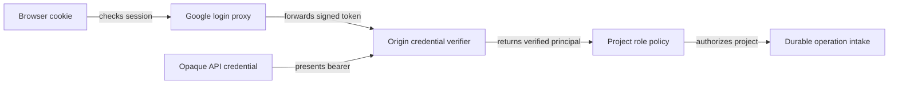

# Production authentication contract

Implementation contract against merged core `980a2577`. Use the existing Google proxy for browser login and verify its Google ID token again inside gwrk. Use separate opaque API credentials for automation. Blocked: implementation and behavioral gates. Root owns infrastructure and live acceptance.

## Boundary

The production origin is `https://gwrk.gforge.ai`. Keep the callback at `https://gwrk.gforge.ai/oauth2/callback`. Keep the private origin inaccessible from the public network. This contract changes no cloud configuration or account setting.

The existing proof authenticates a fixed read-only response. Preserve that proof as a regression fixture. Its Authorization stripping and empty identity forwarding are not a production API configuration. [Existing gateway contract](../../041-hosted-google-signin-proof/contracts/gateway-surface.md)

Core already has project authorization through `evaluateHttpProjectAccess`. Its `resolvePrincipal` option is synchronous. Both server command entry points currently omit a production verifier. Health routes also lack project authorization. [Principal seam](../../../src/server/index.ts#L125). [Server start](../../../src/commands/server.ts#L108). [Internal startup](../../../src/commands/server.ts#L165).

## Authentication flow

Authentication never grants a project role by itself. New Google users receive no automatic project enrollment or maintainer role. Existing project role bindings remain the single authority for project scope.

## Google login and origin verification

Keep Google OpenID Connect at the proxy. Require authorization code flow with PKCE S256 and checked state. Enable nonce verification explicitly. Keep the approved issuer and exact callback. Set `insecure_oidc_skip_nonce = false` in the production proxy configuration. Deny when the account allowlist is absent or empty. No wildcard account or domain rule is permitted.

The origin adapter must verify the Google token signature using the configured issuer's JWKS. Require the approved web client audience and permitted signing algorithm. Validate expiry and issued-at bounds. Require a nonempty subject and verified email. Apply the current explicit account allowlist again before returning a principal.

Use `jose` in the infrastructure adapter. Pin its selected release during implementation. Do not decode an unverified token into a principal. Do not fetch keys from token-supplied URLs. Bound discovery and JWKS requests with timeouts and a finite cache. Use the approved Node 22 runtime on the pilot host. Unknown keys or unavailable validation must deny access. [JWT verifier documentation](https://github.com/panva/jose#json-web-tokens-jwt)

Normalize Google's documented issuer variants to `https://accounts.google.com`. Form the existing `google_sub` principal ID as `<canonical issuer>:`. Never use email as the stable identity. Google documents `sub` as stable while email can change. [Google identity claims](https://developers.google.com/identity/openid-connect/openid-connect#an-id-tokens-payload)

The proxy owns OAuth callback state and nonce validation. Per-request origin verification must not treat a login nonce as single-use across ordinary API requests. The proxy must supply a signed ID token rather than an access token or email header. [Proxy header options](https://oauth2-proxy.github.io/oauth2-proxy/configuration/overview/#header-options)

Store only a digest of each observed Google ID token with its principal and expiry. Include a revocation marker. Observe sessions atomically with insert-if-absent semantics. Preserve existing revocations and the original cap. Reject conflicting principal or token-lifetime metadata. Browser logout first revokes that token digest at the origin. The origin then calls the fixed internal proxy sign-out endpoint. Forward all cookie-clearing response headers and clear the origin CSRF cookie. Do not publicly route proxy sign-out around origin revocation. A copied old cookie must remain denied by the origin. Allowlist removal must deny the next authenticated request without restarting gwrk.

Cap browser sessions at one hour and at the token's expiry. Retain revoked token digests until token expiry. Do not store raw Google ID tokens or refresh tokens in the core database. A new login with a newly issued token may create a new session record.

## Async request integration

Add an asynchronous authentication pre-handler before operational handlers. It must finish verification before any dispatch, harvest or notification effect. Attach verified context to a server-owned request decoration. Keep the existing synchronous `resolvePrincipal` as a reader of that decoration.

The decoration contains the principal type and ID. It also contains the credential identifier and expiry plus the authentication method. Never populate it from public user or email headers. Never accept a role or project grant from a request header.

Wire the same production factory into `server start --foreground` and `server _run`. Construct it inside the startup action. Importing commands must not read auth secrets or contact Google. Initialization must retain its inference-free behavior. Hosted startup must explicitly select hosted transport even when the origin binds to loopback. Missing auth configuration must fail startup or deny all operational routes. It must never fall back to trusted-local authorization.

Keep trusted-local CLI behavior separate from hosted HTTP behavior. Preserve operation identity and existing acknowledgment ordering. Authentication expiry or revocation does not cancel previously accepted durable work. Requests authenticated after revocation commits must fail. Do not claim cancellation of work already accepted before revocation.

## Credential routing at the edge

Use separate browser and API router chains. Both must strip public identity and auth-mode headers before setting internal metadata.

| Chain | Credential handling | Origin requirement |
|---|---|---|
| Browser | Check proxy cookie and forward the proxy's ID-token Authorization response | Verify Google JWT and browser protections |
| API | Preserve the caller's opaque bearer credential without an OAuth redirect | Verify API credential hash and lifecycle |
| Provider webhook | Preserve raw request bytes and provider signature | Enforce the existing HMAC guard |

A static internal auth-mode header may select the credential parser. It cannot establish identity or bypass cryptographic verification. Test a local process forging every identity header. Invalid Google tokens must still fail at the origin.

Forward the origin CSRF secret cookie on browser requests. Do not reuse the proof's blanket Cookie stripping. The origin never treats the proxy cookie alone as authenticated.

Do not overwrite an API credential with a Google token. Reject conflicting credential mechanisms. An invalid API credential must not fall back to a browser session. Configure trusted proxy hops narrowly. Never use a trusted-IP setting as an authentication exemption.

The production gateway must forward the browser ID token in a controlled Authorization header. The proxy supports an Authorization response header for auth-request integration. The pinned deployment version must prove that the forwarded value is an ID token. The existing proof configuration leaves that feature disabled. [Proxy configuration](https://oauth2-proxy.github.io/oauth2-proxy/configuration/overview/#header-options)

## Opaque API credentials

Issue a public credential ID and a cryptographically random 32-byte secret. Proposed format is `gwrk_v1.<credential-id>.<base64url-secret>`. Reject unknown versions and oversized values before lookup. An API credential is not a Google token or a provider API key.

Store a SHA-256 verifier of the complete high-entropy credential. Compare fixed-length verifiers in constant time. Store its public ID and label plus issuer and creation time. Also store expiry and revocation state. Reject absent or malformed credentials before project effects. Reject expired and revoked credentials too.

Store the configured server origin with each credential as its audience. Never authenticate it for another origin. Use the public credential ID as the existing `cli_token` principal ID. Project role bindings determine its allowed projects and roles. Do not create a second project-scope authority inside the credential record. Issue only explicit enrolled-project grants. No wildcard project grant is permitted.

Credential creation and role binding creation must commit atomically. Rotation creates a new credential ID and copies only approved current bindings. Revoke the old credential in the same transaction by default. Any overlap needs an explicit finite expiry and audit record. Revocation must remain effective after restart.

API credentials require a finite expiry at issuance. Define a maximum lifetime in deployment policy. The pilot must not silently create permanent credentials. Metadata list and inspect operations never return verifiers or raw credentials.

## Administration and CLI transport

Keep key administration on the private host for the first pilot. Add local `gwrk auth key create` and `list`. Add `revoke` and `rotate` too. Use the existing trusted local administration boundary. Do not add remote credential-management endpoints during this pilot.

Creation requires repeated `--grant <project>=<role>` inputs and `--expires-at`. Roles remain viewer, operator or maintainer. Rotate and revoke accept public credential IDs only. Require a one-time secret output file outside the checkout. Create that file exclusively with owner-only permissions. Do not overwrite a path or follow a symlink. If secret delivery fails, revoke the new credential before reporting failure.

CLI output contains public metadata and the secret file path. It never contains the raw key. Preserve JSON output and ADR-004 operational signals. Commands remain non-interactive when flags supply their inputs.

Add one outbound HTTP credential provider for remote CLI probes used by `gwrk status`. Keep local PID and liveness checks distinct from authenticated project readiness. If `gwrk server status` calls a protected endpoint, it must use that provider too. It may probe private minimal liveness without claiming project readiness. Load credentials from a protected client profile or explicit private file. Bind the profile to the canonical server origin. Do not attach a key to an arbitrary project-supplied URL or a redirected origin.

Use HTTPS for remote requests and bounded request timeouts. Disable credential-bearing redirect following. Test that an overridden server URL cannot receive another origin's key. Keep outbound provider credentials outside this client credential store.

## Route policy

Deny public access to unclassified routes and methods. HEAD must follow the corresponding read policy. Keep CORS disabled for cross-origin credentialed access. New native routes must declare their policy before publication.

| Route | Production policy | Required project access |
|---|---|---|
| `GET /` | Browser login entry without project metadata | None |
| `GET /oauth2/start` | Rate-limited browser login | None |
| `GET /oauth2/callback` | Proxy state and nonce verification | None |
| `POST /api/auth/logout` | Verified Google session with CSRF protection | Own session only |
| `/oauth2/sign_out` | Internal proxy operation only | Origin logout orchestration |
| `GET /api/auth/session` | Verified Google session, no-store response | Own session only |
| `GET /api/status` | Google session or API credential | Read |
| `POST /api/dispatch` | Google session or API credential | Operate |
| `GET /api/dispatch/queue` | Google session or API credential | Read |
| `GET /api/dispatch/:feature/:phase` | Google session or API credential | Read |
| `POST /api/notify` | Google session or API credential | Operate |
| `GET /api/health` | Authenticated and filtered readiness | Read |
| `GET /health` | Minimal private liveness only, not publicly routed | None |
| `POST /webhook/github` | Required configured HMAC and durable replay checks | Enrolled repository mapping |

Detailed health must authorize an explicit project and filter its payload. It must not expose another project's name or checkout path. Private liveness must omit readiness and secrets. It must not perform Git or provider requests per probe. Preserve full local-mode health behavior where required.

Missing or invalid API authentication returns HTTP 401 JSON. Insufficient project roles return HTTP 403. Authentication dependencies failing closed may return HTTP 503. Denials contain a stable code and request ID without credential values. API paths must return machine-readable denials even when the browser proxy rejects a missing session. Restrict interactive redirects to the browser entry and explicit login routes. Authenticated API calls must not receive an interactive Google sign-in redirect.

## Browser protection and logging

Require the configured same-origin Origin on browser mutations. Use maintained CSRF protection with a server-managed secret. Bind tokens to the verified Google session digest. Accept the token from a dedicated header only. Never accept it from a query parameter.

The session endpoint may issue a CSRF token. Use secure host-only cookies with HttpOnly protection for the CSRF secret. Do not use the raw Google token as a CSRF token. Keep responses no-store. Fastify's CSRF plugin supports a user binding and requires a configured HMAC key for its cookie mode. [CSRF adapter documentation](https://github.com/fastify/csrf-protection#api)

Apply CSRF checks to Google-session requests. Authenticate API-key requests independently. An invalid key must not fall back to cookie authentication. Provider webhooks retain their own signature boundary. OAuth callback state protection does not replace API mutation protection.

Disable or sanitize default request logging before accepting auth routes. Never log Authorization, Cookie or Set-Cookie values. Remove callback code and state values from URL logs. Do not log request bodies or upstream authentication error payloads. Test the edge and origin logs with canary secrets.

Configure finite login and API rate limits before exposure. Bound headers, request bodies and external validation timeouts. Use trusted client-IP handling only at the configured proxy boundary. Application limits use verified credential IDs rather than raw tokens. Audit authentication denials and key lifecycle changes using public identifiers.

## Ports and ownership

Domain policy owns route classification and credential lifecycle decisions. It receives clock values and verified claims as inputs. It performs no filesystem or network access. Application use cases own issuance and authentication orchestration. Adapters own cryptography and persistence plus HTTP and proxy integration.

| Interface | Responsibility | Implementation boundary |
|---|---|---|
| `GoogleIdentityVerifierPort` | Verify signed ID token and return trusted claims | `src/adapters/auth/google-id-token.ts` |
| `CredentialCryptoPort` | Generate entropy and hash or compare verifiers | `src/adapters/auth/credential-crypto.ts` |
| `AuthStorePort` | Persist credentials and session revocations | SQLite auth adapter |
| `CredentialGrantAdminPort` | Atomically issue or rotate credentials with existing role bindings | Same SQLite transaction |
| `BrowserCsrfPort` | Issue and verify tokens bound to verified session | Fastify CSRF adapter |
| `ProxySessionLogoutPort` | Clear proxy cookies after origin revocation | Fixed internal proxy client |
| `HttpClientCredentialPort` | Provide an origin-bound CLI credential | Private client credential adapter |
| Existing `ClockPort` | Supply testable time | Existing clock boundary |
| Existing `ProjectRegistryPort` | Resolve projects and roles | Existing registry adapter |

Use one verified context type in `src/ports/`. Keep Fastify request types in the HTTP adapter. The application returns explicit authenticated or denied results. Repository or verifier failures must never manufacture a principal.

Auth records are operational state. They do not change git-native task authority. Do not import SQLite, Fastify or `jose` into domain policy. Record the selected design in a Proposed ADR under `docs/decisions/`. Derive its index through gwrk. Preserve existing Decided constraints and human ratification.

## Behavioral test matrix

| ID | Reproduction | Required result |
|---|---|---|
| AUTH-01, token identity | Bad signature or wrong issuer, audience or algorithm | Denial and zero operation rows |
| AUTH-02, token lifetime | Expired token or future issued-at outside policy | Denial and zero effects |
| AUTH-03, allowlist | Unverified email, unlisted account or empty allowlist | Denial and no role creation |
| AUTH-04, header forgery | Public and local forged identity or auth-mode headers | No principal without verified credential |
| AUTH-05, callback | Wrong state or nonce plus replayed callback | Proxy denial and no origin session |
| AUTH-06, sessions | Logout then replay copied cookie and ID token | Origin denies the revoked digest |
| AUTH-07, keys | Missing, malformed, expired or revoked API key | HTTP 401 JSON and zero effects |
| AUTH-08, grants | Project A key requests project B or exceeds its role | HTTP 403 and zero effects |
| AUTH-09, rotation | Crash or rollback during rotation and grant copy | Atomic state and persisted revocation |
| AUTH-10, output | Key creation and failed secret-file delivery | No stdout secret or active orphan key |
| AUTH-11, browser writes | Missing Origin, cross-site Origin or wrong-session CSRF | HTTP 403 and zero effects |
| AUTH-12, health | Project A reads readiness for project B | No cross-project metadata |
| AUTH-13, webhook | Missing secret, invalid HMAC or changed replay payload | Denial with no new effect |
| AUTH-14, bounds | Limit exceeded or validation dependency unavailable | Bounded denial without accepted work |
| AUTH-15, logs | Canary key, cookie and OAuth code through every error path | Zero secret matches in logs |
| AUTH-16, CLI | Wrong server origin or redirect during a probe | No credential forwarding |
| AUTH-17, startup | Hosted start and internal start without verifier config | No operational listener or deny-all policy |
| AUTH-18, continuity | Valid scoped request through restart and harvest | Stable operation and recipient receipts |

Each test must observe behavior before repair. Use a synthetic OIDC issuer and isolated credentials for local tests. Retain the existing signed webhook regressions. Do not substitute live deployment observations for deterministic gates.

## Phase sequence

1. Freeze this contract and the auth ports. Author failing policy, lifecycle and zero-effect tests.
2. Implement the API credential store and local administration. Implement the Google verifier in a separate worktree against the frozen ports.
3. Wire the asynchronous guard and synchronous principal reader. Add browser protection and origin-bound CLI probes. Preserve project authorization and restart behavior.
4. Build the production edge configuration and synthetic end-to-end gates. Keep the original read-only proof as a separate regression target.
5. Run independent review and native Linux checks. Then root may perform live Google and API acceptance before opening public application ingress.

Infrastructure can prepare a private host while these phases run. After synthetic authentication and native Linux gates pass, canonical DNS and trusted TLS may support operator-restricted HTTPS acceptance. Worldwide ingress requires all live security checks. Capture the live allowlist and credential lifecycle proof without recording secrets. Project rollout remains feature 052.

## Residual trust boundary

Application verification prevents a local process from inventing identity headers. It does not isolate a process that can modify the auth database or read daemon memory. Root must establish the worker filesystem and process boundary before claiming untrusted-workload isolation. Workers must not receive inbound credentials or gateway session secrets. Keep this distinct from outbound provider credentials intentionally supplied to an approved job.

No production code or cloud setting has changed under this draft. No secret value was read. The user account allowlist remains an operator input. Until supplied, authentication must deny access.

## Fixed implementation policy

Use [security-policy.md](security-policy.md) for numeric defaults and edge parser selection. Runtime adapters must share that policy. The authorized coordinator may perform actual live probes. Autonomous feature workers must not record synthetic results as live acceptance.
