# Hosted AWS pilot implementation plan

Build Google login verification and scoped API keys plus hosted origin guards and edge routing for `051-hosted-aws-pilot`. Blocked: task generation and implementation remain pending. Public exposure at `https://gwrk.gforge.ai` waits for Google policy acceptance and the explicit account allowlist plus passing security gates. The coordinator owns code and synthetic checks. Root owns host setup and worker isolation. David Gonzalez (project owner) owns Google inputs and Architecture Decision Record (ADR) ratification plus pull request merge approval.

> Feature: `051-hosted-aws-pilot`
> Specification: [spec.md](spec.md)
> Authoritative contract: [production-auth.md](contracts/production-auth.md)
> Separate operator references: [deployment-plan.md](deployment-plan.md) and [deployment-plan-stress-test.md](deployment-plan-stress-test.md)
> Independent assessment: [plan-stress-test.md](plan-stress-test.md) approves the corrected implementation sequence. The first-pass findings remain in [plan-review-first-pass.md](evidence/plan-review-first-pass.md).

## Architecture and phase dependency flow

```mermaid
flowchart LR
  P1["Phase 1: Ports and policy"] -->|freezes contracts| P2["Phase 2: API keys and CLI"]
  P1 -->|freezes contracts| P3["Phase 3: Google JWT verifier"]
  P2 -->|supplies store and crypto| P3
  P2 -->|feeds store| P4["Phase 4: Origin guard and health"]
  P3 -->|feeds verifier| P4
  P4 -->|feeds HTTP routes| P5["Phase 5: CSRF, bounds and logs"]
  P5 -->|feeds server| P6["Phase 6: Startup and CLI probes"]
  P6 -->|feeds loopback origin| P7["Phase 7: Edge and runner"]
  P7 -->|feeds full stack| P8["Phase 8: Native verification"]
  P8 -->|clears synthetic gates| P9["Phase 9: Operator live gates"]
```



Phases 2 and 3 may prepare independent adapters in isolated worktrees against Phase 1 frozen ports. Running `gwrk ship` on one feature branch uses one writer and executes one phase at a time. Root composes independent preparation sequentially before each phase review.

## Baseline and scope boundaries

Private host preparation on Amazon Web Services (AWS) in profile `gforge-dev` and region `us-east-2` passed audit GO. No application service is running. No application port is public and no Domain Name System (DNS) record points to the host. Worldwide application ingress stays closed until live acceptance passes. After deterministic and native Linux gates pass, the coordinator may configure canonical DNS and trusted TLS for operator-restricted HTTPS acceptance.

| Surface | Current repository state | Planned target | Scope owner |
|---|---|---|---|
| Project roles | `ProjectRoleBinding` and `evaluateHttpProjectAccess` exist | Keep as single project-scope authority | Feature 051 |
| Server startup | `server start` and `_run` omit hosted verifier | Wire lazy fail-closed auth factory | Feature 051 |
| Health endpoints | `/health` and `/api/health` lack principal checks | Filter `/api/health` and keep `/health` private | Feature 051 |
| Proof fixture 041 | Read-only gateway under `deploy/hosted-auth-proof/` | Keep untouched as separate regression target | Preserved |
| Project rollout 052 | Zero live project enrollment during bootstrap | Keep outside pilot bootstrap | Feature 052 |
| Worker isolation | Shared host OS and filesystem boundary | Keep separate with zero inbound auth secrets | Root |

Decided Architecture Decision Records `ADR-001` through `ADR-012` in [index.md](../../.gwrk/decisions/index.md) stay binding. Operational auth tables in SQLite (`gwrk.db`) leave git-native task authority unchanged under `ADR-002` and `ADR-003`. Domain and application modules follow `ADR-011` and Proposed `ADR-013`. Phase 1 adds Proposed `ADR-014` and updates the index with `gwrk define adr --reindex`. Human ratification stays required under Axiom `AX-004`.

## Frozen port contracts and data schema

Phase 1 freezes one verified context type and seven boundary ports in `src/ports/auth-port.ts`. Pure policy in `src/domain/auth-policy.ts` imports zero infrastructure adapters and zero SQLite or Fastify or `jose` or filesystem modules. Clock inputs enter through `ClockPort` in `src/ports/operations-port.ts`. Project lookups and roles reuse `ProjectRegistryPort` in `src/ports/store-port.ts`.

```typescript
// src/ports/auth-port.ts (frozen in Phase 1; type-only imports from domain)
export interface VerifiedAuthContext {
  readonly principalType: "google_sub" | "cli_token";
  readonly principalId: string;
  readonly credentialId: string;
  readonly expiresAt: string;
  readonly authMethod: "google_id_token" | "api_key";
  readonly sessionDigest?: string;
}

export interface GoogleIdentityVerifierPort {
  verifyIdToken(input: {
    token: string;
    nowMs: number;
  }): Promise<
    | {
        ok: true;
        claims: {
          canonicalIssuer: "https://accounts.google.com";
          subject: string;
          principalId: string;
          email: string;
          emailVerified: true;
          issuedAtMs: number;
          expiresAtMs: number;
          tokenDigestSha256: string;
        };
      }
    | {
        ok: false;
        code:
          | "AUTH_TOKEN_INVALID"
          | "AUTH_TOKEN_EXPIRED"
          | "AUTH_ACCOUNT_DENIED"
          | "AUTH_VERIFIER_UNAVAILABLE";
        message: string;
      }
  >;
}

export interface CredentialCryptoPort {
  generateApiCredential(credentialId: string): {
    rawCredential: string;
    verifierSha256: string;
  };
  hashCredential(rawCredential: string): string;
  hashTokenDigest(rawToken: string): string;
  verifySha256Equal(expectedHex: string, candidateHex: string): boolean;
}

export interface AuthStorePort {
  findApiCredentialById(credentialId: string): StoredApiCredential | null;
  listApiCredentials(): readonly ApiCredentialMetadata[];
  revokeApiCredential(input: {
    credentialId: string;
    revokedAt: string;
    reason: string;
  }): boolean;
  observeGoogleSession(input: {
    tokenDigestSha256: string;
    principalId: string;
    issuedAt: string;
    expiresAt: string;
    sessionCapAt: string;
  }):
    | { ok: true; session: StoredGoogleSession; created: boolean }
    | { ok: false; code: "SESSION_REVOKED" | "SESSION_METADATA_CONFLICT" };
  getGoogleSession(tokenDigestSha256: string): StoredGoogleSession | null;
  revokeGoogleSession(input: {
    tokenDigestSha256: string;
    revokedAt: string;
    reason: string;
  }): boolean;
  appendAuditEvent(event: AuthAuditEvent): void;
  close(): void;
}

export interface CredentialGrantAdminPort {
  createCredentialWithGrants(input: {
    credentialId: string;
    verifierSha256: string;
    label: string;
    issuer: string;
    audienceOrigin: string;
    createdAt: string;
    expiresAt: string;
    grants: readonly { projectId: string; role: "viewer" | "operator" | "maintainer" }[];
  }): { credential: ApiCredentialMetadata; grants: readonly ProjectRoleBinding[] };
  rotateCredential(input: {
    targetCredentialId: string;
    newCredentialId: string;
    newVerifierSha256: string;
    issuer: string;
    audienceOrigin: string;
    createdAt: string;
    expiresAt: string;
    overlapUntil?: string;
    reason: string;
  }): {
    created: ApiCredentialMetadata;
    revokedCredentialId: string | null;
    overlapUntil: string | null;
    copiedGrants: readonly ProjectRoleBinding[];
  };
}

export interface BrowserCsrfPort {
  issueToken(input: { sessionDigest: string }): Promise<{
    token: string;
    cookieHeader: string;
  }>;
  verifyToken(input: {
    sessionDigest: string;
    headerToken: string | undefined;
    cookieValue: string | undefined;
  }): Promise<boolean>;
  clearCookieHeader(): string;
}

export interface ProxySessionLogoutPort {
  clearProxySession(input: {
    cookieHeader?: string;
  }): Promise<
    | { ok: true; setCookieHeaders: readonly string[] }
    | { ok: false; code: "PROXY_LOGOUT_FAILED"; message: string }
  >;
}

export interface HttpClientCredentialPort {
  resolveBearerForUrl(input: {
    targetUrl: string;
  }): Promise<
    | { ok: true; bearerToken: string | null; boundOrigin: string | null }
    | { ok: false; code: "ORIGIN_MISMATCH" | "HTTPS_REQUIRED" | "PROFILE_INVALID"; message: string }
  >;
}
```

### Session observation semantics

`observeGoogleSession` performs one atomic insert-if-absent observation. Existing rows retain their revocation marker and original session cap. Later observations never extend that cap. An existing revoked digest returns `SESSION_REVOKED`. A principal or issued-at or token-expiry mismatch returns `SESSION_METADATA_CONFLICT`. A later requested cap does not overwrite the initial cap.

SQLite observation and revocation must serialize in the same authoritative database. Revocation commits before proxy logout. Real two-connection tests must observe races and reopen the database. A request whose observation starts after revocation commits must fail. Requests already authenticated before revocation retain the existing durable acceptance boundary.

### Frozen security policy

[Security policy](contracts/security-policy.md) defines numeric defaults and allowed ranges. Phase 1 freezes their typed representation and pure validation. All adapters consume that policy. No request header may override it.

The gateway classifies provider webhooks first. For other routes, a caller Authorization header selects the API chain before browser forwarding. Invalid bearer input returns JSON denial without cookie fallback. A caller bearer combined with a gwrk browser session cookie returns credential-conflict denial. Unrelated cookies do not establish browser authentication.

Without caller Authorization, browser routes use the verified proxy session and forwarded signed ID token. Missing browser sessions on `/api/*` return JSON denial. Interactive redirects belong only to the browser entry and login routes. Strip caller identity and auth-mode headers before setting internal metadata. Prove valid and invalid bearer behavior with and without browser cookies at the synthetic edge.

### Contract port mapping

| Interface | Implementation boundary | Frozen in | Implemented in |
|---|---|---|---|
| `GoogleIdentityVerifierPort` | `src/adapters/auth/google-id-token.ts` | Phase 1 | Phase 3 |
| `CredentialCryptoPort` | `src/adapters/auth/credential-crypto.ts` | Phase 1 | Phase 2 |
| `AuthStorePort` | `src/adapters/sqlite/auth-store.ts` | Phase 1 | Phase 2 |
| `CredentialGrantAdminPort` | `src/adapters/sqlite/auth-store.ts` | Phase 1 | Phase 2 |
| `BrowserCsrfPort` | `src/adapters/auth/browser-csrf.ts` | Phase 1 | Phase 4 |
| `ProxySessionLogoutPort` | `src/adapters/auth/proxy-logout.ts` | Phase 1 | Phase 3 |
| `HttpClientCredentialPort` | `src/adapters/auth/http-client-credential.ts` | Phase 1 | Phase 6 |
| `ClockPort` and `ProjectRegistryPort` | Existing `operations-port.ts` and `store-port.ts` | Existing | Phases 1 to 6 |

### Operational SQLite migration 020

Migration `src/db/migrations/020-production-auth.sql` adds three operational tables to `gwrk.db` after `019-outbox-metadata-uniqueness.sql`.

| Table | Purpose | Persisted fields | Forbidden fields |
|---|---|---|---|
| `api_credentials` | Opaque key lifecycle and origin audience | `credential_id`, `verifier_sha256`, `label`, `issuer`, `audience_origin`, `created_at`, `expires_at`, `revoked_at`, `revoked_reason`, `rotated_from_id`, `overlap_until` | Raw API keys |
| `google_sessions` | Digest-only session cap and revocation | `token_digest_sha256`, `principal_id`, `issued_at`, `expires_at`, `session_cap_at`, `revoked_at`, `revoked_reason` | Raw Google tokens |
| `auth_audit_events` | Public-identifier security audit trail | `id`, `occurred_at`, `event_type`, `outcome`, `principal_type`, `principal_id`, `credential_id`, `request_id`, `detail_code`, `metadata_json` | Secrets, cookies, emails |

### Agent-native CLI contract

| Command | Classification | Output modes | Exit codes |
|---|---|---|---|
| `gwrk auth key create` | `mutator` | Text, `--format json`, `--agent`, `[exit:N \| Xs]` | `0`, `1`, `2` |
| `gwrk auth key list` | `query` | Text, `--format json`, `--agent`, `[exit:N \| Xs]` | `0`, `1`, `2` |
| `gwrk auth key revoke <id>` | `mutator` | Text, `--format json`, `--agent`, `[exit:N \| Xs]` | `0`, `1`, `2` |
| `gwrk auth key rotate <id>` | `mutator` | Text, `--format json`, `--agent`, `[exit:N \| Xs]` | `0`, `1`, `2` |

Every error emits a corrective navigation hint on stderr and preserves `ADR-004` signals. No command prints a raw API key to stdout or stderr.

## Sister specification alignment

| Sister spec | Shared boundary | Compatibility constraint | Conflict status |
|---|---|---|---|
| `041-hosted-google-signin-proof` | `deploy/hosted-auth-proof/` and `gateway-proof.mjs` | Keep untouched as separate regression target | Clear |
| `048-project-identity-slack` | `ProjectRegistryPort` and `evaluateHttpProjectAccess` | Keep `project_role_bindings` and existing `RouteDenialCode` values | Clear |
| `049-durable-dispatch-harvest` | `OperationsStorePort` and `githubWebhookPlugin` | Keep raw-body HMAC guard, `DELIVERY_ID_CONFLICT`, restart continuity | Clear |
| `050-linux-runner-deploy-packaging` | `deploy/linux-runner/` and `gwrk db` commands | Keep runner paths, loopback bind, `.restore-pending`, rollback gating | Clear |

---

### Phase 1: Auth ports and policy

Write failing domain-law and AST boundary tests first. Observe RED before creating the pure auth policy and frozen ports plus Proposed `ADR-014`.

#### Files

- `src/domain/auth-policy.ts` (NEW: Pure route table and credential grammar plus issuer normalization and session cap and log redaction)
- `src/domain/index.ts` (MODIFY: Export pure auth policy functions and schemas from domain barrel)
- `src/ports/auth-port.ts` (NEW: Freeze `VerifiedAuthContext` and seven auth ports with type-only domain imports)
- `src/ports/index.ts` (MODIFY: Re-export `auth-port.js` from ports barrel)
- `docs/decisions/ADR-014-hosted-production-auth.md` (NEW: Proposed ADR for hosted Google login and opaque API credentials)
- `.gwrk/decisions/index.md` (MODIFY: Regenerate derived decision index with `gwrk define adr --reindex`)
- `src/domain/auth-policy.test.ts` (NEW: Domain-law tests for routes and key grammar plus issuer mapping and redaction)
- `src/architecture.test.ts` (MODIFY: Assert domain purity and frozen port signatures plus Proposed `ADR-014` status)

#### Governance and Skills

- Architecture rules: `.gwrk/architecture.md` and `ADR-010` plus `ADR-011` and `ADR-013`.
- Decisions: preserve Decided `ADR-001` through `ADR-012` and human ratification under `AX-004`.
- Skills: `compile-gate`.
- Delivers: `FR-015` and pure policy rules for `FR-002` through `FR-014` plus `TC-003` and `TC-004` and `TC-011`.

#### Test Strategy

| TR-### | Type | Target | Assertion |
|---|---|---|---|
| TR-020 | unit | `src/architecture.test.ts` | Domain policy stays pure, `auth-port.ts` freezes seven ports, `ADR-014` stays Proposed |
| TR-001 | unit | `src/domain/auth-policy.test.ts` | Both Google issuers normalize to `https://accounts.google.com:<sub>` and bad algorithms fail |
| TR-007 | unit | `src/domain/auth-policy.test.ts` | Malformed, wrong-version, and oversized keys fail before lookup with finite expiry enforced |
| TR-011 | unit | `src/domain/auth-policy.test.ts` | Unclassified routes, cross-site `Origin`, and conflicting credentials fail closed |
| TR-015 | unit | `src/domain/auth-policy.test.ts` | Redaction strips `Authorization`, `Cookie`, `Set-Cookie`, and OAuth callback query values |

#### Done When

```bash
pnpm run build
pnpm exec vitest run src/domain/auth-policy.test.ts src/architecture.test.ts
node dist/cli.js define adr --reindex --check
node dist/cli.js define adr --check
```

---

### Phase 2: API credentials and local CLI

Prepare this phase against Phase 1 frozen ports. Write failing store and crypto plus CLI tests first. Observe RED before implementing SQLite tables and crypto helpers plus `gwrk auth key`.

#### Files

- `src/db/migrations/020-production-auth.sql` (NEW: Add `api_credentials` and `google_sessions` plus `auth_audit_events` tables to `gwrk.db`)
- `src/adapters/auth/credential-crypto.ts` (NEW: Implement `CredentialCryptoPort` with 32-byte secrets and constant-time SHA-256 checks)
- `src/adapters/sqlite/auth-store.ts` (NEW: Implement `AuthStorePort` and atomic `CredentialGrantAdminPort` with `project_role_bindings`)
- `src/adapters/sqlite/index.ts` (MODIFY: Export SQLite auth store and grant admin adapter factories)
- `src/application/auth/manage-credentials.ts` (NEW: Use cases for key create and list plus revoke and atomic rotate)
- `src/commands/auth.ts` (NEW: Local `gwrk auth key` subcommands writing `0600` non-checkout secret files with `ADR-004` signals)
- `src/cli.ts` (MODIFY: Register `createAuthCommand` and exempt `gwrk auth key` from cwd config preflight)
- `src/adapters/auth/credential-crypto.test.ts` (NEW: Test key format and SHA-256 verifiers plus constant-time comparison)
- `src/adapters/sqlite/auth-store.test.ts` (NEW: Test `AUTH-09` atomic rotation rollback and persisted revocation plus insert-if-absent session races)
- `src/commands/auth.test.ts` (NEW: Test `AUTH-10` `0600` secret files and delivery-failure revocation plus zero stdout leaks)

#### Governance and Skills

- Architecture rules: `ADR-002` through `ADR-005` plus `ADR-008` and `ADR-011` and `.gwrk/rules/workspace.md`.
- Skills: `compile-gate`.
- Delivers: `US-003` and `US-004` plus `FR-003` storage and `FR-004` through `FR-006` plus `TC-005` and `TC-006` and `TC-008`.

#### Test Strategy

| TR-### | Type | Target | Assertion |
|---|---|---|---|
| TR-009 | integration | `src/adapters/sqlite/auth-store.test.ts` | Rotation and observation races preserve atomic state, revocations and the original session cap |
| TR-010 | integration | `src/commands/auth.test.ts` | `gwrk auth key` enforces `0600` non-checkout secret file, revokes on write fail, prints zero secrets |
| TR-007 | unit | `src/adapters/auth/credential-crypto.test.ts` | `CredentialCryptoPort` builds `gwrk_v1.<id>.<secret>` and verifies SHA-256 in constant time |

#### Done When

```bash
pnpm run build
pnpm exec vitest run src/adapters/auth/credential-crypto.test.ts src/adapters/sqlite/auth-store.test.ts src/commands/auth.test.ts src/db/db.test.ts src/architecture.test.ts
```

---

### Phase 3: Google JWT and sessions

Prepare this phase against Phase 1 frozen ports. Compose it after Phase 2 on the single feature branch. Write failing synthetic OpenID Connect (OIDC) verifier and session tests first. Observe RED before implementing.

#### Files

- `package.json` (MODIFY: Pin exact `jose` release for Node.js 22)
- `pnpm-lock.yaml` (MODIFY: Record pinned `jose` lockfile entry)
- `src/adapters/auth/google-id-token.ts` (NEW: Implement `GoogleIdentityVerifierPort` with pinned `jose` and bounded JWKS cache plus live allowlist reload)
- `src/adapters/auth/proxy-logout.ts` (NEW: Implement `ProxySessionLogoutPort` against fixed internal `/oauth2/sign_out` endpoint)
- `src/application/auth/authenticate-request.ts` (NEW: Orchestrate API key and Google ID token checks plus audience and session cap denials)
- `src/application/auth/browser-session.ts` (NEW: Orchestrate session reads and origin-first digest revocation before proxy sign-out)
- `src/application/index.ts` (MODIFY: Export authentication and session plus credential-management services)
- `src/adapters/auth/google-id-token.test.ts` (NEW: Synthetic OIDC tests for `AUTH-01` through `AUTH-03` plus live allowlist removal)
- `src/application/auth/authenticate-request.test.ts` (NEW: Application tests for logout order and 1-hour session cap plus outage fail-closed)

#### Governance and Skills

- Architecture rules: `ADR-005` and `ADR-008` plus `ADR-011` and `ADR-013`.
- Skills: `compile-gate`.
- Delivers: `US-001` and `US-002` revocation core plus `FR-002` and `FR-003` and `FR-007` core plus `FR-015` and `TC-001` through `TC-003` and `TC-008`.

#### Test Strategy

| TR-### | Type | Target | Assertion |
|---|---|---|---|
| TR-001 | integration | `src/adapters/auth/google-id-token.test.ts` | Bad signature, wrong issuer, wrong audience, bad algorithm, and token JWKS URL fail closed |
| TR-002 | integration | `src/adapters/auth/google-id-token.test.ts` | Expired `exp` and future `iat` fail while Google issuer variants map to `google_sub` |
| TR-003 | integration | `src/adapters/auth/google-id-token.test.ts` | Unverified email, unlisted account, empty allowlist, and live allowlist removal fail with zero roles |
| TR-006 | unit | `src/application/auth/authenticate-request.test.ts` | Logout revokes digest before proxy sign-out and blocks replay even when proxy call fails |

#### Done When

```bash
pnpm run build
pnpm exec vitest run src/adapters/auth/google-id-token.test.ts src/application/auth/authenticate-request.test.ts src/architecture.test.ts
```

---

### Phase 4: Origin guard and health

Requires Phases 2 and 3. Write failing HTTP pre-handler and logout replay plus API key scope tests first. Observe RED before wiring Fastify guards and auth routes plus scoped health.

#### Files

- `package.json` (MODIFY: Pin `@fastify/cookie` and `@fastify/csrf-protection` plus `@fastify/rate-limit` for Fastify 5)
- `pnpm-lock.yaml` (MODIFY: Lock pinned Fastify security plugin releases)
- `src/adapters/auth/browser-csrf.ts` (NEW: Implement `BrowserCsrfPort` with `@fastify/csrf-protection` and `__Host-gwrk_csrf` cookie plus `x-gwrk-csrf-token` header)
- `src/server/auth-guard.ts` (NEW: Fastify async auth pre-handler and request decoration plus synchronous `resolvePrincipal` reader and default-deny guard)
- `src/server/routes/auth.ts` (NEW: Register `GET /` and `GET /api/auth/session` plus `POST /api/auth/logout` routes)
- `src/server/routes/health.ts` (MODIFY: Filter hosted `GET /api/health` to one authorized project and serve minimal private `GET /health`)
- `src/server/index.ts` (MODIFY: Register auth pre-handler and CSRF plus auth routes and scoped health while keeping `trusted_local` separate)
- `src/server/auth-prehandler.test.ts` (NEW: Test `AUTH-04` local and remote forged identity headers yield zero principal and zero rows)
- `src/server/auth-session.test.ts` (NEW: Test `AUTH-06` origin-first logout clears proxy and CSRF cookies and denies copied replay)
- `src/server/auth-api-keys.test.ts` (NEW: Test `AUTH-07` HTTP `401` key denials and `AUTH-08` HTTP `403` cross-project and role denials)

#### Governance and Skills

- Architecture rules: `ADR-005` and `ADR-011` plus `ADR-013` and [production-auth.md](contracts/production-auth.md).
- Skills: `compile-gate`.
- Delivers: `US-002` and `US-003` plus `US-005` and `US-006` plus `FR-003` and `FR-004` and `FR-007` and `FR-009` and `FR-010` plus `TC-002` and `TC-003` and `TC-008`.

#### Test Strategy

| TR-### | Type | Target | Assertion |
|---|---|---|---|
| TR-004 | integration | `src/server/auth-prehandler.test.ts` | Forged identity or auth-mode headers yield zero principal and zero operation rows |
| TR-006 | integration | `src/server/auth-session.test.ts` | Origin logout revokes digest first, clears proxy and CSRF cookies, and blocks copied replay |
| TR-007 | integration | `src/server/auth-api-keys.test.ts` | Missing, malformed, wrong-version, oversized, wrong-origin, expired, and revoked keys return HTTP `401` JSON |
| TR-008 | integration | `src/server/auth-api-keys.test.ts` | Project A key requesting Project B or excess role returns HTTP `403` JSON with zero effects |

#### Done When

```bash
pnpm run build
pnpm exec vitest run src/server/auth-prehandler.test.ts src/server/auth-session.test.ts src/server/auth-api-keys.test.ts src/server/routes/status.test.ts src/server/routes/dispatch.test.ts src/server/routes/notify.test.ts src/server/routes/health.test.ts src/architecture.test.ts
```

---

### Phase 5: CSRF, bounds and redaction

Requires Phase 4. Write failing CSRF and cross-project health plus bounds and canary-log tests first. Observe RED before implementing sanitized logging and abuse bounds.

#### Files

- `src/server/auth-logging.ts` (NEW: Sanitized Fastify logger removing auth headers and cookies plus OAuth query params and error secrets)
- `src/server/auth-bounds.ts` (NEW: Finite login and per-credential API rate limits plus header and body bounds with fail-closed denials)
- `src/server/index.ts` (MODIFY: Replace default `logger: true` with sanitized logger and register request bounds before auth routes)
- `src/server/auth-csrf.test.ts` (NEW: Test `AUTH-11` Origin and session-bound CSRF rejections plus zero cookie fallback for bad API keys)
- `src/server/routes/health.auth.test.ts` (NEW: Test `AUTH-12` cross-project `/api/health` denial and single-project filtering plus zero Git probes on `/health`)
- `src/server/auth-route-policy.test.ts` (NEW: Test `FR-010` default-deny routes and `HEAD` parity plus disabled CORS and JSON API `401` denials)
- `src/server/auth-bounds.test.ts` (NEW: Test `AUTH-14` rate limit `429` and oversized `413` or `431` plus JWKS outage `503`)
- `src/server/auth-logging.test.ts` (NEW: Test `AUTH-15` canary keys and cookies plus `Set-Cookie` and OAuth codes never match logs or responses)
- `src/server/github.test.ts` (MODIFY: Retain and tag `AUTH-13` webhook HMAC secret and `DELIVERY_ID_CONFLICT` regressions)

#### Governance and Skills

- Architecture rules: `ADR-005` and `ADR-008` plus `ADR-011` and [hosted-security-readiness.md](../../docs/operations/hosted-security-readiness.md).
- Skills: `compile-gate`.
- Delivers: `US-002` and `US-006` plus `US-008` and `FR-009` through `FR-011` plus `FR-013` and `TC-002` and `TC-003`.

#### Test Strategy

| TR-### | Type | Target | Assertion |
|---|---|---|---|
| TR-011 | integration | `src/server/auth-csrf.test.ts` | Bad `Origin`, query CSRF, and wrong-session CSRF return HTTP `403` with no cookie fallback |
| TR-012 | integration | `src/server/routes/health.auth.test.ts` | Cross-project `/api/health` fails closed and private `/health` runs zero Git or provider probes |
| TR-013 | integration | `src/server/github.test.ts` | Missing, blank, or bad webhook HMAC and changed-payload replay create zero harvest rows |
| TR-014 | integration | `src/server/auth-bounds.test.ts` | Rate limits, oversized inputs, and JWKS outages fail closed with zero accepted work |
| TR-015 | integration | `src/server/auth-logging.test.ts` | Canary API key, cookie, `Set-Cookie`, and OAuth code produce zero log or response matches |
| TR-012 | integration | `src/server/auth-route-policy.test.ts` | Unclassified routes fail closed, CORS stays disabled, and API paths return JSON denials |

#### Done When

```bash
pnpm run build
pnpm exec vitest run src/server/auth-csrf.test.ts src/server/routes/health.auth.test.ts src/server/auth-route-policy.test.ts src/server/auth-bounds.test.ts src/server/auth-logging.test.ts src/server/github.test.ts src/architecture.test.ts
```

---

### Phase 6: Hosted startup and CLI probes

Requires Phase 5. Write failing startup and origin-bound CLI plus restart continuity and init tests first. Observe RED before wiring lazy startup factories and remote CLI probes.

#### Files

- `src/utils/config.ts` (MODIFY: Add fail-fast hosted auth config fields for origin and Google client plus allowlist and CSRF secret and transport)
- `src/adapters/auth/hosted-auth-factory.ts` (NEW: Lazy startup-only auth factory with zero import-time secret reads or network calls)
- `src/adapters/auth/http-client-credential.ts` (NEW: Implement `HttpClientCredentialPort` reading `0600` origin-bound profiles with HTTPS and redirect-disabled fetch)
- `src/commands/server.ts` (MODIFY: Wire `hosted-auth-factory.ts` into `server start --foreground` and `_run` and separate local liveness in `server status`)
- `src/commands/status.ts` (MODIFY: Attach origin-bound `HttpClientCredentialPort` on remote probes and drop keys on origin mismatch or redirect)
- `src/adapters/auth/http-client-credential.test.ts` (NEW: Test `AUTH-16` origin match and mismatched `--server-url` plus plain HTTP and `302` redirect stripping)
- `src/commands/server.auth-startup.test.ts` (NEW: Test `AUTH-17` fail-closed hosted `start` and `_run` startup plus `FR-014` local liveness split)
- `src/server/auth-continuity.test.ts` (NEW: Test `AUTH-18` restart continuity for scoped dispatch and harvest plus post-revocation denial)
- `src/commands/init.test.ts` (MODIFY: Add `TR-019` proving CLI imports and `gwrk init --non-interactive --server` make zero inference or auth reads)

#### Governance and Skills

- Architecture rules: `ADR-004` through `ADR-008` plus `ADR-011` and `.gwrk/rules/workspace.md`.
- Skills: `compile-gate`.
- Delivers: `US-005` and `US-009` plus `US-010` and `FR-008` and `FR-014` plus `FR-017` continuity and `TC-001` and `TC-002` and `TC-007` and `TC-010`.

#### Test Strategy

| TR-### | Type | Target | Assertion |
|---|---|---|---|
| TR-016 | integration | `src/adapters/auth/http-client-credential.test.ts` | Stored bearer attaches to matching HTTPS origin only and never crosses `--server-url` or redirects |
| TR-017 | integration | `src/commands/server.auth-startup.test.ts` | Hosted `start` and `_run` fail closed without verifier config and `server status` isolates local liveness |
| TR-018 | integration | `src/server/auth-continuity.test.ts` | Scoped dispatch and harvest keep stable operation IDs and receipts across restart while revoked calls fail |
| TR-019 | integration | `src/commands/init.test.ts` | Module imports and `gwrk init --non-interactive --server` run zero agent, secret, or Google calls |

#### Done When

```bash
pnpm run build
pnpm exec vitest run src/adapters/auth/http-client-credential.test.ts src/commands/server.auth-startup.test.ts src/server/auth-continuity.test.ts src/commands/init.test.ts src/commands/server.test.ts src/commands/status.test.ts src/architecture.test.ts
```

---

### Phase 7: Gateway and Linux runner

Requires Phase 6. Keep `deploy/hosted-auth-proof/` and `tests/hosted-auth-proof/gateway-proof.mjs` unchanged. Write failing synthetic OIDC edge and runner preflight tests first. Observe RED before creating the production gateway bundle and updating runner scripts.

#### Files

- `deploy/hosted-pilot/compose.yaml` (NEW: Digest-pinned Traefik and OAuth2 Proxy stack publishing ports `80` and `443` with loopback-only origin and sign-out)
- `deploy/hosted-pilot/traefik/dynamic.yaml` (NEW: Isolated browser and API plus webhook chains stripping forged headers and blocking public `/oauth2/sign_out` and `/health`)
- `deploy/hosted-pilot/oauth2-proxy/oauth2-proxy.cfg` (NEW: Google OIDC PKCE `S256` with `insecure_oidc_skip_nonce = false` and `set_authorization_header = true` plus explicit allowlist)
- `deploy/hosted-pilot/.env.example` (NEW: Non-secret edge config template with zero assumed Google accounts)
- `deploy/linux-runner/credentials.sh` (MODIFY: Validate origin auth file paths and permissions without exporting secret values)
- `deploy/linux-runner/preflight.sh` (MODIFY: Fail closed on missing hosted auth secrets or loose modes or non-loopback bind or Telegram vars)
- `deploy/linux-runner/.env.example` (MODIFY: Document hosted origin auth paths and loopback bind without secrets)
- `tests/hosted-pilot/compose.test.yaml` (NEW: Loopback synthetic OIDC overlay connecting pinned Traefik and OAuth2 Proxy to a real `gwrk` origin)
- `tests/hosted-pilot/gateway-production.mjs` (NEW: Synthetic OIDC edge suite for `AUTH-05` and ID-token proof plus API non-redirect and header forgery and canary logs)
- `tests/linux-runner/preflight-auth.test.ts` (NEW: Test `FR-016` fail-closed preflight checks and worker secret isolation)

- `src/domain/worker-auth-environment.ts` (NEW: Pure inbound auth environment filter from the deployment boundary contract)
- `src/utils/agent.ts` (MODIFY: Apply inbound auth filtering after merging the agent child environment)
- `src/utils/agent.auth-env.test.ts` (NEW: Actual hermetic child verifies inbound removal and outbound credential preservation)

#### Governance and Skills

- Architecture rules: `ADR-005` and `ADR-008` plus `ADR-011` and `.gwrk/rules/workspace.md`.
- Skills: `compile-gate`.
- Delivers: `US-001` and `US-007` plus `US-010` and `FR-001` and `FR-012` and `FR-016` plus `TC-001` and `TC-002` and `TC-009` and `TC-010` and `TC-012`.

#### Test Strategy

| TR-### | Type | Target | Assertion |
|---|---|---|---|
| TR-005 | integration | `tests/hosted-pilot/gateway-production.mjs` | Proxy blocks wrong `state`, wrong `nonce`, and replayed callback while forwarding signed ID token only |
| TR-021 | integration | `tests/linux-runner/preflight-auth.test.ts` | `preflight.sh` rejects missing auth secrets, non-loopback bind, and Telegram while isolating worker env |
| TR-021 | gate | `tests/hosted-auth-proof/gateway-proof.mjs` | Untouched `041` read-only proof regression passes independently |

#### Done When

```bash
pnpm run build
pnpm exec vitest run src/utils/agent.auth-env.test.ts tests/linux-runner/preflight-auth.test.ts tests/hosted-auth-proof/preflight.test.ts tests/hosted-auth-proof/production-bundle.test.ts
node tests/hosted-pilot/gateway-production.mjs
node tests/hosted-auth-proof/gateway-proof.mjs
```

---

### Phase 8: Combined verification and operator handoff

Requires Phase 7. Write failing backup-restore auth-state and rollout-gate tests first. Observe RED before completing handoff docs and native container checks. During worker runs, wrap Docker or native Linux checks with `python3 /Users/gonzo/Code/gwrk/.runs/run-heavy-check.py --`.

#### Files

- `tests/linux-runner/backup-restore-rollback.test.ts` (MODIFY: Add `FR-017` test proving backup and restore preserve verifiers and revocations plus roles and receipts)
- `tests/hosted-pilot/rollout-gates.test.ts` (NEW: Check private defaults and zero assumed accounts plus preserved `041` proof and Phase 9 auto-complete block)
- `deploy/hosted-pilot/README.md` (NEW: Operator runbook for secret separation and key rotation plus allowlist updates and restore and ingress closure)
- `deploy/hosted-pilot/live-acceptance.example.md` (NEW: Pending operator live acceptance template keeping live probes separate from synthetic tests)
- `tests/hosted-pilot/live-acceptance-gate.mjs` (NEW: Operator-only live verifier exiting `1` without `GWRK_OPERATOR_LIVE_ACCEPTANCE=1` and real non-synthetic HTTPS probes)
- `tests/linux-runner/container-proof.sh` (MODIFY: Add hosted auth preflight and migration `020` restore plus rollback-check proofs to native Linux container run)

#### Governance and Skills

- Architecture rules: `ADR-002` through `ADR-005` plus `ADR-010` and `ADR-011` and `ADR-013`.
- Skills: `compile-gate`.
- Delivers: `US-010` and `US-011` plus `FR-017` and `FR-018` plus `TC-003` and `TC-009` through `TC-012`.

#### Test Strategy

| TR-### | Type | Target | Assertion |
|---|---|---|---|
| TR-021 | integration | `tests/linux-runner/backup-restore-rollback.test.ts` | Backup and clean restore preserve auth verifiers, revocations, roles, and receipts while rollback-check blocks downgrade |
| TR-021 | unit | `tests/hosted-pilot/rollout-gates.test.ts` | Manifests enforce private defaults, zero assumed Google accounts, and fail-closed blocking of Phase 9 auto-completion |
| TR-021 | gate | `tests/linux-runner/container-harness.mjs` | Native Linux container passes install, auth preflight, restart, backup, restore, and rollback |
| TR-020 | gate | `src/architecture.test.ts` | Full build, Biome zero errors, hexagonal AST checks, and ADR citation checks pass |

#### Done When

```bash
node tests/hosted-pilot/gate-completeness.test.mjs
pnpm run build
pnpm run lint
pnpm exec vitest run src/utils/agent.auth-env.test.ts src/architecture.test.ts src/domain/auth-policy.test.ts src/adapters/auth/credential-crypto.test.ts src/adapters/sqlite/auth-store.test.ts src/commands/auth.test.ts src/adapters/auth/google-id-token.test.ts src/application/auth/authenticate-request.test.ts src/server/auth-prehandler.test.ts src/server/auth-session.test.ts src/server/auth-api-keys.test.ts src/server/auth-csrf.test.ts src/server/routes/health.auth.test.ts src/server/auth-route-policy.test.ts src/server/auth-bounds.test.ts src/server/auth-logging.test.ts src/server/github.test.ts src/adapters/auth/http-client-credential.test.ts src/commands/server.auth-startup.test.ts src/server/auth-continuity.test.ts src/commands/init.test.ts tests/linux-runner/preflight-auth.test.ts tests/linux-runner/backup-restore-rollback.test.ts tests/hosted-pilot/rollout-gates.test.ts
node dist/cli.js define adr --reindex --check
node dist/cli.js define adr --check
node tests/hosted-pilot/gateway-production.mjs
node tests/hosted-auth-proof/gateway-proof.mjs
node tests/linux-runner/container-harness.mjs
```

---

### Phase 9: Operator live security acceptance

The explicitly authorized root coordinator owns actual operations after Phases 1 through 8 pass independent review. Live rollout also requires David’s implementation merge approval. Autonomous feature workers must not execute or complete this phase. Only observed operator probes may support completion. Fabricated or synthetic receipts must never claim live acceptance. Google policy acceptance and account allowlist choice plus skills-connection preservation stay pending operator inputs. Worldwide HTTPS ingress stays closed until every live check passes. Canonical DNS and trusted TLS may be configured first for operator-restricted HTTPS acceptance.

Install the reviewed application release and separately verified gateway artifact before real probes. Keep the origin on loopback. Configure canonical DNS and trusted TLS while HTTPS ingress permits only the operator address. Run real Google and API acceptance through that restricted path. Open worldwide HTTPS only after recorded acceptance. HTTP may redirect to HTTPS only after the same gate.

On any failed live security check, close restricted ingress before repair. Roll back only to a migration-compatible reviewed release while retaining the authoritative auth ledger. Run `rollback-check` before switching code. Never restore an older database to downgrade code or recover access. If no compatible release is available, stop the service and keep ingress closed. Test backup restoration on an isolated copy. Unknown revocation freshness requires invalidating restored credentials before reopening access.

The gateway artifact has its own source hash and file digest. Its delivery must not depend on the existing runner archive implicitly including `deploy/hosted-pilot/`. Phase 8 records both installed artifacts. Extend packaging only with explicit tests or transfer a separately verified gateway bundle.

#### Files

- `specs/051-hosted-aws-pilot/evidence/live-acceptance.md` (NEW: Sanitized operator live acceptance record with zero secrets written after real probes pass)

#### Governance and Skills

- Authority rules: `AX-004` and `TC-010` through `TC-012` plus [deployment-plan.md](deployment-plan.md) and [deployment-plan-stress-test.md](deployment-plan-stress-test.md).
- Delivers: `US-011` and `FR-018` restricted live acceptance and public gateway exposure gate.

#### Test Strategy

| TR-### | Type | Target | Assertion |
|---|---|---|---|
| TR-021 | gate | `tests/hosted-pilot/live-acceptance-gate.mjs` | Real live probes verify Google login and denial, API key lifecycle, cross-project denial, private origin, header forgery, CSRF, logout replay, webhook HMAC, restart, reboot, restore, and zero leaked tokens |

#### Done When

```bash
node tests/hosted-pilot/live-acceptance-gate.mjs --mode=live --record specs/051-hosted-aws-pilot/evidence/live-acceptance.md
```

---

## Coverage Matrix

### User stories and functional requirements

| Spec ID | Description | Planned phase | Verified by |
|---|---|---|---|
| US-001 | Browser Google login and origin JWT verification | Phase 1, Phase 3, Phase 7 | TR-001, TR-002, TR-003, TR-005, TR-020 |
| US-002 | Browser session revocation and CSRF mutation protection | Phase 1, Phase 2, Phase 3, Phase 4, Phase 5 | TR-006, TR-009, TR-011 |
| US-003 | Opaque project-scoped API keys and atomic rotation | Phase 1, Phase 2, Phase 4 | TR-007, TR-008, TR-009, TR-020 |
| US-004 | Local private-host key administration CLI | Phase 2 | TR-010 |
| US-005 | Fail-closed hosted startup, async guard, no-inference init | Phase 1, Phase 3, Phase 4, Phase 6 | TR-004, TR-017, TR-019, TR-020 |
| US-006 | Default-deny routes, scoped health, webhook guard | Phase 1, Phase 4, Phase 5 | TR-012, TR-013 |
| US-007 | Separate edge chains and untouched `041` proof | Phase 7 | TR-004, TR-005, TR-021 |
| US-008 | Bounded denials, rate limits, canary log redaction | Phase 1, Phase 5 | TR-014, TR-015 |
| US-009 | Origin-bound outbound CLI credentials for remote probes | Phase 1, Phase 6 | TR-016, TR-017 |
| US-010 | Systemd runner, backup restore, restart continuity | Phase 6, Phase 7, Phase 8 | TR-018, TR-021 |
| US-011 | Staged rollout gates and pending operator boundaries | Phase 8, Phase 9 | TR-020, TR-021 |
| FR-001 | Google OIDC proxy PKCE, checked state, nonce | Phase 7 | TR-005 |
| FR-002 | Origin Google ID token verification via pinned `jose` | Phase 1, Phase 3 | TR-001, TR-002, TR-003 |
| FR-003 | Digest-only browser sessions and origin-first logout | Phase 1, Phase 2, Phase 3, Phase 4 | TR-006, TR-009 |
| FR-004 | Opaque `gwrk_v1` API credentials and hash-only checks | Phase 1, Phase 2, Phase 4 | TR-007, TR-008 |
| FR-005 | Atomic SQLite credential grant and rotation transactions | Phase 2 | TR-009 |
| FR-006 | Local `gwrk auth key` CLI with `0600` non-checkout file | Phase 2 | TR-010 |
| FR-007 | Async pre-handler and synchronous `resolvePrincipal` reader | Phase 1, Phase 3, Phase 4 | TR-004, TR-007, TR-008 |
| FR-008 | Fail-closed hosted startup factory and no-inference init | Phase 6 | TR-017, TR-019 |
| FR-009 | Same-origin `Origin` and session-bound CSRF header | Phase 1, Phase 4, Phase 5 | TR-011 |
| FR-010 | Default-deny 14-route policy and filtered health | Phase 1, Phase 4, Phase 5 | TR-012 |
| FR-011 | Configured raw-body webhook HMAC and replay conflict | Phase 5 | TR-013 |
| FR-012 | Separate browser, API, and webhook edge chains | Phase 7 | TR-005, TR-021 |
| FR-013 | Sanitized logging, canary redaction, rate limits, audit | Phase 1, Phase 2, Phase 5 | TR-014, TR-015 |
| FR-014 | Origin-bound HTTPS `HttpClientCredentialPort` for CLI | Phase 1, Phase 6 | TR-016, TR-017 |
| FR-015 | Frozen hexagonal auth ports, domain purity, Proposed ADR | Phase 1, Phase 3 | TR-020 |
| FR-016 | Linux systemd runner preflight and worker secret isolation | Phase 7 | TR-021 |
| FR-017 | Backup, offline restore, rollback-check, restart continuity | Phase 6, Phase 8 | TR-018, TR-021 |
| FR-018 | Staged rollout gates, operator inputs, `052` boundary | Phase 8, Phase 9 | TR-020, TR-021 |

### Technical constraints and behavioral testing matrix

| Spec ID | Contract or constraint | Planned phase | Target suite |
|---|---|---|---|
| TC-001 | Air-gapped synthetic OIDC and local SQLite default | Phase 3, Phase 6, Phase 7 | `google-id-token.test.ts`, `gateway-production.mjs` |
| TC-002 | Fail-fast config with zero `trusted_local` fallback | Phase 4, Phase 5, Phase 6, Phase 7 | `server.auth-startup.test.ts`, `preflight-auth.test.ts` |
| TC-003 | Strict ESM TypeScript, Biome zero errors, pinned deps | Phase 1 to Phase 8 | `pnpm build`, `pnpm lint` |
| TC-004 | Hexagonal boundaries under `ADR-011` and `ADR-013` | Phase 1, Phase 8 | `src/architecture.test.ts` |
| TC-005 | Two-tier SQLite operational auth vs git task authority | Phase 1, Phase 2, Phase 8 | `auth-store.test.ts`, `backup-restore-rollback.test.ts` |
| TC-006 | Agent-native `gwrk auth key` signals and JSON output | Phase 2 | `src/commands/auth.test.ts` |
| TC-007 | Single dispatch path via `AgentPort` and `WorkflowRuntime` | Phase 6, Phase 8 | `src/commands/init.test.ts`, `src/architecture.test.ts` |
| TC-008 | Constant-time SHA-256 verifiers and digest-only sessions | Phase 1, Phase 2, Phase 3 | `credential-crypto.test.ts`, `auth-store.test.ts` |
| TC-009 | Node 22, pinned Traefik and OAuth2 Proxy, untouched `041` | Phase 7, Phase 8 | `gateway-production.mjs`, `gateway-proof.mjs` |
| TC-010 | Loopback `127.0.0.1:18790`, IMDSv2, encrypted gp3, no Telegram | Phase 7, Phase 8, Phase 9 | `preflight-auth.test.ts`, `rollout-gates.test.ts` |
| TC-011 | Operator Google inputs and Proposed `ADR-014` (`AX-004`) | Phase 1, Phase 8, Phase 9 | `src/architecture.test.ts`, `rollout-gates.test.ts` |
| TC-012 | Separate `052` rollout and root OS worker isolation | Phase 7, Phase 8, Phase 9 | `preflight-auth.test.ts`, `rollout-gates.test.ts` |
| TR-001 | `AUTH-01` token signature, issuer, audience, algorithm | Phase 1, Phase 3 | `src/adapters/auth/google-id-token.test.ts` |
| TR-002 | `AUTH-02` token expiry, `iat` skew, issuer normalization | Phase 3 | `src/adapters/auth/google-id-token.test.ts` |
| TR-003 | `AUTH-03` unverified email, unlisted account, empty allowlist | Phase 3 | `src/adapters/auth/google-id-token.test.ts` |
| TR-004 | `AUTH-04` local and remote forged identity headers | Phase 4 | `src/server/auth-prehandler.test.ts` |
| TR-005 | `AUTH-05` callback `state`, `nonce`, replay, ID token proof | Phase 7 | `tests/hosted-pilot/gateway-production.mjs` |
| TR-006 | `AUTH-06` origin-first logout and copied token replay | Phase 3, Phase 4 | `src/server/auth-session.test.ts` |
| TR-007 | `AUTH-07` missing, malformed, expired, revoked API keys | Phase 1, Phase 2, Phase 4 | `src/server/auth-api-keys.test.ts` |
| TR-008 | `AUTH-08` cross-project and excess-role HTTP `403` denials | Phase 4 | `src/server/auth-api-keys.test.ts` |
| TR-009 | `AUTH-09` atomic grant creation and rotation rollback | Phase 2 | `src/adapters/sqlite/auth-store.test.ts` |
| TR-010 | `AUTH-10` `0600` non-checkout secret file and orphan revoke | Phase 2 | `src/commands/auth.test.ts` |
| TR-011 | `AUTH-11` browser `Origin`, session CSRF, no cookie fallback | Phase 1, Phase 5 | `src/server/auth-csrf.test.ts` |
| TR-012 | `AUTH-12` scoped `GET /api/health` and private `GET /health` | Phase 5 | `src/server/routes/health.auth.test.ts` |
| TR-013 | `AUTH-13` required webhook HMAC and replay conflict | Phase 5 | `src/server/github.test.ts` |
| TR-014 | `AUTH-14` rate limits, size limits, JWKS outage fail-closed | Phase 5 | `src/server/auth-bounds.test.ts` |
| TR-015 | `AUTH-15` canary secrets absent from logs and responses | Phase 1, Phase 5 | `src/server/auth-logging.test.ts` |
| TR-016 | `AUTH-16` origin-bound CLI probes reject mismatch or redirect | Phase 6 | `src/adapters/auth/http-client-credential.test.ts` |
| TR-017 | `AUTH-17` fail-closed hosted `start` and `_run` startup | Phase 6 | `src/commands/server.auth-startup.test.ts` |
| TR-018 | `AUTH-18` restart continuity for dispatch, harvest, receipts | Phase 6 | `src/server/auth-continuity.test.ts` |
| TR-019 | No-inference `gwrk init` and import-time secret isolation | Phase 6 | `src/commands/init.test.ts` |
| TR-020 | `ADR-011` boundaries, Proposed `ADR-014`, ADR checks | Phase 1, Phase 8 | `src/architecture.test.ts` |
| TR-021 | Runner preflight, backup restore, `041` proof, rollout gates | Phase 7, Phase 8, Phase 9 | `preflight-auth.test.ts`, `backup-restore-rollback.test.ts`, `rollout-gates.test.ts`, `gateway-proof.mjs`, `live-acceptance-gate.mjs` |

## Deferred Items

None for `specs/051-hosted-aws-pilot/spec.md` coverage. Every user story and functional requirement plus technical constraint and testing requirement maps to a phase above.

The following items stay outside `051-hosted-aws-pilot` by contract:

- Live project enrollment and multi-project rollout belong to downstream feature `052`.
- Remote HTTP API-key administration endpoints stay excluded during this pilot. Key administration stays local on the private host.
- OS-level and filesystem untrusted-workload worker isolation stays a separate residual trust boundary owned by root.
- Human ratification of Proposed `ADR-014` and final PR merge approval stay under David Gonzalez control under `AX-004`.
- Telegram transport stays disabled with status `disabled_in_pilot`.
