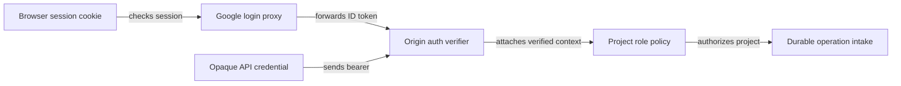

# Feature Specification: 051 Hosted AWS Pilot

Deploy a private `gwrk` pilot on Amazon Web Services (AWS) at `https://gwrk.gforge.ai` with Google login and scoped API credentials. Blocked: public exposure waits for authentication gates and native Linux checks plus live acceptance and operator Google inputs. The coordinator owns deployment gates while David Gonzalez (project owner) owns Google policy acceptance and the allowlist.

> Feature: `051-hosted-aws-pilot`
> Created: 2026-11-23
> Status: Draft
> Authoritative contract: [production-auth.md](contracts/production-auth.md)
> Related records: [plan.md](plan.md) · [plan-stress-test.md](plan-stress-test.md) · [hosted-security-readiness.md](../../docs/operations/hosted-security-readiness.md) · [gateway-surface.md](../041-hosted-google-signin-proof/contracts/gateway-surface.md)

## 1. Overview

The pilot host is privately provisioned in AWS profile `gforge-dev` in `us-east-2`. It uses one `t3a.medium` Linux instance with Instance Metadata Service version 2 (IMDSv2) and encrypted gp3 volumes. Root storage is 32 GB and separate data storage is 20 GB. Inbound access allows Secure Shell (SSH) from the operator IPv4 address only. No application port or Domain Name System (DNS) record is public yet. The planned `gwrk` origin must bind to `127.0.0.1:18790`. No application service is running yet.

Authentication never grants a project role by itself. New Google users receive no automatic project enrollment or maintainer role. Existing role bindings in `ProjectRegistryPort` remain the single authority for project scope.

### Pending operator inputs and rollout boundaries

| Boundary | Current state | Owner | Constraint |
|---|---|---|---|
| Private AWS host | Privately provisioned with application ingress closed | Coordinator | Loopback origin until public gateway acceptance |
| Google policy and allowlist | Pending operator input | David Gonzalez (project owner) | Deny all until supplied and preserve skills-connection config |
| Read-only proof `041` | Existing regression fixture | Coordinator | Retain unchanged under `deploy/hosted-auth-proof/` |
| Project rollout `052` | Downstream feature | David Gonzalez (project owner) | Zero live project enrollment during bootstrap |
| Untrusted-workload isolation | Residual OS and filesystem boundary | Root | Workers never receive inbound auth or gateway secrets |

Telegram stays disabled with status `disabled_in_pilot`. Live acceptance results remain separate from synthetic fixture tests. No secret value appears in tracked records or logs.

### Architecture decisions and target alignment

This specification preserves all Decided Architecture Decision Records (ADRs) from `ADR-001` through `ADR-012` in [index.md](../../.gwrk/decisions/index.md). Operational authentication tables in SQLite do not change git-native task authority under `ADR-002` and `ADR-003`. Domain policy follows `ADR-011` and the Proposed `hexagonal-functional` target in `ADR-013`. Proposed targets never supersede Decided constraints. Implementation records the auth architecture in a new Proposed ADR under `docs/decisions/`. Run `gwrk define adr --reindex` to update the index and preserve human ratification (`AX-004`).

## 2. User Scenarios and Testing

### US-001 Browser Google login and origin token verification

Priority is P0. Implements FR-001 and FR-002 and FR-015.

An allowed operator signs in through the Google OpenID Connect (OIDC) proxy at `https://gwrk.gforge.ai`. The `gwrk` origin cryptographically re-verifies the forwarded Google ID token before establishing a `google_sub` principal. Unlisted or unverified or forged or expired tokens fail with zero operation rows.

Independent test: run synthetic OIDC issuer fixtures against the verifier and edge callback guard. Cover bad signatures and wrong issuer or audience claims. Cover disallowed algorithms and bad token lifetimes. Cover unverified email and empty allowlists. Cover invalid callback `state` and `nonce`. Assert zero operation rows on every denial.

#### Acceptance scenarios (US-001)

1. Given a token with a bad signature or wrong issuer or wrong audience or disallowed algorithm. When `AUTH-01` runs, then:
   - `pnpm vitest run src/adapters/auth/google-id-token.test.ts -t "AUTH-01"` exits 0
2. Given an expired token or a future `iat` outside clock skew policy. When `AUTH-02` runs, then:
   - `pnpm vitest run src/adapters/auth/google-id-token.test.ts -t "AUTH-02"` exits 0
3. Given an unverified email or an unlisted account or an empty allowlist. When `AUTH-03` runs, then:
   - `pnpm vitest run src/adapters/auth/google-id-token.test.ts -t "AUTH-03"` exits 0
4. Given a callback with wrong `state` or wrong `nonce` or a replayed code. When `AUTH-05` runs, then:
   - `node tests/hosted-pilot/gateway-production.mjs --grep "AUTH-05"` exits 0
5. Given a valid token using either Google issuer variant. When principal mapping runs, then:
   - `pnpm vitest run src/adapters/auth/google-id-token.test.ts -t "FR-002: normalizes issuer and maps google_sub"` exits 0

### US-002 Browser session revocation and mutation protection

Priority is P0. Implements FR-003 and FR-009.

An operator logs out from the browser. Origin logout revokes the Google ID token digest before clearing proxy cookies. Every browser write requires a same-origin `Origin` header and a session-bound Cross-Site Request Forgery (CSRF) token.

Independent test: get a synthetic Google session and CSRF token from `GET /api/auth/session`. Send browser writes with missing `Origin` or cross-site `Origin`. Send writes with query-parameter CSRF tokens or another session's CSRF token. Log out and replay the copied cookie and ID token.

#### Acceptance scenarios (US-002)

1. Given a valid browser session. When `POST /api/auth/logout` commits and the caller replays the copied cookie and ID token (`AUTH-06`), then:
   - `pnpm vitest run src/server/auth-session.test.ts -t "AUTH-06"` exits 0
2. Given a browser write with missing `Origin` or cross-site `Origin` or wrong-session CSRF (`AUTH-11`). When the write guard runs, then:
   - `pnpm vitest run src/server/auth-csrf.test.ts -t "AUTH-11"` exits 0
3. Given an observed browser session. When SQLite auth tables are inspected, then:
   - `pnpm vitest run src/adapters/sqlite/auth-store.test.ts -t "FR-003: stores digest only without raw Google tokens"` exits 0

### US-003 Opaque project-scoped API credentials and atomic rotation

Priority is P0. Implements FR-004 and FR-005 and FR-015.

A private-host administrator issues finite-expiry opaque Application Programming Interface (API) credentials formatted as `gwrk_v1.<credential-id>.<base64url-secret>`. The store saves SHA-256 verifiers bound to the server origin. Creation and rotation commit role bindings atomically. Invalid or expired or revoked or out-of-scope calls fail with zero effects.

Independent test: issue credentials through the SQLite auth and grant transaction adapter. Test missing or malformed or oversized credentials. Test wrong-origin or expired or revoked credentials. Verify cross-project and excess-role HTTP 403 denials. Inject a mid-rotation failure and reopen the database to confirm rollback and persisted revocation.

#### Acceptance scenarios (US-003)

1. Given a missing or malformed or expired or revoked API credential (`AUTH-07`). When verification runs, then:
   - `pnpm vitest run src/server/auth-api-keys.test.ts -t "AUTH-07"` exits 0
2. Given a Project A API credential requesting Project B or exceeding its role (`AUTH-08`). When authorization runs, then:
   - `pnpm vitest run src/server/auth-api-keys.test.ts -t "AUTH-08"` exits 0
3. Given a crash or rollback during credential rotation and grant copy (`AUTH-09`). When the store recovers, then:
   - `pnpm vitest run src/adapters/sqlite/auth-store.test.ts -t "AUTH-09"` exits 0

### US-004 Local private-host key administration CLI

Priority is P0. Implements FR-006.

A private-host administrator runs `gwrk auth key create` and `list` and `revoke` and `rotate` locally using flags. Creation writes the raw secret once into an owner-only file outside the checkout. Stdout and stderr contain public metadata and the secret file path only.

Independent test: run `gwrk auth key` commands against a temporary state directory with `--format json` and `--agent`. Test exclusive `0600` file creation. Test symlink and existing-file and inside-checkout path rejections. Test auto-revocation on write failure and confirm zero raw secrets in stdout or stderr.

#### Acceptance scenarios (US-004)

1. Given valid grants and finite `--expires-at` with `--secret-out` outside the checkout (`AUTH-10`). When `create` runs, then:
   - `pnpm vitest run src/commands/auth.test.ts -t "AUTH-10: creates secret file 0600 without stdout secret"` exits 0
2. Given a symlink or existing file or inside-checkout path or write failure (`AUTH-10`). When `create` runs, then:
   - `pnpm vitest run src/commands/auth.test.ts -t "AUTH-10: revokes orphan key on delivery failure"` exits 0
3. Given non-interactive `list` and `revoke` and `rotate` calls with `--format json`. When outputs are checked, then:
   - `pnpm vitest run src/commands/auth.test.ts -t "FR-006: emits ADR-004 signal and public metadata only"` exits 0

### US-005 Fail-closed hosted startup, async verification, and no-inference init

Priority is P0. Implements FR-007 and FR-008 and FR-015.

An asynchronous authentication pre-handler attaches a server-owned verified context before any operational handler runs. Both server startup entry points fail closed when hosted auth configuration is absent. Command imports and `gwrk init` perform zero inference calls and zero auth secret reads.

Independent test: invoke `gwrk server start --foreground` and `gwrk server _run` without verifier config. Send forged identity headers from a local process. Run `gwrk init --non-interactive --server` with stubbed agent executables that fail on any invocation.

#### Acceptance scenarios (US-005)

1. Given local or public forged identity or auth-mode headers without a valid credential (`AUTH-04`). When the pre-handler runs, then:
   - `pnpm vitest run src/server/auth-prehandler.test.ts -t "AUTH-04"` exits 0
2. Given hosted `server start --foreground` or `server _run` without verifier configuration (`AUTH-17`). When startup runs, then:
   - `pnpm vitest run src/commands/server.auth-startup.test.ts -t "AUTH-17"` exits 0
3. Given stubbed agent executables and absent auth secrets. When CLI modules import and `gwrk init --non-interactive --server` runs, then:
   - `pnpm vitest run src/commands/init.test.ts -t "TR-019: init retains inference-free and secret-free behavior"` exits 0

### US-006 Default-deny route policy, scoped health, and webhook preservation

Priority is P0. Implements FR-010 and FR-011.

Unclassified routes and HTTP methods fail closed. Detailed `GET /api/health` authorizes and filters strictly to one requested project. Private `GET /health` returns minimal liveness without project metadata or Git probes. Signed `POST /webhook/github` enforces configured raw-body Hash-based Message Authentication Code (HMAC) and replay conflict checks.

Independent test: probe documented and undocumented routes across HTTP methods. Request Project B readiness using a Project A credential. Verify zero Git calls on `/health`. Replay missing-secret and invalid-HMAC and changed-payload webhooks.

#### Acceptance scenarios (US-006)

1. Given a Project A credential reading readiness for Project B (`AUTH-12`). When `GET /api/health` runs, then:
   - `pnpm vitest run src/server/routes/health.auth.test.ts -t "AUTH-12"` exits 0
2. Given a missing secret or invalid HMAC or changed replay payload (`AUTH-13`). When `POST /webhook/github` runs, then:
   - `pnpm vitest run src/server/github.test.ts -t "AUTH-13"` exits 0
3. Given an unauthenticated API request or unclassified route. When the hosted router handles it, then:
   - `pnpm vitest run src/server/auth-route-policy.test.ts -t "FR-010: denies unclassified routes and returns JSON on API paths"` exits 0

### US-007 Separate edge gateway chains and proof regression preservation

Priority is P0. Implements FR-001 and FR-012.

The production edge routes browser traffic and API traffic and webhooks on separate chains. Every chain strips forged identity headers. Browser routes forward the proxy ID token and CSRF cookie. API routes preserve opaque bearer keys without OAuth redirects. The read-only `041` proof remains untouched as a separate regression.

Independent test: run the production gateway suite with Traefik and OAuth2 Proxy. Use a synthetic OIDC issuer and a real `gwrk` loopback origin. Run the untouched `041` proof regression suite separately.

#### Acceptance scenarios (US-007)

1. Given the production gateway bundle with synthetic OIDC and real `gwrk` origin. When edge routing and isolation tests run, then:
   - `node tests/hosted-pilot/gateway-production.mjs` exits 0
2. Given the read-only proof under `deploy/hosted-auth-proof/`. When its regression suite runs, then:
   - `node tests/hosted-auth-proof/gateway-proof.mjs` exits 0

### US-008 Bounded denials, rate limits, and canary log redaction

Priority is P0. Implements FR-013.

Rate limits and request size limits and unavailable validation dependencies fail closed with zero accepted work. Canary API keys and cookies never appear in logs or error responses. Response `Set-Cookie` headers and OAuth callback codes never appear in logs or error responses.

Independent test: exceed login and API rate limits and simulate JWKS unavailability. Drive canary secret strings across every authentication error path. Scan captured origin logs and edge logs and HTTP responses for canary matches.

#### Acceptance scenarios (US-008)

1. Given rate limit excess or oversized input or unavailable validation dependency (`AUTH-14`). When bounded handlers run, then:
   - `pnpm vitest run src/server/auth-bounds.test.ts -t "AUTH-14"` exits 0
2. Given canary keys and cookies and OAuth codes sent through every error path (`AUTH-15`). When logs are scanned, then:
   - `pnpm vitest run src/server/auth-logging.test.ts -t "AUTH-15"` exits 0

### US-009 Origin-bound CLI credentials for remote probes

Priority is P1. Implements FR-014.

A remote `gwrk status` or `gwrk server status` probe attaches a stored API credential only for its bound HTTPS origin. Redirects and overridden origins never receive credentials. Local PID liveness stays distinct from authenticated project readiness.

Independent test: bind a private client credential profile to `https://gwrk.gforge.ai`. Probe matching origins and mismatched `--server-url` overrides. Probe plain HTTP URLs and 302 redirects. Assert zero credential forwarding on mismatches and redirects.

#### Acceptance scenarios (US-009)

1. Given an overridden `--server-url` for another origin or an HTTP redirect (`AUTH-16`). When the CLI credential provider runs, then:
   - `pnpm vitest run src/adapters/auth/http-client-credential.test.ts -t "AUTH-16"` exits 0
2. Given a local daemon without remote credentials. When `gwrk server status` checks private minimal `/health`, then:
   - `pnpm vitest run src/commands/server.auth-startup.test.ts -t "FR-014: separates local liveness from authenticated readiness"` exits 0

### US-010 Systemd runner, backup restore, and durable restart continuity

Priority is P0. Implements FR-016 and FR-017.

The pilot operator runs `gwrk-runner.service` and preflight checks with authentication state preserved. Backups and offline restores and rollbacks preserve authentication state. Accepted scoped dispatches and harvests keep stable operation IDs and recipient receipts across restarts.

Independent test: validate `preflight.sh` with hosted auth secrets and loopback settings. Accept a scoped dispatch and harvest and restart the server. Run `gwrk db backup` and `gwrk db restore`. Verify verifiers and revocations and operation IDs and receipts survive.

#### Acceptance scenarios (US-010)

1. Given a valid scoped request through server restart and harvest (`AUTH-18`). When continuity checks run, then:
   - `pnpm vitest run src/server/auth-continuity.test.ts -t "AUTH-18"` exits 0
2. Given `gwrk.db` with API verifiers and session revocations and durable operations. When backup and restore run, then:
   - `pnpm vitest run tests/linux-runner/backup-restore-rollback.test.ts -t "FR-017: preserves auth verifiers revocations and receipts"` exits 0
3. Given missing hosted auth secrets or enabled Telegram in runner config. When `preflight.sh` runs, then:
   - `pnpm vitest run tests/linux-runner/preflight-auth.test.ts -t "FR-016: fails closed on missing hosted auth secrets"` exits 0

### US-011 Staged rollout gates and pending operator input boundaries

Priority is P1. Implements FR-018.

Canonical DNS and operator-restricted HTTPS may follow deterministic and native Linux gates. Worldwide HTTPS requires restricted live acceptance with operator-supplied Google inputs. Project enrollment (`052`) and OS-level untrusted-workload isolation remain separate boundaries.

Independent test: run rollout gate verification over tracked deployment manifests and checklists. Verify zero assumed operator accounts and fail-closed empty allowlists. Verify private defaults and hexagonal architecture checks and valid ADR citations.

#### Acceptance scenarios (US-011)

1. Given tracked deployment templates and rollout checklists. When gate checks run, then:
   - `pnpm vitest run tests/hosted-pilot/rollout-gates.test.ts -t "FR-018: enforces private defaults and zero assumed Google accounts"` exits 0
2. Given the repository imports and ADR corpus. When architecture and citation checks run, then:
   - `pnpm vitest run src/architecture.test.ts && node dist/cli.js define adr --reindex --check && node dist/cli.js define adr --check` exits 0

## 3. Functional Requirements

### FR-001 Google OIDC proxy configuration and callback integrity

Fulfills: US-001 and US-007.

Configure the production Google login proxy for origin `https://gwrk.gforge.ai` and callback `https://gwrk.gforge.ai/oauth2/callback`. Pin the issuer to `https://accounts.google.com`. Require authorization code flow with Proof Key for Code Exchange (PKCE) `S256` and checked `state`. Enable nonce verification explicitly by setting `insecure_oidc_skip_nonce = false`. Deny all access when the explicit account allowlist is absent or empty. Forbid wildcard accounts and wildcard domains and `skip_auth_routes`. Configure the pinned proxy version to supply a signed Google ID token in its controlled `Authorization` auth-request response header. Do not forward an access token or email header. Prove that the forwarded value is an ID token in the pinned deployment test.

#### Error states (FR-001)

| Condition | Response or stderr | Code |
|---|---|---|
| Absent or empty allowlist file | Proxy fails startup or denies access | Exit 1 or HTTP 403 |
| Wrong or replayed `state` or `nonce` | Proxy rejects callback with no cookie | HTTP 403 or 401 |
| Unlisted or unverified email | Proxy denies request before origin | HTTP 403 |
| Off-host `rd` redirect target | Proxy rejects or resets target to `/` | HTTP 400 or 302 |

### FR-002 Origin Google ID token cryptographic verification and principal mapping

Fulfills: US-001.

Verify every forwarded Google ID token inside `src/adapters/auth/google-id-token.ts` implementing `GoogleIdentityVerifierPort`. Use a pinned release of `jose` on Node.js 22. Verify the signature against the configured issuer's JSON Web Key Set (JWKS). Require the approved web client audience and permitted asymmetric signing algorithms. Validate `exp` and `iat` bounds plus a nonempty `sub` and `email_verified === true`. Re-apply the current explicit account allowlist on every request so allowlist removal denies the next request without restarting `gwrk`. Normalize Google's documented issuer variants to `https://accounts.google.com`. Form the `google_sub` principal ID as `<canonical issuer>:`. Never use email as the stable identity. Never decode an unverified token into a principal and never fetch keys from token-supplied URLs. Bound discovery and JWKS fetches with finite timeouts and a finite cache. Fail closed when keys are unknown or validation is unavailable. Do not treat login nonces as single-use across ordinary API requests. Never grant a project role automatically upon login.

#### Error states (FR-002)

| Condition | Response or stderr | Code |
|---|---|---|
| Bad signature or issuer or audience or algorithm | JSON denial `AUTH_TOKEN_INVALID` with request ID | HTTP 401 |
| Expired token or future `iat` outside policy | JSON denial `AUTH_TOKEN_EXPIRED` with request ID | HTTP 401 |
| Unverified email or unlisted account or empty allowlist | JSON denial `AUTH_ACCOUNT_DENIED` with request ID | HTTP 403 |
| JWKS timeout or unknown key | Fail-closed JSON denial `AUTH_VERIFIER_UNAVAILABLE` | HTTP 503 or 401 |

### FR-003 Digest-only browser session tracking and origin-first logout

Fulfills: US-002.

Store only a SHA-256 digest of each observed Google ID token in `AuthStorePort`. Store its `google_sub` principal and expiry and revocation marker alongside the digest. Cap browser sessions at one hour and at the token expiry. Retain revoked token digests until token expiry so a copied old cookie and ID token remain denied. Never store raw Google ID tokens or refresh tokens in the core database. Allow a fresh login with a newly issued token to create a new session record. On `POST /api/auth/logout`, revoke the token digest at the origin first. Then call the fixed internal `/oauth2/sign_out` endpoint through `ProxySessionLogoutPort`. Forward all cookie-clearing `Set-Cookie` headers and clear the origin CSRF cookie. Never publicly route `/oauth2/sign_out` around origin revocation.

#### Error states (FR-003)

| Condition | Response or stderr | Code |
|---|---|---|
| Replayed token with revoked digest | JSON denial `AUTH_SESSION_REVOKED` with request ID | HTTP 401 |
| Session past 1-hour cap or token expiry | JSON denial `AUTH_SESSION_EXPIRED` with request ID | HTTP 401 |
| Internal proxy sign-out fails after origin revocation | Keep revocation committed and clear CSRF cookie | HTTP 502 or 503 |
| Public caller requests `/oauth2/sign_out` directly | Edge blocks unrouted path | HTTP 404 or 403 |

### FR-004 Opaque scoped API credentials and hash-only verification

Fulfills: US-003.

Issue opaque API credentials with a public credential ID and a cryptographically random 32-byte secret through `CredentialCryptoPort` (`src/adapters/auth/credential-crypto.ts`). Format credentials as `gwrk_v1.<credential-id>.<base64url-secret>`. Reject unknown versions and malformed strings and oversized values before lookup. Store a SHA-256 verifier of the complete high-entropy credential in `AuthStorePort`. Compare fixed-length verifiers in constant time. Persist public ID and label and issuer and creation time. Persist finite expiry and revocation state and configured server origin as audience (`https://gwrk.gforge.ai`). Never authenticate a credential for another origin. Map the public credential ID to the existing `cli_token` principal ID. Keep `ProjectRegistryPort` role bindings as the sole project-scope authority across `viewer` and `operator` and `maintainer` roles. Allow explicit enrolled-project grants only. Forbid wildcard project grants and permanent credentials by enforcing a maximum lifetime in deployment policy. Metadata list and inspect outputs never return verifiers or raw credentials.

#### Error states (FR-004)

| Condition | Response or stderr | Code |
|---|---|---|
| Absent or malformed or oversized bearer token | JSON denial `AUTH_CREDENTIAL_INVALID` before lookup | HTTP 401 |
| Hash mismatch or wrong origin or expired or revoked | JSON denial `AUTH_CREDENTIAL_REJECTED` with zero effects | HTTP 401 |
| Missing or permanent expiry on issuance | Usage error requiring finite `--expires-at` | Exit 2 |
| Authorized principal lacks project role | JSON denial `PROJECT_ACCESS_DENIED` with zero effects | HTTP 403 |

### FR-005 Atomic credential grants and rotation transactions

Fulfills: US-003.

Implement `CredentialGrantAdminPort` inside the same SQLite transaction boundary as `AuthStorePort` and `ProjectRegistryPort`. Commit credential creation and explicit enrolled-project role bindings atomically. Reject unenrolled projects or invalid roles before any write commits. Implement rotation in one transaction that creates a new credential ID and copies approved current bindings. Revoke the old credential in the same transaction by default. Allow overlap only with an explicit finite expiry and an audit record. Any crash or rollback leaves zero partial rows. Committed revocations persist across daemon restarts.

#### Error states (FR-005)

| Condition | Response or stderr | Code |
|---|---|---|
| Unenrolled project or invalid role in `--grant` | Roll back with hint `gwrk project list` | Exit 1 or 2 |
| Missing or revoked target ID on rotation | Roll back without issuing new credential | Exit 1 |
| Error during binding copy or old-key revocation | Roll back entire SQLite transaction | Exit 1 |
| Overlap expiry missing or above policy maximum | Reject before opening write transaction | Exit 2 |

### FR-006 Local private-host key administration CLI

Fulfills: US-004.

Keep key administration local on the private host through `gwrk auth key create` and `list` and `revoke` and `rotate`. Do not add remote HTTP credential-management endpoints during this pilot. Creation requires repeated `--grant <project>=<role>` flags plus `--expires-at <iso8601>` plus `--label <text>` plus `--secret-out <path>`. Rotate and revoke accept public credential IDs only. Rotate also requires `--expires-at` and `--secret-out <path>`. Create the one-time secret output file outside the repository checkout with owner-only `0600` permissions using exclusive creation without following symlinks. Refuse to overwrite any existing path. If secret delivery fails, revoke the new credential before reporting failure. Emit public metadata and the secret file path to stdout without ever printing the raw key. Preserve `--format json` and `--agent` and non-interactive flag execution. Preserve exit codes `0` and `1` and `2` and `127`. Preserve error-as-navigation messages and the `ADR-004` stderr signal `[exit:N | Xs]`.

#### Command classification (FR-006)

| Command | Type | Side effects | Format support |
|---|---|---|---|
| `gwrk auth key create` | `mutator` | Persists credential and grants and writes `0600` secret file | Text and `--format json` |
| `gwrk auth key list` | `query` | Read-only public metadata query | Text and `--format json` |
| `gwrk auth key revoke <id>` | `mutator` | Persists revocation and audit event | Text and `--format json` |
| `gwrk auth key rotate <id>` | `mutator` | Atomically rotates key and writes `0600` secret file | Text and `--format json` |

#### Error states (FR-006)

| Condition | Response or stderr | Code |
|---|---|---|
| `--secret-out` inside checkout or symlink or existing file | Refused path error directing a new path outside checkout | Exit 2 |
| Secret file write fails after commit | Revokes new credential and reports delivery failure | Exit 1 |
| Missing `--grant` or `--expires-at` or `--secret-out` | Usage error pointing to `gwrk auth key create --help` | Exit 2 |
| Raw secret detected in output buffer | Guard aborts emission before stdout write | Exit 1 |

### FR-007 Asynchronous authentication pre-handler and synchronous principal reader

Fulfills: US-005.

Add an asynchronous Fastify authentication pre-handler before all operational route handlers. Verification must finish before any dispatch or harvest or notification or status effect occurs. Define one `VerifiedAuthContext` type in `src/ports/`. Include `principalType` and `principalId` and `credentialId` and `expiresAt` and `authMethod`. Attach the verified context to a server-owned request decoration inside the HTTP adapter while keeping Fastify types out of `src/domain/` and `src/ports/`. Keep existing synchronous `resolvePrincipal` in `src/server/index.ts` as a pure reader of that decoration feeding `evaluateHttpProjectAccess`. Never populate the decoration from public identity or email headers. Never accept a role or project grant from a request header. Preserve durable operation identity and acknowledgment ordering. Auth expiry or revocation does not cancel previously accepted durable work. Requests authenticated after revocation commits MUST fail.

#### Error states (FR-007)

| Condition | Response or stderr | Code |
|---|---|---|
| Forged identity or auth-mode headers without valid credential | Pre-handler denies with zero context and zero effects | HTTP 401 |
| Both Google token and API key supplied together | Pre-handler rejects with `AUTH_CONFLICTING_CREDENTIALS` | HTTP 401 |
| Unhandled verifier or store failure | Pre-handler fails closed with zero principal | HTTP 503 |

### FR-008 Fail-closed hosted startup wiring and no-inference init regression guard

Fulfills: US-005.

Wire one production authentication factory into both `gwrk server start --foreground` and `gwrk server _run` in `src/commands/server.ts`. Construct that factory inside the startup action only. Importing CLI commands MUST NOT read auth secrets or contact Google. Retain inference-free behavior in `gwrk init` with zero agent invocations and zero auth secret reads. Hosted startup MUST explicitly select `transport: "hosted"` even when binding to loopback (`127.0.0.1`). Missing or invalid auth configuration in hosted mode MUST fail startup without binding an operational listener. Otherwise it MUST enforce a deny-all operational policy. Never fall back to `trusted_local` authorization in hosted mode. Keep `trusted_local` CLI behavior separate from hosted HTTP behavior.

#### Error states (FR-008)

| Condition | Response or stderr | Code |
|---|---|---|
| Hosted startup missing verifier or CSRF secret config | Startup exits before listening with corrective message | Exit 1 |
| Hosted startup with absent or empty allowlist | Startup fails closed or denies all Google sessions | Exit 1 or HTTP 403 |
| Command module import triggers secret read or network call | Import purity regression fails | Test FAIL |

### FR-009 Browser same-origin and session-bound CSRF protection

Fulfills: US-002.

Require the configured same-origin `Origin` header (`https://gwrk.gforge.ai`) on all browser mutations (`POST` and `PUT` and `PATCH` and `DELETE`). Implement `BrowserCsrfPort` with `@fastify/csrf-protection` using a server-managed HMAC key. Store the secret in a `Secure` and `HttpOnly` host-only cookie. Bind every CSRF token to the verified Google session digest. Issue CSRF tokens through `GET /api/auth/session` with `Cache-Control: no-store`. Never use the raw Google ID token as a CSRF token. Accept the CSRF token from a dedicated HTTP request header only and never from a query parameter. Apply CSRF checks to Google-session requests only. Authenticate API-key requests independently so an invalid API key never falls back to browser cookie authentication. Retain HMAC verification for provider webhooks.

#### Error states (FR-009)

| Condition | Response or stderr | Code |
|---|---|---|
| Missing or cross-site `Origin` on browser write | JSON denial `AUTH_ORIGIN_MISMATCH` with zero effects | HTTP 403 |
| Missing or query-supplied or wrong-session CSRF token | JSON denial `AUTH_CSRF_INVALID` with zero effects | HTTP 403 |
| Invalid API key sent with valid browser cookie | Reject as invalid API key without cookie fallback | HTTP 401 |

### FR-010 Default-deny route policy, machine-readable denials, and health filtering

Fulfills: US-006.

Deny public access to all unclassified routes and HTTP methods. `HEAD` requests follow the corresponding read route policy. Keep Cross-Origin Resource Sharing (CORS) disabled for cross-origin credentialed access. Require every new native route to declare its policy before publication.

| Route | Production policy | Required project access |
|---|---|---|
| `GET /` | Browser login entry without project metadata | None |
| `GET /oauth2/start` | Rate-limited browser login | None |
| `GET /oauth2/callback` | Proxy state and nonce verification | None |
| `POST /api/auth/logout` | Verified Google session with CSRF protection | Own session only |
| `/oauth2/sign_out` | Internal proxy operation only | Origin logout orchestration |
| `GET /api/auth/session` | Verified Google session and `no-store` response | Own session only |
| `GET /api/status` | Google session or API credential | Read |
| `POST /api/dispatch` | Google session or API credential | Operate |
| `GET /api/dispatch/queue` | Google session or API credential | Read |
| `GET /api/dispatch/:feature/:phase` | Google session or API credential | Read |
| `POST /api/notify` | Google session or API credential | Operate |
| `GET /api/health` | Authenticated and filtered readiness | Read |
| `GET /health` | Minimal private liveness only and not publicly routed | None |
| `POST /webhook/github` | Required configured HMAC and durable replay checks | Enrolled repository mapping |

Hosted `GET /api/health` MUST authorize an explicit project and filter its response to that project alone. It MUST NOT expose another project's name or slug or checkout path. Hosted `GET /health` MUST return minimal private liveness only without readiness or secrets. It MUST perform zero Git or provider requests per probe. Preserve full local-mode health behavior in `trusted_local` mode where required. Return HTTP `401` JSON for missing or invalid API auth. Return HTTP `403` JSON for insufficient project roles. Return HTTP `503` JSON when auth dependencies fail closed. Include a stable code and request ID without credential values. Restrict interactive `302` redirects to `GET /` and `GET /oauth2/start`. All `/api/*` routes MUST return machine-readable JSON denials even when the proxy rejects a missing session.

#### Error states (FR-010)

| Condition | Response or stderr | Code |
|---|---|---|
| Unclassified route or disallowed method | JSON denial without reaching operational handlers | HTTP 404 or 405 |
| Unauthenticated request to `/api/*` | JSON denial `AUTH_REQUIRED` with no 302 redirect | HTTP 401 |
| `GET /api/health` without explicit authorized project | JSON denial `PROJECT_REQUIRED` or `PROJECT_ACCESS_DENIED` | HTTP 400 or 403 |

### FR-011 Provider webhook signature and durable replay preservation

Fulfills: US-006.

Retain required raw-body HMAC verification on `POST /webhook/github` and inside `ingestWebhook`. Reject missing or empty or whitespace webhook secrets and invalid signatures with zero harvest operation or delivery rows. Retain durable delivery deduplication from feature `049` repair `89ac728b`. Identical replays reuse receipts while reused delivery IDs with changed payload digests fail with `DELIVERY_ID_CONFLICT` and zero new effects.

#### Error states (FR-011)

| Condition | Response or stderr | Code |
|---|---|---|
| Missing or blank configured webhook secret | Reject intake with zero operation and delivery rows | HTTP 503 or 401 |
| Missing or invalid `X-Hub-Signature-256` header | Constant-time HMAC denial with zero effects | HTTP 401 |
| Reused delivery ID with changed payload digest | Conflict rejection `DELIVERY_ID_CONFLICT` with zero effects | HTTP 409 |

### FR-012 Production edge gateway routing chains and proof fixture preservation

Fulfills: US-007.

Configure three separate edge gateway chains with narrow trusted proxy hops. Never use a trusted IP setting as an authentication exemption.

| Chain | Credential handling | Origin requirement |
|---|---|---|
| Browser | Checks proxy cookie and forwards ID-token `Authorization` and CSRF cookie | Verifies Google JWT and revocation and Origin and CSRF |
| API | Preserves caller opaque bearer without OAuth redirect | Verifies SHA-256 verifier and audience and lifecycle |
| Provider webhook | Preserves raw request bytes and provider signature | Enforces configured HMAC and durable replay guard |

Both browser and API chains MUST strip public identity and internal auth-mode headers before setting trusted internal metadata. Strip `X-Forwarded-User` and `X-Forwarded-Email` and `X-Forwarded-Groups`. Also strip `X-Forwarded-Preferred-Username` and `X-Forwarded-Access-Token` and `X-Auth-Request-*`. A static internal auth-mode header may select the credential parser, never establish identity or bypass cryptographic checks. Forward the origin CSRF secret cookie on browser requests instead of reusing the proof's blanket `Cookie` stripping. The origin never treats the proxy cookie alone as authenticated. Never overwrite an API credential with a Google token. Preserve `specs/041-hosted-google-signin-proof` and `deploy/hosted-auth-proof/` as a separate regression target.

#### Error states (FR-012)

| Condition | Response or stderr | Code |
|---|---|---|
| Direct public probe to loopback origin | Connection refused outside host loopback | Network fail |
| Conflicting Google and API credentials on one request | Reject without fallback or redirect | HTTP 401 |
| Missing browser session on `/api/*` | Edge or origin returns machine-readable JSON denial | HTTP 401 |

### FR-013 Request bounds, rate limits, log redaction, and audit records

Fulfills: US-008.

Disable or sanitize default Fastify request logging before accepting auth routes. Never log `Authorization` or `Cookie` or `Set-Cookie` values across edge or origin logs. Strip OAuth callback `code` and `state` values from URL logs. Never log request bodies or upstream authentication error payloads. Configure finite login and API rate limits before exposure. Bound header sizes and request bodies and external validation timeouts. Trust client-IP headers only at the configured proxy boundary. Key application-level rate limits on verified credential IDs rather than raw tokens. Audit authentication denials and key lifecycle changes using public identifiers only.

#### Error states (FR-013)

| Condition | Response or stderr | Code |
|---|---|---|
| Login or API rate limit exceeded | Bounded JSON denial `RATE_LIMIT_EXCEEDED` with zero work | HTTP 429 |
| Oversized header or request body | Bounded rejection before handler runs | HTTP 431 or 413 |
| Canary secret appears in logs or error payloads | Canary regression fails build gate | Test FAIL |

### FR-014 Origin-bound outbound CLI credential transport

Fulfills: US-009.

Add one outbound HTTP credential provider (`HttpClientCredentialPort`) backed by a private client credential adapter. Use it for remote probes in `gwrk status` and in `gwrk server status` when calling a protected endpoint. Keep local PID and minimal `/health` checks distinct from authenticated project readiness so `gwrk server status` may probe private liveness without claiming project readiness. Load credentials from a protected client profile or explicit private file bound to the canonical server origin (`https://gwrk.gforge.ai`). Require HTTPS for remote requests and enforce bounded request timeouts. Disable credential-bearing redirect following. Never attach a credential to an arbitrary project-supplied URL. Never attach a credential to an overridden `--server-url` for another origin or to a redirected origin. Keep outbound provider credentials outside this client credential store.

#### Error states (FR-014)

| Condition | Response or stderr | Code |
|---|---|---|
| `--server-url` origin differs from bound profile origin | Omit credential and emit corrective navigation hint | Exit 1 |
| Remote endpoint returns HTTP 3xx redirect | Abort probe without following redirect or sending key | Exit 1 |
| Non-HTTPS remote URL with stored production credential | Refuse credential attachment with HTTPS error | Exit 1 |

### FR-015 Hexagonal auth ports, domain policy purity, and Proposed ADR

Fulfills: US-001 and US-003 and US-005.

Freeze the authentication port interfaces in `src/ports/` before implementing adapters. Domain policy in `src/domain/` owns route classification and credential lifecycle decisions. Domain policy receives clock values and verified claims as inputs and performs zero filesystem or network access. Do not import SQLite or Fastify or `jose` into `src/domain/`.

| Interface | Responsibility | Implementation boundary |
|---|---|---|
| `GoogleIdentityVerifierPort` | Verify signed ID token and return trusted claims | `src/adapters/auth/google-id-token.ts` |
| `CredentialCryptoPort` | Generate entropy and hash or compare verifiers | `src/adapters/auth/credential-crypto.ts` |
| `AuthStorePort` | Persist credentials and session revocations | SQLite auth adapter |
| `CredentialGrantAdminPort` | Atomically issue or rotate credentials with role bindings | Same SQLite transaction |
| `BrowserCsrfPort` | Issue and verify tokens bound to verified session | Fastify CSRF adapter |
| `ProxySessionLogoutPort` | Clear proxy cookies after origin revocation | Fixed internal proxy client |
| `HttpClientCredentialPort` | Provide an origin-bound CLI credential | Private client credential adapter |
| `ClockPort` (existing) | Supply testable time | Existing clock boundary |
| `ProjectRegistryPort` (existing) | Resolve projects and roles | Existing registry adapter |

Application use cases (`src/application/`) return explicit authenticated or denied results. Repository or verifier failures never manufacture a principal. Record the selected design in a new Proposed ADR under `docs/decisions/`. Update `.gwrk/decisions/index.md` via `gwrk define adr --reindex` while preserving existing Decided ADRs and human ratification.

### FR-016 Existing Linux systemd runner integration interface

Fulfills: US-010.

Preserve compatibility with `deploy/linux-runner/gwrk-runner.service` and `run.sh` and `preflight.sh`. Also preserve compatibility with `credentials.sh` and `install-release.sh` and `/etc/gwrk/runner.env`. Keep standard paths at `/opt/gwrk` and `/var/lib/gwrk` and `/run/gwrk` and `/etc/gwrk/secrets`. Keep the loopback listener at `127.0.0.1:18790`. Store origin auth secret files under `/etc/gwrk/secrets` owned by `root:gwrk` with mode `0640`. Store gateway-only client and cookie secrets in a separate directory that the `gwrk` worker user cannot read. Keep inbound auth secrets distinct from outbound runner secrets (`pilot-git-credential` and `agent-credential` and `slack-bot-token` and `slack-app-token`). Extend `preflight.sh` to check hosted auth config presence and file permissions and loopback bind and disabled Telegram. Run those checks before `run.sh` launches `node /opt/gwrk/current/dist/cli.js server start --foreground`. Make sure spawned workers never inherit inbound auth credentials or gateway session secrets.

#### Error states (FR-016)

| Condition | Response or stderr | Code |
|---|---|---|
| Missing or loose-permission hosted auth secret file | `preflight.sh` fails before service start | Exit 1 |
| Non-loopback bind in hosted runner config | `preflight.sh` rejects unsafe listener host | Exit 1 |
| Telegram variables present in runner environment | `preflight.sh` rejects Telegram configuration | Exit 1 |

### FR-017 Ledger backup, offline restore, and restart continuity interface

Fulfills: US-010.

Store operational auth tables in `gwrk.db` under the existing migration and ledger-lock contract. Preserve compatibility with `gwrk db backup --out <dir> --format json` and `gwrk db restore --from <dir> --state-dir <dir>`. Also preserve compatibility with `gwrk db rollback-check` and `.restore-pending` and `deploy/linux-runner/rollback-release.sh`. Restoring a backup into a clean instance MUST preserve enrolled projects and role bindings. Restores MUST also preserve credential verifiers and revocations and accepted durable operations and recipient receipts. Backups MUST contain zero raw API keys and zero raw Google ID tokens and zero refresh tokens. Systemd restart and host reboot recovery MUST resume with one server and one worker. Restarts MUST preserve stable operation IDs and recipient receipts (`AUTH-18`).

#### Error states (FR-017)

| Condition | Response or stderr | Code |
|---|---|---|
| Restore runs while server holds instance or ledger lock | `gwrk db restore` fails with `gwrk server stop` hint | Exit 1 |
| Interrupted restore leaves `.restore-pending` | Server startup refuses launch until restore retries | Exit 1 |
| Target release lacks applied auth migration digest | `gwrk db rollback-check` blocks incompatible downgrade | Exit 1 |

### FR-018 Staged private-host rollout gates and operator boundaries

Fulfills: US-011.

Execute the five-phase sequence from [plan.md](plan.md) and [production-auth.md](contracts/production-auth.md):
1. Freeze auth ports and pass deterministic behavioral gates (`AUTH-01` through `AUTH-18`).
2. Prepare the private AWS host with zero public application ports and zero DNS records (completed privately).
3. Install the systemd runner behind the loopback listener and verify reboot plus backup and restore.
4. Run restricted HTTPS acceptance with real Google login and API denial checks. Require David Gonzalez to supply Google policy acceptance and the initial allowlist while preserving skills-connection Google configuration.
5. Open public HTTPS gateway access at `https://gwrk.gforge.ai` only after deterministic and native Linux and restricted live acceptance gates pass.

If any security gate fails, close public ingress before repair. Keep project enrollment and rollout (`052`) outside `051-hosted-aws-pilot`. Keep OS-level untrusted-workload isolation as a separate residual trust boundary owned by root.

## 4. Technical Constraints

| ID | Constraint | Requirement |
|---|---|---|
| TC-001 | Air-gapped default | Deterministic suites use synthetic OIDC issuer and local SQLite with zero runtime CDN or telemetry |
| TC-002 | Fail-fast config | Missing auth config or empty allowlist or blank webhook secret fails closed with zero `trusted_local` fallback |
| TC-003 | TypeScript only | Strict ESM ES2022 TypeScript with zero `any`, Biome zero errors, clean `pnpm build`, pinned `jose` and CSRF plugin |
| TC-004 | Hexagonal boundaries | `src/domain/` imports zero adapters, SQLite, Fastify, `jose`, or filesystem modules (`ADR-011`, `ADR-013`) |
| TC-005 | Two-tier state | Auth SQLite tables are operational state only while git-native `tasks.json` and run manifests keep authority (`ADR-002`, `ADR-003`) |
| TC-006 | Agent-native CLI | `gwrk auth key` emits `[exit:N \| Xs]`, supports `--format json` and `--agent`, and runs non-interactively (`ADR-004`, `ADR-008`) |
| TC-007 | Single dispatch path | Preserve `AgentPort` and `WorkflowRuntime` with zero direct agent CLI spawning (`ADR-006`, `ADR-007`) |
| TC-008 | Hash-only secrets | Constant-time SHA-256 verifiers for API keys and SHA-256 digests for Google revocations with zero raw secrets persisted |
| TC-009 | Runtime and gateway | Node.js 22 on Linux `t3a.medium` with version-pinned Traefik and OAuth2 Proxy while `041` proof stays untouched |
| TC-010 | Private host posture | Loopback bind `127.0.0.1:18790`, IMDSv2, encrypted gp3, SSH operator IPv4 only, no host AWS creds, Telegram disabled |
| TC-011 | Operator authority | Google policy acceptance and allowlist remain operator inputs while the auth ADR stays `Proposed` until human ratification (`AX-004`) |
| TC-012 | Explicit boundaries | Project rollout `052` and root OS worker isolation remain separate while workers never receive inbound auth or gateway secrets |

## 5. Testing Requirements

Every test MUST observe RED failure before production repair (`ADR-005`, `ADR-013`). Local verification uses a synthetic OIDC issuer and isolated credentials. Never substitute live observations for deterministic gates.

| TR ID | Contract ID | Target file and module | Behavioral assertions |
|---|---|---|---|
| TR-001 | AUTH-01 | `src/adapters/auth/google-id-token.test.ts` | Rejects bad signature, wrong issuer, wrong audience, bad algorithm, token JWKS URL, zero operation rows |
| TR-002 | AUTH-02 | `src/adapters/auth/google-id-token.test.ts` | Rejects expired `exp` and future `iat` beyond skew policy and checks issuer normalization and `google_sub` |
| TR-003 | AUTH-03 | `src/adapters/auth/google-id-token.test.ts` | Rejects unverified email, unlisted account, empty allowlist, live allowlist removal without restart, zero auto-roles |
| TR-004 | AUTH-04 | `src/server/auth-prehandler.test.ts` | Local and remote forged identity or auth-mode headers yield zero principal and zero effects |
| TR-005 | AUTH-05 | `tests/hosted-pilot/gateway-production.mjs` | Proxy rejects wrong `state`, wrong `nonce` (`insecure_oidc_skip_nonce = false`), and replayed callback with no session |
| TR-006 | AUTH-06 | `src/server/auth-session.test.ts` | `POST /api/auth/logout` revokes digest first, clears proxy and CSRF cookies, and denies replayed cookie and token |
| TR-007 | AUTH-07 | `src/server/auth-api-keys.test.ts` | Missing, malformed, wrong-version, oversized, wrong-origin, expired, and revoked API keys return HTTP 401 JSON with zero effects |
| TR-008 | AUTH-08 | `src/server/auth-api-keys.test.ts` | Project A key requesting Project B or exceeding granted role returns HTTP 403 JSON with zero effects |
| TR-009 | AUTH-09 | `src/adapters/sqlite/auth-store.test.ts` | Crash or rollback during creation or rotation leaves atomic DB state and persisted revocation after reopen |
| TR-010 | AUTH-10 | `src/commands/auth.test.ts` | `gwrk auth key` enforces `0600` exclusive non-checkout file, revokes on write fail, and prints zero stdout secrets |
| TR-011 | AUTH-11 | `src/server/auth-csrf.test.ts` | Missing `Origin`, cross-site `Origin`, query CSRF, or wrong-session CSRF returns HTTP 403 with zero effects and no cookie fallback |
| TR-012 | AUTH-12 | `src/server/routes/health.auth.test.ts` | Project A reading Project B readiness fails closed while `/api/health` filters strictly and `/health` omits metadata and Git probes |
| TR-013 | AUTH-13 | `src/server/github.test.ts` | Missing, blank, or invalid webhook HMAC and changed-payload replay deny intake with zero harvest or delivery rows |
| TR-014 | AUTH-14 | `src/server/auth-bounds.test.ts` | Rate limit excess, oversized header or body, and unavailable JWKS fail closed with HTTP 429, 413, 431, or 503 and zero work |
| TR-015 | AUTH-15 | `src/server/auth-logging.test.ts` | Canary API key, cookie, `Set-Cookie`, and OAuth `code` or `state` across all error paths yield zero log or response matches |
| TR-016 | AUTH-16 | `src/adapters/auth/http-client-credential.test.ts` | Overridden `--server-url` origin, non-HTTPS URL, and HTTP redirect never receive stored CLI API credential |
| TR-017 | AUTH-17 | `src/commands/server.auth-startup.test.ts` | Hosted `server start --foreground` and `server _run` without verifier config bind no operational listener or deny all |
| TR-018 | AUTH-18 | `src/server/auth-continuity.test.ts` | Valid scoped dispatch and harvest survive restart with stable operation IDs and receipts while post-revocation calls fail |
| TR-019 | Init guard | `src/commands/init.test.ts` | `gwrk init --non-interactive --server` and command imports make zero agent inference calls, auth secret reads, or Google requests |
| TR-020 | Architecture | `src/architecture.test.ts` | Enforces `ADR-011` hexagonal boundaries, Proposed auth ADR presence, and clean `gwrk define adr --reindex --check` plus `--check` |
| TR-021 | Runner and rollout | `tests/linux-runner/backup-restore-rollback.test.ts`, `tests/linux-runner/preflight-auth.test.ts`, `tests/hosted-pilot/rollout-gates.test.ts`, `tests/hosted-auth-proof/gateway-proof.mjs` | Checks systemd preflight, backup and restore of auth verifiers and revocations, untouched `041` proof, and private rollout gates |

## 6. Coverage Matrix

| User Story | Functional Requirements | Contract IDs | Tested by TR |
|---|---|---|---|
| US-001 | FR-001, FR-002, FR-015 | AUTH-01, AUTH-02, AUTH-03, AUTH-05 | TR-001, TR-002, TR-003, TR-005, TR-020 |
| US-002 | FR-003, FR-009 | AUTH-06, AUTH-11 | TR-006, TR-011 |
| US-003 | FR-004, FR-005, FR-015 | AUTH-07, AUTH-08, AUTH-09 | TR-007, TR-008, TR-009, TR-020 |
| US-004 | FR-006 | AUTH-10 | TR-010 |
| US-005 | FR-007, FR-008, FR-015 | AUTH-04, AUTH-17 | TR-004, TR-017, TR-019, TR-020 |
| US-006 | FR-010, FR-011 | AUTH-12, AUTH-13 | TR-012, TR-013 |
| US-007 | FR-001, FR-012 | AUTH-04, AUTH-05 | TR-004, TR-005, TR-021 |
| US-008 | FR-013 | AUTH-14, AUTH-15 | TR-014, TR-015 |
| US-009 | FR-014 | AUTH-16 | TR-016, TR-017 |
| US-010 | FR-016, FR-017 | AUTH-18 | TR-018, TR-021 |
| US-011 | FR-018 | Rollout gates | TR-020, TR-021 |
